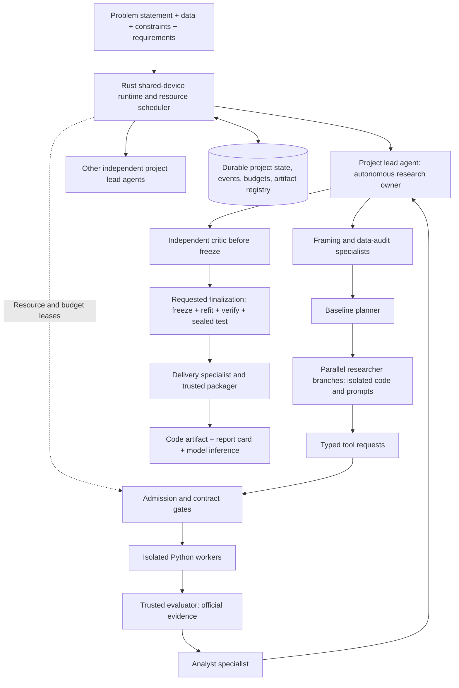

# MLRescurix: independent tabular ML coding harness

Planning document, revised 12 October 2026 after the Rust/Python, dependency, and approval-gate discussions. M0 and M1 are implemented at this point. Build one phase at a time: agree on its assertion, scope, and acceptance criteria with the user before writing that phase's code. [SYSTEM_DESIGN.md](SYSTEM_DESIGN.md) specifies this approval workflow, agent context, wakeups, collaboration, live UI contracts, dependencies, and the failure register. Its Rust/Python ownership decisions supersede the original Python-only recommendation.

## 1. Product and success definition

Build an agent-led tabular ML system backed by a durable Rust runtime and isolated, installable Python ML workers. Each project represents one user problem and one final model/pipeline finalization, with three required outcomes: the final code artifact, an evidence-backed report card, and runnable model inference. The user supplies a problem statement, data or data requirements, constraints, and delivery requirements. A project lead agent owns the research flow: framing, specialist delegation, parallel hypotheses, interpretation, iteration, and requests to finalize. Rust supplies durable tools, shared-device scheduling, and narrowly placed correctness/safety gates; it does not replace scientific reasoning with a fixed decision script. A final pipeline may be an ensemble but is delivered as one finalization unit.

Use **MLRescurix** as the working project name and **Apex** as the designation for its best verified feasible candidate. Recursive improvement means successive evidence-driven experiments, not an unlimited recursion or a promise to discover a globally optimal architecture. A successful run may select an existing algorithm, custom pipeline, or feasible ensemble. A novel model is an experiment outcome, not a prerequisite.

The product promise is: **the best validated feasible model discovered within the declared budget, with evidence and working inference code.** If no model meets the constraints, return a clear unsuccessful outcome and the evidence; never quietly relax limits or label an infeasible model Apex.

Initial scope:

- Supervised binary classification, multiclass classification, and regression.
- Local CSV initially; Parquet through an optional reader extra.
- Numeric and categorical columns, missing values, unseen categories, imbalanced labels, explicit class-label mappings, and raw-input schema validation.
- Stratified/random, entity-grouped, and chronological evaluation policies. Chronological tabular prediction does not imply support for a full forecasting framework.
- One machine with multiple active projects and bounded parallel agent branches/training jobs within each project. Design for, for example, ten active model projects and three research branches in a project; these are scheduling scenarios, not promises that every job can execute simultaneously on any device. CPU first; GPU backends follow capability discovery and integration tests.
- CLI and native lifecycle API first, with a small live local dashboard in the first useful workflow milestone. Python inference API in delivered bundles. Cloud deployment, distributed search, and learned RL policies follow later if justified.

No separate existing general-purpose harness was supplied in this workspace. Define a worker/agent adapter interface now; do not assume an external harness already provides isolation or recovery.

## 2. What the supplied MLForge actually provides

These are static findings from the supplied local files, not runtime test results. The historical GitHub review in `Redesigning.md` refers to some files absent from this snapshot; its findings must not automatically be carried over as verified local facts.

The outer `MLForge/` and nested `MLForge/MLForge/` are read-only reference material for concepts and lessons. This is a clean-slate build: do not migrate, copy, import, or transform legacy MLForge code, project state, SQLite databases, datasets, models, run artifacts, or environment contents into the new system. Reimplement selected product ideas against new contracts. The new workspace starts with its own empty state and user-selected input datasets. Findings below guide design only; no legacy implementation is being ported. The historical GitHub review in `Redesigning.md` refers to files absent from this local snapshot and should not be treated as verified local facts.

| Existing source | Observation | Redesign decision |
| --- | --- | --- |
| `.antigravity/agents.md`, workflows and phase documents | Agent routing and important lifecycle decisions depend on IDE instructions. | Implement orchestration and tool contracts in Rust; retain phase concepts and hypothesis vocabulary. |
| `scripts/setup_mlforge.sh:115` | Setup installs multiple boosting libraries, tracking, plotting, and explanation dependencies together. | Small core install; optional, managed worker environments per dependency profile. |
| `train_and_evaluate.py:36` | Missing dependencies are installed from inside training. | Resolve environments before admission, with bounded installation time and disk usage. Training runs offline. |
| `train_and_evaluate.py:69` and other registry branches | Many estimators default to `n_jobs=-1`. | Derive estimator, OpenMP, BLAS, and fold concurrency from the scheduler allocation. |
| `train_and_evaluate.py:333,405` | Training keeps numeric features and serializes the estimator. A fitted raw-input preprocessing bundle is not guaranteed here. | Serialize preprocessing, estimator, labels, thresholds, and custom transform code together. |
| `search_utils.py:132` | Champion promotion compares scores, without resource feasibility checks. Atomic JSON replacement does not serialize concurrent read/modify/write operations. | Transactional state, direction-aware metrics, and a separate feasibility verifier. |
| `hybrid_search.py:68,115` | Training subprocess has no timeout; startup initializes search state again even though the Optuna study can resume. | Durable job lifecycle, supervisor deadlines, and recovery reconciliation. |
| `bohb_search.py:17` | The objective generates simulated scores. | Retain the search idea only; use genuine evaluated trial results. |
| `hypothesis_executor.py:45` and following methods | Hypothesis actions log intended changes rather than implementing them. | Typed proposals must produce a versioned patch or changed recipe and measurable evidence. |
| `evaluate_test.py:148` | Records completion after evaluation, without a persistent pre-evaluation consumption gate. | Separate sealed test access and durable finalization reservation. |
| `shared/meta_db.py:104` | Warm-start entries are illustrative hardcoded results. | Historical scientific memory contains measured findings with provenance; examples cannot become evidence. |

Reuse algorithm/search-space ideas, metric utilities after review, experiment lineage, model-card structure, and evidence-linked lessons. Rewrite state, subprocess execution, dependency installation, preprocessing, champion verification, and packaging. Keep MLflow optional as an export integration; it is not the authoritative state store.

## 3. Architecture and responsibility boundaries



**Project lead agent:** owns scientific workflow and autonomous delegation. It decides which permitted phase specialists to invoke, how many research branches to request, which evidence to inspect, and whether to iterate or request finalization. Phase prerequisites are enforced at consequential tool boundaries; they do not prescribe every reasoning step. No model output can waive user constraints or manufacture official evidence.

**Rust runtime and device scheduler:** persist commands/state, arbitrate resources across projects, enforce bounded budgets, supervise leases/deadlines, reconcile failures, and gate official publication. One serialized metadata writer does not imply one active agent or worker. The scheduler arbitrates tool requests; it does not choose scientific hypotheses. Default fair project scheduling with configurable weights and aging prevents one project's fan-out from starving others.

**Phase specialists:** independently scoped agents with versioned system prompts, input/output contracts, allowed tools, evidence access, budget ceilings, and stop/yield rules. Multiple researchers may work concurrently in separate branch workspaces. They return versioned proposals/findings through the project lead and shared ledger. They cannot modify another branch or overwrite project intent.

**Search engine:** tunes numeric parameters, allocates fidelity, avoids duplicate work, and chooses between promising branches. Optuna ask/tell is an appropriate initial interface; each externally executed trial must be reconciled to its terminal state. [Optuna Study documentation](https://optuna.readthedocs.io/en/stable/reference/generated/optuna.study.Study.html)

**Workers:** execute immutable specifications in fresh processes or isolated containers. They produce artifacts, predictions, logs, and training measurements. They cannot promote themselves or write official scores.

**Evaluator:** computes official metrics from prediction artifacts and labels it owns; verifies prediction shape, row IDs, class ordering, finite values, and resource evidence. Labels for validation and final test are absent from agent-controlled workers. Harness-owned recipe adapters may support internal early stopping using a designated inner training split.

**Artifact/environment managers:** own hashes, retention, installation, reference counts, and cleanup. Agents cannot install arbitrary packages into the orchestrator or delete arbitrary host paths.

**Provider adapter:** exposes structured messages, tools, token accounting, timeouts, bounded retries, and cancellation. Persist proposals and tool results; handle malformed calls and provider failure. Support a deterministic planner for offline development. Credentials are confined to the provider adapter, not training workers.

Proposed tools: `profile_dataset`, `list_recipes`, `propose_experiment`, `write_candidate_patch`, `validate_candidate`, `run_experiment`, `inspect_results`, `compare_candidates`, `request_ablation`, `get_budget`, `get_candidates`, and `request_finalization`. Promotion and final test execution remain verifier-controlled operations.

## 4. Phase model and recursive improvement

| Phase | Work | Completion evidence |
| --- | --- | --- |
| 0: Frame | Lock target, metric direction, positive class, split semantics, budgets, and inference workload. | Validated immutable project specification. |
| 1: Audit data | Check schema/labels, bounded profiling, duplicates, feature availability, IDs, groups/time, and split feasibility. | Dataset fingerprint, schema, row IDs, split manifest, data findings. |
| 2: Baselines | Dummy reference, linear model, and a strong tree baseline. | Genuine scores, measured costs, at least one candidate or explicit infeasibility. |
| 3: Hypothesize/code | Propose one controlled change, implement it, test its contract. | Hypothesis, parent IDs, patch hash, expected benefit and estimated cost. |
| 4: Execute | Reserve resources, train, predict, measure, evaluate. | Terminal trial record and evaluator-owned results. |
| 5: Select/improve | Tune, prune, ablate, repeat important results, optionally calibrate/ensemble. | Comparable evidence and updated feasible frontier. Return to phase 3 while budget permits. |
| 6: Freeze/verify | Freeze selection, fit final artifact, benchmark it, and assess once on sealed test. | Immutable artifact identity and final audit. |
| 7: Deliver | Package, reload in a fresh environment, and exercise raw-input inference. | Verified bundle, manifest, scorecard, and reproduction instructions. |

Every experiment records its hypothesis, parents, code/recipe, dataset/split versions, parameters, seed, environment, fidelity, outcomes, and resource cost. Store failed ideas too. Reuse compact conclusions only with supporting trial IDs and applicable dataset conditions.

Cheap trials can screen candidates, but only the full declared evaluation protocol can qualify a champion. Do not compare a 20% training subset directly against a full-data champion as equivalent evidence. Iteration-based pruning requires a meaningful intermediate reporting interface; non-iterative estimators use complete bounded trials.

Stop on budget exhaustion, user cancellation, configured stagnation, or inability to admit useful work. Also bound agent tool calls, patch repairs, hypothesis count, API cost, and retries. A critic can suggest improvements before freeze; it cannot restart research after inspecting the final test score.

## 5. Contracts and persistent state

Implement versioned, validated contracts before model execution:

- `ProjectSpec`: problem statement, task, target, primary metric/direction, label semantics, data ownership, split policy, agent-led research policy, constraints, and the three delivery requirements. One project has one finalization identity; incompatible objectives become separate projects or explicit scientific revisions.
- `ResourcePolicy`: host reserves, device/project concurrency ceilings, trial CPU/RAM/VRAM/disk/time limits, total budgets, environment/download policies, and required enforcement level. Add `DevicePolicy`, `AgentRoleSpec`, `AgentTask`, and `ResearchBranch` contracts for global admission, prompt/tool versions, task identity, branch lineage, and stale-result fencing.
- `InferenceSpec`: target OS/architecture/device, CPU threads, batch sizes, concurrency, cold/warm latency, throughput, resident/peak memory, bundle size, and benchmark protocol.
- `ExperimentSpec`: parents, hypothesis, immutable recipe/code identity, environment lock hash, parameters, seed, fidelity, split identity, expected resource demand.
- `TrialResult`: status/reason, evaluator metrics, measurements with units/provenance, artifact references, timestamps, and charged costs.
- `Scorecard`, `ArtifactManifest`, `EnvironmentSpec`, and `Finding`: structured evidence rather than free-form success claims.

Use SQLite with migrations, foreign keys, transactions, and WAL on a supported local filesystem. Store project state, trials, lineage edges, events, budget reservations/charges, worker leases, evaluation gates, environments, artifacts, and pins. A single serialized metadata writer and shared-device supervisor support multiple project orchestrators and parallel jobs. Every task, reservation, lease, command, event, and artifact is project-scoped; shared immutable environments require reference-counted leases. Optuna storage is subordinate search state, reconciled with the trial ledger after a crash.

Project lifecycle: `created -> auditing -> searching -> finalizing -> completed`, with explicit `paused`, `cancelled`, and `failed` outcomes. Trial lifecycle: `proposed -> validated -> queued -> reserved -> running -> evaluating -> verified`, or `rejected`, `failed`, `pruned`, `timed_out`, `resource_exceeded`, `cancelled`, `interrupted`, or `infeasible`.

Use compare-and-set transitions and idempotency keys. No completion without required evidence. A completed training call does not imply a verified trial.

Execution transaction:

1. Validate and deduplicate the spec; persist the proposed trial.
2. Resolve/lease a locked environment; atomically reserve resources and budget.
3. Launch a worker with a unique lease and deadline; persist worker identity and heartbeat.
4. Write bounded outputs into staging. The supervisor validates paths, sizes, and hashes.
5. Evaluate and verify independently; atomically publish artifacts and terminal state.
6. Reconcile actual charges and reservations; stop/reap workers; release leases; clean disposable storage.

On restart, inspect owned workers/containers and staging outputs before retrying. Fence stale workers so late results cannot publish. Trials without valid recoverable outputs become interrupted. Restart ordinary scikit-learn training; resume checkpoints only for recipes that implement and verify that capability. Do not promise universal training resume.

## 6. Resource stability is part of correctness

Distinguish **training-host safety**, **total research expenditure**, and **the model's inference requirements**. All three must have separate policies and measurements.

### Admission and enforcement

Probe OS/architecture, CPU, available RAM, free disk, container capabilities, and supported GPU backend. Compute an allocation from both explicit policy and current availability; leave configurable headroom for the OS, orchestrator, evaluator, database, and other applications. Reject impossible policies before installing dependencies or training.

Do not infer that machine capacity is reserved for us. Pause admission when observed pressure rises. Reserve estimated peak storage for environments, downloads, data transforms, logs, model serialization, and export staging. Admit multiple training jobs only when their aggregate allocations fit host headroom and both device-wide and project budgets. Budget preprocessing, evaluation, installation, inference benchmarking, and local LLM execution as workloads too. Active project count is separate from admitted job count.

| Resource | Admission, enforcement, and measurement plan |
| --- | --- |
| CPU | Explicit worker quota where available; thread counts for estimator, BLAS/OpenMP and joblib; avoid nested fold/model parallelism. |
| RAM | Aggregate worker process/container accounting; kernel/container limit where supported; pressure watchdog and timeout; no automatic unbounded swap. Include preprocessing and serialization. |
| GPU/VRAM | Device compatibility and leases, backend telemetry, supported allocator limits, conservative headroom, and cancellation. Device visibility is not a general hard VRAM quota. |
| Disk | Owned-directory size accounting, bounded outputs, free-space checks, and quota-backed volume where available. Watchdogs alone can overshoot. |
| Time | Supervisor deadlines for install, data work, training, evaluation, inference benchmarks, final fit, and packaging. Terminate and then force-stop the owned process group/container if necessary. |
| Overall cost | Atomically reserve and charge wall time, CPU/GPU time, installation/download bytes, trials, LLM calls/tokens/cost, and storage. Failed jobs count. |

Linux containers support CPU and RAM limits, but containers have no limits by default and capabilities depend on the host kernel. Configure and verify limits; do not treat simply using Docker as sufficient. [Docker resource documentation](https://docs.docker.com/engine/containers/resource_constraints/)

Provide two clearly labeled execution modes:

- **Trusted local recipes:** fresh subprocesses, thread budgets, watchdogs, and platform-supported controls. Monitoring on macOS is best effort for some resources. Reject requests requiring unavailable hard enforcement.
- **Generated code:** isolated Linux worker/container or equivalent verified sandbox, resource limits, no host credentials/container socket, read-only data, private bounded writable storage, no network during training, and no evaluator-label access. The container's aggregate CPU/RAM must also fit the host allocation. Until this backend passes isolation tests, disable arbitrary generated-code execution.

CPU-only local use remains useful on macOS. CUDA is not assumed to exist there, and Apple unified memory must not be counted as independent RAM plus VRAM. Add GPU support only for combinations the recipe and runner can actually execute and measure.

Watchdogs complement hard limits; they cannot eliminate every spike or guarantee stability against unrelated host workloads. Record each policy as enforced, monitored, unsupported, or unmeasured. An unsupported required limit blocks certification.

### Dependencies and environments

The Rust orchestrator has no scientific Python environment requirement. Start CPU workers with NumPy, pandas, SciPy, and scikit-learn. Add Optuna to the search-sidecar profile and optional profiles for individual boosting libraries, Parquet, plotting/explanations, neural/GPU work, tracking, and serving. Polars is optional pending measured benefit. Benchmark tools such as AutoGluon use separate optional environments. See SYSTEM_DESIGN.md for direct and transitive dependency policy.

Key environments by lock hash, Python version, OS/architecture, and accelerator runtime. Build once, validate imports, then lease an immutable ready environment across compatible trials. Dependency changes create a new environment. No installation into a live environment or user's global Python.

The environment manager is the only installer. Resolve through configured package sources; prefer binary wheels; reject unsupported combinations or expensive source builds under the initial policy. Bound installer process resources, timeout, retries, cache size, and expansion. Stage partial environments and remove them on failure. Preflight size estimates are uncertain, so enforcement and free-space checks are still necessary.

Use a project-owned uv cache and its supported cleanup commands. uv explicitly cautions against modifying cache entries directly; periodic `uv cache prune` is available. [uv cache documentation](https://docs.astral.sh/uv/concepts/cache/)

Distinguish installed environments, wheel/download cache, container images/layers, trial scratch, and exported runtime dependencies. An unused library is not safely removed from a shared live environment. Release the environment lease and evict the entire unused owned environment when policy calls for it. Keep bounded reusable environments briefly to avoid repeated heavy downloads; support an aggressive cleanup setting. Account for actual reclaimed disk space, including shared links/layers.

Pin the champion's exact runtime lock and custom source. Preserve a ready inference environment during validation; retained runtime environments are optional afterward because they can be recreated from the bundle. Offline reproducibility requires an optional wheelhouse/image with a separately approved storage budget.

### Artifact and data lifecycle

Treat user inputs as read-only. Hash/stream large files and profile in bounded batches; do not assume a CSV's file size equals its in-memory cost. Save split row indices instead of multiple full copies when possible. Use versioned columnar/memory-mapped caches where appropriate. Cache keys include dataset, split, training fold, transform/code, and environment identities.

Forecast categorical expansion and sparse/dense conversions before admission. Cap category counts, interaction features, polynomial expansion, pairwise operations, and prediction buffers. Larger-than-memory data must choose an explicitly supported incremental recipe or stop with an actionable explanation; no silent full-data success claim after sampling.

Retention policy:

- After a trial terminates, remove owned scratch/temporary data; release the process and environment lease.
- Keep all compact trial metadata and capped diagnostic logs. Rotate logs before they fill disk.
- Retain champion, bounded Pareto alternatives, best useful family representatives, and artifacts required for pending ablations/ensembles. Retain prediction evidence within its own size/privacy budget.
- Remove losing bulky artifacts once unreferenced and no longer needed; preserve their specs, hashes, scores, failure reasons, and reconstruction instructions.
- Garbage collection marks live references and leases, then tombstones and deletes only owned managed paths. Prevent path traversal and symlink escapes. Handle interruption and retry deletion idempotently.
- Never prune raw user data, active artifacts/environments, exported bundles, or pinned champions to make room. Stop admission if only protected objects remain.
- Run reconciliation/cleanup after failure, cancellation, startup, and normal completion. Terminate workers before releasing their allocations.

Reserve finalization capacity in advance. Initial policy: protect 20% of the total time/cost budget, increased to the estimated final fit + test + benchmark + export requirement when larger. This is a heuristic, configurable and measurable. If finalization cannot be admitted, report an unfinalized candidate rather than verified delivery.

## 7. Evaluation, feasibility, and Apex selection

Lock one primary metric with explicit direction, class semantics, threshold policy, and aggregation. Other metrics are diagnostics unless the user specifies additional objectives. Keep predictive quality separate from constraints rather than hiding failures inside a weighted average.

Create splits before any learned preprocessing. Fit imputers, scalers, encoders, selectors, resampling, and calibration inside the relevant training fold. Use one fitted pipeline for raw-input prediction. Scikit-learn recommends pipelines to avoid inconsistent preprocessing and leakage. [Common pitfalls documentation](https://scikit-learn.org/stable/common_pitfalls.html)

Group/time rules override convenience random splitting. Require sufficient samples/classes per fold; reject incompatible metric/split combinations. Group duplicates when appropriate. Feature availability and leakage checks produce findings, but cannot prove that every domain-specific leakage source has been eliminated.

Independent evaluator receives row-keyed predictions and checks missing/extra rows, shape, probabilities, class order, and invalid numerics. Missing primary metrics, fabricated scores, exceptions, and unknown resource measurements are never treated as zero-valued successful trials. Custom code gets predictions on feature-only evaluation inputs; the evaluator owns labels and scoring.

Benchmark the complete raw-input inference path, including preprocessing, against a locked workload. Record device/CPU architecture, threads, runtime versions, batch sizes, concurrency, warmups, repetitions, p50/p95/p99, throughput, cold load time, artifact/bundle bytes, and memory. Specify which values are hard requirements. Warm latency excludes loading only when explicitly declared; measure cold behavior separately. GPU timing requires backend synchronization. A laptop benchmark cannot certify a different target machine.

A candidate qualifies only after full-fidelity evaluation, valid artifact reload, and every required constraint passing on the declared target. Rank feasible candidates by the primary validation objective. Compare finalists on the same folds/seeds; spend repeat-run budget where differences matter. Treat fold variability as evidence, not an automatic confidence interval. Within the declared practical tie tolerance, prefer simpler/faster/smaller candidates. Maintain a bounded feasible Pareto frontier.

Calibration and classification thresholds are selected using development data. Ensembles need aligned out-of-fold predictions for training the combiner and separate valid scoring; every member and the combined inference cost count. Distillation can reduce inference cost but must be evaluated as a new candidate.

Finalization protocol:

1. Freeze winning recipe, selection evidence, preprocessing policy, thresholds, and final-fit seed.
2. Fit the final pipeline on permitted development data; do not train on sealed test labels.
3. Serialize and reload the actual delivery artifact. Benchmark it and verify all resource constraints again.
4. Reserve final-test access durably, tied to dataset/split and frozen artifact hash, before exposing labels to the evaluator. Run one final assessment and publish the immutable result.
5. Interrupted assessment can recover only the same frozen artifact/protocol, never select another model using partial test feedback. Exposed test evidence ends independent-test eligibility for that research session.
6. Verify packaged inference against the frozen artifact and export. No further retraining after test assessment in the default bundle.

If final refit exceeds constraints, stop or use a development-only fallback chosen before final-test access. If the final test result is disappointing, report it; do not resume searching against that test set. A later research session needs fresh independent assessment or an explicit disclosure that the existing test is now development data.

## 8. Default user delivery

The three product outcomes are (1) final code artifact with frozen training/custom source and model identity, (2) report card with measured quality, feasibility, costs, and limitations, and (3) independently runnable inference for that same final model/pipeline. They may be packaged together; their manifest identities must agree. A failed project returns an honest failure report and available provisional artifacts without claiming all three verified outcomes.

Deliver **a tested inference-ready bundle**. The requested artifact + scorecard + inference code is the right foundation; include the following so another user can actually run it.

```text
apex_bundle/
  README.md                       # exact install/predict commands and limitations
  manifest.json                   # hashes, artifact identities, versions, constraints
  model/                          # fitted preprocessing + estimator + labels/thresholds
  runtime/                        # packaged custom transforms/models, when applicable
  inference.py                    # Python interface and batch prediction CLI
  input_schema.json               # types, required columns, null/category policies
  examples/input.json             # synthetic or explicitly permitted example records
  examples/expected_output.json    # output labels/probabilities and tolerance semantics
  scorecard.json                   # machine-readable results with measurement provenance
  model_card.md                   # human-readable quality, slices, caveats, intended use
  inference.lock                  # only exact runtime dependencies
  training/recipe.json            # frozen spec and seeds
  training/source/                # exact training/custom implementation
  training/environment.lock       # reproducible training dependency specification
  lineage.json                    # compact experiments, findings, selection evidence
  verification.json               # reload, raw-input parity, schema, resource checks
```

The inference module must accept raw rows, preserve feature order internally, handle permitted missing/unseen values, reject invalid schema, map predictions back to original labels, and expose probabilities only when supported. It runs without Antigravity, LLM credentials, MLflow, or the harness service. Native/joblib serialization is allowed for trusted generated artifacts with version locks and provenance; do not suggest loading untrusted pickle files safely.

Scorecard includes validation protocol/scores, repeat variability, final test results separately, baseline lift, relevant per-class/slice diagnostics with sample counts, train/final-fit cost, CPU/device, peak RAM/VRAM, inference workload/latencies, model and bundle size, every constraint's threshold/value/verdict/enforcement, total research expenditure, failed-trial counts, and known limitations. Optional bounded permutation importance or explanations must use their own budget and disclose their limitations.

Do not embed private training data or all checkpoints by default. Training reproduction references dataset hashes and tells the user how to supply the original dataset. Reproducibility is within declared tolerance; exact equality across hardware/library changes is not promised.

An API/container service is optional after this bundle works: health/predict endpoints, input validation, load-time and service overhead benchmarks. Hosting, Kubernetes, continuous monitoring, scheduled retraining, and cloud deployment are separate product extensions.

## 9. New codebase layout

```text
MLRescurix/
  BUILD_PLAN.md
  Redesigning.md
  MLForge/                          # preserved legacy reference
  SYSTEM_DESIGN.md
  Cargo.toml
  crates/harness/src/
    contracts/                      # control-plane contracts and schema versions
    core/                           # orchestration, state, events, budgets, timers
    agents/                         # provider adapter, context, tools, code proposals
    execution/                      # routing, supervision, limits, telemetry
    storage/                        # artifacts, environments, pins, garbage collection
    api/                            # commands, snapshots, durable event stream
    main.rs                         # CLI and local service
  contracts/                        # versioned JSON Schema and protocol fixtures
  python/pyproject.toml
  python/src/mlrescurix_worker/
    data/                           # audit, schema, fingerprints, splits
    recipes/                        # fitted pipelines and model registry
    search/                         # isolated Optuna sidecar
    evaluation/                     # official metrics; separate label authority
    delivery/                       # export and inference verification
    inference/                      # feature-only inference, custom code isolation
    protocol/                       # worker event transport and schema validation
  ui/                               # small local dashboard; compiled static assets
  tests/
    unit/
    integration/
    fault_injection/
    fixtures/
  examples/
    project.cpu.yaml
  docs/
    architecture.md
    resource_policy.md
    delivery_contract.md
```

Create modules as milestones need them rather than filling every directory with placeholders. Keep runtime data/environments outside source control, under an explicitly owned workspace path.

## 10. Build sequence and acceptance gates

| Milestone | Implement | Required evidence before moving on |
| --- | --- | --- |
| M0: Foundation | Rust binary, Python worker packaging, project/agent/branch contracts, SQLite state/migrations, durable agent checkpoints and action receipts, uncertain-outcome reconciliation, device/project budget ledger, command receipts, timers, lifecycle CLI, capability reporting. | Cross-language fixtures pass; ten synthetic active projects and concurrent branch requests preserve project isolation, atomic reservations, revisions and restart state; fake workers cannot forge official results; checkpoint/dispatch/commit crash scenarios preserve intent and charges without blind action replay. |
| M1: Safe execution/storage | Shared-device supervisor, fair multi-project admission, bounded parallel workers, thread limits, deadlines, telemetry, environment leases, artifact staging/pins/GC, trusted CPU runner. | Concurrent disposable jobs verify aggregate limits, fairness, per-project stop isolation, shared-environment leases, timeout/crash cleanup, low disk and restart recovery without deleting protected data. |
| M2: First real vertical slice (implemented) | Bounded owned CSV registration/audit, stratified/random/grouped/chronological three-way splits, dummy/linear/tree CPU recipes in managed Python, feature-only worker predictions, trusted scoring, inference measurements, one transactional per-dataset final-test reservation, frozen refit, hashed bundle and loopback dashboard. | Synthetic binary, multiclass, and regression cases; group/time isolation; raw-input bundle parity including unseen categories; forged/invalid prediction rejection; infeasible constraints block test access; supervisor crash preserves a reserved/consumed assessment identity; dashboard reads committed events/snapshots and applies receipt-backed lifecycle controls. Hard memory quota and cold-load certification remain unsupported and cannot pass as required constraints. |
| M3: Constrained search (implemented) | Optuna ask/tell, experiment DAG, duplicate suppression, bounded multi-fidelity search, repeat comparisons, feasible Apex selection. | Maximize/minimize tasks work; superior but infeasible trials never win; resume preserves studies/budgets; screening scores cannot become certified champions. |
| M4: Coding agent (implemented) | Provider-neutral tool loop, evidence memory, context compaction/recovery, event wakeups, scoped patches, generated-code sandbox, bounded repairs/LLM budget, project lead and versioned specialist prompts, parallel branch workspaces, research/collaboration modes. | Agent implements a component with measured evidence; context recovery preserves constraints/user intent; timers do not duplicate trials; interrupts fence stale proposals; sandbox denies labels/secrets/unsafe writes/network; provider failure is recoverable; three concurrent researcher branches cannot overwrite one another or duplicate finalization; provider quotas and costs are accounted across projects. |
| M5: Scientific improvements | Ablations, optional boosting profiles, calibration, valid ensembles, resource-aware branch selection; GPU adapters where supported. | Gains measured against equal-budget deterministic search; full-pipeline cost counted; new dependencies/backend controls pass integration tests. |
| M6: Release quality | Bundle verifier, documentation, resource fault suite, representative tabular benchmarks, install/recovery scenarios. | No manual edits needed to complete supported tasks; failure outcomes are honest; bundles run independently; cleanup/storage reach policy-bounded steady state. |

M2 is the first usable model optimizer. **M4 is the first version that deserves the full “ML coding agent harness” description.** M6 is the initial release target. Building the deterministic foundation first does not remove the coding-agent objective.

These milestones are a roadmap, not authorization to implement them in one run. At each milestone boundary, stop and present the next phase's assertion, proposal, assumptions, scope, interfaces/dependencies, risks, and acceptance criteria. Discuss and revise with the user. Implement only after the user approves that phase; verify it, present the result, then ask what they want to change before preparing the next phase. Do not begin an unapproved phase, silently broaden its scope, or treat approval of this roadmap as approval of every implementation milestone.

Compare random search, equal-budget Optuna, deterministic harness, full agent harness, and optional AutoGluon on representative unseen tabular datasets/seeds. Publish feasible-model rate, final quality, time to useful candidate, resource/cost consumption, failure rate, and storage growth. Report the agent's added cost and benefit; do not claim superiority from one convenient dataset. Downloads, benchmark baselines, and final verification also need explicit budgets.

Important automated checks include fold-local preprocessing, group/time separation, missing/rare labels, metric direction, raw-input prediction parity, stale worker fencing, concurrent reservations, NaN/forged predictions, OOM/timeout handling, orphan process cleanup, garbage collection racing leases, protected artifact retention, disk-full publishing, repeated final-test access, and inference on unseen categories. Use small fixtures and disposable environments; no heavy ML downloads are needed for initial tests. Test actual kernel limits only on an isolated supported runner, not by deliberately exhausting the user's machine.

## 11. Decisions for the first implementation

Proceed with these defaults unless product requirements change:

1. Rust control plane and isolated Python scientific workers at this workspace root; legacy MLForge remains a reference. No embedded interpreter in v1.
2. Single-machine CPU execution with multi-project scheduling and bounded intra-project parallelism, SQLite state and managed on-disk artifacts.
3. Binary/multiclass classification and regression, sklearn first, optional model-family environments later.
4. One autonomous project lead agent per project with specialized phase agents and parallel researcher branches. Use deterministic tools/gates for admission, official scoring, resource/budget accounting, label protection, recovery and final publication; agents own scientific decisions.
5. Validation objective plus explicit hard feasibility constraints; sealed final test and fresh bundle verification.
6. Managed dependency/environment retention with immediate scratch cleanup and bounded reusable caches.
7. Inference-ready bundle as the default output; minimal real-time dashboard accompanies the first useful workflow. Optional serving and external integrations follow.
8. Finite resource budgets everywhere; unknown/unsupported enforcement is disclosed and cannot pass a required gate.
9. User-led, stepwise implementation: an explicit approval gate before each build phase. Discuss, refine, and assert the phase's acceptance criteria first. Do not autonomously research and implement later phases.

Development Phase 0 is the framing/architecture/contract discussion before M0; runtime ML Phase 0 is project framing. They are separate. Each later coding milestone requires its own concrete proposal and explicit approval. M0 defines multi-project and parallel-branch identities/admission contracts; M1 proves concurrent execution safety, M2 provides the scientific kernel slice, and M3 provides constrained resumable search. M4 provides the autonomous agent-led coding harness. Do not install every ML library or use placeholder metrics to simulate product completion.

## 12. Agent continuation and next-phase status

The revised Phase 0 architecture direction was accepted in discussion on 12 October 2026. Durable checkpointing and uncertain-action recovery are required from the foundation. See SYSTEM_DESIGN.md sections 6 and 16 for checkpoint boundaries and pending-action reconciliation. M0 uses scripted task/provider observations to prove storage contracts. M0, M1, M2, M3, and M4 are implemented with verifiable acceptance evidence. M4 provides the agent-led tabular ML coding harness with provider-backed orchestration, reusable specialist roles, agent-authored project tools, sandboxed execution, evaluator separation, achievement context management, and permanent finalization closure.
