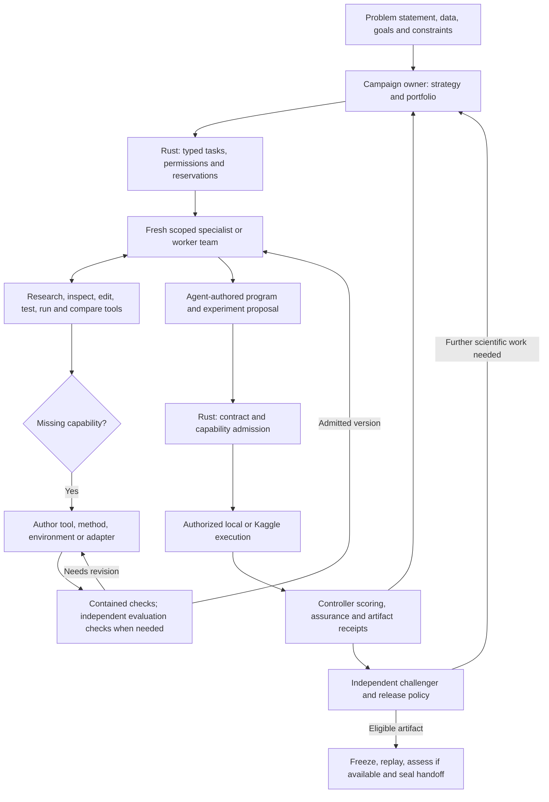

# Agentic Workflow and Scientific Flexibility Audit

**Date:** November 1, 2026  
**Applies to:** [Master plan, revision 2.3](FINAL_AUTONOMOUS_MODEL_CREATOR_MASTER_PLAN.md)  
**Status:** Design review and implementation requirements; runtime behavior is not yet verified.

## 1. Verdict

The pasted workflow has a useful control structure: one campaign owner, fresh scoped workers, independent evaluation, durable scientific memory and hybrid compute. Its concrete action sequences are too specific to a tabular/multimodal Kaggle recipe to serve as the general execution architecture.

The master plan previously addressed several fixed-recipe risks, but revision 2.0 still mandated six script files, relied on registered split routines without defining how to add one, and did not fully specify the worker's capability-building loop. Revision 2.1 corrects these gaps and adds non-template acceptance tests.

The governing rule is: **agents choose and implement the scientific solution; the harness governs permissions, execution, resources, evidence, and release.** Phases are responsibilities and checkpoints. They do not prescribe the sequence of modeling actions inside a phase or the complete list of methods an agent may use.

Coding agents also need meaningful verification and can preserve branches, use tools, cache work, and delegate. MLRescurix should reuse those useful agent behaviors. Its additional requirements arise from empirical model quality, information leakage, adaptive evaluation, stochastic training, expensive compute and deployable model/state closures. Compiling and passing engineering tests establish useful properties; they do not establish generalization. A numerically high validation score also does not establish that the validation design is valid.

## 2. Fixed-recipe risks and required corrections

| Risk in the supplied workflow or previous plan | Why it can fail on a new problem | Required behavior in revision 2.1 |
|---|---|---|
| Default LightGBM anchor | A forecasting, graph, image, retrieval or simulation task may require a different reference method. | Agent chooses a task-appropriate baseline and explains its relevance. |
| Listed GBDT/TabNet/DeBERTa branches | New architecture names can be rejected or coerced into old templates. | Arbitrary source-package execution with extensible descriptive identifiers; optional recipe scaffolds. |
| Required six-file package | Joint training, a fixed pretrained model or a multi-stage native library may not map naturally to six files. | Manifest declares actual executable operations, dependencies and source layout. No mandatory dummy files. |
| Feature factory must precede model training | End-to-end representation learning fits features and predictor jointly. | Joint programs are allowed; fitting provenance and separate inference/scoring remain enforced. |
| Fixed loss list or positive Hessian for every method | Nonconvex neural losses, nonsmooth quantile losses and derivative-free optimization have different requirements. | Agent chooses loss and compatible optimizer; tests reflect the actual method. A tree callback constraint is not a system-wide loss constraint. |
| Fixed registered splitter list | Spatial, graph, event-window or custom deployment semantics may require a new split rule. | Agent can propose a splitter extension; independent checks precede protocol freezing. |
| Ten rows → 15% fold 0 → five-fold CV | Small random samples can destroy groups, rare classes, temporal dependencies or viable batch shapes. | A justified task-specific fidelity plan; equivalent evidence can use different pilots, splits and hardware. |
| Automatically prune every weaker standalone model | It may add ensemble diversity, robustness or meet an inference constraint. | Preserve a budgeted branch when evidence supports its portfolio value; distinguish weak, invalid and inconclusive results. |
| Always ensemble, calibrate, rank-average or run Nelder–Mead | These can be inapplicable or overfit development predictions. | Optional methods chosen and evaluated by the agent under explicit fit/score boundaries. |
| Mandatory MCTS | A fixed search controller can become another inflexible action selector. | Start with a replaceable scheduler over arbitrary hypotheses; require evidence before adopting more complex search. |
| Fixed imports/package stack | A new method may need another dependency or interpreter. | Agent requests a pinned environment/assets through an authorized broker; availability and resources remain real constraints. |
| Two repairs forever, exact 150-token receipts | Some failures need another diagnostic step; valid evidence may exceed a summary target. | Configurable bounded allocations, complete durable evidence, concise summaries and retrieval. |
| Five plots and a pickle for every task | The artifacts may be inappropriate or unsupported. | Task/request-based output policy, executable inference closure, compatible serializations and useful diagnostics. |
| New task requires editing central Rust/Python dispatch code | The harness is still a closed recipe selector despite an agent front end. | Runtime campaign-scoped extension with admitted schemas, tools, methods and independently checked evaluation. |

The current code contains concrete risks worth tracking: the synthesis schema has closed task/framework/feature enums, and `_generate_model_code` routes intent through template generators with a generic fallback. `custom_modules` and the existing tool registry provide useful groundwork, but do not by themselves prove arbitrary scientific programs can reach official evaluation unchanged.

An explicit source mode must bypass template generation. If the requested implementation cannot execute, return a precise failure or propose a separately identified alternative. Never report the original architecture while running a generic substitute.

## 3. Corrected agentic architecture

The worker node can be a recon agent, data scientist, feature engineer, loss/optimizer designer, model architect, evaluator-implementation specialist, ensembling agent, packager, or another scoped role. The role list is extensible. Fresh contexts contain relevant facts and permitted evidence, not M1's prior narrative. Code and data permissions come from the task, not the name of its role.

The program can contain any suitable source tree. Its manifest defines how to train/construct the model, predict, fit optional postprocessing, and produce requested artifacts. It does not require a feature Parquet table, separate `featurize.py`, tabular output, or a pickle. Model/state artifacts and inference semantics remain essential to the final handoff.

## 4. Phases define responsibilities; the research graph defines work

```mermaid
flowchart LR
    Intake[Intake and task semantics] --> Understand[Research and data understanding]
    Understand --> Protocol[Freeze valid evaluation protocol]
    Protocol --> Explore[Adaptive scientific work]
    Explore --> Learn[Observe errors, scores and resource use]
    Learn -->|Revise hypotheses, source or tools| Explore
    Learn -->|Investigate new evidence| Understand
    Learn -->|Eligible candidate| Freeze[Freeze deployment recipe]
    Freeze --> Verify[Replay and optional untouched assessment]
    Verify --> Handoff[Model artifacts, inference, diagnostics and report]
```

Returning to research or data investigation is allowed. Changing scientific source creates a new candidate. Discovering that validation is invalid requires a new protocol lineage and invalidation of affected claims. It does not permit repeatedly changing the split until a preferred method wins, and previously tuned data does not become an untouched assessment set.

Ensembling and postprocessing are possible activities inside exploration. They are not mandatory stages every dataset must traverse. A compact reliable model may be the best deliverable for a constrained deployment.

## 5. Four feedback loops

| Loop | Typical observations | Agent response | Harness responsibility |
|---|---|---|---|
| A: implementation repair | Import, shape, runtime or serialization failure | Inspect diagnostics, patch source, author a reproducer and rerun. | Bound execution and spending; preserve source/attempt identity. |
| B: learning and resource adaptation | Divergence, weak learning curves, OOM, slow startup, poor fidelity estimate | Change optimizer/schedule, inspect data, checkpoint, revise pilot or request another backend. | Preserve label boundaries; treat scientific changes as new candidate identities; account for every attempt. |
| C: scientific strategy | Weak scores, error slices, contradictory research, complementary models | Revise hypotheses, investigate features, branch models, test portfolio decisions. | Supply honest comparable evidence and durable memory. |
| D: capability extension | Missing operation, package, task representation, splitter or scorer | Discover alternatives or author a new versioned capability, verify and resume. | Admit only permitted execution; independently verify evaluation semantics; freeze scoring authority. |

All four loops are bounded by budget/deadline and finalization reserves. A local repair can avoid an extra orchestrator call while still costing worker tokens and compute. There is no universal zero-token or zero-GPU-cost guarantee for repairs requiring real hardware.

## 6. Custom loss versus official metric

The official metric answers **how the candidate is judged**. The training objective answers **how the candidate learns**. The task owner/competition defines the former; the scientific agent chooses and can invent the latter.

For example, an agent may train a nonconvex neural objective using first-order optimization while the controller evaluates predictions with a frozen competition metric. A positive-definite analytical Hessian is not required by that training path. A custom second-order tree callback does need to satisfy that library's requirements or explicitly use a tested approximation. A nonsmooth objective needs appropriate optimization/boundary behavior, not a fictitious smooth derivative.

The SMAPE correction in the master plan rejects an incorrect claim that a particular smoothed loss is convex. It does not prohibit the agent from experimenting with that loss. An experiment can be valid even when it fails to improve the final score; its result remains useful evidence.

An agent may implement a missing evaluator from an authoritative task specification. It cannot choose a flattering success definition, edit the active scorer, or certify its own test fixtures as independent evidence.

## 7. New-problem walkthrough

Suppose the user supplies image segmentation data and a precise held-out overlap metric, while the platform currently has certified tabular recipes.

1. The owner recognizes a structured image-output task and discovers the missing capabilities. It does not convert masks to one scalar target.
2. A fresh specialist proposes image/mask schemas, subject/scene-aware split semantics, a decoder/serializer and an evaluator implementation. Independent known-answer fixtures check the metric against the supplied definition.
3. The controller admits the required campaign-scoped capability versions under existing permissions and freezes evaluation. If the success definition or data rights are missing, it asks for that essential information instead of inventing it.
4. A modeler writes a joint augmentation/representation/training loop, selects a suitable baseline and loss, requests a compatible pinned environment, and proposes a resolution/batch/step-based pilot. It need not create a feature table or a 15% random sample.
5. Separate label-free inference produces masks in the required schema. The controller-owned scorer evaluates the frozen holdout memberships and records identity-bound evidence.
6. The agents use errors and resource observations to plan further experiments. The final artifact includes weights, preprocessing/inference code, output decoding, appropriate overlay diagnostics, a report and a model card. Ensembling and pickle are included only if justified and supported.

This is an acceptance scenario, not a claim that segmentation is already implemented. The important behavior is that a missing method triggers bounded implementation and verification through the same harness, rather than an opaque unsupported enum or silent fallback to a tabular template.

## 8. Claims in the pasted example that need correction

- **“Leakage is impossible.”** Removing validation labels closes a major channel. Bad split semantics, duplicate entities, future features, contaminated pretrained assets and adaptive CV reuse still require statistical checks.
- **“Zero bias.”** A fresh conversation removes inherited chat history; model priors, selected evidence and task framing remain.
- **“Save 90% of GPU quota.”** Measure against a specified baseline. A pilot can save work or add overhead; the architecture does not establish a percentage.
- **“All OOF vectors live in SQLite permanently.”** Store large predictions in CAS/Parquet, index them in SQLite, and apply explicit evidence retention and data-deletion policy.
- **“AST plus fold ID identifies a reusable feature cache.”** Source bytes, inputs, environment, configuration, external assets and fitting scope all matter.
- **“Replay final predictions against OOF.”** Compare the same frozen artifact on the same inputs. A full-data refit and individual fold models need different reference identities.
- **“Every worse L2 score is a dead end.”** An inconclusive pilot, implementation failure or useful diversity candidate is not a falsified hypothesis.
- **“The listed tools will help in every case.”** No finite toolbox covers every ML task. Robustness requires a usable path to build, validate and admit missing capabilities, plus an honest stop when essential semantics or resources are unavailable.

## 9. Implementation acceptance

Master-plan section 7.5 defines the required generality tests. W0 captures existing enum/template restrictions; W3 admits independently checked evaluation extensions; W4 proves arbitrary source execution and alternative layouts; W5 adds the missing-capability feedback loop; W8 exercises a previously unlisted task representation.

The decisive test is an unlisted method/custom training objective/nonstandard source tree reaching independent evaluation and a verified handoff with recipe generation disabled for that route. Separate negative tests prove that this flexibility cannot grant withheld-label access, mutate the active metric, evade resource authority, or swap artifacts during replay.

No application code was changed by this design revision. The plan now requires these behaviors; implementation must still demonstrate them.

Revision 2.2 adds operational detail without narrowing scientific freedom: cached scope-specific remote inputs, bounded inline source transport, immutable compatible environments, explicit per-operation provenance, conditional evaluator properties and serialized durable state mutations. Optional co-resident development predictions have weaker execution assurance; selected candidates still require independent replay. A feasibility-aware lockbox is created before target-aware search when appropriate, and a subsequent full-data refit cannot inherit the assessed model's independent score. See master-plan sections 4.7, 5.5, 6.5–6.6 and 8.1–8.3.

Revision 2.3 makes removal part of every implementation milestone: trace and delete replaced rigid dispatch, obsolete source/model code, orphan dependencies, configuration and stale tests until the affected dependency closure is clean. Moving an old engine into a legacy folder or leaving it behind a flag fails the gate even if tests pass. Supported artifact readers and scientific evidence remain governed by their explicit contracts and retention policy. See master-plan section 10.4.

The same revision adds configurable model/provider profiles and role/task routing. The campaign owner can use a higher-capability model while workers use a lower-cost model, with explicit bounded escalation, independent fresh contexts and authoritative cost/capability checks. LLM provider choice is separate from Kaggle/local compute selection; future models are configuration values and native protocol differences belong in gateway adapters, not scientific pipelines. See master-plan section 4.8.
