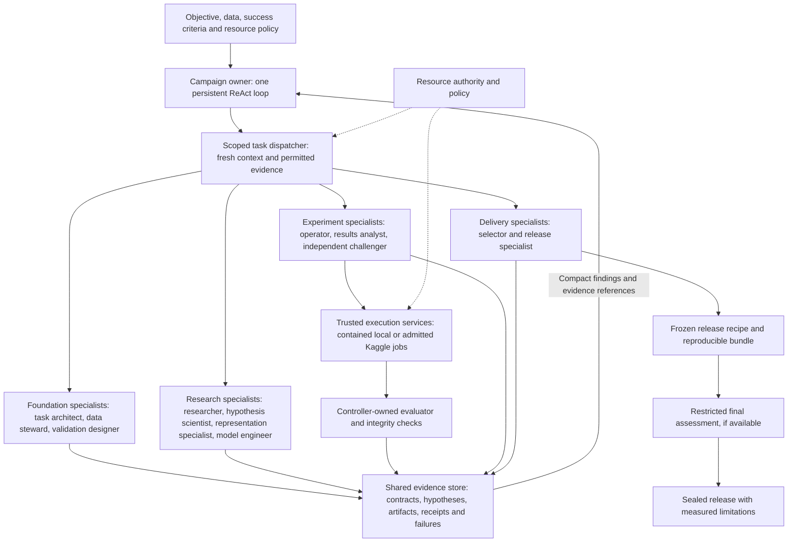

# Final Implementation Plan: Autonomous ML Researcher and Apex Model Creator

**Platform:** MLRescurix

**Revision:** 3.12 — November 4, 2026 — independent continuation review and fast completion

**Status:** S4–S6 remain PARTIAL. Real SIGKILL recovery and failed-fit repair fixtures improved; unified budgets, owner-driven scientific research, complete provenance, recursive deletion and live campaign remain open. See the [independent continuation review](../../docs/refactor_sessions/S4_S6_CONTINUATION_RED_TEAM_20261104.md).

**Code baseline:** `95a35e9` plus the existing working-tree changes inspected on November 2. Earlier detailed inventories are historical, not certification of current behavior.

**Authority:** This is the single implementation plan. It resolves the four reviews in `Major_refactor_docs/plans/Suggestion/` and supersedes conflicting recommendations in those reviews, earlier plans, and `.agents/teamwork` planning records. Existing runtime gates remain enforced until their replacements pass acceptance. Financial authorization comes from the active policy and ledger, never from this document.

### Reading and execution order

Read sections 1–2 for decisions and current gaps, section 4.9 for the approved boss-and-specialist workflow, and section 10.5 for the six implementation sessions. Section 10.1 retains the detailed work-package dependencies; section 11.4 governs the fresh Amazon test. Sections 3–9 define the contracts those changes must satisfy. Source suggestions are review inputs, not additional implementation queues. A blocked external service does not block independent local work.

### Evidence baseline — November 2, 2026

| Evidence | What it establishes | What remains unproven |
|---|---|---|
| Run 6: nine turns; selected candidate `cand_4dd30caf643a04af52e06c86`, development SMAPE **62.46631892131646** | Built-in portfolio evaluation on 75,000 rows/two folds; repeated neural attempts; historical handoff score and token attribution defects | Independent generalization, superiority of the neural family, or the precise cause of repeated scores |
| Run 7: four turns; selected candidate `cand_accf1e986a6d4ee90a3fcfb0`, same development score | Saved scorecard configuration identity matches Run 6 (`79ef1f9c…`); candidate-bound reporting and cumulative accounting have follow-up evidence | Score equality alone does not establish independent retraining or broad reliability |
| Run 8: four turns; selected candidate `cand_33a0c4a2d20123c09e3d7020`, development SMAPE **62.77886850142577** | Trace `turn_index` 1 and 2 are rejected for unsupported Ridge `C` and `penalty`; launcher specifies four turns | The later parameter-tolerance patch did not prevent these historical failures and has no subsequent live Amazon evidence |
| Current Python action set excludes `RESEARCH_TOPIC`, although the prompt, handler and Rust gateway include it | Dispatch contract drift; a proposed research action is caught as a rejected turn | This is not necessarily a whole-process crash, and it is not sufficient to explain all absence of research |
| Current pipeline supports `log` and `log1p`; text SVD is capped at 16 components | Target-transform support already exists; sparse representations and configurable composition need extension | Raw-target-only training is an incorrect description of current capabilities; better representations are hypotheses |
| Current staging uses `os.link` where possible | Scratch and staged input can share a writable inode | No data corruption was established by this review |
| Ledger: ceiling **$0.280494020**, recorded billed **$0.084074020**, uncertain **$0.186040000**, reserved **$0**, headroom **$0.010380000** | Current recorded financial feasibility, including unresolved liabilities | Recorded billed amounts can include estimates; recoverable liability and actual provider charges require evidence |
| Search/Kaggle modules and connected flags exist | Integration groundwork; no demonstrated live research or Kaggle run in the supplied run evidence | Credential availability or a connected flag does not establish reservation, enforcement, quota telemetry or successful execution |

The ledger currently stores `per_run_ceiling_usd: 0.20`; historical runs and policy sources used other ceilings. Resolve effective limits from all applicable authorities at preflight instead of asserting a single universal $0.05 ceiling. Do not edit historical receipts to match current code. Run 6's saved receipts total 60,302 tokens while its handoff reported 1,537; that historical defect remains part of the evidence even after repair.

Evidence sources: [ground-truth handoff](../../docs/EXTERNAL_LLM_GROUND_TRUTH_HANDOFF.md), [historical run report](../../docs/AMAZON_FRESH_TEST_RESULTS_20261102.md), [campaign ledger](../../docs/evidence/v2/robustness/20261021-robustness/campaign_budget_ledger.json), and the Run 6–8 `autonomous_trace.jsonl`/`bundle/scorecard.json` artifacts under `.mlrescurix-state/amazon-2025/`. Local artifacts may be absent in another checkout. This planning revision performed source/artifact inspection and documentation checks; it did not run new training, reconcile billing, or certify services.

## 1. Final decisions and scope

### 1.1 The outcome

Build an autonomous ML campaign owner that accepts a problem statement, authorized data, an evaluation contract, compute resources, and a budget; researches the problem; delegates independent scientific work; runs and compares hypotheses; selects the strongest verified model or ensemble within those constraints; and delivers usable model artifacts, inference code, visualizations, a report, and a model card.

The professional workflow is:

```text
Intake → research + data understanding → freeze validation → suitable baselines
       ↔ adaptive scientific experiments ↔ optional ensemble/postprocess
       → freeze winner
       → refit/replay → independent assessment if available → sealed handoff
```

The orchestrator owns campaign strategy and the final portfolio. Ephemeral phase agents own scoped scientific proposals. Rust owns permissions, accounting, execution, scoring, persistence, and promotion. Python implements scientific computation. Kaggle provides an optional remote execution backend; local isolated compute provides the baseline and eligible fallback.

These are scientific responsibilities and evidence milestones, not a fixed sequence of scripts. Agents plan their own tool calls and can revise, combine, revisit, or omit scientifically inapplicable activities. The non-negotiable ordering concerns trust and evidence: authorize before executing, freeze an evaluation contract before comparing candidates, train before replaying learned weights, and freeze the release before independent assessment.

“Universal” means extensible task, modality, metric, validation, and artifact contracts. It cannot mean guaranteed success on every dataset or guaranteed Kaggle rank. “Apex” means the best eligible candidate discovered under the declared search and release policy, with evidence and limitations disclosed. Grandmaster-level quality is an empirical objective, not an architecture certificate.

### 1.2 Earlier architectural decisions retained

These decisions came from the earlier architectural review behind revisions 2.x. They remain part of this consolidated specification. Section 1.8 resolves the four newly supplied reviews separately.

| Review proposal | Final decision | Required correction or addition |
|---|---|---|
| Phase-specific agents with fresh contexts | Adopt | Context isolation reduces conversational anchoring; it does not prove zero bias. Give agents factual, scoped evidence and allow an independent challenger. |
| Six scientific contracts | Adopt as reference interfaces | Six example scripts map to scientific responsibilities; manifest-declared modules/operations can implement them differently. No mandatory six-file recipe. Training, inference, and meta-model fitting retain separate data capabilities. |
| Kaggle GPU execution and local fallback | Adopt | Refactor the existing Kaggle pool. Keep one authoritative Rust ledger. Fallback must preserve semantics or create a new candidate identity. |
| Fifth budget for remote GPU quota | Adopt | Per-account quota, observed usage, reservations, uncertainty, provider reset windows, and finalization reserve; 30 hours is a configurable initial allowance. |
| Label-stripped private remote datasets | Adopt with narrower guarantee | Per-fold jobs and separate training/inference sources. One dataset containing all folds exposes every target. The provider necessarily sees authorized training labels. |
| Raw-space Huber-SMAPE is problematic | Accept | Remove it as a recommended default. Negative curvature is real; a universal 100–1,000× step explosion is not established. |
| Replacement log-space loss is convex with an exact Gauss–Newton/Fisher Hessian | Reject that claim | The positive curvature supplied in the review is a heuristic, not the true Hessian or a demonstrated Fisher derivation. Section 7 derives the actual curvature. |
| Dynamic CV from drift heuristics | Amend | Deployment semantics determine validation. Adversarial AUC is diagnostic evidence, not proof of time structure. |
| Calibrate/optimize thresholds on OOF data | Adopt with fitting boundaries | Score on rows excluded from all relevant fitting; nested confirmation for strong generalization claims. Optimizing and scoring the same OOF rows is development selection. |
| Full metric registry immediately | Stage | Canonical metric contracts first; task families become available only when their metrics and prediction schemas are verified. |
| Mandatory single pickle, SHAP suite, service, and constant-prediction rejection | Amend | Artifact selection follows the task. Pickle is optional; native weights and a verified inference entrypoint are required. Constant predictions and distribution drift are warnings unless forbidden by the task contract. |
| Eight commits in Days 1–3; predicted 98/100 verdict | Replace | Use dependency-ordered work packages with measurable gates. No preassigned score, elapsed-time promise, or certification before execution. |

### 1.3 Scope and quality claims

Initial built-in certified support is supervised tabular regression and binary/multiclass classification, followed by text/image/multimodal supervised tasks, panel forecasting, multilabel prediction, and grouped ranking/retrieval. This is a rollout/testing order, not a permanent task allowlist. A new task can enter the capability-extension path in section 4.6: agents author the required schema, scientific implementation, validation strategy, and evaluator proposal, and the controller verifies them against an authoritative task specification. Detection, segmentation, audio, graph learning, survival, reinforcement learning, and other custom tasks must never silently run through an incompatible tabular path. A bounded campaign-specific extension can run before receiving platform-wide certification; report that status explicitly.

A campaign terminates with one of:

- `RELEASED`: eligible bundle and verified evidence, including independent assessment status.
- `RELEASED_WITH_LIMITATIONS`: usable bundle with explicit gaps such as no independent holdout, reduced search budget, or an unavailable optional artifact.
- `NO_ELIGIBLE_MODEL`: diagnostic report and best observed development evidence; no false release claim.
- `NEEDS_INPUT`: an essential ambiguity, permission, data source, or resource is unresolved.
- `CANCELLED`: user cancellation, with completed evidence and accounting preserved.

Historical Amazon 2025 numbers (64.87% development SMAPE and the proposed 38–39% target) are context from earlier documents. Their folds and conditions are not established as comparable here. Amazon is a regression benchmark and later multimodal demonstration, not the universal architecture or a guaranteed score target.

### 1.4 Scientific freedom: the anti-template contract

**Agents write the scientific program; the harness governs its execution and verifies its evidence.** A convenient recipe, known model zoo, or reference implementation cannot be the only route to an official evaluation.

| Must remain enforced | Agent-controlled scientific choices |
|---|---|
| Data permissions, isolated label access, budgets and truthful accounting | Model family/framework, architecture, optimizer, initialization, training loop, loss and auxiliary objectives |
| Frozen task/evaluation semantics and independent scoring authority | Feature representations, joint/end-to-end learning, sampling curricula, augmentations and ablations |
| Artifact identities, fitting provenance and reproducible inference | Tool-call order, branch topology, helper code, dependencies, experiment fidelity and checkpoint schedules |
| Sufficient evidence for the claimed result | Number/type of folds where appropriate, backtests, simulations, task-specific diagnostics and release artifacts |

The evaluation metric is the external yardstick. The training loss is the agent's optimization choice. They need not have the same formula, and no SMAPE/GBDT-specific objective list controls general job admission. A model that needs a different optimizer is not an invalid scientific idea merely because one tree library cannot train it.

Presets are editable starting points. Task/model/feature names are versioned extensible identifiers and descriptive metadata, not closed dispatch enums. A generic source-package path must accept an unlisted implementation without rewriting it into a built-in estimator. Scientific extensions obey the same resource and label boundaries as built-ins and cannot change their own official score.

### 1.5 Review of the supplied workflow

The earlier supplied architecture contributed its campaign owner, fresh role contexts, independent scoring, durable artifacts and feedback loops. Its corrected diagrams and detailed review are retained in [AGENTIC_WORKFLOW_AND_FLEXIBILITY_AUDIT.md](AGENTIC_WORKFLOW_AND_FLEXIBILITY_AUDIT.md). The separately referenced original pasted-workflow file is absent from this checkout; no requirement depends on retrieving it. This consolidated plan defines the implementation contract.

Required corrections: no universal LightGBM anchor, fixed model/loss branches, compulsory separate feature stage, 10-row/15%/five-fold schedule, compulsory ensemble, fixed plot count or pickle, mandatory MCTS, or blanket pruning of weak individual models. Add capability discovery/creation and a feedback loop for missing tools, methods, splitters, task schemas and evaluators. Fresh contexts reduce anchoring; label isolation reduces leakage channels; neither proves zero bias or impossible leakage. Claims of 90% quota savings, exact 150-token summaries, and universally sub-five-second repairs require measured evidence and are not product guarantees.

### 1.6 Disposition of the seven operational refinements

The disposition of the seven operational refinements against storage and runtime contracts:

| Proposal | Decision | Final contract |
|---|---|---|
| Reuse static fold datasets and inline small candidate packages | Adopt with bounds | Lazily stage each unique permitted data/fit scope once per content/protocol identity; embed bounded source-only archives in the launcher when supported. Do not require exactly K datasets for nested/custom workflows or assume undocumented readiness times/limits. |
| Three-tier evaluator admission | Amend | Use authoritative references, task-applicable property tests and blinded cross-checks with explicit assurance. Identity, strict noise monotonicity and arbitrary permutation are not universal metric laws; two LLMs are not a correctness oracle. |
| Inference in the same remote reservation | Conditional | Permit an explicit lower-assurance development profile; a subprocess is not a clean security boundary. Strict independent inference and release replay remain distinct evidence. |
| Automatic 10% assessment split | Amend | Default to a feasibility-aware assessment policy before agent-facing target analysis, not a hard row-count rule. An unchanged assessed artifact retains the claim; any later full-data refit has new weights and assessment status. |
| Immutable mounted Python environment | Adopt with ABI/path correction | Build a real environment at the runtime path in a matching isolated platform, then seal/mount it read-only. A `--target` install is not a virtualenv; no portable Python 3.13 directory layout is assumed. |
| Per-operation fit-scope kinds | Adopt and strengthen | Required declared fitting behavior plus controller-materialized row/label/dependency scopes; compatibility checks use actual provenance, not only equality of fold numbers. |
| WAL, serialized writer, no I/O in transactions | Adopt without durability downgrade | Reuse existing writer infrastructure and `synchronous=FULL` for authoritative state. Bounded busy handling and backpressure; never hold transactions across hashing, builds, remote calls or subprocess waits. |

These refinements preserve the open scientific execution path in sections 1.4 and 4.6. Caches, environment mounts, fitting scopes, evaluator checks and development profiles are infrastructure contracts, not lists of permitted model families or scientific recipes.

### 1.7 Clean replacement and configurable intelligence allocation

**Remove superseded implementation as its replacement lands.** Recursively trace and delete obsolete callers, rigid scientific dispatch branches, abandoned model implementations, duplicate authorities, unused helpers, schemas, flags, configuration, dependencies, fixtures and documentation. Moving them into `legacy/`, commenting them out, leaving an unreachable fallback, or keeping old behavior solely to satisfy old tests does not complete a refactor. The target architecture must stand on its own, as if the replaced internal design had never existed. Section 10.4 makes this a completion gate for every work package.

**Choose LLM providers and models independently for each role/task.** A campaign may use a high-capability model for M1 strategy and difficult decisions, and a lower-cost model for routine research, implementation and repair, with bounded escalation when needed. The user's example of “Opus 5.5” for the orchestrator and “DeepSeek V4.1 Flash” for workers expresses a configurable allocation preference; these names are illustrative, not verified availability, API identifiers, pricing or capability claims. No particular vendor/model is an architectural requirement. Section 4.8 defines routing, provider adapters, budgets and acceptance evidence.

### 1.8 Consolidation of the four new reviews

The reviews were based on the supplied handoff, not direct repository access. Their diagnoses are evaluated against current code and artifacts; agreement between reviewers is not independent empirical confirmation. `Gemini_Argon.md` contains the pasted handoff followed by its response; duplicated handoff text is not a second source.

| Source | Adopted contribution | Correction incorporated into this plan |
|---|---|---|
| [GPT 6.1 Sol](Suggestion/GPT_6.1_sol.md) | Separate hypothesis, recipe, execution and evaluation identities; controller-owned recovery; careful failure/cost accounting; operational proof before scientific claims | A plugin registry is a convenient path, not the only admissible scientific program. Add arbitrary source execution early under the same trust boundary. |
| [GPT 6 Astra](Suggestion/GPT_6_Astra.md) | Explicit authority ownership; typed outcomes; effective-configuration evidence; separate engineering success, predictive improvement and useful negative findings | Cheap local science may proceed while Kaggle remains unavailable. No score target is guaranteed by the architectural changes. |
| [Claude review](Suggestion/Cluade_Sonnet_5.5.md) | Replay historical failures; deterministic baseline/deduplication/diagnostic work outside LLM calls; compact durable memory; non-Amazon generality checks | Do not derive seeds circularly from IDs containing those seeds. Do not silently translate Ridge parameters. Coarse confirmation feedback is not a reusable-holdout theorem; formal mechanisms are optional separately validated extensions. |
| [Gemini Argon](Suggestion/Gemini_Argon.md) | Orthogonal axis tracking; target/loss and text ablations; resolved-configuration fingerprints; immutable candidate-specific receipts; explicit preflight and per-turn trace | Reject silent parameter dropping, arbitrary financial buffers, guaranteed liability releases/speed/score gains, fixed splits/fold counts, whole-family bans, AST-only containment and automatic production certification. |

Binding decisions when recommendations conflict:

1. **Repair the experimental system and open the scientific path together.** Establish containment, schemas, provenance and recovery before lengthening paid campaigns. Include an unlisted source program in the first vertical slice; do not defer all scientific freedom until a larger model registry is built.
2. **Preserve three user-facing operational ceilings:** 5,000,000 total model tokens, 30 Kaggle quota-hours and 500 dispatched search attempts, all configurable. Existing monetary authorization and technical resource limits remain explicit additional admission constraints. No new arbitrary four-turn limit or fixed model-family quota is introduced.
3. **Exploration changes mechanisms.** Sparse versus dense representations, loss/target choices, data scale and neural architectures are available. Their order follows evidence, compatibility and expected value. Multiple boosting libraries or random seeds alone do not demonstrate breadth.
4. **Recovery limits repeated uninformative work.** Diagnose and pivot after a configurable stall; allow justified continued work on the same family with a structural hypothesis, replication or useful diagnostic. Do not force web calls, ensembles or architecture switches solely to tick boxes.
5. **Protect evaluation before extending search.** Use frozen development evidence, limited confirmation and a genuinely untouched final assessment where feasible. More folds, paired standard errors or a bootstrap probability of 0.85 do not control arbitrary adaptive search or establish a false-discovery guarantee.
6. **Settle only from admitted evidence.** HTTP 200, locally hashed receipts or token-count arithmetic alone do not prove final account charges. No automatic 10% buffer, age-based release, presumed $0.15 recovery, or new campaign used to escape liabilities.
7. **Integrity and predictive risk are different.** Unauthorized labels, changed inputs and provenance failures block promotion. A train–validation gap, constant baseline or noisy folds ordinarily trigger scientific diagnostics, not an unconditional integrity veto.
8. **A final holdout assesses the frozen artifact.** It does not alone confer production readiness. Use owner-defined release criteria and preserve `production_certified: false` unless their full evidence is satisfied.

## 2. Repository ground truth and change ownership

The first five rows reflect this consolidation's direct source inspection; the remaining rows retain the earlier audited integration inventory and must be revalidated in W0 before implementation. File existence does not establish an integrated, certified workflow. Paths under `scientific/` abbreviate `python/src/mlrescurix_worker/scientific/`; Rust filenames in work packages refer to `crates/harness/src/` unless stated otherwise.

| Existing surface | Observed state | Implementation action |
|---|---|---|
| `python/src/mlrescurix_worker/scientific/autonomous_loop.py` | Separate action set missing research; prompt/handler exist; shared-inode staging; eight-turn prompt history; general deduplication incomplete; loop accepts no turn limit | Shared capability contract, immutable inputs, durable experiment state and bounded context. Preserve supported CLI contracts; replace incompatible internal dispatch. |
| `scientific/governance.py` and `operational_budgets.py` | Separate Python financial transitions and operational counters; unverified settlement retains unused exposure; terminal entries need explicit reconciliation; connected flags influence enforcement claims | Migrate authority to the existing Rust writer. Add evidenced reconciliation and replay-safe multi-resource reservations; Python becomes a delegating facade. Connectivity and enforcement have distinct statuses. |
| `config/operational_budgets.json`, active policy, campaign ledger, `scripts/run_live_amazon.sh` | Generous operational defaults coexist with multiple dollar ceilings and a launcher pinned to Run 8/four turns/model/route | One resolved versioned campaign policy, binding-constraint preflight, configurable run identity/routing and optional turn limit. Preserve ledger history and authorized ceilings. |
| `scientific/candidate_pipeline.py`, `model_zoo.py`, `critic_engine.py` | Log/log1p already supported; text SVD capped at 16; current Ridge compatibility patch maps `C` and ignores some `penalty` values; critic gap can hard-veto | Task-specific strict schemas, portfolio fault isolation, parameter-application evidence, composable sparse/dense programs; replace implicit conversions and gap-only rejection. |
| `scientific/governed_research.py` | Provider adapters, sanitizer and bounded markdown exist; search recorded after successful response | Reserve before dispatch; count every dispatched attempt and retry; isolate retrieval/extraction; preserve cited evidence and explicit unavailable status. |
| `crates/harness/src/execution.rs` | Earlier audit found blocked custom scientific admission and a broad writable workflow mount | Keep custom gate closed until isolated snapshot → train → independent inference → trusted score is integrated. Recheck and migrate every applicable launch path. |
| `crates/harness/src/trusted_evaluation.rs` | Scalar row predictions; Accuracy, MAE, MSE, RMSE; identity-bound receipts | Extend prediction and metric schemas, numerical conventions, and authoritative aggregation. |
| `crates/harness/src/custom_protocol.rs` | Frozen train/validation/test protocol with dataset hashes | Extend to versioned multi-split protocols, optional unlabeled test/holdout, forecast origins, group IDs, and explicit coverage. |
| `crates/harness/src/agents/{task_contract,context,orchestrator,roles}.rs` | Existing task assignment and agent infrastructure | Extend these contracts for phase tasks and authoritative scheduling; avoid a competing orchestrator. |
| `crates/harness/src/agents/gateway.rs`, `scientific/{rust_gateway,dual_gateway}.py` | Gateway request/response types and Rust transport exist; Python surfaces contain model/endpoint defaults and pricing/translation assumptions | Extend the existing Rust gateway with provider adapters and role routing; remove superseded hardcoded defaults, translation/fallback logic and duplicate accounting. Thin public facades must resolve the same authoritative routing policy. |
| `scientific/kaggle_pool.py` | Account registration, leases, durable intents, push/status/output, unknown-outcome handling, checksum checks; internet enabled in generated metadata | Retain reusable transport behavior behind a Rust-owned adapter. Replace unsafe defaults, duplicate accounting, and unsupported “anti-ban” claims. |
| `scientific/task_adapters.py`, `panel_contract.py`, `time_series.py` | Regression/classification and panel contracts already exist | Extend and reconcile rather than replace with disconnected implementations. |
| `scientific/{candidate_synthesis,candidate_runner,candidate_pipeline}.py` | Candidate science surfaces | Route both reference recipes and arbitrary agent-authored packages through the same manifest-driven execution protocol. |
| `contracts/v2/candidate_synthesis.schema.json`, `candidate_synthesis.py::_generate_model_code` | Closed task/framework/encoding enums and template dispatch, despite `custom_modules` support; unrecognized intent can reach a generic generator | Add an explicit agent-authored source path with extensible identifiers. Never silently replace unknown code or architecture with a template/generic estimator. |
| `crates/harness/src/agents/tools.rs` | Discovery, workspace editing, sandbox execution and agent-authored tool registration already exist; evaluation tool exposes fixed fold-count parameters | Reuse these primitives, bind evaluation to a frozen protocol reference, and connect runtime extension admission to official evaluation. Existing tool registration is useful groundwork, not proof that this complete path works. |
| `crates/harness/src/storage.rs`, `read_pool.rs` | Bounded writer channel/thread, WAL and `synchronous=FULL` already exist in storage; dedicated read pool uses short-lived query-only connections | Extend the existing mutation authority to budget/remote lifecycle paths; audit other direct connections. Preserve durability and bounded read/backpressure behavior rather than inventing a second writer. |
| `scientific/{export,bundle,evidence,ensemble,pareto_ensemble,frozen_embeddings}.py` | Existing export, verification, evidence, and science utilities | Reuse algorithms after provenance and capability checks. |
| `crates/harness/src/bundle.rs`, `scientific/bundle.py` | Bundle validators support v1/v2 | Add coordinated v3 writers/readers; retain v1/v2 compatibility tests. |
| `python/pyproject.toml` | Python 3.13 constraint; scientific dependencies pinned | Establish separate tested local/remote training and inference environments; do not assume Kaggle matches the host interpreter. |

New module names below are planned additions, not claims that those modules exist. Rust remains the single authority even where a Python helper performs transport or scientific work.

## 3. Authority, privacy, and execution boundaries

### 3.1 Required invariants

1. **Per-job label isolation.** A training process receives only labels in its authorized training partition. An isolated scientific inference process receives no label files. Unconsumed confirmation/assessment labels never enter scientific training jobs or remote uploads; only the controller-owned scorer accesses them. An explicitly authorized post-assessment full-data refit may reclassify consumed lockbox rows as training data, producing a new artifact with no inherited independent assessment. With ordinary CV, a row can be validation in one job and training in another: this is per-job isolation, not lifelong secrecy of all development labels. Co-resident development inference has a separate, weaker process-isolation claim as defined in section 6.6.
2. **Authority decoupling.** Agents propose code, split strategies, budgets, and promotions. Only Rust commits execution authorization, official scores, resource reservations, and releases.
3. **Independent resource dimensions.** The user-facing ceilings are cumulative model tokens, Kaggle quota-hours and dispatched search attempts. Money, per-request context, local resources/storage/concurrency and deadlines remain separate technical/financial admission constraints. Section 6.3 replaces the earlier five-family grouping; no dimension silently grants another's authority.
4. **Bound scoring identity.** Every official score binds authorized rows and predictions to dataset, split, metric implementation, code, feature state, environment, weights, and attempt identity. Worker metrics and self-authored manifests are untrusted claims.
5. **Fold fit provenance.** Learned preprocessing, encoders, feature selection, early stopping, calibration, and supervised embeddings respect the declared fitting boundaries. No outer-validation fitting or mutable cross-fold state.
6. **Durable intent and fencing.** Persist intent and reservations before external effects. Reject stale branch attempts. Reconcile unknown remote outcomes before retrying or freeing reservations.
7. **Dependency-preserving retention.** Active inputs, champions, release closures, ensemble dependencies, audit evidence, and unresolved jobs are GC roots. Keep completed OOF evidence for the campaign retention period; deletion follows the explicit retention/privacy policy.
8. **Fail closed.** Never execute generated code directly on the host when a sandbox, schema, capability, or integrity check fails. Backend unavailability may select another authorized backend; containment failure cannot lower isolation.
9. **Frozen evaluation.** Split and metric changes create a new protocol lineage. Independent assessment is a recorded one-shot operation after the final artifact is frozen.
10. **Honest capability reporting.** Record actual backend/hardware, prediction coverage, uncertainty, limitations, and fallback transformations. Fresh contexts, hashes, and CV scores are not proofs of unbiasedness, authentic execution, or global optimality.

### 3.2 Threat model and limits

Treat generated Python, external research, model files, remote logs, and returned artifacts as untrusted. Protect host credentials, controller state, assessment labels, filesystem boundaries, resource ceilings, and promotion decisions. Research pages cannot issue controller commands. A hash proves byte identity, not code safety or the authenticity of a worker's execution claim.

Kaggle is an authorized third-party processor when enabled. Private datasets and HTTPS do not make uploaded training data invisible to Kaggle. Application encryption with a key available inside a notebook does not isolate labels from that notebook. Datasets prohibited from remote processing stay local.

Cross-job collusion, memorized public targets, malicious information embedded in model files, and repeated adaptive CV queries cannot be ruled out by mount isolation alone. Mitigate with frozen code/inputs, separate fold state, controlled artifact flow, score-query budgets, audit inspection, and an untouched assessment set where possible. Reports state this boundary.

### 3.3 Local execution

Replace writable hard links between staged data and job inputs with independent byte copies or verified copy-on-write snapshots. Workers receive controller-owned read-only mounts under a different identity, with no writable path to the master inode. `chmod 0444` under the same owning user is insufficient containment because that user can change permissions. Read-only mount/ownership checks prevent writes; source hashes before staging and after execution detect unexpected mutation. Avoid rescanning the entire source on every small action when an immutable snapshot and verified content identity provide the required check. Retain protected originals so detection is actionable.

Use separate training and inference containers, managed by Rust:

| Job | Read-only inputs | Writable area | Forbidden inputs |
|---|---|---|---|
| Profiling/split proposal | Authorized schema and development features; approved target aggregates | Bounded scratch | Assessment data/labels, controller DB, credentials |
| Fold training | Fold-train features/labels, fold-train fitted assets, approved code/environment | Bounded scratch/model outputs | Outer-validation labels, other-fold models, assessment labels |
| Inference | Frozen code, model and feature state, validation/test features | Prediction scratch | All label files, training snapshot, shared mutable cache |
| Meta fitting | Explicit meta-training prediction rows/labels or inner-fold data | Bounded fitted state | Meta-validation/assessment labels |
| Bundle replay | Inference closure, replay fixture | Bounded outputs | Training data, secrets, network |

Required Linux controls: non-root UID/GID mapped to readable snapshots; read-only root; dropped capabilities; no-new-privileges; network disabled; bounded CPU/RAM/PIDs/wall time/output bytes; minimal seccomp profile; no Docker socket, host home, controller database, or broad workflow mount. Resolve and validate every mounted/harvested path; reject symlinks and path traversal.

Small temporary data can use tmpfs. Large embeddings/checkpoints use a private size-controlled scratch volume; do not force all GPU outputs into an 8 GB RAM filesystem. Separate staging for executable package material from `noexec` output areas. AST lint is an early diagnostic, not a security boundary; even imports run inside containment.

On macOS, Docker uses a Linux VM and does not expose Apple MPS directly. The initial local backend is isolated CPU compute. MPS is a later separately reviewed adapter for vetted code; the router must not promise Docker/MPS fallback for arbitrary generated Python.

Dynamic Python dependencies use the immutable environment lifecycle in section 8.3. A compatible environment can be mounted at `/env:ro` without granting scientific jobs network access or writable access to the base image.

### 3.4 Disclosure, diagnostics, and research

Maintain local forensic logs under controller access and bounded provider-visible diagnostics. Structured exception types, scrubbed stack frames, shapes, timings, resource counters, and aggregate scores are the default debugging interface. Free-form exception text, filenames, plots, and reports can contain sensitive values and require filtering. Never transmit raw rows or label arrays as LLM context by default.

Research queries use approved abstract task descriptions. Allowlisted public competition identifiers may be included when authorized. Dataset substring matching and secret scans supplement the policy; they do not provide differential privacy or prove no disclosure. Unknown diagnostic payloads remain local with a reason code instead of silently hiding all useful errors.

A research broker fetches primary papers, package documentation, and permitted competition writeups. Record URL, access date, source/version, claim, applicability, license/rule constraints, and the experiment that would test it. Treat content as evidence, block prompt-injection instructions, bound response sizes, and isolate asset downloading from code execution. Approved weights/packages are fetched by a trusted broker, pinned and hashed, then supplied offline.

Use `ResearchIntent` containing an approved public task abstraction, technical question, intended decision and disclosure-policy reference. The query constructor has no raw dataset mounts; templates and a public technical lexicon are defaults, with an admitted path for new terminology rather than a permanent closed ML enum. Record benchmark policy: competition-specific solutions/public identifiers may be allowed for task solving or excluded for an independent-method benchmark. Do not accidentally compare those modes as equivalent.

Search/fetch/extraction is isolated from training and controller privileges. The fetcher has no credentials or private mounts, checks destinations and redirects against private-network access, and limits bytes, types and download concurrency. A reader with no action tools emits cited structured evidence; the planner sees explicitly untrusted claims. A summary limit or AST/regex filter does not guarantee resistance to prompt injection or semantic leakage. Authorization remains outside model output. Cache by sanitized question, policy, source version and time; distinguish reused evidence from a fresh external request.

Operational search accounting counts **physical requests dispatched**, independently of result or provider charge:

| Outcome | Search-attempt budget | Financial exposure |
|---|---|---|
| Local validation/privacy/availability rejection before dispatch | No dispatched unit; retain diagnostic | No new provider exposure |
| Success, empty results, HTTP error including 401/403/429, or response parse failure after dispatch | One consumed attempt | Verified charge, admitted verified zero, or unresolved liability according to evidence |
| Timeout or crash around dispatch | Preserve a pending/unknown attempt until dispatch evidence resolves it; never refund an ambiguous request automatically | Retain unresolved exposure |
| Retry | New physical attempt with its own reservation and retry link | New possible charge |
| Local cache hit | No physical attempt; record logical research use | No new provider charge |

Reserve attempts and possible dollars atomically before sending; persist intent before the network effect. `successful`, `failed`, `unknown`, `reserved` and `cancelled_before_dispatch` are separate states. Query budget consumption is not reversed merely because an HTTP error is nonbillable. Provider credits, paid fetches and reader-model calls are separately recorded resource components. Authentication failures open a circuit breaker; transient failures use bounded backoff. Every research record links the question, sources, adopted/rejected claim, resulting hypothesis and any negative finding. Apply equivalent disclosure rules to ordinary LLM prompts and remote uploads.

## 4. Campaign state machine and phase agents

### 4.1 State ownership

```text
User: statement + data + constraints
                 │
       M1 Campaign Owner (strategy, hypothesis DAG, portfolio, stop proposal)
                 │ typed proposals
       Rust Supervisor (state, capabilities, ledger, dispatch, scorer, release)
                 │ scoped task with fresh conversation
   Recon | Crucible | Featurizer | Modeler | Ensembler | Packager | Challenger
                 │ immutable packages/artifacts
       LocalSandbox or KaggleKernel → quarantine → verification → receipts
```

M1 may retain compact campaign memory; workers do not inherit M1's chat history, private reasoning, earlier code attempts, or unsieved logs. Workers receive explicit task facts and relevant artifacts, not an assertion that a preferred hypothesis must win. A repair task may inherit its own scoped diagnostics and source, within its attempt budget.

Fresh conversation creation must be tested in the actual agent gateway. Reusing one provider thread with a new role prompt does not satisfy isolation. Models/providers and supported generation settings are configured by role and capability under section 4.8; do not hardcode obsolete model IDs or assume one provider's tokenizer applies to another. Switching models creates a new receipt field and preserves cost/context checks.

Roles are reusable specializations, not the complete list of permitted workers. M1 can assign a fresh task-specific specialist, such as an augmentation researcher, graph model designer, simulator author, or optimizer debugger, using the same stage contract. It can run several workers for one responsibility and revisit earlier responsibilities when evidence warrants it. A worker can challenge an assignment, propose a bounded variant, or request another capability; it is not confined to filling predefined parameters. Role naming does not grant privileges: the controller derives capabilities from the actual data and operations requested.

### 4.2 Operational stages

| Stage | Agent responsibility | Required artifact and exit condition |
|---|---|---|
| C0 Intake | M1 drafts task interpretation; controller validates data rights and feasibility | `problem_spec.json`, input hashes, requested artifacts, budget, metric and inference schema. Resolve essential ambiguity before scoring. |
| C1 Recon | Recon gathers literature and competition evidence | `research_playbook.json`: cited, competing hypotheses with cost/risk estimates; no private raw data in searches. |
| C2 Data and validation | Controller applies assessment policy before target-aware agent analysis; Crucible profiles only the development pool and proposes validation | `assessment_policy.json`, private lockbox membership if feasible, `eda_profile.json`, proposed split and leakage checklist. Rust validates and freezes the protocol/folds; remote data sources are staged lazily and reused. |
| C3 Baselines | Worker establishes suitable naive/simple reference methods or a justified task-specific equivalent | Trusted reference receipts, complete output schema and replayable artifacts. Baseline can be the final release if more complex models fail. |
| C4 Experiments | Fresh specialists test scoped hypotheses; M1 allocates search | Paired ablations, OOF or task-equivalent evaluation evidence, resources, research references, failure receipts; advance credible candidates across appropriate fidelities. |
| C5 Portfolio | Worker evaluates useful combinations, calibration, thresholds or constraints when applicable | Fitting provenance, selection-vs-confirmation score labels, frozen selected spec, or an explicit not-applicable decision. |
| C6 Review and freeze | Challenger checks leakage, metric fidelity, reproducibility, resource feasibility; M1 proposes winner | Controller selects eligible candidate under frozen promotion policy and writes `release_lock.json`. |
| C7 Finalize | Controller executes frozen construction/refit/inference recipe; Packager builds inference and documentation | Fixed deployment closure, replay evidence, performance profiles, submission validation when applicable. |
| C8 Assess and release | Controller evaluates untouched assessment once if available and seals handoff | Assessment receipt or `not_available`, final verdict, hashes and release manifest. |

C1–C5 describe responsibilities, not a mandatory linear traversal. Research can recur after an unexpected error slice; model findings can trigger new data investigation; feature learning and training can be one end-to-end operation; ensemble/postprocessing can be inapplicable. Skip/defer/combine decisions record a reason and their evidence requirements. Missing methods enter section 4.6 instead of becoming a terminal “unsupported family” error. C6 freezes the scientific choices. An assessment failure is reported under the predeclared release policy; its labels do not feed a repair loop. Packaging defects may be repaired only if prediction behavior remains unchanged; otherwise assessment is consumed and cannot be claimed untouched again.

If a later investigation discovers invalid validation semantics or leakage, invalidate affected evidence and create a new protocol lineage. Do not keep the flattering old score or use split changes to chase improvements. Legitimate scientific backtracking is allowed; previously tuned data does not become untouched by renaming a phase.

Every scientific phase records a research decision: fresh search, reuse of versioned evidence, or `not_needed` with reason. Do not require repetitive web calls for deterministic packaging. A challenger is mandatory before release and starts without M1's narrative; it receives contracts, provenance, and evidence, and can request controller checks.

### 4.3 Stage contracts

Add versioned JSON Schemas in `contracts/` and matching Rust types with unknown-field rejection. Large arrays and code remain in CAS, not JSON prompts.

Use one versioned action/tool descriptor source for Rust gateway validation, Python dispatch and prompt construction. The advertised capability set is the intersection of implemented handlers, backend permissions and connected/admitted services. A missing search credential produces `unavailable` with offline/cached alternatives; a handler name alone is not a live capability. Integration tests traverse the installed CLI and embedded Python assets, so a rebuilt helper cannot leave the shipped executable on stale schemas. Unknown actions yield structured rejection and bounded repair, not guessed default models.

`ProblemSpec` includes: task type; modalities; target/domain; row identity; groups/time/horizon/known-at-inference fields; data and external-resource permissions; metric specification; validation requirements; requested artifacts; deadline and budgets; serving environment; submission schema; independent assessment availability; capability requirements.

Use versioned registry references for scientific task types, role specializations, output schemas, frameworks and methods. Unknown identifiers trigger discovery/extension rather than a generic fallback. Strict schema validation still applies to authority-bearing fields such as artifact identities, capabilities and reservations; extensibility does not mean accepting unchecked arbitrary fields as permissions.

`StageInputContract` includes:

```json
{
  "schema_version": "mlrescurix.stage.v1",
  "campaign_id": "cmp_001",
  "task_id": "task_017",
  "role": "modeler",
  "protocol_sha256": "<sha256>",
  "campaign_epoch": 1,
  "branch_id": "branch_lgbm",
  "attempt_generation": 2,
  "problem_spec_ref": "cas:<sha256>",
  "input_artifact_refs": ["cas:<sha256>"],
  "hypothesis_ref": "hyp_012",
  "prior_result_refs": ["rcpt_baseline"],
  "capability_profile": "fold_training",
  "resource_profile_ref": "profile_small_cpu",
  "reservation_id": "reserve_017",
  "expected_artifacts": ["candidate_pkg", "training_manifest"],
  "acceptance_policy_ref": "policy_dev_v1"
}
```

This is a schema illustration; angle-bracket hashes are placeholders. `StageOutputArtifact` binds the task, input hashes, source/environment hashes, produced files, hypothesis status, diagnostic codes, citations, and fit provenance. A worker may report advisory metrics; only controller-issued receipts are authoritative.

Artifact references do not grant general filesystem access. The controller materializes exactly the files authorized by the task capability. Do not send full OOF arrays or training data to the LLM; the numerical worker accesses approved rows inside its sandbox.

### 4.4 Search memory, diversity, and stop rules

The hypothesis DAG stores parentage, research basis, changed axes, comparison, expected mechanism, falsification criterion, estimated cost, result, uncertainty, and resource tier. Start with a cost-aware priority queue and a task-appropriate fidelity ladder. Add MCTS/UCB only after comparative evidence justifies it. Do not build a distributed scheduler before the existing transactional store and local controller can recover a campaign.

Require appropriate reference evidence: usually a dummy/naive baseline and a simple competitive method for supervised prediction, or a justified task-specific equivalent for other tasks. No estimator name is mandatory. Explore budget-permitting orthogonal hypotheses. Model families are task-specific choices: linear/GBDT, pretrained encoders, fine-tuning, specialized forecasting/ranking models, or new agent-authored implementations. Deep networks, focal loss, SHAP, rank averaging, and stacking are options, not mandatory rituals.

Keep all outcomes in the authoritative SQLite event store. JSON ledgers and prompt digests are generated views, not competing mutable authorities. Separate these identities:

```text
hypothesis_id  = durable scientific question/lineage; not a cache key
recipe_id      = H(task, data/protocol, canonical resolved program/configuration excluding seed,
                   source/dependencies, target/loss, external assets)
execution_key  = H(recipe_id, fit scope, fidelity, explicit seed, relevant runtime)
attempt_id     = unique retry/replication execution with its lease and costs
evaluation_id  = H(attempt, actual model/predictions, ordered keys, scorer, tier)
```

Resolve defaults and documented semantic aliases before hashing. Exclude run/session names and narrative from reusable scientific keys. Derive a seed from campaign seed plus a stable pre-seed recipe identity, or specify it explicitly; do not derive it circularly from an ID that contains itself. A new seed is a replication. Cache hits require matching scope/environment/evidence, not just matching scalar scores. An exact completed execution key returns prior receipts without training; an explicit diagnostic rerun gets a new attempt and recorded reason. In-flight duplicate requests share/reuse the admitted job rather than submit another unreserved copy.

Typed outcomes are `invalid_spec`, `duplicate_reused`, `infrastructure_failure`, `resource_denied`, `integrity_failure`, `evaluated_no_improvement`, `evaluated_improved`, and `inconclusive`. A timeout does not falsify a scientific idea. Candidate schemas are generated from task-compatible component descriptors; unknown or incompatible parameters are rejected before fit. Portfolio members validate and execute independently so malformed siblings do not erase valid results. Reject Ridge `C`/classification `penalty` with a valid schema; remove the silent inverse/ignore patch. A versioned alias is permitted only when semantics are preserved and both requested/resolved values are recorded. Library `get_params()` is useful but not sufficient for cross-parameter, objective, task and backend compatibility.

Use a deterministic steering policy over durable evidence, with `EXPLORE`, `REFINE`, `DIAGNOSE`, `RESEARCH`, `CONFIRM` and `FINALIZE` modes. Initial configurable defaults:

| Trigger | Controller response | Escape/termination rule |
|---|---|---|
| Invalid proposal | Structured field errors, actual task/schema, one bounded repair before training | Repeated same error requires a schema-driven configurator or another admitted approach; all repair tokens count |
| Two duplicate/near-duplicate proposals without new information | Return existing receipts, inspect resolved settings and cache provenance | Next scheduled experiment must change a substantive mechanism or have an explicit diagnostic/replication exception |
| Changed settings but identical predictions | Compare resolved estimator values, source, prediction hashes, cache hits and training logs | Do not conclude parameters were ignored from scalar equality alone; quarantine results if a contract defect is found |
| Two gap warnings or repeated scientific rejection in a branch | Check metric units, learning curves, leakage, evaluation mode, slices and split behavior | Confirmation or a structural hypothesis can continue the same family; no blanket family ban |
| Three valid local variants without practically meaningful progress | End that neighborhood; compare underexplored axes and current diagnostics | Research a concrete uncertainty, run an orthogonal experiment, or stop if none is valuable/feasible |
| NaN/OOM/timeout or transient infrastructure failure | Classify cause; one bounded stabilization/resource adjustment or reconciled retry | No blind unlimited repair or duplicate remote launch; maintain cost/exposure |
| Budget denial or finalization threshold | Reduce admitted fidelity, reconcile, then finalize the best eligible candidate | No policy override or liability erasure; record exact limiting resource |

The table is a scheduling guard, not proof that a fixed number of trials detects a plateau. Defaults are configurable before a campaign and auditable when changed. A diagnostic exception names the information sought and a bounded next check; repeated exceptions with no new evidence end the branch. Local parameter repairs and deterministic comparisons need no extra strategist turn, but still consume their actual tokens/compute.

Track coverage across data quality/scale, representation, features, family/architecture, target/loss, optimizer/training and ensemble/postprocessing. One change can affect multiple axes; record confounding rather than claim a clean ablation. A provisional 50% promising-branch / 30% underexplored / 20% diagnostic-replication allocation can guide discretionary scheduling; it is neither spending authority nor a mandatory quota. Preserve a bounded chance for slow-starting neural methods where cheap proxies are misleading.

Prompts contain the frozen contract, feasible resources, coverage gaps, diverse best candidates, diagnostic failures, selected receipts and recent actions. Retrieve full records on demand; an eight-turn window is not campaign memory. Persist requested versus effective configuration, fit logs, prediction hashes, learned lessons and the next evidence-based decision. Keep agent-stated hypotheses/rationales separate from controller-observed facts. A compact summary has no fixed 150-token correctness requirement and cannot discard unresolved liabilities or failed hypotheses.

Stop when the budget/deadline requires finalization, incremental value is low under a configured patience policy, a declared quality goal is reached, no eligible hypotheses remain, or the user cancels. Reserve enough resources to deliver the best verified candidate; never spend the entire allowance on search and leave no inference bundle.

### 4.5 Tools and adaptive inner loops

The phase agent runs a genuine plan → tool call → observe → revise loop. Tools provide capabilities rather than a predetermined series of actions. Expose small composable primitives backed by the existing workspace/sandbox/tool registry:

| Tool capability | What the agent can decide |
|---|---|
| Discover capabilities and inspect documentation | Choose available methods, identify a missing operation, inspect schemas and backend/environment constraints. |
| Research and inspect approved data/evidence | Form and challenge hypotheses; request bounded aggregates, diagnostics or additional permitted assets. |
| Read/write/patch source trees and author tests | Build arbitrary modules, training loops, architectures, losses, data loaders, simulators, wrappers and inference code. |
| Request dependencies/assets and environments | Propose a pinned package, source build, weight revision or compatible environment; the broker resolves it under data/license/resource policy. No fixed package list is a scientific limit. |
| Run contained commands/jobs and inspect diagnostics | Choose experiments, profile memory, test gradient behavior, debug batch shapes, benchmark inference and checkpoint long jobs. |
| Submit evaluation under a protocol reference | Receive independently computed scores and bounded slices without editing labels or the scorer. |
| Query/publish artifacts, compare experiments and register tools | Reuse valid cache/state, preserve a failed branch, and turn a new helper into a reusable versioned capability. |

All LLM calls, worker repairs, tools and jobs count against campaign budgets. Two repair attempts can be a default allocation, but the orchestrator may obtain more within the existing ceiling when evidence justifies it. A tactical repair may cost no additional M1 call, yet it still consumes worker tokens and compute; never label it “0 tokens” overall.

Use four feedback loops: (A) code/runtime repair; (B) learning dynamics, fidelity and resource adjustment; (C) scientific hypothesis/portfolio revision; (D) capability discovery and extension. Loop B can use learning curves, gradient checks, full-resolution small batches, alternative schedules or a longer bounded pilot; it is not synonymous with a 15% random sample. M1 and workers can return to research when observations challenge assumptions. No worker may lower evidence standards or resource isolation to bypass a failed check.

### 4.6 Missing-capability path: extend before declaring unsupported

Distinguish a missing implementation from an undefined problem or an unavailable permission/resource. The first triggers an extension proposal; the latter can require input. Implement `CapabilityProposal` and `CapabilityReceipt` schemas and this lifecycle:

1. Discover the gap and its cause: task/output schema, data representation, splitter, training method/loss, tool, dependency, metric, evaluator, or artifact serializer.
2. A fresh specialist authors a versioned source package and descriptor: purpose, input/output contracts, entrypoint, dependencies, requested capabilities, fit scope, expected resources, and verification fixtures. Reuse `ToolDescriptor` registration where applicable; do not create a parallel unchecked plugin system.
3. Run contained compatibility, resource and contract checks. Scientific code remains untrusted even after successful tests. Give label access only for the precise fitting role required; no extension inherits controller credentials or permission to certify itself.
4. Admit ordinary scientific helpers under the existing capability policy. Evaluation-affecting extensions need additional independent checks against the authoritative user/competition specification: known-answer metric fixtures, split invariants, allowed information, prediction schema and scoring direction. Agent-authored tests alone cannot establish the correctness of an agent-authored evaluator.
5. Rust records an immutable admitted version and scopes it to the campaign/protocol. Freeze before official comparison. Changing a metric/split contract creates a new lineage; a scientific helper cannot mutate an active scorer. Researching a new training loss does not require a new scoring metric.
6. Resume the worker with the admitted capability and evidence. If the task semantics are ambiguous, independent validation cannot be established, or permissions/resources are unavailable, return a precise gap and retain completed work. Never guess an evaluator, fabricate quality, or silently substitute a known task.

Ordinary method/tool additions should not require editing a central Rust match statement, adding a hardcoded model enum, or obtaining fresh user approval when already covered by campaign permissions. Extensions requiring a genuinely new privilege or undefined success criterion cannot authorize themselves. Provisional campaign support and reusable platform certification are distinct statuses.

Freezing scientific code for one reproducible job does not freeze the campaign's solution space. Every revised source tree is a new candidate identity and can be explored under the same valid protocol.

### 4.7 Evaluation-extension admission and the limits of an oracle

A new evaluator does not require fixtures already compiled into Rust. It requires an authoritative success definition and evidence with a declared origin. `CapabilityProposal` includes `spec_ref`, `reference_implementation_ref`, `fixture_refs`, `property_suite_refs`, `assurance_requested` and each check's applicability/expected tolerance. Keep admission fixtures separate from model-selection labels. Use three evidence tiers:

1. **Authoritative reference conformance.** Prefer versioned user/competition golden fixtures, an authenticated official scoring implementation, or an approved independently maintained reference implementing the same semantics. Verify origin/hash, direction, numerical conventions and boundary behavior. An official implementation can itself be the reference; pre-existing Rust fixtures are unnecessary. Emit `reference_conformant` with its exact evidence, not a claim of formal correctness.
2. **Specification-applicable property checks.** The controller selects admitted property handlers whose preconditions follow from the task specification. Record transformed inputs, expected relations and tolerances. These tests can falsify an implementation but do not uniquely identify a metric or replace a reference. They are metamorphic/property tests, not cryptographic zero-knowledge checks.
3. **Blinded specification cross-check.** If only a sufficiently precise text specification exists, a separate specialist implements the evaluator while a fresh challenger derives small numerical examples/boundaries or an independent reference from that specification without seeing the first code or outputs. Run both, preserve disagreements, and combine with applicable property checks. Shared model priors can produce shared mistakes; agreement alone is not authoritative truth. Unless stronger independent evidence is established, label the evaluator `provisional_spec_checked`. Permit exploratory evaluation under that identifier, and cap any release at `RELEASED_WITH_LIMITATIONS (provisional_evaluator)` if the campaign policy permits it. Otherwise return `NEEDS_INPUT` for an authoritative definition/reference.

Properties are conditional, not universal:

- Identity as an optimum applies only to matching input/output domains and the metric's stated conditions. Probability losses, ranking scores, degenerate/constant targets and empty relevant sets need their own fixtures; do not blindly call `M(y, y)`.
- Increasing random noise does not guarantee a strictly worse realized metric. Accuracy/AUC may stay unchanged; separate random draws may improve by chance. Use deterministic, proven monotonic constructions for a particular metric or an explicitly statistical test with its error rate, never a universal strict inequality.
- Joint row permutation is tested only when the metric is exchangeable under that transformation, preserving IDs, weights, groups, query semantics and temporal order where required. Task-defined sequence/order metrics can legitimately change under arbitrary permutation. Use declared numerical tolerances rather than a universal `1e-12`.
- Split checks always enforce within-split train/validation disjointness. Group separation applies only to declared held-out entity dimensions; seen-entity forecasting can share entities across time. Temporal/embargo constraints follow prediction origin, label availability and interval semantics, not the presence of a positive `horizon` field alone.

The controller stores fixture origin, independent-check method, applicable/skipped properties with reasons, disagreements, assurance and admission version in `CapabilityReceipt`. Weak evidence cannot be upgraded by renaming its tests or adding more agents. This protocol governs evaluation authority; ordinary model/loss/helper code remains freely authorable under existing execution capabilities.

### 4.8 Role-based model routing and provider independence

LLM inference providers and ML compute backends are separate choices. Changing the orchestrator's LLM must not require replacing the Kaggle adapter, scientific program format, evaluator or campaign state machine. Extend the existing Rust agent gateway; do not introduce another Python dispatcher with its own budget authority.

Use three versioned configuration contracts:

- `ProviderProfile`: adapter/protocol identifier, endpoint, secret reference, permitted data-disclosure policy, timeouts, rate/concurrency limits and supported request features. Secrets stay in the controller's credential store and never enter worker prompts or receipts. A shared compatible protocol adapter can serve multiple providers; native adapters handle genuine protocol differences.
- `ModelProfile`: provider reference, exact configured model ID, verified capability/limit metadata, tokenizer or conservative counting method, pricing version, output/reasoning bounds and supported settings. Model IDs are configuration data, not a closed enum or vendor-name conditional in scientific code. Requested and returned model identities are recorded separately when the API exposes both; unknown revisions remain explicit.
- `AgentRoutingPolicy`: role/task selectors, primary model-profile reference, allowed fallback/escalation profiles, required capabilities, per-task spending limits and escalation/stop conditions. Resolve campaign defaults → role policy → permitted task override, validate before dispatch, and record the resolved policy version on each task. Changes affect future requests and are auditable; they cannot silently rewrite already-issued evidence.

Example allocation, using deployment-configured profile aliases rather than invented API identifiers:

```json
{
  "schema_version": "mlrescurix.agent_routing.v1",
  "default_worker_profile_ref": "worker_economy",
  "roles": {
    "campaign_owner": {"model_profile_ref": "owner_reasoning"},
    "recon": {"model_profile_ref": "worker_economy"},
    "modeler": {"model_profile_ref": "worker_economy", "escalation_profile_ref": "owner_reasoning"},
    "challenger": {"model_profile_ref": "review_reasoning"},
    "packager": {"model_profile_ref": "worker_economy"}
  }
}
```

Role keys remain extensible. `owner_reasoning` can be bound to the user's preferred high-capability model and `worker_economy` to a cheaper model, independently across providers. `review_reasoning` may use a different model/provider to diversify review, but model diversity does not prove independence or evaluator correctness. Use task evidence and measured quality/cost/latency to choose profiles; an expensive model need not handle every tool call. Missing capability, repeated repair failure, specification ambiguity or high-impact review can justify a bounded escalation under the configured policy. Neither model price nor a marketing name proves competence.

The gateway's controller-owned normalized contract covers text, structured tool calls/results, schema validation, stop/refusal/error status, cancellation, usage and response identity. Adapters translate provider-specific message formats, tool schemas, streaming fragments and reasoning controls without dropping meaning or exposing provider-private reasoning. A provider lacking a required capability is ineligible for that task unless an explicitly configured alternative mode passes equivalent contract checks. Do not assume every API is OpenAI-compatible, every model supports `temperature`, or every provider counts tokens identically.

Before each request, validate the provider's disclosure permissions, model capabilities and context/output limits; reserve money and usage under the actual resolved profile. Account for provider-specific cached-input, output/reasoning and other applicable charges with explicit reported/estimated/unknown fields. No guessed cheap price for an unknown model. Fallback is restricted to configured eligible profiles, requires its own reservation and fresh scoped context, and records its cause; ambiguous billed attempts retain their exposure until reconciled. Retry limits and circuit breakers cannot bypass the campaign ceiling. If no eligible funded route exists, return a structured routing failure rather than silently changing provider.

Fresh worker contexts use the same typed task and permitted evidence across providers. Provider thread IDs, private reasoning and incompatible hidden session state never become cross-provider memory. A mid-task switch starts a new attempt from approved artifacts and bounded diagnostics, fences pending duplicate tool work, and preserves earlier usage. Models propose tool actions; the controller retains authorization and scoring authority regardless of provider.

Acceptance requires: (1) M1 and a worker use different configured providers in one campaign; (2) either model ID can change through configuration without scientific-code changes; (3) a compatible-protocol endpoint can be added through configuration and a native adapter through the gateway extension boundary; (4) tool-result round trips, fresh contexts, limits, disclosure rules, normalized errors and usage accounting hold on both; (5) outage, unknown billing and denied escalation cannot cause duplicate unreserved work. Deterministic adapter fixtures verify routing; actual configured providers need bounded live smoke evidence before being marked verified. The adapter mechanism is open to future providers, not a claim that every future provider already works.

### 4.9 Approved target: one campaign owner and independently scoped specialists

The user-approved target is an autonomous research lab with **one durable campaign owner running a single top-level ReAct loop**: assess authoritative state → select the next useful question → delegate an admitted task → observe a verified result → update the portfolio and choose again. Specialist tasks may have bounded local tool/repair loops; they do not become competing project owners. A long training job is asynchronous work, not a reason for repeated paid owner polling. Resume reconstructs this same campaign from stored events rather than starting a second owner or inheriting an unrelated conversation.

Extend the existing Rust `AgentOrchestrator`, context, role, tool, workspace and recovery modules. Python provides scientific execution/proposal helpers and supported CLI facades. Do not add a second Python campaign authority or an unrelated agent framework merely to demonstrate delegation. One active owner lease per campaign, fenced attempts, atomic resource reservations and immutable evidence protect concurrent branches. Role configuration is extensible and does not grant capabilities by itself.



These responsibilities expand C0–C8; they are not twelve mandatory sequential calls:

| Specialist responsibility | Required useful output | Boundary |
|---|---|---|
| Task architect | Objective, prediction unit, success criteria and deliverables | Cannot invent unavailable labels or change the user's objective silently |
| Data steward | Provenance/quality manifest, permissible sources and data findings | Development-only analysis after assessment partitioning; no holdout labels |
| Validation designer | Proposed splits, metrics, baselines and assessment protocol | Rust validates/freezes semantics; proposer cannot certify its own evaluator |
| Research specialist | Sourced alternatives, applicability and concrete uncertainties | Sanitized queries; retrieved content cannot grant tools or authority |
| Hypothesis scientist | Competing mechanisms, falsification criteria and experiment proposals | Avoid unsupported certainty and arbitrary family quotas |
| Representation specialist | Reproducible preprocessing/features/embeddings and ablations | All learned transforms obey transitive fit scopes |
| Model engineer | Source, configuration schema, train/infer interface and checkpoints | Algorithms and architectures are extensible, not a central family enum |
| Experiment operator | Admitted execution, recovery and classified failure receipts | Numerical services handle epochs/checkpointing; operator cannot self-issue scores |
| Results analyst | Comparisons, uncertainty, slices, resource use and information gained | Distinguish measured observations from causal/scientific interpretations |
| Independent challenger | Counter-explanations, integrity concerns and falsification requests | Initial view excludes proposer/owner advocacy; receives protocol and primary evidence |
| Selection specialist | Eligible shortlist, useful combinations and frozen confirmation proposal | Controller enforces promotion and limited confirmation access |
| Release specialist | Reproducible bundle, replay/profile evidence and documentation | No changed predictions inherit an earlier assessment score |

Monitoring is an optional post-deployment responsibility: drift or failures can open a separately identified campaign under a new admission decision. It is not a prerequisite for an offline Amazon model bundle.

**Context and evidence protocol.** Each specialist receives the question, completion criteria, verified task facts, necessary prior outcomes, approved artifact references, allowed capabilities and resource allocation. It does not receive the whole owner's transcript, hidden reasoning, unsieved logs or another specialist's advocacy. Relevant negative results remain retrievable so context isolation does not cause repeated failed work. Initial challenger evidence excludes persuasive narratives; additional factual context can be requested through the controller. Fresh contexts and a different reviewer model reduce some anchoring opportunities but do not establish statistical or epistemic independence.

The specialist returns `finding`, `evidence_refs`, `uncertainty`, `artifact_refs`, `outcome`, `next_experiment_proposal` and measured `resource_usage_refs`, bound to its task/attempt/protocol identities under section 4.3. Worker interpretations remain claims until controller evidence supports them. The owner consumes concise projections and retrieves detail on demand; the underlying records and liabilities are never discarded to meet a summary token target.

**General ML contract.** Reuse `Task → Data → Protocol → Hypothesis → Experiment → Prediction → Evaluation → Selection → Artifact` across methods. Task adapters supply output/metric/split semantics; program adapters supply preprocess/train/infer/checkpoint capabilities. Classification, forecasting, clustering and generation must not be coerced into scalar-regression semantics. Components can be jointly learned when provenance is explicit. No single estimator interface is assumed to cover every modality; adapters and independently admitted extensions handle the differences.

**Efficiency and anti-fixation.** Invoke specialists on demand, batch justified independent work, cache valid evidence and wake the owner on useful events. Ordinary code handles epochs, metric computation, checkpoint management, deterministic comparisons and safe bounded retries. Section 4.4's durable coverage and stall rules steer across data, representation, algorithm, architecture, loss, optimization and combinations. Measure total campaign tokens/compute/search, time and research outcomes against the single-agent baseline; do not claim that more agents automatically reduce cost or improve quality. A useful falsification is progress even without a better score.

Acceptance must show real delegation and tool execution through the supported entrypoint, distinct specialist context construction, one durable owner, crash-safe task resumption, evidence-bound owner decisions and an independent challenger. Merely adding role prompts or fabricating a multi-agent transcript fails. All enabled specialists share campaign resource accounting; no role-specific budget resets or assessment-data access exceptions.

## 5. Scientific package, validation, and scoring

### 5.1 Manifest-declared programs and reference interfaces

```text
candidate_pkg/
├── manifest.json
├── eda.py
├── split.py
├── featurize.py
├── train_fold.py
├── postprocess.py
└── predict.py
```

This six-script layout is a reference scaffold, not a required file layout, source generator, or fixed pipeline. Agents may create any number of source modules, helpers, native extensions or package directories. The manifest declares actual entrypoints/arguments and operation dependencies. Do not require dummy files or identity implementations for stages that do not apply.

Each declared entrypoint receives a typed job contract and controller-assigned output location, returns a nonzero status on failure, and emits a typed output manifest. A wrapper can support the example `--contract <job.json>` and `--output-dir <scratch>` CLI; manifest-declared argv may invoke another suitable module/runtime. The controller still selects actual paths/resources and verifies outputs. A release includes its complete inference dependency closure, not necessarily six named scripts. Analysis/splitting can be campaign artifacts rather than candidate files.

Minimum requirements are executable inference and enough declared training/construction/evaluation operations to support the task's claims. A fixed pretrained or retrieval pipeline may have no fit step. A joint text/image model may implement tokenization, augmentation, representation learning and loss computation inside one training program. This does not relax the separate inference/scoring label boundary. Postprocessing and ensembling are required only when the selected pipeline uses them.

| Entrypoint | Permitted work | Required outputs |
|---|---|---|
| `eda.py` | Reference analysis operation: approved profiling; duplicate/group/time/modality/drift evidence | Profile and aggregate diagnostics, without changing evaluation authority. |
| `split.py` | Propose CV topology/memberships from problem semantics and approved metadata | Proposed splitter specification or row/split/role membership, rationale, coverage and feasibility. Rust materializes, revalidates and freezes. |
| `featurize.py` | Explicit `fit` on authorized train data and `transform` with frozen state | Feature blocks and state, source hashes, fitted row IDs/hash, split identity, external-asset revisions. |
| `train_fold.py` | Train on permitted features/labels; inner-fold early stopping | Weights, training config, fitted-state manifest. Independent inference supplies verified outer predictions; optional co-resident development predictions carry the weaker assurance in section 6.6 until replayed. |
| `postprocess.py` | Explicit meta `fit` and label-free `transform` | Frozen blend/calibration/threshold state and inference semantics. |
| `predict.py` | Load inference closure and process raw unlabeled inputs offline | Row-keyed prediction tensor/table in the canonical output schema. |

`manifest.json` binds source files, dependencies, task/modality tags, seeds, requested backend/resource requirements, input/output schemas, entrypoint versions, and the inference dependency DAG. Only Rust chooses the actual backend. Runtime-specific assets use exact source revision and content hash.

For example, an agent-authored program can declare the following operations without using any reference generator:

```json
{
  "schema_version": "mlrescurix.program.v1",
  "execution_kind": "agent_authored",
  "source_tree_ref": "cas:<sha256>",
  "task_contract_ref": "task-contract:<id-and-version>",
  "environment_ref": "env:<digest>",
  "method_id": "project:new_joint_architecture.v1",
  "operations": {
    "fit": {
      "argv": ["python", "-m", "my_project.optimize"],
      "capability": "fold_training",
      "fit_scope_kind": "outer_fold_train"
    },
    "infer": {
      "argv": ["python", "-m", "my_project.run_model"],
      "capability": "label_free_inference",
      "fit_scope_kind": "consumes_matching_scope"
    }
  }
}
```

This is a planned contract illustration with placeholder references. The final schema also binds input/output schemas and dependency hashes. The controller materializes job contracts, checks operation scope and runs the exact hashed source; the agent does not choose privileged mounts through command arguments. More operations or a different executable runtime can be declared through the same admitted contract path.

Every operation declares both `capability` and `fit_scope_kind`, independent of its arbitrary operation name. Initial fit-scope kinds include `stateless`, `fixed_pretrained`, `outer_fold_train`, `inner_fold_train`, `meta_fold_train`, `full_development_train` and `consumes_matching_scope`; new scope semantics use the admitted extension path. Do not combine stateless transforms and pretrained assets into one unverifiable declaration. An inference operation can use frozen learned state without fitting it.

Rust materializes `FitScopeBinding`: protocol/split/origin, actual permitted feature/label row-set hashes, evaluation exclusions, target/output semantics, cutoff and label-availability rules, and producer/consumer artifact references. A self-declared `stateless` flag cannot grant wider mounts or prove that code is stateless. Require the declared no-fit behavior plus bounded capability checks; record any external pretraining uncertainty. Section 8.1 defines transitive provenance checks.

Target-aware stratification, target-bin construction, and sensitive profiling run through controller-owned admitted routines with development labels. The phase agent receives approved aggregates and the resulting membership artifact, not raw targets. The split proposal can request an existing strategy or propose a new spatial, graph, event-window or other splitter through section 4.6. Any necessary label-aware execution occurs in a dedicated controller-mediated capability, never the general LLM context. Final-assessment data is excluded from these routines; split choice is frozen before score-based model selection.

Supervised encodings require inner cross-fitting of the outer-training partition. For row `i` in inner validation set `V_j`, a smoothed category target encoding uses category counts/sums and a global mean computed only from `T_j`, the complementary inner-training partition:

```text
TE(i) = (sum(y[t] for t in T_j with category[t] = category[i])
         + smoothing * mean(y[T_j]))
        / (count(t in T_j with category[t] = category[i]) + smoothing)
```

Apply the final outer-train map to outer-validation/test rows. Fitted imputers, vocabularies, scalers, and learned unsupervised transforms are fold-specific too. Only fixed pretrained or stateless row transforms can be reused across folds by default. Transductive fitting using test features requires explicit permission and a distinct provenance flag.

### 5.2 Validation topology is part of the problem

Prefer authoritative user/competition definitions. Otherwise choose from evidence and intended deployment, then freeze before model selection:

| Task/deployment | Initial validation policy |
|---|---|
| IID regression | Shuffled KFold; optional robust target-bin stratification when feasible, without splitting duplicates. |
| Binary/multiclass | Stratified folds subject to class counts; combine with groups when required. |
| Repeated entities or near duplicates | Group-aware splits based on the required generalization target. Seen-entity forecasting may intentionally share entities across time; document this. |
| Forecasting/panel | Rolling-origin/expanding windows, explicit horizon and information availability, purging/embargo where label windows overlap. |
| Multilabel | Adapter-tested iterative stratification, preserving groups if applicable. |
| Ranking/retrieval | Keep query/session groups intact; declare new-query, new-user/item, or temporal deployment; record relevance/candidate-set semantics. |
| Text/images | Group related documents, subjects, products, or near-duplicate media according to the deployment contract. |

Adversarial train-vs-test AUC, timestamp-like columns, and ID drift flag investigation. They do not automatically select a purged split or justify changing folds after seeing model results. Future labels, unavailable covariates, duplicate media, pretraining contamination, and competition-specific external-data rules require explicit checks. Scikit-learn documents why time-dependent observations need a different evaluation strategy from IID folds. [Cross-validation guidance](https://scikit-learn.org/stable/modules/cross_validation.html)

`folds.parquet` uses `(split_id, row_id, role)` memberships with roles such as train, valid, purge, and excluded. A row may be train in multiple splits. Store `validation_protocol.json` with group/time rules, split seeds, required prediction coverage, exclusions, metric aggregation, and canonical content digest. Rust owns freezing and verifies disjoint train/valid sets within each split, group/time constraints, and required coverage.

Rolling forecasts may leave early rows unscored or predict the same row at multiple origins/horizons. The prediction key is therefore `(split_id, row_id, horizon, output_index)` as applicable, rather than assuming exactly one prediction per development row. Compare candidates on identical authorized evaluation keys. Do not impute missing OOF scores or mix different split protocols into one leaderboard.

### 5.3 Metric and prediction contracts

`MetricSpec` declares name/version, minimize/maximize direction, units, accepted output type, class/output order, sample/query weights, reduction, clipping/epsilon conventions, tie policy, zero-denominator policy, and cutoff/horizon where relevant. Metric identifiers encode incompatible variants. Do not average fold AUC/SMAPE/QWK by accident when the contract requires pooled predictions or a different weighting.

First integrate existing Accuracy/MAE/MSE/RMSE with exact SMAPE, RMSLE, binary/multiclass log loss, ROC-AUC and F1 variants. Later enable MAPE, pinball loss, R², Pearson, Brier, PR metrics, QWK, MCC, multilabel reductions, MAP@K, NDCG@K, and MRR with the corresponding adapters. PR-AUC and average precision have separate IDs; they are not interchangeable. The registry is extensible rather than a claim to include every Kaggle metric.

Prediction schemas cover scalar regression, class labels/probability vectors, multilabel vectors, quantiles/horizons, and query-keyed ranking scores. Validate expected keys, duplicate/missing rows, tensor shape, finite values, class order and normalization, and task-domain constraints before scoring. Remove the current scalar-only assumption and make the existing one-million-row bound a declared resource limit or implement bounded streaming where the metric allows it.

Every metric has reference fixtures and edge cases: all-zero SMAPE; RMSLE domain; zero/negative MAPE behavior; empty inputs; nonfinite/overflow; constant vectors; single-class AUC; absent classes; tied rankings; zero relevant documents; sample weights; multiclass class order; macro/micro/weighted reductions; and direction. Differential tests use pinned reference implementations where available plus independent hand-computed cases.

Custom metrics are registered before search from an authoritative user/competition specification, hashed, resource bounded, and run in a controller-owned network-isolated scoring sandbox. When implementation is missing, an agent may draft it under section 4.6, but independent known-answer/specification checks are required for admission. Scientific agents cannot replace an active scorer or certify their own metric implementation. Pass only required labels, predictions, weights/group metadata, and metric parameters; return a bounded scalar/diagnostic contract. No label-bearing logs or exception text leave that sandbox. Rust owns the resulting official receipt even when the metric implementation runs in Python. New structured outputs may register task-specific evaluators; the scalar/prediction examples are not a permanent ceiling on task representation.

### 5.4 Verification ladder

| Gate | Verification | Promotion consequence |
|---|---|---|
| L0 Admission | Schema, syntax, declared files/assets, policy, resource feasibility; no uncontained imports | Package may enter contained smoke checks. |
| L1 Smoke | Synthetic/small authorized fixtures, entrypoint wiring, shapes, missing-value and unseen-category behavior | Eligible for a scoped trial; no quality claim. |
| L2 Exploration | Single split/reduced fidelity, inner early stopping, resource estimate and basic score | Allocate more budget based on evidence; preserve some exploration for slow-starting families. |
| L3 Development | All required frozen splits, independent inference, complete comparable predictions, trusted score and uncertainty | Eligible development candidate. |
| L4 Release | Freeze/refit as declared, clean-room inference, schema/latency/RAM and submission checks | Eligible release artifact. |
| L5 Seal | Optional one-shot assessment on frozen artifact, evidence verification, atomic bundle publication | `RELEASED` or explicit limited/failure verdict. |

Smoke/proxy/full-training limits are calibrated resource profiles, not universal 5-second/600-second guarantees. A small CPU smoke does not prove CUDA imports or remote model availability; remote environment preflight remains necessary. Proxy pruning must preserve task structure and report fidelity, not compare a 15% random sample to an unrelated full-data baseline.

L0–L5 describe evidence maturity, not a mandatory list of training actions. The agent proposes a task-appropriate `FidelityPlan`: pilot type/size, hardware, stopping signals, comparison baseline, escalation policy, and full-evaluation requirements. The controller checks resource/evaluation compatibility. A small-sample proxy may be inappropriate for rare classes, graphs, high-resolution inputs, long-horizon simulation or slow-starting training; use an appropriate alternative or a justified bounded direct evaluation. L2 may be marked not applicable with rationale; L3-equivalent honest quality evidence and L4 replay cannot be skipped for a release claim.

Pruning distinguishes infeasibility, implementation failure and weak evidence. A slightly worse standalone model can remain useful for ensemble diversity, robustness or deployment cost; it is not automatically a dead end. Survival of a branch is a budgeted scientific decision backed by recorded evidence.

Replay compares identical inputs through identical frozen weights and preprocessing. Replaying fold `k` against its saved predictions is valid. Replaying a full-data refit or an averaged fold ensemble against individual-fold OOF predictions is not. Establish fresh reference predictions for the final deployed artifact. Use declared `atol + rtol * abs(reference)` tolerances by output/backend; class labels and row identities match exactly. Parity does not require bitwise-identical stochastic retraining.

### 5.5 Assessment policy when only one labeled dataset exists

Separate three evidence tiers: **development** for frequent adaptive search, **confirmation** for a limited frozen shortlist, and **lockbox assessment** for the exact final artifact. Confirmation may use a separate disjoint population or a properly nested outer evaluation of the complete selection procedure. In a disjoint scheme, keep its labels out of candidate training; in nested evaluation, train every learned stage inside the outer-training subset. State which design is in use. Merely scoring a globally tuned candidate on extra folds is not an unbiased evaluation of the research procedure.

Freeze the confirmation shortlist, comparators, protocol and query/reveal budget before each assessment batch. Release only the predeclared feedback; once it guides new search, mark those results as adaptive development evidence. Coarsening feedback may reduce exposure but does not establish formal reusable-holdout guarantees. Do not fit blend weights on confirmation rows and report their fitted score as confirmation. Maintain an independent final lockbox even when confirmation is limited to a few uses.

Default `AssessmentPolicy.mode` to `auto_if_feasible` when compatible with the campaign's data and training requirements; alternatives are `external` and `disabled` with a recorded reason. The controller applies it before any target-aware agent profiling, research based on target statistics, development OOF generation or model search. Intake may inspect controller-private schema/group/time/class counts solely to construct a valid partition. The scientific agents then see only the resulting development pool and approved metadata.

If no external assessment set exists, propose a deterministic lockbox using the task's sampling unit and deployment semantics: stratified IID rows, held-out groups, spatial regions, future time blocks, or another admitted scheme. Ten percent is an editable initial target, not a rule. Check effective independent units, rare-class/event counts, forecast horizon coverage, minimum viable development/training data and assessment precision. `N >= 5000` or fifty groups alone cannot establish feasibility. If a useful uncontaminated lockbox cannot be constructed, record `not_available` and why; do not damage validation merely to manufacture an assessment score.

Persist membership hash, split rules/seed, intended population, creation time, access state and consumption status in controller-private storage. Exclude lockbox rows from scientific training, target statistics, learned preprocessing, cache fitting, early stopping and meta-fitting. Unconsumed assessment labels never enter remote sources. A temporal tail estimates future-period behavior, not necessarily the same population as IID CV; report that distinction. A previously accessed dataset cannot become pristine by carving it after search.

For Amazon, the repeatedly used 75,000-row prefix stays development-only. Audit prior runs, EDA, labeling, preprocessing and entity duplicates before calling any of the remaining source rows untouched. Row ordering and available group/time semantics determine the protocol; never assume `brand` alone is the correct held-out entity. Partition sizes and fold counts follow effective independent units, precision needs and affordable training, rather than mandatory 100k/350k/150,209 or five-fold rules. If no uncontaminated set can be established, report `independent_assessment: unavailable` and continue valid development work without inventing certification.

Choose a practical improvement threshold before results, and report paired uncertainty using the actual independent units (groups/time blocks where needed). Correlated folds are not independent samples; a mean-plus-standard-error score or per-candidate bootstrap probability is not a multiple-search correction. Keep protocol/fidelity-specific leaderboards. New splits, larger training samples and different aggregation cannot inherit comparison claims against the historical 62.4663 score.

Freeze the use policy at intake/C2:

- **Default: retain the lockbox.** Finalize/refit using the development pool only, freeze the actual deployment weights and replay them, then assess that identical artifact once. The release can truthfully associate the score with its exact weight identity.
- **Optional predeclared full-data refit after assessment.** First assess the frozen development-trained artifact. Only after the receipt is durably consumed may the controller reclassify lockbox rows as training under the authorized policy and run a fixed refit without renewed search or holdout-driven tuning. This produces a different artifact, requires fresh replay, and carries `not_independently_assessed_after_refit`; retain the old assessment only as evidence about the pre-refit model. Do not inherit its assessed/independent status. A release claiming independent assessment needs another genuinely untouched set; otherwise the refit release is explicitly limited.

The C7/C8 default order remains finalize → replay → assess → seal. A post-assessment refit is a separately identified terminal construction step, not a C8-to-C4 tuning loop. Assessment outcome handling and any predeclared quality threshold are recorded before revealing scores.

## 6. Hybrid compute and durable resource accounting

### 6.1 Router and account policy

Add `crates/harness/src/compute_router.rs` and `kaggle_backend.rs`, extending the existing execution/broker/storage interfaces. Define `ComputeTarget::{LocalSandbox, KaggleKernel}` with typed submit/poll/collect/reconcile/cancel-intent operations. Python's existing `kaggle_pool.py` becomes a transport compatibility facade; it cannot independently allocate budgets, certify output, or mutate campaign authority.

Use a single authorized Kaggle account by default. An optional registry can represent separately authorized real collaborators/accounts, each with its own eligibility, consent, permissions, quota window, and concurrency. Eligibility is checked against current platform and specific competition rules before scheduling or sharing data. Separate credentials and a designated submitter do not prove that pooling is permitted. No account creation/rotation to evade quotas, concealed usage, or randomized naming presented as protection from enforcement. A representative Kaggle rules page explicitly limits multiple accounts and private sharing outside teams; the actual competition's rules must be recorded. [Kaggle competition rules example](https://www.kaggle.com/competitions/getting-started/rules)

Multiple configured accounts are a supported interface, not a multiplied guaranteed GPU budget. Submission is a distinct capability and is disabled unless explicitly authorized by the campaign policy. Producing `submission.csv` is part of handoff and does not itself submit anything.

### 6.2 Routing and local fallback

1. Estimate hardware compatibility, input/staging/output size, expected runtime, data permissions, deadline, and remaining reservations.
2. Run L0/L1 locally where appropriate; use short remote hardware preflight for CUDA-specific candidates. Prefer local CPU for small jobs.
3. Use Kaggle for eligible heavy embedding, GPU GBDT, fine-tuning, or batched experiments when expected benefit exceeds queue/staging overhead.
4. Limit concurrent jobs by local resources, provider limits, quota uncertainty, and required finalization reserve. CPU and GPU branches may overlap with separately reserved resources.
5. On transient 429/5xx/network failure, bounded exponential backoff with jitter and `Retry-After`; use an account-scoped circuit breaker and half-open probe. Authentication/permission failures disable that account pending repair rather than repeated retries.
6. When remote execution is unavailable, run the same candidate locally only if its operations, artifacts, resources, and isolation are supported. Hardware differences remain recorded and may require a reproducibility check.
7. Replacing a backbone, precision, feature set, data sample, training schedule, or hyperparameters creates a new candidate and requires appropriate revalidation. Never silently activate a “light” model under an existing candidate identity.
8. If neither backend is feasible, choose a verified simpler candidate or return `NEEDS_INPUT`/`NO_ELIGIBLE_MODEL` with resource evidence. Report fallback decisions to the user.

A 180-second queue threshold or 90-second local estimate can be configurable initial heuristics, not correctness requirements. Queue timeout does not establish remote cancellation. Do not launch an unreserved duplicate while a remote attempt may still run.

### 6.3 Operational ceilings and independent admission constraints

The user-facing high-default configuration is **5,000,000 model tokens, 30 Kaggle quota-hours and 500 physical search attempts** per authorized campaign. Aggregate usage across every role, reader, repair, retry and resumed session. The 30-hour value is a campaign allowance, not 30 guaranteed hours per registered account. Units and any provider-quota conversion are explicit. These ceilings are configurable, not instructions to spend them all.

| Dimension | Reservation and settlement |
|---|---|
| Request context | Count system/messages/tools/images and requested completion against the selected model window with margin. Use a verified tokenizer/counter; provider-specific conservative estimation if unavailable. |
| Campaign LLM usage | Reserve estimated input plus maximum output and applicable reasoning usage; settle provider-reported usage, including failed/ambiguous billable calls. Track estimates explicitly. |
| Search attempts | Reserve before physical dispatch; consume on dispatch regardless of result; retain unknown dispatches conservatively. Track logical questions, provider billing credits and page fetches separately. |
| Money | Reserve maximum authorized call/paid-compute cost using versioned prices; settle actual known charges. All agents and retries share one campaign ceiling. |
| Local resources, storage, and deadline | Enforce per-job and aggregate CPU/RAM/PIDs/scratch/CAS/output caps and wall deadlines; reserve finalization resources. |
| Remote accelerator quota | Per-account/provider window: configured allowance, observed external usage, settled usage, active/unknown reservations, finalization reserve, and measurement confidence. |

Do not use `tiktoken` as an exact counter for arbitrary model families. Do not treat cumulative requested context as settled campaign tokens. Byte length remains useful for file/payload size limits, not token accounting. Money and token caps must be mutually feasible; remove the earlier implication that a $0.30 cap supports 2 million arbitrary-provider tokens and 50 research turns.

Resolve active policy, config and ledger once into a hashed `EffectiveCampaignPolicy`; display requested limits, inherited obligations, enforceable limits, evidence confidence, protected finalization reserve and the binding constraint. A less restrictive config cannot overrule an authority ceiling. Where limits have a declared hierarchy use the most restrictive applicable value; incompatible units, identities or source precedence produce a precise configuration error. Remove hidden per-turn token limits and hardcoded launcher turn counts when their replacement admission works. `max_turns` remains an optional explicitly requested guard, not the default scientific stopping rule.

Do not present `floor(USD / average_token_price)` as an exact token allowance: routing, input/output mix, cached/reasoning tokens and fees can differ. Use documented bounded costs for admission and labeled estimates for planning. Preflight establishes a viable set of experiments plus finalization under the real remaining envelope; a fixed eight-turn minimum is not universal. Choose cheaper routes/fidelities only under configured permissions. If a meaningful live campaign is infeasible, continue independent offline work and quantify the shortfall instead of consuming the remaining cent on a misleading demonstration.

Discover/record each eligible account's actual quota, availability and reset time; do not assume a fixed weekly reset or a reliable public remaining-quota API. Account for manual jobs through observed usage or a conservative adjustment. Unknown quota is not free quota, and adding an account does not multiply the campaign allowance. Hardware device-hours, wall time and provider quota-hours are separate measurements.

Reserve a conservative runtime upper bound aligned with enforced job deadlines rather than only an optimistic estimate. Finalization reserve includes any outstanding selected-fold/member verification, final refit, inference/harvest/replay time and a margin; two hours can be an initial minimum, not an assurance it suffices. For dual T4, distinguish GPU device-seconds from provider quota-seconds. Kaggle's T4 announcement says a one-hour dual-T4 notebook consumes one hour of quota; confirm current account behavior and record the billing basis. [Kaggle T4 resource announcement](https://www.kaggle.com/product-feedback/361104)

SQLite transactions are the authoritative atomic budget/lease operation. A filesystem lock may coordinate legacy helpers during migration but cannot be a second source of truth. Admission requires settled + unresolved exposure + active reservations + protected reserve to remain within the authorized allowance, including the proposed operation. No double settlement or automatic refund of ambiguous external work is permitted. External overruns are recorded as overruns, never hidden to preserve that equation; reconciliation stops further dispatch. Provider enforcement limits are described below.

Use fixed-precision financial amounts and disjoint categories: recorded settled amount (with evidence kind), remaining unresolved exposure, active reservations and protected finalization allocation. Moving a reservation into uncertainty must not count it twice. Reserve the complete resource vector atomically against current epoch/lease, and persist intent before any external effect. Repeated receipt/callback/reconciliation application is idempotent. A response above its reservation is recorded in full, flagged as a breach and stops further admission; accounting never truncates reality to fit a cap.

Add `mlrescurix-harness reconcile-ledger` (proposed command) through the existing Rust authority, with inspect/dry-run and evidence-validated apply modes:

1. Preserve the original ledger bytes/hash and import its liabilities with stable migration identities. Do not claim the current JSON file already has an append-only signed event history; preserve what exists and add authenticated authority events through the new implementation.
2. Match local operation IDs, provider request/generation IDs, model/route/account, timestamps, retries and available response metadata. Missing historical IDs remain an explicit gap; aggregate account usage cannot automatically identify a single request's releasable amount.
3. Retrieve admitted provider/account cost evidence where available; retain origin, timestamps and hashes. A locally signed/hash-bound receipt proves local integrity, not a provider signature or final billing truth. Distinguish account charge from upstream inference cost and token-derived estimates.
4. Produce the proposed balance deltas and evidence matches before mutation. Apply only policy-permitted deterministic matches within existing authorization. An accounting write-down, aggregate attribution or changed spend ceiling needs explicit authority; ordinary evidenced settlement need not repeatedly request user approval.
5. Append a reconciliation event referencing the original liability and evidence; release only evidenced excess; reconstruct the identical balance after restart/replay. Unmatched or disputed exposure remains unresolved without time-based expiry. Test duplicate apply, delayed evidence, overruns and concurrent admission.

OpenRouter's generation-metadata documentation exposes generation identity, token metadata, `total_cost` and a separate upstream inference cost. Use it as a candidate evidence source, subject to retention, account matching and the active settlement policy; do not assume old records are retrievable or that HTTP 200 alone establishes sufficient finality. [OpenRouter generation metadata](https://openrouter.ai/docs/api/api-reference/generations/get-request-&-usage-metadata-for-a-generation)

Right-size future reservations using the actual bounded route/options and preserve provider IDs as soon as known. Reconcile asynchronously with bounded backoff; a failed metadata request does not turn liability into zero. Token-derived upper bounds may release excess only when an independently admitted pricing contract covers all charge components. Do not substitute a guessed 10% buffer or promise a fixed amount of recovered headroom.

Capability status distinguishes `configured`, `connected`, `dispatch_accounting_enforced`, `usage_reconciled`, and `live_verified`. A configured credential/account cannot set `enforced: true` by itself. Show unknown usage as unknown, retain conservative exposure, and report applicable unavailable services without blocking unrelated local experiments.

### 6.4 Kaggle job protocol

Kaggle's current CLI documents accelerator selection and push/status/output, while metadata supports explicit machine shape and data sources. Pin a tested client version and smoke-test supported behavior. Do not infer dual T4 from `enable_gpu` alone; request `NvidiaTeslaT4` through the supported adapter and verify actual devices inside the run. The documented interface does not establish a remote force-kill capability. [Official kernel commands](https://github.com/Kaggle/kaggle-cli/blob/main/docs/kernels.md), [kernel metadata](https://github.com/Kaggle/kaggle-cli/blob/main/docs/kernels_metadata.md)

Implement this lifecycle:

```text
PLANNED → RESERVED → STAGING → SUBMITTING → QUEUED → RUNNING
                            │                       │
                            └→ UNKNOWN ←────────────┘
                                                    ↓
                    COLLECTING → QUARANTINED → VERIFIED → SETTLED
```

Include `FAILED`, `CANCEL_REQUESTED`, and `CANCELLED_CONFIRMED` transitions. Fencing prevents stale publication; it does not terminate a remote process or stop quota consumption.

1. **Prepare immutable input sources.** Broker stages row-level features and only the active fit scope's permitted training labels. Never attach a full labeled competition source, all-fold dataset, previous fold output, or sibling kernel closure. Strict inference jobs attach frozen model/state and label-free features only. The optional co-resident development profile uses the explicit permissions and weaker assurance in section 6.6. Unconsumed assessment labels remain local.
2. **Reuse sources by scope and content.** Maintain a durable remote-source registry keyed by account/access scope, input content, protocol and fitting-scope identity. Lazily create a private label-bearing source once for each unique authorized training partition; a conventional K-fold campaign can reuse K raw fold sources across candidates. Nested/meta/forecast protocols may require additional scopes. Separate label-free feature/evaluation sources may be reused only when their contents and availability policy are compatible; learned embeddings remain fold-specific. New code alone does not trigger reupload of static training data. Multiple labeled folds in one attachment cannot claim strict outer-label isolation. No shared writable remote fold cache.
3. **Create private datasets and wait for readiness.** Persist staging intent and verify privacy, readiness and exact content before admitting a kernel. Use bounded status polling/backoff with retryable not-ready/rate-limit states, source leases to deduplicate concurrent uploads, and explicit deadline/resource accounting. Create-once identities or verified version binding prevent mutable “latest” races. Store ownership, licenses, versions, retention and cleanup policy. The official CLI exposes dataset status; this plan does not assert a universal 45–180-second delay, daily creation allowance or other undocumented limit. [Official dataset commands](https://github.com/Kaggle/kaggle-cli/blob/main/docs/datasets.md)
4. **Deliver actual package files.** For small source trees, the broker may embed a compressed base64 archive in the `code_file` launcher, with a controller-expected source digest and bounded decoding/extraction. Use a configurable tested inline-payload ceiling that includes encoding overhead and the provider/client request limits. Source-only payloads contain no dataset rows, labels, credentials or private logs. Larger code, wheels, pretrained assets and reusable heavy CAS objects use private hashed sources from the same registry. Do not assume `kernels push` uploads a local module directory. Reject archive traversal, links, expansion bombs, excessive file counts and oversized outputs. Inline encoding is a transport optimization, not encryption or execution attestation.
5. **Keep scientific execution offline.** `is_private=true`, `enable_internet=false`, exact allowlisted source IDs. Use approved metadata serialization for the pinned client. Prestage weights and wheels through the broker. Never give generated code Kaggle/LLM API credentials or enable unrestricted internet merely to download a model.
6. **Establish capability evidence.** Record attached paths/source versions, actual hardware, environment/package fingerprints and available network/credential surfaces. A Kaggle notebook is not the same sandbox as the local Docker profile; arbitrary custom Linux controls cannot be assumed. If a required isolation property cannot be established, route that job locally or mark remote execution unsupported for the policy.
7. **Submit after durable intent.** Bind campaign/protocol/source/environment/attempt hashes and reservation to a deterministic job identity. Timeouts enter `UNKNOWN`; reconcile by persisted owner/slug/version identity before reissuing. A retry cannot overwrite a different payload with the same identity.
8. **Poll asynchronously.** Start with a bounded interval of at least 15 seconds, back off with jitter. Map known provider states; unknown/error responses are not interpreted as “running” or success. Differentiate API failure, queue wait, run time, and deadline.
9. **Harvest into quarantine.** Retrieve exact expected outputs with byte/count/time limits. Validate archive paths, file types, schemas, full expected coverage, and controller-computed hashes. Verify expected source/environment identity; a remote self-written checksum manifest is not an independent execution attestation.
10. **Infer, score and record assurance.** Prefer isolated local replay when hardware/environment compatible. If GPU-specific operations or model size require remote replay, use a compatible fresh inference-only job, or genuine isolated inference within a retained reservation if the backend can establish that boundary. Section 6.6 permits cheaper co-resident development predictions under an explicit policy, not a false claim of independent execution. Rust computes the numerical score locally and records scoring authority separately from execution assurance; release candidates require independent replay.
11. **Reconcile quota and cleanup.** Use provider timing if available, else conservative locally observed bounds including uncertainty; do not bill queue duration as exact GPU runtime. Keep pending reservations for unresolved work. Apply authorized retention without deleting active or evidence-pinned assets.

Cancellation uses a verified provider stop operation if available. Otherwise record cancel intent, fence outputs, request cooperative checkpoint/exit using supported channels, and keep monitoring/reserving until terminal evidence. Even a process-level runtime cap is not a guaranteed remote host kill against hostile code. Hard physical GPU ceilings cannot be promised without provider enforcement; cap exposure through admission, conservative reservations, small concurrency, and refusal to dispatch uncertain work. Manual stop may require user action.

### 6.5 Recovery and concurrency

Persist campaign epoch, branch generation, lease token/expiry, idempotency key, source payload hash, remote identity/version, quota reservation, timestamps, and reconciliation status. Controller restart replays pending intents and collects/reconciles existing jobs before creating replacements.

A campaign epoch changes for protocol/policy changes invalidating all existing work. Normal champion promotion does **not** bump the global epoch and invalidate unrelated running branches. Branch cancellation/replacement increments that branch's generation. Successful publication uses transactional compare-and-swap on the current lease/generation; stale artifacts are quarantined and their usage still settled.

Extend the existing bounded storage writer service rather than creating another independent actor. Authoritative budget, lease, remote-source, assessment-consumption and receipt/publication mutations go through one serialized mutation service per database root; audit and migrate remaining direct-write paths. Enforce process ownership or mediated access so opening another runtime cannot create an uncontrolled second authority. Use dedicated short-lived read-only connections for polling/UI snapshots; do not retain a read transaction across a stream.

Retain `journal_mode=WAL`, `synchronous=FULL`, `foreign_keys=ON` and bounded busy handling for authoritative state. The existing two-second writer busy timeout can be tuned within the configured service deadline, rather than requiring a universal five seconds on every reader. Do not downgrade the financial/quota intent ledger to `NORMAL` for throughput: in WAL mode it can lose committed transactions after a power failure even though the database remains consistent. This distinction follows SQLite's documentation. [SQLite WAL durability](https://www.sqlite.org/wal.html)

Hashing, archive staging, environment builds, network calls and subprocess waits happen outside SQL transactions and off blocking async executor paths. Pattern: prepare → submit short intent/CAS mutation → await durable acknowledgement → perform external operation → submit short reconciliation mutation. Recheck source identity and lease generation when committing outputs. Never hold `BEGIN IMMEDIATE` across filesystem work or awaited I/O. Bound queue size, deadlines and retries; prioritize accounting/lease transitions and coalesce replaceable heartbeat observations. Backpressure must not silently drop intent or allow dispatch before durable reservation acknowledgement. Monitor queue delay, busy errors and WAL growth; checkpoint without pinning long snapshots.

### 6.6 Remote development inference versus independent replay

Separate the **provider reservation** from the **isolation boundary**. A second `kernels push` may add queue/startup costs, but neither a fixed startup duration nor minimum quota billing is assumed without measurement. A local ARM CPU may be unable to execute CUDA-specific weights/operators; replay on compatible hardware rather than silently replacing precision, model code or layers.

`EvaluationExecutionPolicy` is frozen with the campaign and records permitted data exposure and required assurance:

- **`isolated_verified` (default):** separate training and inference security contexts, inference inputs contain no label files, expected source/weights/state are bound, and controller-owned scoring verifies the resulting predictions. Distinct provider jobs are necessary when a single reservation cannot enforce the required separation. A backend that genuinely supports isolated stages within one reservation may reuse it after capability verification.
- **`co_resident_development` (optional):** permit a trusted bootstrap to finish training, freeze/hash outputs, terminate the training process tree as far as the backend supports, and invoke inference in a fresh process in the same reservation. The reservation contains only the current training labels and authorized features; outer-validation and unconsumed assessment labels are absent. Training-label files, lingering state or background processes may still be reachable, so this is not a label-free security context or independent clean-room run. Record any permitted validation-feature availability; no label-bearing sibling sources or silent transductive fitting.

In the second profile, Rust can issue an authoritative **numerical** metric with `execution_assurance=co_resident_unreplayed` and `status=DEV_SCORED_UNREPLAYED`. This can guide search but does not satisfy verified L3 or release eligibility. Never relabel a `development_prediction_after_fit` capability as isolated `label_free_inference`. Failure of a strict check cannot automatically downgrade a job into this profile; it must already be permitted by policy.

Before promotion of a selected candidate/ensemble, independently replay all retained fold/member predictions needed to support its claimed CV score, with the same frozen artifacts and evaluation keys. Preserve those weights as GC roots until replay or explicitly retain the unverified status. Separately replay the actual final deployment artifact at L4. If parity fails, invalidate the affected execution evidence and repair under a new attempt; if replay is unaffordable/unavailable, the candidate remains development-only. Default local execution keeps separate containers. No policy treats a same-user child process as equivalent to a sandbox merely because withheld labels were not mounted.

## 7. ML science, objective correction, and portfolio selection

### 7.1 Research-driven experiments

Each experiment names one primary hypothesis, its baseline, expected mechanism, metric, fitting scope, falsification criterion, fidelity, compute estimate, and required assets. Test incremental ablations before expensive combinations. Confirm candidate improvements on the complete frozen evaluation protocol; report fold dispersion and paired uncertainty with group/time-aware resampling where justified. Repeated adaptive selection remains biased even with confidence intervals.

Expose these axes as composable, versioned capabilities, while preserving arbitrary-source admission:

| Axis | Initial evidence-producing comparisons | Further options when justified |
|---|---|---|
| Task/data | Dummy/naive predictor, label/duplicate/availability audit, representative learning curves | Noise handling, sampling strategy, additional permitted data, modality-specific preprocessing |
| Text/representation | Direct sparse word/character TF-IDF or hashing versus configurable SVD; fit vocabulary inside each fold | Fixed pinned embeddings, tokenization alternatives, pretrained encoder fine-tuning, text/tabular/image fusion |
| Features | Appropriate numeric/categorical handling, missingness and reusable quantity/unit parsing | Cross-fitted target encoding, scoped group aggregates, interactions, learned features |
| Model/architecture | Compatible sparse linear model, a strong GBDT, verified existing MLP with matched resources | Other genuinely different families, FT-Transformer, TabNet, text CNN, custom PyTorch/JAX/training programs |
| Target/loss | Existing identity/log/log1p choices where valid; compare compatible MAE/MSE/Huber under the same external metric | Quantile/distributional losses, task-specific surrogates, auxiliary objectives and constrained optimization |
| Learning dynamics | Verify effective settings, inner early stopping, batch size, regularization, learning-rate schedule and convergence | Alternative optimizers/curricula, larger bounded pilots or hardware when curves justify them |
| Combination | Simple fixed blend of complementary errors with explicit development-selection status | Constrained metric-aware blending, properly cross-fitted stacking/calibration, inference-cost tradeoffs |

Run deterministic schemas, simple baselines, diagnostics, cache comparisons and numerical blending in workers without paying for repeated strategist calls. They still consume measured local resources. For text pricing, a direct sparse linear baseline and data-size/loss ablations are high-priority comparisons, not guaranteed improvements. Do not require sparse inputs to pass through the current dense matrix path. Frozen embedding caching differs from corpus-fitted vocabulary/SVD caching; preserve the corresponding provenance.

Domain and library compatibility govern losses. Focal loss is not a generic pricing-regression objective; log-target MAE is not exact SMAPE; inverse-transform bias corrections depend on the desired statistical functional and require separate evidence. Fit learned correction/scaling/clipping on allowed training/meta data. Additional neural architectures are available through source packages as soon as containment and scoring pass; no need to add every architecture to the core model zoo first.

For Amazon-style product pricing, candidate branches include pack/unit extraction, sparse text plus a linear model, categorical GBDTs, fixed pretrained text/image embeddings, and budget-permitting fine-tuning and multimodal fusion. Backbones are pinned research choices, not universal requirements. Handle missing/corrupt images and inference-time asset availability. Image downloads obey data/resource policy. Benchmark gains and the value of each modality must be demonstrated rather than asserted as a fixed percentage of lost signal.

### 7.2 Correct SMAPE mathematics and defaults

**Scope of this subsection:** SMAPE is one worked objective-design example, not the permitted-loss catalog. Agents may implement arbitrary task-appropriate losses, multi-task/auxiliary terms, constraints, nondifferentiable objectives with a compatible optimizer, and new training algorithms. Require evidence appropriate to that implementation: analytical gradient/Hessian callbacks need derivative checks; autodiff losses need gradient/shape/numerical checks where differentiable; piecewise objectives need declared boundary/subgradient behavior; derivative-free methods need valid evaluations and optimizer tests. A framework-specific limitation applies to that training path, not to every candidate. Reject unsupported mathematical claims or incompatible callbacks, not all nonconvex or unfamiliar losses.

The authoritative SMAPE variant must be frozen. For the conventional percentage form:

\[
\operatorname{SMAPE}(y,p)=\frac{100}{N}\sum_i\frac{2|p_i-y_i|}{|y_i|+|p_i|},
\]

with zero/zero contributing zero. Range is 0–200 in percentage units; a ratio form is 0–2. Do not silently introduce an epsilon or confuse 0.39 with 39%.

For strictly positive `y` and `p=exp(z)`, define `r=z-log(y)`. Then the per-row ratio identity is exact:

\[
\frac{2|e^z-y|}{e^z+y}=2\tanh(|r|/2).
\]

It does not apply to zero/negative targets or epsilon-modified denominators. Clipping targets before a logarithm changes the problem and requires an explicit transform policy.

The old raw-target Huber numerator divided by the SMAPE denominator has negative curvature in the overprediction linear region. A small positive Hessian clamp changes the optimization and can cause unstable steps. It is removed as a recommended default.

The review's smoothed alternative uses:

\[
\phi=\sqrt{r^2+\delta^2}-\delta,\quad L=2\tanh(\phi/2),
\quad a=\frac{r}{\sqrt{r^2+\delta^2}},\quad
b=\frac{\delta^2}{(r^2+\delta^2)^{3/2}},\quad
s=\operatorname{sech}^2(\phi/2).
\]

Its actual derivatives are:

\[
g=s a,\qquad h=s\left(b-\tanh(\phi/2)a^2\right).
\]

The true Hessian can be negative. At `r=1, delta=0.05`, `h≈-0.35306154`, consistent with numerical finite differences. The review's positive proxy `s*b + 0.5*s*s*a*a≈0.32439465` is different. Supplying positive curvature to a tree optimizer does not make the underlying loss convex. Its Hessian cap also changes the true central curvature (`h(0)=20` when `delta=0.05`). These are mathematical corrections derived here, not a source-backed convergence claim.

Reference warm-start policy for this positive-target regression example (editable by the agent):

- Start with stable library objectives: raw/log/log1p target MAE/MSE/Huber as allowed by target domain; choose using exact trusted metric evaluation.
- An optional convex log-residual pseudo-Huber surrogate is `L=sqrt(r²+delta²)-delta`, with `g=a`, `h=b`. It is not exact SMAPE and can still need step-size/leaf regularization at large residuals.
- The bounded tanh surrogate may be tested with a first-order neural optimizer or an explicitly experimental positive-curvature approximation. Do not name it `exact_log_space_huber_smape_objective` or present it as proven Gauss–Newton/Fisher optimization without a derivation.
- For this analytical-callback experiment, include finite-difference gradient/Hessian tests of the actual loss, stable `hypot`/overflow handling, declared exponential-output bounds, library-specific callback signatures, sample weights, target-domain failures, initialization, and convergence/ablation checks. If using a curvature approximation, test it as an approximation separately from the true derivative; do not demand that they match.

XGBoost's official custom-objective guidance warns that negative Hessians may be clipped and discusses the tradeoffs of replacing the true Hessian. That supports caution, not a guarantee for the proposed surrogate. [Custom objective guidance](https://xgboost.readthedocs.io/en/stable/tutorials/advanced_custom_obj.html)

### 7.3 Ensembling and postprocessing without misleading validation

Store prediction tensors in CAS/Parquet with SQLite indexes and receipt references; do not put a dense `N×M` matrix inside chat context or require it to be a SQLite table. Candidates must share the same evaluation keys and output semantics. Preserve raw outputs and transformed outputs separately.

Begin with uniform/greedy blending and simple constrained weights. A Nelder–Mead search is not automatically simplex constrained; use an explicit feasible parameterization or a constrained optimizer and compare to simpler alternatives. Fit calibration, thresholds, cutpoints, bias corrections, clipping, and meta-learners with their own provenance. Rank averaging is a candidate for rank-sensitive metrics; it is not a requirement for AUC/NDCG and must respect per-query semantics.

Distinguish three evidence levels:

1. **Selection score:** optimize and score blend/threshold settings on the same cached OOF rows. Useful for search; explicitly optimistic development evidence.
2. **Cross-fitted meta score:** fit each postprocessor on permitted meta-training rows and score excluded meta-validation rows. This avoids direct self-fitting, but reusing globally generated base OOF can still carry indirect fold dependencies.
3. **Nested confirmation or untouched assessment:** train every base model, learned feature, early-stopping choice, and meta-model strictly inside the outer-training partition; evaluate the complete pipeline on untouched outer-validation rows, or assess the final frozen pipeline once on a separate holdout. Required for a strong independent generalization claim.

For a final candidate using calibration/stacking, either obtain nested confirmation within budget or disclose selection/cross-fit limitations and the assessment status. During final fitting, use valid out-of-sample development predictions to learn the meta-stage, freeze it, then apply the declared fold-ensemble/full-refit recipe. Calibration guidance likewise requires predictions independent of base-model fitting; the complete nested policy above is this plan's additional evaluation constraint. [Scikit-learn calibration guidance](https://scikit-learn.org/stable/modules/calibration.html)

### 7.4 Promotion and final refit

Freeze promotion policy with the protocol: primary metric direction, required coverage, allowed uncertainty/complexity tradeoffs, inference ceilings, improvement tolerance, and deterministic tie-breaks. Latency/RAM targets come from the deployment contract, not universal 15 ms/2 GB limits. Optional Pareto axes include robustness, calibration, ensemble diversity, and deployment cost; mark inapplicable axes rather than invent values.

Replace the critic's gap-only veto with separate `integrity_status`, `scientific_warnings` and `promotion_decision`. Hard failures include unauthorized labels/access, mutated inputs, mismatched provenance/coverage, invalid prediction domains and incompatible frozen contracts. A train–validation gap, fold dispersion, feature dominance or constant predictions can merit a diagnostic/confirmation step but does not by itself prove leakage, memorization or inferiority. Any nonfinite prediction fails a finite-output contract; do not allow a universal 1% NaN allowance. A valid dummy model remains an eligible baseline.

Audit gap units, metric direction, training evaluation mode/dropout and train-versus-validation populations before interpreting it. Keep a scientifically concerning but integrity-valid candidate and its predictions for diagnostics or ensembling. Promote only under the registered evidence/uncertainty/deployment policy, rather than automatically accepting any lower development mean or rejecting every larger gap. Avoid an arbitrary standard-error penalty, `3×` fold variance veto or fixed bootstrap confidence as a universal rule.

Every trusted `EvaluationReceipt` binds candidate/recipe/execution/attempt, actual model state, source/environment, data/protocol, permitted fit lineage, ordered evaluation keys, prediction hash, metric/version/aggregation, evidence tier and execution assurance. `SelectionRecord` references an immutable evaluation ID and selected artifact closure. Generate handoff, scorecard, release metadata and verification output from that record. Out-of-order completions, restart or a global `latest_*` field cannot change the selected score. A worker-written manifest or copied scalar is not sufficient authority.

Preserve these maturity labels: best development candidate → replay-verified release candidate → optional independently assessed candidate → released apex. Never call a tuned CV score independent validation.

The release lock chooses a declared inference recipe: a retained fold ensemble, full-development refit with a fixed schedule, or a verified distilled/simplified model. Do not choose final epoch count using assessment labels. A refit is a new weight identity; independent assessment evaluates the actual final artifact. If refit fails, a previously verified fallback may be released only under the predeclared policy with its own replay/evidence.

The optional post-assessment full-data refit in section 5.5 is the explicit exception to retaining the assessed weights: it produces a newly replayed but independently unassessed release identity. Its manifest must not attach the earlier assessment receipt as a score of the new weights.

### 7.5 Generality acceptance tests: prove the harness is not a recipe selector

These are mandatory behavioral tests of the execution architecture, separate from accuracy benchmarks. Build them into the first vertical slice and extension work, not only the final rollout:

| Exercise | Required behavior |
|---|---|
| Unlisted model and source layout | An agent-authored package with a new family identifier, custom modules and nonstandard filenames trains, independently predicts and receives an official score without passing through any built-in model generator. Verify the actual executed source hash and model outputs. |
| Novel objective and optimizer | A previously unlisted loss/training loop runs under the appropriate backend. For example, allow a nonsmooth quantile loss with supported subgradient/optimization behavior; do not require a positive-definite Hessian from every method. |
| Joint representation learning | End-to-end training uses no separately materialized feature table and still preserves correct fold provenance, inference closure and replay. |
| Missing helper/dependency | A worker discovers a missing safe capability, authors/requests it, passes admission, and resumes within the campaign instead of returning a terminal unknown-action error. No central model-enum/code-generator edit is required. |
| New validation strategy | A spatial or event-window split absent from the built-in list is proposed, independently checked against the task contract and frozen; later score-driven mutations are rejected. |
| New task/output type | A supplied authoritative structured-output task specification is implemented through the extension path with an independently checked evaluator. It is not flattened to scalar regression or blocked solely by a closed task enum. |
| Inapplicable default | A suitable non-LightGBM baseline, no ensemble, no SHAP, and a justified non-five-fold evaluation can produce an eligible bundle when all task-specific evidence requirements pass. |
| Inappropriate proxy | A task whose minimum viable example exceeds ten rows or whose sampling destroys structure gets a valid alternative pilot/fidelity plan without loosening containment or hiding cost. |
| Unexpected learning behavior | A late-improving or diversity-producing branch can receive a justified bounded extension; an L2 timeout is not permanently labeled a falsified hypothesis. |
| Evidence and security stay fixed | Custom code still cannot read withheld labels, alter the active scorer, overrule quota authority, or pass a replay by swapping weights. Flexibility does not create a privileged escape route. |

Include an end-to-end campaign fixture whose exact method is not present in any recipe registry, with recipe generation disabled for that route. Passing existing template benchmarks alone is insufficient evidence of agentic generality. This proves a usable extension path, not successful performance on every possible problem.

## 8. Artifacts, CAS, and reproducibility

### 8.1 Cache identity

Key features and model states by canonical source bytes (not AST alone), dependency/environment digests, input content and row order, task/output schema, configuration, seeds, external asset revisions, fitting scope/row membership hash, validation protocol, and backend/precision when numerically relevant.

Separate fixed row transforms from learned fold-specific transforms. Reuse is forbidden when fit provenance is missing. Publish by write → validate/hash → atomic rename → transactional registration. Workers cannot overwrite a published CAS object.

Operation names do not determine provenance. Bind each materialized operation to its declared `fit_scope_kind` and controller-owned `FitScopeBinding` before mounting inputs. Record producer operation, actual source/input/state hashes, accessible fitting row and label scopes, protocol/split/origin, external assets, and transitive state dependencies in every output manifest. Propagate a conservative fitting-dependency closure; applying a stateless transform to a contaminated learned feature cannot erase that feature's fitting history. A declared flag is not evidence that arbitrary code ignored accessible labels.

Scope compatibility is a controller-checked relation:

- A genuinely stateless transform has no fitted rows; a fixed pretrained transform references its pinned external weights and known/unknown pretraining provenance. These can be reusable where task permissions allow.
- Inner-fold state may be used only where its fit rows and information cutoff are permitted. Outer-fold state cannot enter a prediction whose evaluated labels were included in any transitive fit stage. Unsupervised learned state still needs feature-fitting permissions.
- Meta-fit/calibration state carries its permitted base-prediction provenance and meta-training labels. Validate the entire dependency graph, not just the last calibrator's fold ID.
- A final test prediction or declared inference ensemble may intentionally consume several fold states or full-development state. Permit this through its explicit final-inference recipe. For verified fold evaluation, every member must exclude the evaluated labels and respect the matching protocol/time constraints.

Reject unsafe cross-fold use, unknown scopes and missing bindings before dispatch/publication. `split_j != split_k` is a useful warning but not the universal rule: safe subset scopes, fixed pretrained assets and final fold ensembles require different compatibility decisions. New scope semantics need admitted validation, not another hardcoded list of model implementations.

The artifact registry owns sizes, media types, reference counts/roots, fit provenance, input dependencies, leases, timestamps, retention, and verification state. Perform mark/tombstone/unlink GC with a concurrency-safe grace period; recheck pins before deletion. Preserve release closures and unresolved remote evidence. Dominated weights may be removed only when not needed by an ensemble, replay, audit, or finalization plan. If later retraining is necessary, new weights require new verification.

### 8.2 Environment and reproducibility

Maintain separate training and inference lockfiles and tested environment images. Pin container digest where available; on Kaggle record platform image/version metadata and all relevant package/driver/hardware fingerprints. A requirements file alone is not a complete reproducibility guarantee. Account for Python version, wheels, CUDA compatibility, deterministic flags, seeds, and dataset/asset access.

Record stochastic/non-deterministic operations and achievable tolerances. Exact inference parity for a frozen artifact is distinct from statistically comparable retraining. No claim of 100% deterministic GPU retraining without evidence. The bundle must run without the MLRescurix controller or agent service installed.

### 8.3 Immutable environment mounts for dynamic dependencies

Use a content-addressed wheelhouse and environment registry to avoid rebuilding a base image for every compatible Python dependency. The broker handles permitted network acquisition; generated scientific code remains offline. This is an optimization with platform checks, not a promise of zero builds or instantaneous startup.

1. Resolve a complete pinned lock for the requested target interpreter/platform; fetch and hash wheels into `.mlrescurix-state/wheelhouse/`. Include transitive/build dependencies. If a source build is necessary, run it in a bounded isolated builder without campaign data or credentials; publish its wheel by hash. Do not execute package build hooks on the privileged host.
2. Bind environment identity to the base-image/interpreter digest, Python ABI, OS/architecture, native library/CUDA requirements, lock and wheel hashes, and installer/version/settings. Build Linux runtime environments in a compatible Linux container/VM, not from macOS host packages. ARM and x86/CUDA environments are distinct identities.
3. Create an actual virtual environment at `/env` inside a matching staging container, using the same in-container path as execution. Install offline from the sealed wheelhouse using the pinned installer; for example, a tested `uv venv /env` followed by `uv pip install --python /env/bin/python --offline --no-index --find-links /wheelhouse --require-hashes -r <lock>`. This is a reference build operation, not a model-training recipe.
4. Run import/native-link/CLI and minimal backend checks in that environment. Persist both the requested build identity and resulting content digest. Seal it atomically under `.mlrescurix-state/envs/<digest>/`; validate links against its own tree and approved base interpreter, and make it controller-owned/read-only to workers.
5. Mount the sealed environment at `/env:ro` in compatible jobs and invoke `/env/bin/python` directly. Use bounded scratch for runtime caches, temporary compilation and bytecode where needed. No job mutates a shared environment. A new dependency request creates/reuses a new identity rather than pip-installing into a running campaign's frozen closure.

Do not treat `pip/uv --target <dir>` as a venv with guaranteed `bin` and `lib/python3.13/site-packages` layout; it is a different installation mode. Virtual environments and installed entrypoint paths are not generally portable across locations, interpreters or platforms, which is why the staging/runtime path and base identity must match. [Python virtual environment portability](https://docs.python.org/3/library/venv.html), [uv install options](https://docs.astral.sh/uv/reference/cli/)

An environment mount cannot provide missing system libraries, compiler toolchains, kernel features or GPU drivers. Resolve those through a separately pinned compatible image/backend build; cache the result and disclose its cost. Kaggle environments may not support the same mount mechanism: use a separately verified offline staging/install adapter there and record the resulting platform fingerprint. Source-build/download/verification failures return useful diagnostics or a revised environment proposal, not an unisolated host execution fallback.

## 9. Final handoff specification: `mlrescurix.bundle.v3`

### 9.1 Required and optional outputs

```text
mlrescurix_handoff_bundle_v3/
├── manifest.json
├── README.md
├── REPORT.md
├── MODEL_CARD.md
├── input_schema.json
├── output_schema.json
├── scorecard.json
├── verification.json
├── final.json
├── inference.py
├── inference.lock
├── training.lock
├── examples_input.json
├── examples_expected.json
├── models/
│   ├── native_weights/
│   ├── feature_state/
│   └── ensemble_postprocess.json
├── visualizations/
├── reproducible_training/
│   ├── train_standalone.py
│   ├── Dockerfile
│   └── data_requirements.json
├── evidence/
│   ├── provenance_graph.json
│   ├── validation_protocol.json
│   ├── receipts.jsonl
│   ├── replay.json
│   └── assessment.json
└── optional/
    ├── apex_unified_pipeline.pkl
    ├── submission.csv
    ├── submission_verification.json
    └── serve.py
```

The exact v3 manifest schema fixes paths and required artifacts; optional files are declared with status and reason. Preserve equivalent v2 metadata contracts and update both validators together. Public/shared bundles use synthetic or approved examples and disclosure-reviewed reports; raw private labels, credentials, training rows, and sensitive per-row evidence are not packaged by default. Internal full evidence remains access controlled.

Native model formats are preferred where supported, with frozen feature state and executable inference closure. JSON parameters or approved non-executable arrays are preferable to opaque feature-state pickles where feasible. Neither `.joblib` nor `.pkl` is a safe serialization format. Optional pickle/cloudpickle is produced only for a compatible Python pipeline, with an exact environment and sandboxed load verification. Do not promise one portable pickle for every neural/multimodal pipeline, or treat ONNX conversion as universally available.

`inference.py` must expose an importable predict function and CLI accepting raw input under the schema, preserve row/output order, handle documented missing/unseen values, and run offline. Include output semantics, class order, thresholds, and quantile/horizon definitions. A FastAPI wrapper is optional when requested and supported by a tested serving dependency set.

`train_standalone.py` reconstructs the selected training recipe from authorized source data/assets without the agent harness. Document access/licensing requirements; do not imply restricted datasets are bundled. Deliver the requested pickle, native weights, plots, report, model card, or service through the artifact policy with explicit unavailability reasons.

### 9.2 Reports and visualizations

`REPORT.md` describes the problem, validation rationale, cited research, baseline, hypotheses/ablations including failures, selected model/ensemble, resources/quota spent, final scores with units, assessment status, deployment measurements, and reproducibility commands.

`MODEL_CARD.md` states intended use, prohibited/unsupported inputs, training/evaluation provenance, metrics and uncertainty, calibration where relevant, error slices, data/model licenses, domain-shift behavior, operational limits, and known failure boundaries. Do not invent explanations or bias guarantees.

Generate readable, task-appropriate PNGs (300 DPI where useful), with data disclosure review and captions:

- Data/modality quality and drift; target distribution when relevant.
- Feature importance or an appropriate explanation; SHAP only when supported and within budget.
- Hypothesis/score progression with fidelity and metric units.
- Regression residuals, classification calibration/confusion, forecasting horizon errors, or ranking/query slices.
- Ensemble diversity only when multiple meaningful members exist.

Small/simple campaigns may mark inapplicable plots explicitly. Modeler/packager receive trusted aggregates rather than assessment labels. Plots are evidence artifacts with hashes; a vision-capable reviewer may inspect approved images without exposing private row content.

### 9.3 Submission integrity and distribution diagnostics

When a competition/test schema is provided, require:

1. Exact expected row cardinality and allowed ID uniqueness/multiplicity.
2. Exact required columns, dtypes/format, and prescribed row order via stable ID join.
3. No missing/nonfinite predictions, unless explicitly required by the format.
4. Task-specific bounds, probability sums/class order, ranking/quantile/horizon constraints.
5. Successful serialization and read-back under the submission parser, with file hash/size.
6. Prediction parity between the serialized file and the frozen inference recipe on the same inputs.

Distribution drift, KS statistics, variance collapse, unexpected class rates, or target extremes trigger a diagnostic/review policy. They are not universal hard failures: a dummy predictor may validly be constant, covariate shift may be real, and variance is scale-dependent. Use task-specific thresholds and compare against declared expectations without reading hidden test labels. Do not auto-adjust predictions merely to resemble the development distribution.

### 9.4 Clean-room release gate

Rust launches the pinned inference environment with no network, no training snapshot, and no controller credentials. Verify full dependency closure, raw-input schema behavior, finite outputs, correct ordering, frozen-model reference parity, cold/warm batch latency, and peak RAM under the declared deployment profile. Verify the optional pickle/service independently when included.

The controller validates all files and hashes against its registry and release lock, records assessment availability/result and submission checks, and atomically seals the bundle. A manifest created solely by the packager cannot certify itself. No runtime model loading occurs inside privileged Rust host memory.

## 10. Implementation work packages and dependency gates

### 10.1 Delivery strategy

Implement a vertical slice early: authorized tabular data → fresh modeler task → agent-authored source → contained training → separate inference → Rust score → verified standalone bundle. Include an unlisted method and an extensibility test early. Extend this same path to remote compute and other modalities; avoid parallel disconnected “new engine” implementations.

The table is the execution queue. Each work package should be reviewable and may require multiple commits. Estimates are intentionally deferred until the foundation reproductions and environment checks are complete; the review's eight commits in three days is not a credible delivery guarantee.

| ID | Work package and primary files | Dependencies | Acceptance gate |
|---|---|---|---|
| W0 | **Freeze evidence and reproduce defects offline.** Existing traces/receipts, `contracts/`, affected Rust/Python tests | None | Record commit plus dirty patch/hash, source/runtime asset versions, dependency and binary identities; inspect source-data exposure and effective policy. Replay Run 8 parameter failures and Run 6 duplicate/warning patterns with a fixture gateway. Capture baseline metric/provenance defects without paid calls. Inventory existing writer, gates and replacement ownership. |
| W1 | **Repair the current public execution contract.** `autonomous_loop.py`, `candidate_pipeline.py`, `model_zoo.py`, `operational_budgets.py`, `governed_research.py`, `agents/gateway.rs`, `assets.rs`, launcher and shared schemas | W0 | One advertised/validated/dispatched action contract; installed/embedded research path works with a fixture. Invalid parameters never reach fit; valid portfolio siblings survive. Remove silent Ridge conversions/default-model substitution; record effective settings. Exact execution duplicates reuse evidence. Restart restores selected evaluation and usage without double counting. Search dispatch/timeout attempts are durable; reserve before side effects using the current authority until W2 migration. |
| W2 | **Unify resource authority and reconciliation.** Rust `agents/gateway.rs`, `broker.rs`, `storage.rs`, `read_pool.rs`, ledger migration/adapter; Python governance/gateway facades; policy/config | W0–W1 | Single Rust mutation authority; all three operational ceilings plus financial/technical constraints resolved at preflight. Concurrent reservations, crash-after-dispatch, duplicate settlement and evidenced reconciliation pass. Import historical obligations without clearing them. Show exact binding constraint and finalization allocation. No guessed price, arbitrary refund or automatic cap increase. Connectivity alone cannot report enforcement. |
| W3 | **Protect inputs, fitting scopes and evaluation.** `execution.rs`, `development_inputs.rs`, `custom_protocol.rs`, `trusted_evaluation.rs`, `contracts.rs`, environment broker, task adapters | W0; W2 for resource-admitted execution | Independent snapshots and actual read-only/identity boundaries resist mutation and label/credential access. Fold preprocessing and inner early stopping have validated scope lineage. Canonical metrics/prediction keys, immutable receipts/selection, confirmation and one-shot lockbox policy pass. Applicable custom-evaluator admission and sealed offline environments work. Custom gate stays closed for uncertified profiles. |
| W4 | **Deliver an open local vertical slice.** Existing candidate synthesis/runner/pipeline, program/stage/fit schemas and Rust execution/bundle hooks | W1–W3 | An unlisted source layout/model/loss completes admitted train → isolated infer → trusted score → standalone replay. Actual code/environment/state hashes and transitive fit provenance match. No built-in generator or central family enum is needed. A minimal reviewed v3 bundle or explicitly limited v2 export completes from the production entrypoint. |
| W5 | **Make long-running autonomy recoverable.** Rust `agents/`, storage-backed experiment/hypothesis records, tool registry, Python scientific proposal/digest helpers, routing configuration | W4; replay-controller work may begin after W1 | Section 4.4 recovery policy pivots within two further planner decisions after a fired stall trigger or records a bounded useful exception. No third uninformative duplicate. Resume preserves coverage, failures, incumbent, leases and obligations. Fresh worker/challenger contexts, source-extension admission and role routing work. Validate mixed providers with fixtures, and live evidence only when funded/available. |
| W6 | **Broaden science and connect useful research.** Existing representations/model/ensemble/objective modules, `governed_research.py`, controlled retrieval/extraction and asset broker | W4–W5; W3 for confirmation | Matched sparse-vs-SVD, structured-feature, target/loss, existing MLP and data-scale ablations can run; new neural source enters the same path. Gap-only veto replaced by integrity/warning/promotion separation. Research sources link to tested hypotheses; failed/retried calls count, untrusted pages cannot obtain capabilities. A minimal real search verifies service integration when admitted. |
| W7 | **Verify optional Kaggle execution.** New Rust `compute_router.rs`, `kaggle_backend.rs`; refactor existing pool/output transport under shared authority | W2–W5; independent of completion of local W6 | Private scoped staging, bounded source/environment delivery, hardware/assurance evidence, unknown dispatch/recovery/cancellation and quota units pass synthetic fixtures. An admitted small real synthetic job verifies backend claims. No real-data upload before dataset permission/privacy checks. Lack of Kaggle does not block local science/release. |
| W8 | **Demonstrate generality incrementally.** Existing task/panel/time-series adapters, modality modules, evaluator/extension registry | W3–W6; W7 only when required by the task | Same controller completes non-Amazon regression and grouped classification fixtures; temporal and other modalities admitted individually. One unseen task/output/split exercises independently checked extension, not silent scalar conversion. Hold back some datasets from framework tuning. |
| W9 | **Complete release and fresh benchmark evidence.** Rust/Python bundle/export/evidence modules, standalone training/inference, preflight/launcher and benchmark report | Minimal path from W4; first local campaign after W6 and applicable W3/W5 gates; enabled-family completion after W8 | Full v3 writer/readers and supported old formats pass. Selected and final artifact replay, inference/resource profiles and candidate-bound reports agree. Execute section 11.4; distinguish operational, autonomy, scientific and delivery results. No changed weights inherit a previous holdout score. |

The critical local path is **W0 → W1 → W2/W3 → W4 → W5 → W6 → first W9 campaign**. W2/W3 share contracts and can be developed independently once their prerequisites exist; actual mutations remain serialized. W7 is an optional backend branch. W8 expands support family by family. W9 packaging begins at W4 so every milestone can deliver usable evidence. No requirement to finish all modalities or full mixed-provider certification before a valid local Amazon campaign.

W1 contains immediate low-cost repairs, not a second permanent engine. Later packages replace its internal paths through the same public contract and deletion gate. First target a focused, measurable slice; introduce schemas needed for that slice, then version extensions instead of designing every future task before a training run can execute.

Every work package also passes section 10.4's deletion gate. Cleanup is part of its implementation, not deferred to W9 or a future cleanup project. Preserving v1/v2 artifact reads means preserving the supported data contract through the current implementation; it does not require retaining old scientific engines or model dispatchers.

### 10.2 First eight reviewable changes

These foundation changes replace the proposed eight “Day 1–3” commits. They are the first implementation sequence, not the entire project:

1. Capture W0 evidence and a fixture replay through the installed entrypoint; distinguish proposal, effective configuration, attempt and evaluation.
2. Repair action parity, task schemas, portfolio isolation and parameter application; include the embedded runtime assets and remove silent Ridge/action reinterpretation.
3. Replace hard-link staging and verify source protection under the real worker identity; bind all reported scores to immutable selection/evaluation records.
4. Add multi-resource durable reservations/replay, effective-policy preflight and inspectable reconciliation; migrate authority without resetting history.
5. Implement scope-checked train/infer/evaluator isolation, fold fitting and confirmation/assessment contracts for the first supported task.
6. Execute one unlisted source program through the generic path to an offline standalone bundle; preserve v1/v2 readers through the new implementation.
7. Add durable recovery/coverage memory and role-based provider configuration; replay the old stagnation pattern and demonstrate a substantive pivot.
8. Run a matched cheap hypothesis portfolio and governed research integration, then the gated fresh local campaign. Build Kaggle and further modalities through W7/W8 as separate verified capabilities.

These are reviewable increments, not a promise that each requires exactly one commit. Do not start a long paid search before W2/W3/W5 acceptance. Do not defer cheap baseline measurement until remote infrastructure or a complex neural model is complete.

### 10.3 Migration and rollout

Use capability profiles and temporary rollout flags for custom science, phase agents, remote Kaggle, new task adapters, and v3 output. Flags require an owner, removal milestone and explicit completion criterion; remove them once the new path is accepted. They must not preserve a second obsolete engine indefinitely. Keep the existing custom rejection for unsupported profiles until a replacement fail-closed capability check passes; then remove the redundant gate. Migrate ledgers with additive versioned schema changes, import legacy jobs into reconciled/unknown states, and preserve outstanding reservations; do not reset quota or spend to zero on upgrade.

Exercise read/shadow comparisons of new scores on recorded predictions before switching authority. Do not dual-run expensive jobs merely for migration parity. Retain a CLI facade only for an explicitly supported public contract and route it through the current implementation; delete obsolete internal wrappers and direct Python authority mutations in the owning work package. Rollback uses a previously released version plus the documented schema/data recovery procedure; do not keep a dormant alternate engine for rollback. Disabling dispatch must still preserve job reconciliation, artifacts, money/quota settlement, and supported readers for already-issued receipts.

### 10.4 Recursive deletion gate: no legacy implementation parking

Apply this loop during every implementation change, across the repository rather than just the edited file:

1. **Map replacement ownership.** Identify the public behavior being retained, the authority/evidence invariants that must survive, the replacement entrypoints, and the obsolete symbols, callers, model implementations, scripts, schemas, configuration and tests. Baseline reproducers document defects; they must not permanently require the defects to remain.
2. **Switch supported callers to the current path.** Exercise the replacement through real public entrypoints, not only new helper tests. If an optional reference recipe still has documented utility, keep it as a tested client of the generic program contract; remove closed family dispatch, silent estimator substitution and duplicate pipelines. No recipe is retained just because it existed.
3. **Delete the replaced implementation.** Remove obsolete source and model code, wrappers, branches, exports, CLI commands/options, feature flags, registries, schemas, templates and fixtures that have no supported purpose. Do not rename or move them into a `legacy/`, `deprecated/`, archive runtime package or commented block. Repository history is the source-code recovery mechanism. Existing historical planning documents are provenance, not executable fallback code.
4. **Follow the dependency closure to a fixed point.** Re-run caller/import/registration/configuration searches after each deletion. Trace newly orphaned helpers, model assets, package/build dependencies, generated bindings, CI steps and documentation; remove or regenerate them as appropriate. Check dynamic registration, string-based entrypoints, subprocess calls and packaging manifests before declaring code unused. Mere lack of a static reference is insufficient evidence.
5. **Replace stale tests with meaningful current-contract checks.** Delete assertions and mocks whose only purpose was enforcing removed behavior. Preserve relevant defect prevention by testing the replacement at the right boundary, including unseen methods, fitting isolation, scoring identity, budgets and real entrypoint integration. Do not skip, weaken, xfail or blanket-update tests to hide a regression, or resurrect old logic to turn the suite green. A changed expectation requires a documented intended-contract change and supporting evidence.
6. **Prove removal and behavior together.** Report deleted surfaces and deliberate retained exceptions with owner/reason; check exports, runtime registrations, configs, package contents and dependency manifests for dangling references or alternate authority. Run the focused replacement checks and affected integration/build checks. Passing tests while the obsolete path remains available does not satisfy this gate. Continue until the change introduces no unexplained orphan or superseded path in its affected dependency closure.

Aggressive deletion targets implementation debt. Scientific experiment history, valid baseline methods, reusable supported algorithms, current model/checkpoint closures, issued receipts and outstanding job/budget records have separate correctness and retention requirements. Do not destroy them merely because an internal implementation is replaced; use the explicit CAS/retention rules in section 8 and preserve reconciliation until external exposure is settled. Delete abandoned repository model assets only after checking that no supported runtime or retained artifact closure depends on them. This is not permission to reset evidence or remove safety/evaluation checks before their replacement works.

Compatibility is narrowly scoped to declared external contracts, such as supported CLI arguments and old artifact schemas. Implement these through the current architecture or a bounded format translator, with tests and explicit support ownership. It cannot justify a retained old training loop, rigid pipeline, duplicate accounting service, or opaque fallback. Temporary migrations have removal gates; supported format readers do not constitute a second scientific engine.

#### 10.4.1 Comprehensive S4–S6 Recursive Deletion & Authority Unification Inventory
This inventory records the concrete deletions, replacements, and unified paths completed across S4–S6, satisfying the recursive deletion gate of Section 10.4:

1. **Transactional Resource Authority Unification**:
   - **Deleted Duplicate In-Python Accounting & Table Provisioning**: Removed `_ensure_db_schema()`, `_record_durable_search_attempt()`, `_update_durable_search_attempt()`, and direct `sqlite3` mutations from `python/src/mlrescurix_worker/scientific/operational_budgets.py`. Durable search admissions, settlements, and queries strictly delegate to Rust `mlrescurix-harness` CLI (`search-admit`, `search-settle`, `search-count`) and fail closed (`return False, None`).
   - **Removed Fabricated Resource Usage & Remote Quota Assumptions**: Rewrote `get_unified_resource_status` in `crates/harness/src/resource_authority.rs`. Missing or inaccessible state databases and failed SQL queries return `null` for spend, tokens, and searches, with explicit `accounting_status: "missing_state_db"` or `"query_failed_uncertain"` and `accounting_verified: false` (eliminating fabricated zero usage). Unconnected or missing Kaggle pool databases return `null` for accounts and GPU hours with `kaggle_status: "unconnected_or_missing_pool"`. Registered Kaggle pools return `kaggle_hours_used: null`, `kaggle_remote_usage_verified: false`, and explicit uncertainty scope (`"remote quota and usage uncertain; remote telemetry not verified"`), completely eliminating the previous fabricated 30-hour allowance assumption.

2. **Durable Owner-and-Specialist Diagnostic Repair**:
   - **Removed Scripted Repair Writes**: Eliminated pre-scripted multi-stage source mutations in Gate B (`s6_gates.rs`). Implemented real subprocess failure handling in `crates/harness/src/campaign.rs`: when child training fails (`!fit_output.status.success()`), the real exit code, stderr, and stdout are recorded. The campaign runtime creates an authoritative M0 `repair_task_id` task matching the branch's initial code hash, instantiates a fresh `AgentOrchestrator` repair context, and passes the genuine error traceback. The specialist generates repaired source code via workspace tools, writes it to disk, and the orchestrator re-executes the fit command to verified exit code 0.
   - **Challenger Audit & Boss Decision**: Independent challenger verifies training artifacts and receipt boundaries; campaign Boss finalizes with evidence-bound release.

3. **Hypothesis-Driven Scientific Ablations**:
   - **Removed Hardcoded Scripted Scores**: Replaced fabricated hypothesis scores in Gate C (`s6_gates.rs`) with a real synthetic dataset, genuine empirical training of baseline mean MAE, a candidate 1 degenerate ablation (degraded model fitting), and a candidate 2 quadratic feature model.
   - **Preserved Negative Results**: Degraded ablations with worse validation metrics are confirmed as refutations via `settle_hypothesis(status: "refuted")` and recorded in hypothesis tracking. Candidate 2 improvements confirm the hypothesis (`status: "confirmed"`), updating the Pareto frontier.

4. **Crash Recovery, Real SIGKILL, and Provenance Hardening**:
   - **Removed Simulated Exit Code 137**: Replaced `std::process::exit(137)` in `s4_gates.rs` with `spawn_and_sigkill_at_crash_window`, delivering an actual asynchronous `libc::kill(pid, libc::SIGKILL)` at the `.lockbox_consumed` boundary. Test asserts genuine signal 9 termination (`status.signal() == Some(9)` and `status.code() == None`).
   - **Fail-Closed Validation Score Recovery**: Eliminated default 0.0 validation score substitution in crash recovery; missing, corrupt, or non-finite candidate validation scores fail closed (`CampaignError::ValidationScoreMissing`).
   - **Deterministic Delivery Bundle Lockfiles**: Eliminated non-deterministic generation timestamps (`generated_ms: now_ms()`) from `package_delivery_bundle()` lockfiles (`inference.lock` and `training.lock`), ensuring identical bundle manifest SHA-256 hashes across crash-window repack recovery and initial runs.

5. **Generic Task & Delivery Contracts**:
   - **Non-Amazon Multi-Type Prediction Contract**: Extended delivery schema to support generic classification targets (`prediction: ["string", "integer", "number"]`) in `output_schema.json`.
   - **Partitioning Column Isolation**: Filtered out `spec.group_column` from `feature_columns` in `campaign.rs`, preventing entity identifier leakage into numeric feature vectors while strictly preserving grouped holdout isolation.
   - **Temporal & Grouped Partitioning**: Verified chronological splits (train max timestamp < val min timestamp < lockbox min timestamp) and zero-leakage entity group partitioning through the owner loop.

#### 10.4.2 Justified Retained Exceptions
- **Offline Hermetic Fixture Environments**: Retained offline mock LLM and test fixtures in integration suites to allow deterministic, isolated verification across developer environments without requiring active billing, network access, or remote Kaggle GPU allocations.
- **V1/V2 Artifact Deserialization**: Retained backward-compatible artifact reader schemas to inspect historical execution receipts while all active authoring and runtime paths use unified V3 schemas.

### 10.5 Six major implementation sessions and review cadence

The user requests approximately **5–7 major Antigravity sessions**. Use the following six substantial delivery boundaries instead of one session per small task. Sessions group the existing W packages; they do not weaken dependencies, evidence gates or deletion requirements. This is a planning target, not a guarantee that unavailable infrastructure or failing evidence can be compressed into six successful sessions.

| Session | Substantial delivered outcome | Work-package coverage and acceptance |
|---|---|---|
| S1 — Campaign foundation and execution-contract repair | A runnable, recoverable boss → fresh specialist → existing scientific tool → controller evidence → boss loop, with challenger delegation and the current proposal defects fixed | W0/W1 plus the W5 local orchestration foundation. Reuse existing Rust modules; fix action parity, strict parameters, sibling isolation, independent input snapshots, evidence selection, effective configs, duplicate reuse and durable search-attempt accounting. CLI fixture demo, fresh-context assertions and crash/restart checks pass. Scientific fitting certification and unified resource mutation remain explicit S2 gates. |
| S2 — Resource authority, data boundaries and scientific validity | One Rust resource mutation authority, safe data scopes and trustworthy evaluation/selection | W2/W3. Import obligations without reset; reconcile only with evidence; implement atomic budgets, effective policy, separate fit/inference/evaluation boundaries, limited confirmation/holdout access and immutable selection. Adversarial mutation, leakage, crash/accounting and replay tests pass. |
| S3 — Open model creation and reproducible local delivery | Agent-authored unlisted source completes contained training → separate inference → trusted scoring → standalone replay | W4 plus early W9. Generic task/program/environment contracts; arbitrary compatible algorithms, losses and source layouts; transitive fit/environment identities; minimal usable bundle. Remove superseded recipe-only scientific dispatch, keeping reusable algorithms as optional components. |
| S4 — Autonomous research and scientific breadth | Durable hypothesis-driven exploration, independent challenge and evidence-based pivots across useful scientific axes | Complete W5/W6 and section 4.9 role/context/routing behavior. Research informs experiments; matched representations/loss/data/model ablations and useful negative results are retained. Stagnation and repair replays escape fixation; mixed-provider fixtures and gated live integration distinguish configured from verified capabilities. |
| S5 — Remote execution and task generality | Optional Kaggle backend follows the same authority/evidence lifecycle; non-Amazon tasks use the same owner loop | W7/W8. Account/quota semantics, uncertain dispatch, cancellation/recovery, staging/privacy and hardware evidence; grouped/temporal and unseen-contract tests. Real synthetic Kaggle smoke only when admitted. If remote access is unavailable, finish local generality and all backend fixtures; record the external gate precisely. |
| S6 — Fresh live campaign, adversarial closure and release | One command runs the fresh Amazon campaign and produces a reproducible candidate-bound bundle and factual verdicts | Complete W9 and applicable outstanding gates under section 11.4. Resolve review regressions, run affected/full checks, execute admitted live research/compute paths, independent replay and final assessment when available. Engineering/autonomy/scientific/delivery verdicts are separate; no guaranteed score or fabricated remote evidence. |

Local release does not wait for unavailable Kaggle. If S5's only remaining item is remote account access, S6 may establish a local release with that backend explicitly unverified. A seventh session is reserved for demonstrated remaining implementation defects or later remote verification, not another design rewrite. S1 may temporarily call the existing trusted scientific path; that migration seam has S3 deletion ownership and cannot become a permanent second engine. Until S2 passes, S1's resource and isolation demonstrations are appropriately limited, not production certification.

**Antigravity builds; this chat reviews.** After each major session, the user brings the session receipt and relevant results here. This chat reviews the actual diff, entrypoint behavior, provenance, failures, claims and acceptance evidence, reproduces high-risk defects where feasible, and fixes small bounded issues with relevant checks. Cross-cutting defects or missing session outcomes become prioritized requirements in the next major prompt. A red-team finding cannot be marked fixed merely by updating prose, weakening a test or adding a skip. No automatic connection or monitoring of Antigravity is implied.

Use one review packet per session at `docs/refactor_sessions/S<n>_REVIEW.md` and supporting evidence under `docs/evidence/refactor/S<n>/`. The packet contains: baseline and changed-file inventory; implemented behavior and removed surfaces; exact commands/exit statuses and environment; artifact/receipt references; failed/unrun checks with reasons; gate status; external dependencies; resource usage; and concrete remaining risks. Exclude secrets and raw private data. Patch/hash capture is local and must be screened before external sharing.

Update the session row below with the packet link and evidence-based verdict, and update existing affected status documents. Do not create another master plan. Each packet is historical evidence, not an additional implementation authority. Antigravity should complete its entire assigned session and repair failures within scope before handing back; optional unavailable services do not justify abandoning independent work. It should not claim later-session capabilities already exist.

| Session | Current implementation status | Review evidence |
|---|---|---|
| S1 | PARTIAL; independent acceptance not established. Numerical/specialist scaffolding exists; boss decisions, recovery/evidence binding, durable accounting and contract gates remain. Bounded isolation/challenger/CSV repairs verified. | [Independent review](../../docs/refactor_sessions/S1_RED_TEAM_REVIEW.md); [original author packet](../../docs/refactor_sessions/S1_REVIEW.md); [evidence](../../docs/evidence/refactor/S1/red_team/) |
| S2 | PARTIAL; all-PASS not upheld. Provider-backed owner branches, changed-spec/weights rejection and durable search admission exist. Review repaired missing owner authorization, malformed challenger bindings, actual loop search restart identity and uncertain sibling handling. One Rust authority, atomic mutation fences, containment and source-bound release remain unaccepted. | [Independent review](../../docs/refactor_sessions/S2_RED_TEAM_REVIEW.md); [historical author packet](../../docs/refactor_sessions/S2_REVIEW.md); [independent evidence](../../docs/evidence/refactor/S2/red_team/) |
| S3 | PARTIAL; offline multi-file fixture, search refusal, settlement checks and fenced-write helper improved. Unified authority, real killed-campaign recovery, complete provenance, scored-candidate replay and containment remain unaccepted. | [Independent review](../../docs/refactor_sessions/S3_RED_TEAM_REVIEW.md); [author packet](../../docs/refactor_sessions/S3_REVIEW.md) |
| S4 | PARTIAL; genuine SIGKILL recovery and failed-fit repair fixtures improved, while resource authority, comprehensive fencing and research remain open. | [Independent review](../../docs/refactor_sessions/S4_S6_CONTINUATION_RED_TEAM_20261104.md) |
| S5 | PARTIAL; offline grouped/temporal fixtures improved, but full task generality and remote verification remain open. | [Independent review](../../docs/refactor_sessions/S4_S6_CONTINUATION_RED_TEAM_20261104.md) |
| S6 | PARTIAL; owner-driven scientific search, recursive deletion, final release and live Amazon campaign remain open. | [Independent review](../../docs/refactor_sessions/S4_S6_CONTINUATION_RED_TEAM_20261104.md) |

## 11. Verification, benchmarks, and fault coverage

### 11.1 Required adversarial and recovery checks

| Scenario | Required evidence |
|---|---|
| Read outer/assessment labels; encoded labels in files/names; mount traversal | Unauthorized files absent; path/schema checks reject; leakage limitations documented. |
| Cross-fold cache or learned-state reuse | Fit hashes and split scope reject mismatches; fixed row-transform reuse remains valid. |
| Forged score, swapped weights/code/predictions, missing/duplicate rows | Independent inference and receipt identity fail before promotion. |
| Multiclass column swap, ranking query split, future covariates | Typed schemas and topology validators reject incompatible inputs. |
| Malicious stdout/traceback/plot or poisoned research page | Bounded disclosure policy and prompt/data separation prevent tool/permission escalation. |
| Fork/memory/disk/output flood and timeout | Process tree terminated or job rejected by provider policy; host/controller remains responsive. |
| Provider call timeout after possible billing | Durable unknown reservation reconciled; no free repeat or silent refund. |
| Crash between reserve/stage/push/collect/settle | Recovery is idempotent; no duplicate push or double settlement. |
| Remote 404/429/5xx/auth failure and novel status | Correct typed unknown/retry/disable action; never fabricated running/success state. |
| Cancelled job later finishes; stale collector races | Branch fence blocks publication; remote usage still accounted. |
| Concurrent CPU/GPU branches and normal champion promotion | Reservations stay within bounds; unrelated valid jobs are not invalidated. |
| Queued job fallback while cancellation unconfirmed | No unreserved duplicate; pending exposure remains in the ledger. |
| Quota reset, manual account use, unavailable remaining-quota API | Conservative per-account accounting and explicit uncertainty; no artificial replenishment. |
| GPU/missing-model failure triggers smaller backbone | New candidate identity and revalidation, never transparent substitution. |
| Remote dataset privacy/version/source mismatch or hostile archive | Dispatch/harvest fails closed; no all-fold label bundle. |
| GC during ensemble packaging or remote collection | Pinned closure stays readable; no dangling release dependencies. |
| Calibration/blend tunes and scores identical rows | Receipt labels development selection; independent claims require stronger evidence. |
| Full-refit predictions compared to fold OOF | Verification rejects mismatched identities; correct frozen-artifact reference is used. |
| Assessment is requested twice or after scientific change | Assessment-consumed state blocks a second untouched claim. |
| Optional pickle untrusted load; bundled secrets/private examples | Load only in sandbox; public bundle disclosure scan blocks sensitive files. |
| Valid constant predictions or shifted test distribution | Warning/report with task policy; no blanket variance/KS hard rejection. |
| v1/v2 bundle and interrupted v3 sealing | Legacy reads still work; incomplete release cannot appear sealed. |
| A metric legitimately violates a proposed universal identity/noise/permutation property | Applicability preconditions prevent false rejection; ambiguous evaluators retain provisional status instead of fabricated assurance. |
| Two isolated LLM implementations agree on an incorrect evaluator | Blinded agreement alone cannot upgrade reference conformance; contradictory known-answer/specification evidence blocks admission. |
| Holdout carved after target-aware search, or too few independent groups/classes | Mark unavailable/contaminated rather than untouched; feasibility policy can choose no carve-out. |
| Post-assessment full-data refit with different weights | New artifact identity and fresh replay; original holdout score remains bound only to the assessed weights. |
| Concurrent candidates share unchanged remote fold data | One staged source per immutable scope/content, deduplicated readiness polling; code edits do not reupload static folds. |
| Oversized inline source or incompatible environment mount | Bounded source staging or a compatible builder is selected; no label/credential payload and no unisolated install. |
| Co-resident remote subprocess produces plausible scores but fails independent replay | Keep `DEV_SCORED_UNREPLAYED` until verified; invalidate mismatched evidence and block release. |
| Writer queue saturation or a process dies around push acknowledgement | Backpressure prevents unreserved dispatch; durable intent survives the configured failure model and recovery reconciles unknown outcomes. |
| Research dispatch succeeds, returns empty/error/timeout, retries or dies before settlement | Every physical attempt has a durable consumed/unknown state and independent charge evidence; cache hits and local rejections do not spend attempts. |
| A configured API key/account exists but admission/quota hooks are disconnected | Status remains configured/connected, not accounting-enforced or live-verified. |
| Run 8's malformed portfolio includes a valid sibling | Reject/repair only the invalid member before fit; valid results survive and requested/effective settings are visible. |
| Different proposals resolve to one execution key, or different runs finish out of order | Reuse the matching receipt without training; selected report remains bound to its immutable evaluation, never the latest completion. |
| Run 6's repeated neural pattern is replayed through the real dispatcher | Recovery triggers, then a substantive diagnostic/pivot occurs within two planner decisions, or a bounded informative exception is recorded. |
| A deliberately planted accessible label path, cross-fold state or contaminated feature enters a job | Capability/scope validation rejects the constructed case. Label-permutation diagnostics probe unexpected signal but do not claim universal leak detection. |
| Old dispatcher survives behind a flag, import alias, CLI route or package entrypoint | Deletion review traces the path and removes it; public entrypoint checks execute the replacement without depending on old modules. |
| Deletion leaves a dynamic plugin, orphan dependency or stale test enforcing removed behavior | Registration/package/config audit closes references; current-contract regression tests pass without resurrecting the old implementation. |
| M1 and workers use different providers; one lacks tools, exceeds context or fails mid-request | Capability/context checks reject incompatible routes; configured funded escalation preserves fresh scoped context, exposure and attempt identity. |
| New model ID, unknown pricing, provider-private session state or forbidden disclosure destination | Configuration changes require no scientific dispatcher edit; admission blocks unfunded/unknown-priced or disallowed routes and never forwards private session state. |

### 11.2 Test commands and environments

During implementation, start with existing focused tests and add suites for the new contracts. These are verification commands, **not commands run or certified by this planning revision**:

```bash
cargo test --locked -p mlrescurix-harness --test trusted_evaluation
cargo test --locked -p mlrescurix-harness --test custom_protocol
cargo test --locked -p mlrescurix-harness --test custom_model_gate
cargo test --locked -p mlrescurix-harness --test custom_snapshot
PYTHONPATH=python/src python3 -m pytest python/tests/test_autonomous_agent_loop.py python/tests/test_kaggle_pool.py python/tests/test_ml_task_adapters.py
PYTHONPATH=python/src python3 -m pytest python/tests/test_autonomy_regressions.py python/tests/test_operational_budget_accounting.py python/tests/test_governed_research.py python/tests/test_portfolio_exploration.py
cargo test --locked --workspace
PYTHONPATH=python/src python3 -m pytest python/tests
```

Add new tests for stage isolation, manifest-driven source execution, the generality exercises in section 7.5, budget races, applicable objective derivative checks, metric variants, fold/nested fitting, router recovery, scoped remote datasets, submission integrity, and v3 replay. Linux/Docker/cgroup tests run in a suitable Linux VM/CI environment. Mac-only or mocked tests do not certify Linux process containment or real Kaggle compatibility.

The final installed CLI must successfully run a controller-anchored verification against a real bundle:

```bash
mlrescurix-harness verify-bundle --bundle /absolute/path/to/bundle --sandbox true --state /absolute/path/to/state
```

Pin the required replay image using the existing environment configuration and record its digest. Missing images, unsupported environments, or unavailable accounts produce an explicit unverified capability; do not silently count skipped tests as passes.

### 11.3 Benchmark matrix and success criteria

For each enabled task family, run a small deterministic fixture for contract correctness plus an appropriate real-data campaign with frozen provenance. Minimum rollout matrix:

| Campaign | Capability exercised | Release evidence |
|---|---|---|
| Tabular regression including zeros | Metric variants, fold transforms, simple/GBDT portfolio | Trusted score, comparison to fixed baseline, raw-input replay, model/report bundle. |
| Imbalanced binary and multiclass | Probabilities, class ordering, AUC/log loss/F1, calibration | Metric fixtures, fitting boundaries, class/schema parity. |
| Product text/image pricing | Research, regex/sparse/dense/multimodal hypotheses, GPU assets | Incremental ablations, local/remote lineage, missing-media inference and bounded quota use. |
| Panel forecast | Rolling origins/horizon, availability rules, lags | No future feature access, coverage-aware scoring and deployment-compatible replay. |
| Multilabel | Multi-output splitting, threshold strategy | Canonical shape/reductions, proper meta fitting and independent inference. |
| Grouped ranking/retrieval | Query boundaries, candidate universe, MAP/NDCG/MRR | Exact tie/relevance semantics and row/query identity. |

Record equal data/protocol/resource conditions when comparing to a fixed baseline, incumbent system, or scheduler alternative. A full campaign must preserve the best verified baseline and complete its handoff even if experiments fail to improve it. Performance thresholds, improvement tolerances and compute budgets are locked per benchmark before the run; they are not backfilled after seeing results.

At least one real eligible Kaggle run is necessary to certify that backend. If credentials, data permissions, quota, or accelerator availability prevent it, local milestones can complete while Kaggle remains `NOT_VERIFIED`. Do not substitute a mocked API success for remote certification.

### 11.4 Fresh Amazon campaign: operational proof, then scientific assessment

Use a fresh generated run identity under the existing authorized campaign and inherited liabilities; do not reuse the launcher’s Run 8 directory. Freeze code plus dirty diff, built binary/embedded assets, environment, data/protocol, model-route policy and acceptance rules. Planning labels such as “Run 9” do not establish an executed run or a mandatory calendar date.

**Gate A — offline readiness, without new provider/search/Kaggle spend.**

1. Replay action parity, unsupported parameters, sibling fault isolation, deduplication, effective-setting application, out-of-order reporting and checkpoint recovery through the public entrypoint. A fake provider is explicitly labeled a fixture.
2. Verify snapshots, real worker filesystem/label/credential boundaries, fold preprocessing and selected receipt identity. Produce a baseline table for dummy, current reproducible reference and compatible cheap alternatives on the frozen development protocol. Same configuration identity across historical runs is useful evidence, not proof of an independent retraining event.
3. Test concurrent admission and dispatch/settlement crash points with synthetic receipts. Produce a read-only historical reconciliation report; apply only adequately evidenced settlements through authority. Record missing provider IDs/evidence without claiming a recovery amount.
4. Freeze problem/metric semantics, data exposure audit, confirmation/lockbox eligibility, practical improvement threshold and release policy. If genuinely untouched data is unavailable, label this as a development/operational campaign with an explicit final-assessment limitation.
5. Resolve and hash the feasible resource envelope, including final construction, selected-member replay, evaluation and packaging. Make model/route/run/optional turn limit configurable. Keep admitted local work progressing if research or Kaggle is unavailable.

**Gate B — bounded live integration proof.**

After Gate A and real admission, demonstrate a small real LLM/tool round trip with usage and request identity persisted, one useful sanitized research request if configured/authorized, checkpoint/resume, and candidate-bound export/replay. Fault scenarios are injected offline instead of deliberately wasting paid turns. Research unavailable is a disclosed unverified capability, not a fabricated search; a campaign cannot claim live research verification without a real request.

Verify Kaggle separately on synthetic data only when that backend is intended and its account/quota/data policy permits it. Capture actual hardware, source/environment/artifact binding, lifecycle and usage uncertainty. Do not require GPU allocation merely to prove that the local agent is autonomous. A miniature smoke test is integration evidence, not the full campaign result.

**Gate C — evidence-guided scientific search.**

Use this starting portfolio, adapting to observations rather than executing every row mechanically:

| Question | Matched comparison / diagnostic |
|---|---|
| Is the current reference reproducible? | Reconstruct its exact configuration/environment where possible; otherwise establish a new named reference and disclose the difference |
| Does compression lose useful text signal? | Direct sparse word/character text plus regularized linear model versus current/configurable SVD under compatible folds/resources |
| Do reusable structured features add information? | Quantity/unit/count or missingness/categorical features with the same estimator and fit boundaries |
| Does target/loss choice matter? | Identity/log/log1p and compatible stable objectives, evaluated on the same exact SMAPE variant |
| Is the current neural model actually using proposed settings? | Inspect resolved settings/training logs; compare a verified MLP to a strong tree baseline fairly, with inner early stopping |
| Would more data or a different representation help? | Eligible learning curves, pinned embeddings or a custom architecture justified by residuals/convergence and admitted compute |
| Are errors complementary? | Fixed simple blend first; fitted weights/stacking get selection labels and independent confirmation |

For the first adequately funded search, pre-register at least **three materially distinct hypotheses** across more than one representation/family mechanism and **one useful diagnostic or ablation** as a minimum process demonstration. Additional families, losses and neural experiments follow available evidence and resources, not obligatory counts. If the envelope cannot support this scope and finalization, label the attempt a smaller integration test or defer paid search; never silently lower the criterion after seeing results.

Freeze a small shortlist for confirmation. Select and construct the final deployment artifact using only permitted data, replay it, then open the eligible lockbox once. If release criteria fail, record failure. Further exploration can use consumed evidence as development only; it cannot repeatedly retest against an “untouched” lockbox. No fixed score such as SMAPE <56, mandatory five folds, or universal one-point drift threshold is a success promise.

**Trace and report contract.** Store full private operational evidence locally under access controls; the public report contains disclosure-approved aggregates and references. Capture:

- Frozen policy/snapshot identities, actual provider/model/backend, capability/enforcement status and admission/finalization decisions.
- Hypothesis mechanism, changed/controlled axes, comparison, falsification criterion, source citations and concise agent-stated rationale.
- Requested/resolved program/configuration; recipe/execution/attempt/evaluation IDs; duplicate/cache/repair events; source/environment/data/fit/weights/prediction hashes.
- Fold or task-equivalent metrics, training curves, permitted slice diagnostics, uncertainty method, integrity warnings, promotion/confirmation decisions and assessment consumption.
- All external request/job IDs, retries, dispatch/terminal/unknown states, tokens, search attempts, quota units, money reservations/settlements/reconciliation and stop reasons.
- Recovery mode transitions, restart/fencing events, branch coverage, best incumbent and final release identity. Capture evidence and decisions, not hidden chain-of-thought.

The handoff/scorecard/resource totals must be reproducible from controller records after restart. A report template cannot fill an unknown cost or unavailable assessment with zero. Actual token receipts sum exactly when complete; missing receipts remain explicit conservative exposure. Score formatting may round for display, but underlying selected numeric identity and provenance must match.

| Result axis | Passing evidence | Failure / limited outcome |
|---|---|---|
| Engineering | Every dispatched operation has a terminal or explicitly unresolved state; input protection, restart, resource admission and selected-candidate reporting hold | Missing usage, altered source, unauthorized effects, mismatched predictions/scores or unreconciled duplicate work |
| Autonomous behavior | Distinct hypotheses execute; repeated errors/stalls cause bounded diagnosis/pivot; memory survives restart | Cosmetic parameter/family changes, repeated invalid specs, unexplained score reuse, or failure to respond to evidence |
| Scientific value | Frozen candidate beats a matched comparator by the preregistered practically useful margin on valid independent evidence, with uncertainty and applicable slices | No improvement or uncertain effect is reported honestly; useful negative evidence can still pass engineering/autonomy |
| Delivery | Standalone frozen inference and receipt-bound artifacts replay; applicable deployment/release requirements pass | Integrity-only verification does not substitute for predictive or production evidence |

If the system explores reliably without improvement, inspect residuals, label/feature availability, learning curves and baseline strength before spending on a larger net. If development gains vanish on confirmation, examine adaptive selection and topology; do not declare leakage from the score difference alone. If identical predictions recur, audit settings/cache/fit logs before blaming the planner. If accounting, containment or provenance fails, fix and replay that layer before interpreting model results. An optional bounded equal-state stronger-model comparison can diagnose planner limits; record all cost and do not infer general superiority from one run.

Write one campaign evidence manifest and a factual results report linking receipts, baselines, hypothesis outcomes, assessment/release status and remaining gaps. Continue repair/replay while authorized work remains; finish with a verified artifact or an explicit scientifically justified terminal verdict. External service unavailability never licenses fabricated success and never prevents unrelated offline implementation work.

## 12. Definition of done and implementation handoff

The plan is ready for implementation because design choices, authority boundaries, artifact contracts, sequencing, and gates are explicit. The system is complete only when all applicable conditions below have executed evidence:

- One command/API starts a campaign from `ProblemSpec`, data references and budget, without hand-editing scripts between phases.
- M1 owns the durable campaign; fresh workers and a challenger exchange typed artifacts without inherited narrative; scoped failures repair or return structured evidence.
- Workers choose scientific actions, author arbitrary source/loss/training loops and extend missing capabilities; unlisted methods and a new task-contract fixture pass the non-template route without modifying a central recipe dispatcher.
- Reference phases, filenames, baseline families, proxy sizes, fold counts, ensemble choices and diagnostic suites do not become unconditional action sequences or scientific allowlists.
- Every completed work package recursively removes its superseded code, rigid dispatch, orphan dependencies and stale tests; no legacy directory, disabled engine or compatibility branch retains the replaced scientific implementation.
- M1, worker specializations and challenger select models/providers through versioned configuration, with capability/disclosure checks, profile-aware budgets, explicit fallback/escalation and verified adapter evidence; stronger reasoning is allocated where task evidence warrants its cost.
- Research informs testable competing hypotheses, and the best verified candidate is retained under resource/finalization constraints.
- Enabled adapters choose valid frozen evaluation protocols and produce correctly shaped predictions scored by controller-owned metrics.
- Local generated code executes only inside the certified boundary; Kaggle jobs obey permitted source scopes and disclose their different assurance level.
- The three configured operational ceilings and all independent financial/technical constraints, retries, branch concurrency, cancellation and restarts reconcile without duplicate authority or unaccounted external exposure.
- Any fallback affecting scientific semantics becomes a new candidate with new evidence.
- Per-operation fitting scopes and transitive dependencies govern caches; immutable remote sources/environments are reused only within their permitted content, scope and ABI identities.
- Evaluator-reference assurance and execution-replay assurance are recorded separately from the numerical score; conditional property checks and co-resident development runs cannot certify themselves.
- The final deployment recipe has frozen preprocessing/weights/postprocessing, raw-input offline inference, replay/profile evidence, requested compatible artifacts, and useful reports/plots/model card.
- Submission is format-verified when applicable; independent assessment is either one-shot on the frozen artifact or clearly unavailable/consumed.
- Feasible assessment lockboxes are created before target-aware agent access, and any later full-data refit carries its own independently unassessed identity.
- Full v3 writer/validators and legacy compatibility pass; release sealing is atomic and controller anchored.
- Real benchmark outcomes, quality limitations and unverified capabilities are reported honestly. No numerical rubric score substitutes for these gates.

**Next implementation action:** Execute [fast completion session 1](./ANTIGRAVITY_FAST_COMPLETION_SESSION_1.md), then finish release and admitted live validation in session 2, with a third only if demonstrated defects or external gates remain.

### Source verification record

Revision 3.10 completes the implementation and verification of Sessions 5 and 6. It implements Session 5 Gates 1–4 (`crates/harness/tests/s5_gates.rs`): Kaggle remote compute lifecycle (credential resolution, secret scrubbing, state transitions, uncertain dispatch fencing, and fail-closed local offline fallback), topology-aware splits (entity-aware grouped splits preventing leakage, temporal lookahead integrity validation), multi-task ML science (binary ROC-AUC/LogLoss, multiclass vector distributions, robust Cauchy/Huber/SMAPE), and extensible agent-authored model program contracts on non-Amazon tasks. It implements Session 6 Gates A–D (`crates/harness/tests/s6_gates.rs`): Gate A offline readiness with strict pre-flight parameter validation (`CampaignProblemSpec::validate`), Gate B durable ReAct loop with feedback-driven repair of a failed fit and independent challenger audit, Gate C scientific search portfolio with hypothesis refutation, diagnostic pivot, and Pareto frontier tracking, and Gate D release provenance with multi-file workspace source hashing (`compute_workspace_source_sha256`), tamper rejection against `controller_release_receipts` across manifest, source, weights, and scorecard, standalone CLI inference parity across batch sizes (1, 5, full), and HTTP serving recipe verification. Wires `OperationalBudgets.get_status()` in Python to `mlrescurix-harness resource-status` for verified authoritative counts. All workspace test suites pass cleanly with exit code 0 (`cargo test --locked --workspace --no-fail-fast`: 91 unit tests + 44 integration test binaries pass, 0 fail; `pytest`: 511 passed, 1 skipped, 0 fail). Documented in `docs/refactor_sessions/S5_S6_REVIEW.md`.

Revision 3.9 completes the comprehensive S4 repair and full verification across master plan deliverables. It resolves the manifest metadata tampering vulnerability on replay by strictly verifying `manifest.json` SHA-256 against `release_receipt.manifest_sha256` in SQLite and validating all physical files on disk against `release_receipt.files` (`tampered_manifest_metadata_rejected_on_replay`). Normalizes path separators in delivery closure merkle computation. Expands Gate D (`test_gate_d_concurrent_resource_admission_and_conflicting_settlement`) to verify 8-thread concurrent resource admission, budget exhaustion, and conflicting/duplicate settlement rejection. Restores Gate F clean replay by preserving exact manifest bytes. Resolves race condition in `resource_broker_p3.rs`. In Python benchmark contracts, enforces strict task-type consistency across evaluation, candidate, and state metadata while prioritizing authoritative controller execution receipts (`test_runner_rejects_conflicting_task_metadata`, `test_runner_prioritizes_authoritative_evaluation_task`). All workspace test suites pass cleanly with exit code 0 (`cargo test --locked --tests --no-fail-fast`: 43 targets pass, 0 fail; `pytest`: 509 passed, 1 skipped, 0 fail). Documented in `docs/refactor_sessions/S4_REPAIR_REVIEW.md`.

Revision 3.8 completed initial S4 repair scaffolding. Replaced the temporary consumed-assessment refusal with controller-owned immutable `controller_release_receipts` in SQLite and canonical cryptographic delivery closure verification (`closure_sha256`) over all files in the delivery closure. Changed `BundleManifest.files` to `BTreeMap` for deterministic serialization. Safely restored unchanged bundle replay and crash repack recovery without re-consuming the holdout assessment, while catching altered wrappers.

Revision 3.7 supersedes the completion claims in revision 3.6 after independent review; see the linked review. Revision 3.6 had claimed the completed S4 continuation: safe unchanged bundle replay and crash repack recovery restored without double assessment; gateway specialist fixtures updated to author real program files via tool calls; standalone CLI inference achieves row-by-row numeric parity across batch sizes (1, 5, full); durable negative-result memory, plateau detection, and orthogonal pivot guidance implemented; candidate identity bound to task-specific configurations; root-scoped resource pressure isolation eliminates concurrent test data races; all workspace suites pass cleanly with 0 failures (cargo: all targets pass, exit 0; pytest: 503 passed, 1 skipped, exit 0). Captured in `docs/evidence/refactor/S4/20261103-continuation/`.

Revision 3.5 records partial S4 work: consumed assessments with incomplete execution provenance now refuse replay/repack, and gateway specialist text alone cannot trigger reference generation, and subprocess results are refused after heartbeat failure or lease loss. Filesystem writes remain unfenced. Python budget status no longer treats connectivity as enforcement. This intentionally blocks unchanged replay until authoritative receipts and reconciliation are implemented. Full S4 acceptance remains open.

Revision 3.4 records the independent S3 review: claims of one Rust resource authority, real campaign SIGKILL recovery, complete source-to-score binding and frozen candidate replay are not established by the submitted tests. A bounded correction includes nested wrapper-named Python files in source hashes and rejects candidate root wrapper name collisions; full provenance remains open.

Revision 3.3 records the independent S2 review and major S3 assignment. The all-PASS claim is corrected to partial acceptance. Bounded runtime repairs reject invalid owner authorization and contradictory challenger identity, preserve pre-turn search accounting through actual loop reconstruction, propagate explicit uncertain-execution recovery and accurately label host fixture environments. A disposable offline probe still exported changed inference source with unchanged weights and old assessment scores; full immutable execution/release binding and unified resource/worker authority remain S3 prerequisites. No new live Amazon campaign or production containment is certified.

Revision 3.2 records the independent S1 code/evidence review, corrected session acceptance and the corrective S2 assignment. It also accompanies bounded runtime fixes: production isolation remains unavailable until implemented; explicit trusted-host offline diagnostics reject live provider gateways/credentials; missing/ambiguous challenger verdicts block finalization; malformed CSV widths are rejected. The review packet records reproduced score/artifact rebinding, missing owner decisions and durable accounting, assigned to S2 at that revision. These repairs do not certify a production worker, scientific release, autonomous CLI campaign or live provider integration.

Revision 3.1 incorporates the user-approved single-owner/specialist workflow, its concrete role and evidence boundaries, and a six-session Antigravity implementation/review cadence. It links the first substantial implementation prompt and preserves the W0–W9 dependencies. This revision changes documentation only; no new implementation, live execution or certification is claimed.

Revision 2.1 adds the user-requested fixed-recipe audit, runtime capability-extension design, and non-template acceptance tests. Its design changes do not add runtime certification.

Revision 2.2 reviews the seven operational refinements against the current storage code and primary SQLite/Python/uv/Kaggle documentation. It adopts bounded source/environment reuse and per-operation scope bindings, and amends the proposed metric invariants, development inference, assessment/refit order and database durability. No code, live provider behavior or runtime certification is changed by this planning revision.

Revision 2.3 adds the user-required recursive deletion gate and configurable per-role LLM provider/model allocation. Provider/model names are preferences and illustrative configuration targets, not newly verified product claims. This revision changes documentation only; implementation removal and mixed-provider execution still require the specified evidence.

Revision 3.0 consolidates all four files in `plans/Suggestion/`, corrects Run 8 chronology and current target-transform/ledger claims against source and artifacts, and integrates strict proposal contracts, independent identities, deterministic recovery, research-attempt accounting, evidence-based reconciliation, confirmation and a fresh live-test protocol. It retains the earlier generic source path, provider routing, environment, remote lifecycle, objective mathematics, deletion and bundle contracts. It rejects unsupported reviewer score/security/statistical guarantees rather than averaging them into requirements. No new live run, financial mutation or runtime certification occurred during consolidation.

On November 2, the consolidation rechecked primary [OpenRouter generation metadata](https://openrouter.ai/docs/api/api-reference/generations/get-request-&-usage-metadata-for-a-generation), [Ridge parameter documentation](https://scikit-learn.org/stable/modules/generated/sklearn.linear_model.Ridge.html) and [Kaggle CLI kernel commands](https://github.com/Kaggle/kaggle-cli/blob/main/docs/kernels.md). These support the referenced interfaces, not the correctness of this repository's adapters. The Kaggle efficient-GPU-usage page was not text-readable in this check; account quota/reset/cancellation behavior remains a runtime verification requirement. Retained November 1 references below keep their original verification scope.

Other retained external interface and scientific references were checked during the November 1 planning work. Links adjacent to the relevant decisions distinguish sourced behavior from this plan's design choices. Kaggle CLI/interfaces, quotas, platform eligibility and competition rules must be revalidated when the adapter is implemented. The derivative correction in section 7.2 was derived and checked during the earlier planning work, not rerun during this consolidation. Runtime, model quality, security integration and bundle certification have not been established by editing this document.
