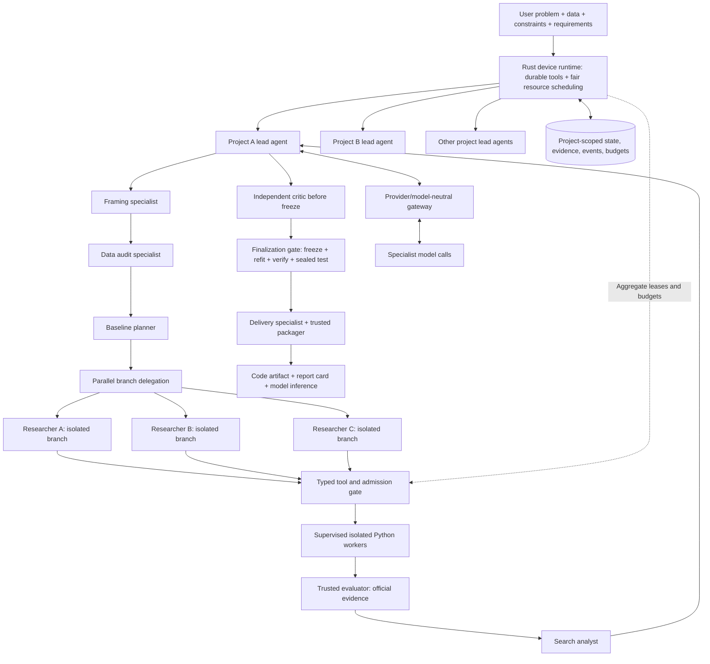

# MLRescurix system design and future requirement register

12 October 2026. Planning only. Read with BUILD_PLAN.md. This document updates language ownership and expands the coding-agent product requirements; it does not claim to anticipate every possible defect. The objective is explicit invariants, extensible boundaries, and testable recovery for predictable failures.

**Clean-slate rule:** MLForge is consulted for product lessons only. Do not migrate or move its code, data, project state, models, artifacts, or environments. Start with a new package, empty database and artifact store, fresh worker environments, and datasets the user explicitly adds to a new MLRescurix project. Schema migrations within the new application's own database are routine software upgrades, unrelated to legacy data migration.

**User approval rule for building MLRescurix:** Work proceeds one implementation phase at a time. Before coding a phase, present the assertion (what we believe and will establish), problem, proposed scope, assumptions, alternatives that matter, dependencies/files/interfaces, risks, and observable acceptance criteria. The user can revise the proposal through discussion. Wait for explicit approval of that phase before implementing it. Once approved, implementation and checks needed to satisfy that phase are authorized; do not expand materially into another phase. Report the concrete result and evidence, then prepare the next phase for discussion. Approval of the overall roadmap does not approve future phases. Do not autonomously research and build the next phase in the background.

## 1. Review of the two supplied discussions

Adopt the Rust control plane + separate Python workers recommendation. Rust owns persistent orchestration, agent tools/context, scheduling, deadlines, commands, state, environment/artifact lifecycles, API, and event delivery. Python owns profiling/splitting, fitted preprocessing, ML code, training, statistical metrics, Optuna, and model packaging. The evaluator is a separate trusted Python component, not code written by the research agent.

Do not embed Python with PyO3 initially or rewrite established ML algorithms in Rust. Native libraries already do much of the expensive training work. Rust's value here is a durable independently running supervisor; training speed gains must be measured from better experiment selection, data reuse, and resource scheduling. Two languages add packaging, contracts, and release work; enforce shared protocol fixtures from the first milestone.

Adopt native SQLite/files as the source of truth and external services as selectable integrations. Modify the attachments in three ways:

1. **Polars is optional initially.** Keep one Python dataframe path for fitting and inference. Add Rust/Polars streaming operations only when measured data workloads justify the build/runtime footprint and cross-language semantics.
2. **MLflow is not a first milestone requirement.** Build native state and live visualization first. Define the outbox and adapter boundary early; ship a connector when useful.
3. **No all-model dependency pack at startup.** Start with sklearn recipes, then add an individually selected LightGBM profile and separate XGBoost/CatBoost profiles. Search and training environments have different responsibilities.

Rustuna exists, but its maintainers describe it as experimental and not a complete Optuna replacement. Retain Optuna behind a replaceable search adapter rather than selecting Rustuna because the harness is Rust. [Rustuna repository](https://github.com/optuna/rustuna)

Use the working project name MLRescurix consistently; EvoML describes the proposed architecture in the attachments. Apex is a verified feasible champion, not a separate mandatory neural architecture.

## 2. Agent-led architecture: project leads, phase specialists, and shared-device scheduling

Each project represents one user problem and one final model/pipeline finalization. Its three required outcomes are final code artifact, report card, and runnable model inference. A user may keep many independent projects active on one device. A project lead agent owns the autonomous research flow, while phase specialists own delegated reasoning/code tasks and Python workers own fixed computational tasks. A durable Rust runtime provides tools and enforces consequential boundaries. Scientific decisions are agent-led, not a fully scripted deterministic workflow.

The diagram shows a usual evidence dependency flow. The lead can revisit stages, delegate bounded parallel branches, request ablations, and choose continuation/stop without following a fixed reasoning script. Required data/spec/evidence prerequisites are checked when consequential tools are called. Before implementing an agent phase, present its graphical flow, role/prompt contracts, tool permissions, autonomy, parallel joins, failure handling, risks and acceptance criteria for user review.

Use deterministic machinery where correctness needs an enforceable boundary: user authorization and intent revisions; atomic resource/cost admission; process isolation/deadlines; official scoring and prediction validation; hidden-label protection; artifact integrity; cancellation/recovery; and single final publication/test access. Do not replace hypothesis generation, specialist routing, experiment interpretation, or scientific stopping decisions with hardcoded rules. The runtime may force a stop when user policy or finite budgets require it. A critic can challenge evidence, but cannot fabricate official scores, waive constraints, access final-test labels, or promote itself.

### Concurrent projects and branches

One device-level scheduler is the authority for aggregate CPU/RAM/VRAM/disk, installation, evaluation and local-model workloads. Each project's lead requests work subject to its own budget and the device allocation. Support ten active project records and three concurrent researcher branches as representative acceptance scenarios, using lightweight fixtures; simultaneous heavy execution depends on available resources. Queued work is explicit, bounded and recoverable.

Use fair per-project queues with configurable weights and aging. Reserve host headroom and account for running, terminating and uncertain/recovering jobs before admitting replacements. Reserve both project and device capacity atomically; provider-account concurrency/rate/cost limits also apply across projects. No project can spend another project's budget. Expensive inference certification can request an exclusive or controlled measurement window so concurrent research does not silently invalidate the benchmark protocol.

Each researcher has its own task ID, branch ID, candidate workspace/base hash, immutable evidence snapshot, intent generation, prompt version, tool capabilities and budget allowance. Sibling branches may produce useful evidence independently; accepting one branch does not automatically stale every sibling. Fence on relevant intent/spec changes or revoked task generation. Proposal acceptance and official state publication are serialized, while reasoning and execution may proceed concurrently. Deduplicate equivalent proposals before costly execution. Never merge candidate code automatically across branches without a new validated artifact identity.

The lead alone updates its coordinating plan through revision-checked tools. Parallel specialists return proposals/findings through the ledger. Serialize finalization per project: close new branch admission, drain/cancel or fence outstanding work according to policy, freeze one candidate identity, and reserve one test assessment. Other projects may continue within their allocations. Project-scoped stop must not terminate another project's workers; device emergency stop is a separate explicit scope.

### Specialist role and prompt contract

`AgentRoleSpec` includes role ID/version, system-prompt template/hash, purpose, required inputs, output schema, allowed tools, data visibility, provider capability requirements, delegation/concurrency ceiling, token/cost/time limits, yield/stop rules and prohibited authority. Construct each invocation from that prompt plus current project contract, user intent and bounded evidence. Do not assume independent work means unlimited privileges or private state.

Roles: project lead, framing, data audit, baseline planner, researcher/coder, search analyst, independent critic and delivery. Execution/evaluation are computational services; calling them does not require an LLM pretending to train or score. Models may differ by role behind the same gateway. Pending user decisions remain pending; a timer is not consent.

| Phase / role | Main responsibility | Orchestrator gate |
| --- | --- | --- |
| 0: Framing agent | Resolve target, task, metric/direction, label semantics, inference target, hard constraints, split policy, budgets; surface consequential ambiguities to the user | Validate and persist an immutable project-spec revision before data work |
| 1: Data audit agent | Review bounded schema/profile, missingness, cardinality, imbalance, group/time fields, likely leakage and split feasibility; suggest handling | Deterministic data checks validate the audit and split proposal |
| 2: Baseline planner | Choose dummy, linear, and suitable tree baselines from registered recipes | Resource/budget admission for every baseline |
| 3: Researcher | Propose a falsifiable evidence-backed hypothesis; select a recipe or write a scoped feature/model patch | Validate contract, parent trial IDs, patch hash, expected benefit/cost and user-review policy |
| 4: Execution | No reasoning agent: supervised Python worker fits and produces predictions; trusted evaluator scores them | Worker limits, feature-only inputs, official metrics and feasibility check |
| 5: Search analyst | Compare compatible trials; recommend tune, repeat, prune, ablate, calibrate, ensemble, continue or stop | Check comparability, budget and resources before accepting the next action |
| 6: Independent critic | Review frozen development protocol, leakage risks, constraints, reproducibility and claims | Return to phases 3–5 only before final-test access; critic cannot waive deterministic gates |
| 7: Delivery agent | Prepare model card and instructions for the verified bundle | Deterministic packager reloads, validates, benchmarks and publishes; final test is evaluator-controlled |

Phases 2–5 form the research loop. Phase 6 runs before freeze. Then a trusted finalization service evaluates the frozen candidate once on the held-out test. Phase 7 packages that evidence. No specialist may silently alter the locked objective, split policy, constraints, or user intent.

### One hypothesis from idea to measured result

1. Committed baseline results wake the project lead, which delegates researcher tasks with the current contract and user-intent revision, remaining budgets, and compact relevant evidence.
2. The agent identifies an observed pattern and proposes one testable change, expected effect, disconfirming result, risk, and estimated cost. It selects a registered recipe or writes a versioned scoped patch.
3. The lead selects the proposed next action and requests its tools. The runtime checks contracts and applicable user-review policy, then atomically reserves device/project compute, time, storage, environment, and model-call budget.
4. A Python worker gets an immutable specification and only the permitted data view. It reports real phase/resource observations and optional model-training callbacks. It cannot publish official metrics.
5. The trusted evaluator validates row IDs, shapes, class order, and finite predictions, then computes development metrics and feasibility evidence. Missing or unsupported measurements remain explicit failures.
6. The runtime commits result/events, updates verified eligibility, releases resources after cleanup, and wakes the lead/assigned analyst on meaningful completion. The analyst recommends comparisons and next actions; the lead owns continuation. Reasoning turns retrieve evidence by ID instead of pasting complete logs.
7. Continue within the selected research policy or stop on budget, user command, or configured stop conditions. Critic and finalizer operate on a frozen candidate under the test-set gate.

OpenRouter, DeepSeek, and other model APIs sit behind provider adapters and one normalized gateway. Model choice is configuration. Capabilities such as tool calls, structured outputs, streaming, context size, usage reporting, and cancellation are tracked per provider/model. No phase agent assumes a particular vendor. Malformed outputs use bounded validation/repair and can never bypass kernel checks.

## 3. Non-negotiable invariants

- A user command, scheduled action, trial, artifact, and official result each have durable identities.
- Only the kernel/evaluator can publish official quality/resource verdicts and promote Apex.
- User instructions, constraints, and budgets remain authoritative across context compaction and restarts.
- Workers cannot write the state database or evaluate hidden labels themselves.
- No computational work is admitted without the applicable environment lease, device/project resource reservation, and budget. Model calls require task/usage reservations and provider quotas; they do not require a scientific Python environment.
- No cancellation releases resource reservations before the owned execution has stopped or is fenced and still charged/reserved.
- Results refer to the exact dataset, split, code, environment, fidelity, and artifact they evaluated.
- UI state is projected from committed backend state; no browser component invents scores, progress, or successful actions.
- Final-test assessment does not feed another research iteration.
- External integrations, dashboard clients, and provider outages cannot corrupt local trial state.
- Every queue, retry loop, context buffer, log, telemetry stream, cache, and artifact set is bounded.
- Unknown or unsupported measurements/enforcement cannot satisfy a required constraint.

## 4. Minimal language and dependency ownership

| Layer | Initial direct dependencies or facilities | Policy |
| --- | --- | --- |
| Rust harness | Tokio, Serde/serde_json, one SQLite binding, tracing, CLI parser; HTTP client when the provider adapter ships | Enable only needed features; Cargo.lock committed. Prefer rusqlite behind one bounded DB writer initially; do not also add SQLx. Block file/DB hashing work off the async executor. |
| Local API/UI server | Axum; static embedded frontend assets | Optional CLI-only operation; same command/state service. Loopback binding by default. |
| Scientific Python base | NumPy, SciPy, scikit-learn, pandas, lightweight telemetry such as psutil where native telemetry is insufficient | Exact validated platform lock, subprocess environment. Include sklearn's resolved joblib/threadpoolctl dependencies; do not claim zero transitive dependencies. |
| Hyperparameter search | Optuna in a managed search sidecar | Required for the HPO milestone, not for baseline inference or harness startup. Optuna may bring SQLAlchemy and other transitive packages; measure the resolved profile. |
| Boosting recipes | LightGBM initially optional; XGBoost and CatBoost individually optional | Install selected family only, validate native/OpenMP/backend compatibility. A missing wheel/runtime produces a capability failure, not a silent model substitution. |
| Parquet/large-table path | One chosen engine, e.g. PyArrow or Polars | Optional, benchmark before adding both. CSV first. |
| Visualization | Small TypeScript frontend; initial charts in SVG/canvas, one chart/graph library only if needed | Build-time Node tooling; compiled static assets at runtime. No required Streamlit, Python Plotly server, Jupyter, or matplotlib. |
| External tracking | MLflow adapter process, official SDK profile; evaluate mlflow-skinny for tracking-only use | Disabled by default; inspect actual dependency resolution and supported features. |
| Data/version integrations | DVC adapter | Only for existing DVC workflows; native hashes/manifests cover local lineage. No Git/DVC commit on every trial. |
| Explanation/monitoring | sklearn bounded permutation importance first; SHAP/Evidently optionally | Budgeted jobs; research-run health monitoring itself requires neither package. |
| Neural/GPU work | PyTorch plus explicitly compatible backend profile | Later recipe; no torch/CUDA download for CPU classical ML users. Local LLMs also count against host resources. |
| Serving/export | Python inference interface by default; FastAPI/ONNX/native export optional | Only needed runtime dependencies in the champion bundle. ONNX conversion requires parity checks and supported transforms. |
| Benchmark baselines | AutoGluon, Ray and other systems only when explicitly benchmarked/needed | Separate disposable profiles; Ray is not the local scheduler. Kubernetes and Redis are unnecessary in v1. |

Sklearn's installation documentation identifies NumPy/SciPy and other requirements; a compact system still has genuine scientific dependencies. [Sklearn installation](https://scikit-learn.org/stable/install.html)

For every enabled profile, record compressed download, installed bytes, build scratch peak, cold startup, RAM baseline, license inventory, and supported OS/architecture. Set size/time caps before installation. No precise size promises until lock resolution and measurement on the target platform. Reuse immutable leased environments; evict unused owned environments and prune a bounded project cache through supported tooling.

The first release artifact is a Rust executable + bundled UI assets + Python worker source/package and lock metadata. Provision a managed Python interpreter only when needed and within the installation budget; do not alter global Python. A Rust toolchain or Node is not required to run a prebuilt release. Python remains needed for Python ML execution/inference unless a verified native export replaces it.

## 5. Workflow specific to an ML coding agent

The main loop is:

`reconcile -> inspect evidence -> propose hypothesis -> implement patch/recipe -> validate -> reserve -> execute -> independently evaluate -> compare -> update evidence -> continue or finalize`

Each hypothesis states the observed issue, supporting trial IDs, one proposed intervention, expected effect, comparison protocol, estimated cost, and disconfirming outcome. Example: a linear baseline performs poorly on one slice; test a bounded interaction transform against the same baseline/splits before increasing model complexity.

The agent has scoped capabilities: read bounded code/evidence, write candidate workspace files, validate transforms, propose experiments, inspect owned logs, request runs/ablations/finalization. Native recipes and generated code use the same result contract. The supervisor owns launch, kill, package installation, network access, and scoring. An arbitrary shell tool is not the default agent execution interface.

Generated feature code implements a versioned fit/transform interface, accepts only permitted training inputs, returns row-aligned features, and becomes part of the fitted pipeline. Candidate model code implements fit/predict and optional predict_proba/checkpoint/intermediate-metric capabilities. Validate row identity, dimensions, class order, serializability, bounded output growth, unknown-category behavior, batch behavior, and raw-input parity before expensive trials.

Custom code, models, and deserialization run in feature-only sandboxes. **A label-owning evaluator never imports generated modules or loads their pickle artifacts.** It scores validated prediction files. Reload/parity tests happen in a separate sandbox without hidden labels. Otherwise unpickling a malicious artifact could defeat label separation despite independent metric code.

Persist scoped patch/base hash and validate the exact resulting source before launching. Never modify a running candidate's code or environment. Cheap contract tests precede full fitting. Repair attempts get a new patch identity and capped diagnostic context. No fake scores, dummy success fallback, or changing the scoring script to make a hypothesis win.

## 6. Long-running context and scientific memory

An LLM conversation is a temporary reasoning window, not the state store. Separate:

| Memory | Contents | Persistence/retrieval |
| --- | --- | --- |
| Immutable project contract | Objective, budgets, split/metric policy, permissions, delivery requirements | Always loaded by revision/hash, separately enforced by Rust. |
| User-intent ledger | Requests, corrections, pending answers, cancellations, effective revisions | Durable authoritative messages and command receipts. |
| Active task state | Current phase/hypothesis, worktree/patch, pending calls/jobs, next decision | Structured checkpoint after significant actions. |
| Experiment evidence | Metrics, resources, parents, failures, artifacts, protocols | Queryable records; retrieve top relevant comparisons. |
| Scientific findings | Supported/contradicted hypotheses, scope, uncertainty, evidence IDs | Versioned conclusions; no unsupported summary claims. |
| Raw transcripts/logs | Model messages and bounded logs, excluding credentials | Local bounded storage, retrieved by reference rather than pasted wholesale. |

Build an agent turn from the current contract + user intent + active task + a bounded evidence packet. Use a model-capability context limit and tokenizer where available; otherwise conservative estimation. Reserve output/tool capacity. Proposed initial compaction trigger: 65% of usable context, with budgeted chunks for authoritative state, active work, relevant evidence, and recent dialogue. These are tunable heuristics, not guarantees across providers.

Checkpoint includes schema/agent version, project and intent revisions, event cursor, hypothesis/patch IDs, outstanding tool-call IDs, pending job handles, stop conditions, remaining budgets, unresolved questions, and explicit next action. Compaction preserves IDs and facts, not hidden chain-of-thought. Validate checkpoint references against the ledger; summaries cannot grant permissions or change scores.

If compaction/model continuation fails, start a new reasoning session from structured state. Reconcile pending tools before retrying them. Never blindly replay a mutating tool call after losing its response; query its idempotency key. Persist provider request IDs, token/cost accounting, model identity, and timeout reason. Bound raw dialogue/log retention, cache evidence summaries, and use SQLite/full-text queries first; no mandatory vector database or embedding service.

### Durable checkpoints and uncertain-action recovery

Checkpointing is foundational, not deferred to the full agent milestone. M0 implements persistence/recovery contracts using scripted agent tasks; M4 connects real provider calls and specialist turns to those contracts. Recovery resumes the last committed safe task boundary, not an exact token or in-memory Python training state.

An `AgentCheckpoint` carries checkpoint ID/sequence, schema version, project/branch/task IDs, role and prompt version/hash, model identity when available, scientific-spec and intent revisions, task fencing generation, event cursor, phase/hypothesis, patch/base hashes, evidence/artifact references, pending questions, call/tool/job handles, next action, and stop/yield conditions. Budget snapshots are explanatory; authoritative remaining capacity is reread from the ledger. Keep bounded structured reasoning conclusions and supporting evidence, not hidden chain-of-thought or credentials.

Persist checkpoints at task creation, before external/model/tool dispatch, after validated responses and committed tool outcomes, before yield/compaction, on intent changes and terminal task outcomes. Commit checkpoint references and related state/events/receipts atomically where they share the local transaction. Stage/hash large checkpoint attachments before referencing them. Reject an invalid schema/hash or dangling reference; retain a bounded previous valid checkpoint and reconcile subsequent ledger events instead of silently rolling back official state.

`ActionRecord` states distinguish `prepared`, `dispatched`, `outcome_unknown`, `succeeded`, `failed`, and `cancelled`, with action/idempotency ID, task generation, attempt IDs, deadline, external request ID, result references, and charged/reserved cost. Persist intent before dispatch. A timeout or lost response does not prove the action failed or was unbilled. Local mutating tools use idempotency keys and stored receipts; reconcile by ID before retrying. External actions lacking a query/idempotency facility remain uncertain: fence late responses, retain conservative cost/execution accounting, and allow a new attempt only under explicit retry/budget policy. Do not claim exactly-once external execution or billing.

On recovery: acquire/fence task ownership; reload latest project contract and intent; validate the checkpoint and replay committed events after its cursor; reconcile pending action receipts, workers, leases and reservations; apply overdue stop/deadline policy; reconstruct bounded model context; then resume the next eligible action. Each parallel branch recovers independently. A lost lead must not create duplicate specialists; completed sibling results remain available. Pending human approval never becomes granted on restart.

Latency handling uses separate connection/read/overall call deadlines, bounded exponential backoff with jitter, provider retry hints, retry/repair budgets and a circuit-breaker/cooldown policy. Persist retry eligibility as a wakeup rather than holding a reasoning thread or unnecessary compute allocation. Model network loss does not kill healthy admitted local jobs; commit their results and wake the agent when it can continue. Partial streamed output is diagnostic until a complete validated response is committed; never execute partial tool arguments. A disconnected CLI/UI reconnects through command receipts and event cursors.

Model-call cancellation may leave charges unknown. Do not release uncertain costs merely because a deadline expired. No assumption that provider sessions persist across requests: rebuild continuation from local structured state and permitted messages. Distinguish agent checkpoint recovery from ML model checkpoints; resume training only for a recipe/runner whose checkpoint capability has separately passed tests.

Treat dataset cells, column names, logs, documentation, integration responses, and generated output as untrusted content. They may contain instructions. Present them as data, redact sensitive values by default, and do not let them modify tool privileges. Provider context uses schema/distributions and approved samples; raw data upload requires an explicit project policy. Local model providers share compute/VRAM reservations with training.

## 7. Wakeups, timers, and monitoring

The Rust supervisor runs independently of a model turn. Waiting for a model to remember to check a job is insufficient. Job completion/failure, user messages, budget alarms, resource pressure, and timer events can wake the agent. The agent does not busy-poll or receive every telemetry sample.

Proposed agent tools: `get_time`, `get_budget`, `watch_job(job_id, conditions)`, `wait_for_event(cursor, types, deadline)`, and `schedule_wakeup(at, reason)`. The tools register durable subscriptions/wakeups and let the reasoning turn yield. Register watch + inspect terminal state without a race; completion just before subscription must still be observed. Timers cannot extend a budget or exempt a job from deadlines.

Suggested event envelopes include `job.started`, `job.progress`, `job.terminal`, `trial.verified`, `artifact.published`, `resource.warning`, `budget.threshold`, `timer.due`, `user.command`, `agent.needs_input`, `project.state_changed`, and `integration.status_changed`. A model-build completion wakes the analyst only once its required artifacts/results are committed. `training finished` and `verified candidate` are different events.

Durable timer record: ID, project, reason, UTC due time, recurrence policy if any, expected state revision, cancellation token, delivery key, status. Runtime deadlines use a monotonic clock; wall-clock schedules persist in UTC and are presented in the user's timezone. Restart reconciles overdue timers; clock jumps cannot create free training time. Define machine-suspend policy: conservatively charge expired wall deadlines, stop/fence overdue jobs on recovery, and mark affected measurements invalid where necessary.

Allow one coordinating lead turn plus bounded independent specialist turns per project; multiple projects may reason concurrently. Prevent duplicate turns for the same task with durable task leases/generations. Coalesce wakeups and batch trial completions; prioritize user stop/resource alarms over research. Deliver at least once, deduplicate by event/task key, and cap queue size. A stale timer whose expected project revision no longer matches becomes obsolete. Persist command/task state before calling a provider, so a restart does not duplicate an existing researcher task. Intent changes fence affected tasks across all branches; ordinary evidence commits do not invalidate unrelated sibling tasks.

Initial monitoring defaults, subject to overhead measurement:

- Sample worker resource health about once per second; independent safety enforcement can act sooner.
- Worker heartbeat about every five seconds; configurable stale threshold, e.g. 30 seconds, initiates investigation rather than assuming a quiet fit failed.
- Aggregate UI telemetry to roughly one update per second while active; retain downsampled history under a storage cap.
- Wake the LLM on completed evidence, meaningful anomalies, user input, and significant decisions—not every heartbeat.
- Intermediate learning curves are recipe capabilities. For a non-iterative fit, show phase, elapsed time, heartbeat and actual usage; do not fabricate a completion percentage or ETA.

CPU use alone does not establish progress. Distinguish missing heartbeat, no recipe metrics, provider silence, blocked I/O, resource limit, and deadline expiry. Process/OS monitoring belongs outside potentially hung Python code. Protect the supervisor's own memory, queues, file descriptors, threads, and disk.

Tokio documents that dropping a child handle does not stop the process by default and recommends awaiting it for stricter cleanup. Implement explicit process-group/container termination and reaping; dropping an async future is not our cancellation strategy. [Tokio process documentation](https://docs.rs/tokio/latest/tokio/process/index.html)

“Keep running” requires the local service to remain alive. CLI can attach/detach from that service; closing a dashboard tab does not stop it. Explicit service shutdown has a declared drain/terminate policy. Startup/login service installation is optional, not silently performed. Recovery after machine reboot is supported when the user starts the service again; background execution cannot continue while the machine is off.

## 8. Research modes and collaboration are separate controls

| Research policy | Behavior | Required guarantees |
| --- | --- | --- |
| Speed-run | Few cheap baselines; one promising family; shallow tuning; strict short wall budget; optional bounded code changes | Same leakage, feasibility, artifact, and test rules. Search fidelity may be reduced, but certificate protocol cannot be silently weakened. |
| Balanced (default) | Strong baselines, adaptive tuning, targeted hypotheses, repeat finalists where budget permits | Explicit search and finalization allocation. |
| Thorough | More branches/families/seeds, selected ablations, calibration/ensembles when justified | Still finite budgets, caps, and stop conditions. |

| Collaboration policy | Behavior |
| --- | --- |
| Automatic (opt-in) | Continue research within the project policy after the user explicitly selects this mode. It cannot override hard constraints or final-test gates. |
| Collaborative | Present hypotheses and comparisons; user can steer branches, pin candidates, forbid features/families, and request experiments. This is the default research mode. |
| Stepwise (opt-in) | Queue each material experiment/patch for review before admission. Deterministic monitoring and cleanup continue. |

Policy names refer to the product's ML research session, not the user-led development process for building MLRescurix. The build process always requires the phase approval gate above. For product use, collaborative mode is the default; automatic research requires an explicit user choice. Switching mode changes future admission; it does not rewrite completed trials. Speed-run results disclose fewer trials and less search evidence. If time is too short for required independent verification, return an unverified draft candidate with its status, not a certified Apex.

## 9. User collaboration, interrupts, and configuration changes

Every action is a durable command with command ID, user/session, project ID, expected revision, payload, timestamp, and receipt. Receipts progress through `accepted -> applied` or `rejected/failed`, with effective revision and reason. “Accepted” is not proof that a running process has stopped.

| Command | Exact semantics |
| --- | --- |
| Pause research | Stop new proposals/admissions, interrupt/fence agent continuation; let the current trial finish by default. Show active work until drained. |
| Stop now | Cancel active research/tool tasks, terminate owned workers, reap them, reconcile charges, persist state. Return stop completion only after cleanup/confirmed fencing. |
| Resume | Reconcile ownership, intents, timers, environments, budgets, and pending commands before scheduling. |
| Finalize current candidate | Stop admission, drain/cancel under policy, choose an already feasible candidate and enter finalization if reserve allows. |
| Steer search | Update branch preferences, blocked algorithms/features, or a requested hypothesis with a new intent revision. |
| Change budget/constraints | Validate new policy; apply to future admission; if lowered limits conflict with active work, use explicit stop/reallocation semantics. Reverify candidate eligibility under new limits. |
| Change target/metric/split/data | New scientific project revision; incompatible results remain historical and cannot be directly ranked under the new objective. Require fresh split/test eligibility as applicable. |
| Pin/export candidate | Protect an identified verified artifact; distinguish provisional export from final certified delivery. |

On a user interruption, increment the intent generation, cancel obsolete model calls when supported, and reject late proposals whose base revision is stale. Provider cancellation may still incur charges. Running experiments remain immutable: their results can be saved as historical evidence without acting on stale plans. Explicitly report what changed and whether active work was allowed to finish.

Serialize conflicting commands in the kernel. Browser tabs, CLI, and APIs all share this service; optimistic revision checks reject conflicting updates. Pause/stop are high priority and idempotent. If the network/UI disconnects, reconcile the receipt before resubmitting. Pending user questions remain durable; timers are not user consent. No agent turn should remain blocked while holding otherwise unnecessary compute reservations.

## 10. Cross-language job protocol and execution boundary

Use versioned JSON Schema for control messages, with Rust Serde and Python validation tested against common positive/negative fixtures. Schema compatibility negotiation is required before admission; do not accept incompatible workers. Define units, optional fields, metric direction, finite numeric handling, large integer encoding, and forward-compatible event fields explicitly. Keep event sequences within portable ranges or encode large cursors as strings.

Small spec/event frames are bounded JSON lines over a dedicated inherited pipe/socket; stdout/stderr are separate bounded logs. Do not parse result JSON from arbitrary training logs. Frame limits, UTF-8 handling, malformed frames, flood behavior, EOF, and backpressure are specified. Rust drains logs/control concurrently to avoid pipe deadlocks. Worker events are observations; only the supervisor publishes official lifecycle events.

Large datasets and predictions use owned artifact references, not JSON arrays. Initial numeric predictions can use validated non-object NumPy files plus row-ID/class metadata; larger/remote columnar exchange can add Arrow/Parquet later. Validate before loading, cap shape/size/decompression, prohibit object-array unpickling, and check row identity independently.

Execution contract: `capabilities`, `submit(spec, lease)`, `inspect(job)`, `cancel(job, reason)`, `subscribe(job, cursor)`, `collect_artifacts(job)`, and `reconcile`. One Rust device scheduler owns aggregate admission policy; project lead agents own scientific workflow; workers enforce issued leases/limits. An Optuna sidecar owns sampler state only and proposes parameters; it cannot launch training or promote its best_trial.

Crash between Optuna ask and harness commit is reconciled through a mapping of optimizer trial ID to kernel trial/request ID. Tell terminal states after official completion with retries/deduplication. Search sidecar loss does not reset budgets, overwrite DAG nodes, or expose sealed labels. Trial hashes include seed, split, fidelity and code/environment; cache reuse requires valid retained evidence, not just matching parameters.

## 11. Dashboard contract: real state and reliable updates

The dashboard is a local UI over the Rust service, not an MLflow page or autonomous frontend scheduler. Axum supports SSE responses suitable for server-to-browser events; replay/durability remain application responsibilities. [Axum SSE documentation](https://docs.rs/axum/latest/axum/response/sse/)

Initial API:

- `GET /v1/projects/{id}/snapshot`: consistent project revision, event cursor, active jobs, mode, budgets, candidate summary, alerts.
- `GET /v1/projects/{id}/events?after={cursor}`: SSE of persisted domain events plus clearly classified transient telemetry; EventSource reconnection cursor supported.
- `POST /v1/projects/{id}/commands`: command ID, expected revision, typed payload; durable receipt.
- `GET /v1/commands/{id}`: actual applied/rejected/stop-completed status.
- Paginated trial/evidence/log/artifact queries with response-size caps; artifact downloads only through scoped IDs.

Commit state transition + domain event + any integration outbox entries in one transaction, then broadcast. Snapshot returns a cursor from the same consistent read. Client subscribes after that cursor, deduplicates IDs, and rebuilds from a fresh snapshot if retention has removed needed events. Never assume SSE transport supplies exactly-once delivery. In-memory broadcast lag triggers replay/resnapshot, not silent event loss.

Two data classes:

1. Durable events: project/trial transitions, official results, commands, artifact publication, budget accounting, intent changes. These are replayable.
2. Sampled telemetry: CPU/RAM/GPU traces, heartbeats and optional training curves. Bounded buffers/downsampled storage; missing samples render gaps and stale state. A sample is not an official resource certificate.

Show:

- Current hypothesis/action, why it was selected, and last verified finding.
- Active jobs, elapsed time, heartbeat age, capability-aware progress, cancel/pause receipts.
- Trial table and bounded experiment DAG with patch/parent links.
- Comparable validation scores, metric direction, uncertainty/replicates, feasible Pareto view.
- Every constraint's threshold, measured value, units, workload, verdict, and enforcement quality.
- Reserved/consumed/remaining budgets, dependency/storage breakdown, GC state, finalization reserve.
- Apex status: provisional, verified development champion, frozen, independently assessed, or delivered.
- User steering history, pending decisions, provider state, integration sync queue and failures.
- Finalization evidence and downloadable bundle; final test hidden during search.

For a tree fit without iteration callbacks, show “training, elapsed 42s, worker healthy”; never “63% complete” based on elapsed time. Mark estimated ETA as an estimate with its basis, or omit it. No metric chart before real values arrive. Group incompatible protocols/revisions rather than drawing misleading comparisons.

The first UI can be a small TypeScript app with SVG/canvas plots; framework choice remains a routine implementation decision. Virtualize/paginate large trial/DAG views, cap live points, use downsampling, and escape code/log text. Disconnected browsers show the last update timestamp and stale indicator. UI errors never stop research.

Loopback service still needs per-session authentication for control actions, Origin/Host checks and CSRF protection. Do not expose an unauthenticated local control API to arbitrary websites. Bind remotely only through explicitly configured authentication/TLS policy. Secrets are stored through an OS/approved secrets provider and redacted in the dashboard/logs.

## 12. Integrations and future remote execution

Native registry works without MLflow or DVC. MLflow supplies tracking/registry capabilities, but our agent decisions, budgets, timers and lifecycle stay local. [MLflow tracking documentation](https://mlflow.org/docs/latest/ml/tracking/)

An enabled connector receives a transactional outbox entry only for approved categories/destinations. Use bounded exponential backoff/jitter, destination-specific credentials, retry caps, dead-letter diagnostics, and separate upload resources. Persist remote IDs and content hashes. Do not promise exactly-once remote run creation: if the remote API cannot honor our idempotency key and a response is lost, reconcile by stable tags/IDs or report an ambiguous duplicate rather than silently claiming certainty.

Keep artifact pins for pending permitted uploads under a bounded spool policy. If the integration backlog exhausts its allowance, stop synchronization/new upload admission and show the issue; do not delete Apex or block unrelated core research. Tracking connection, artifact-storage permission, and registry promotion permission are separate capabilities. Raw data is not uploaded by default; other metadata/artifacts may also be sensitive. Integration installation is optional and isolated.

Future remote workers: capability registration, mutual authentication, encrypted transport, dataset residency/export rules, object-store references, expiring leases/fencing, resumable checksum-verified transfers, worker self-stop on expired lease, and actual cost reconciliation. Lost contact means unknown execution, not immediately free capacity or permission to create a duplicate. Duplicate execution may occur under recovery, but only one fenced result can publish; bill/record both actual attempts.

The SQLite database stays on its owner's local filesystem. Remote workers use API contracts, never a shared NFS SQLite file. SQLite documents that WAL does not work across a network filesystem. [SQLite WAL documentation](https://www.sqlite.org/wal.html)

Single-user multi-project and intra-project concurrency are foundational requirements. Define multi-user/RBAC, team collaboration, remote GPU scheduling and production monitoring as future boundaries. Do not build Kubernetes, a plugin marketplace, distributed locks, or a full forecasting stack before the single-machine contracts pass. Plugin/recipe compatibility, provenance, dependency permissions and isolation must be checked if third-party plugins are later supported.

## 13. Failure register and required responses

| Failure or edge case | Required response/design | Validation |
| --- | --- | --- |
| Context fills or compaction loses intent | Reload contract/intent separately; verify checkpoint references; restart reasoning from ledger | Long scripted sessions spanning several compactions |
| Provider timeout/rate limit/malformed tools | Bounded retry/backoff, schema validation, durable call IDs; deterministic fallback/pause | Stub provider fault scenarios |
| User interrupt during a model call | Intent-generation fencing; late proposal rejected | Race tests against tool submission |
| Completion before job watch registration | Subscribe + terminal reconciliation; deduplicated wakeup | Completion/subscription order permutations |
| Duplicate timer/event after restart | Delivery key, task generation, durable consumption | Restart at each delivery boundary |
| Timer clock jumps/machine sleeps | Monotonic runtime deadlines + persisted UTC reconciliation; honest elapsed cost | Fake clock/suspend scenarios |
| Python/native crash or hung fit | External supervisor, deadline, process-group cleanup, interrupted result | Disposable worker faults, not host exhaustion |
| Orchestrator dies with active workers | Lease/fencing, startup ownership reconciliation; runner self-stop when supported | Kill supervisor during fit and publish |
| PID reused | Identity includes lease/start-time/container ID; never kill by stale PID alone | Simulated PID identity mismatch |
| Log/control pipe fills | Concurrent draining, bounded framing/log rotation, explicit overflow policy | Flooding and malformed-frame worker |
| Budget reservation races | Atomic device/project reservations and generation checks | Concurrent cross-project admit/change-budget tests |
| Project fan-out starves other work | Fair queues, weights, aging, bounded task fan-out | Ten-project scheduler scenarios with observable eventual admission |
| Parallel researcher code or state conflicts | Branch-local workspaces, revision-checked lead plan, scoped task leases | Three-branch collisions, stale intent and restart scenarios |
| Stop/finalize races across branches/projects | Scoped cancellation, fenced joins, serialized per-project finalization | Stop one project while others continue; duplicate finalize and late-result tests |
| Concurrent training contaminates inference certification | Declared contention protocol and controlled measurement allocation | Benchmark admission/rejection under competing workloads |
| OOM/VRAM pressure | Hard limit where supported, host headroom, aggregate accounting, capability-aware stop | Isolated cgroup/backend tests |
| Other apps consume host resources | Reassess admission/pressure; preserve supervisor reserve | Synthetic availability changes |
| Dependency unavailable or interrupted install | Staged env cleanup, wheel/platform check, bounded retries; no global mutation | Installer fake and supported-platform smoke tests |
| Large CSV/compression/category explosion | Bounded scan/expansion, schema caps, memory estimate; reject unsupported size | Oversized synthetic metadata/expansion cases |
| Source data changes mid-run | Immutable owned snapshot or verified file identity/recheck; new dataset revision | Mutate source between hash and read |
| Missing classes/invalid metric/group/time split | Explicit validation and meaningful failure; no successful zero score | Rare-label/group/time fixtures |
| Leakage through target encoding/resampling/calibration | Fit inside correct folds; evaluator-label separation | Adversarial split and transform fixtures |
| Agent code tries hidden-label access | Sandbox paths/capabilities; evaluator never loads custom pickle | Isolation tests and forbidden-access fixtures |
| Predictions reordered/truncated/NaN | Independent row-ID/class/shape/numeric validation | Forged prediction files |
| Validation overfitting/repeated test use | Budgeted selection protocol, repeat finalists, sealed test freeze | Durable gate and restart tests |
| Mixed fidelity or incompatible experiment scores | Protocol identities; only comparable full-protocol candidates eligible | DAG/chart/selection fixtures |
| Ensemble brings large hidden costs | Count every member/transform and measure full pipeline | Ensemble memory/latency checks |
| Final refit violates constraints | Rebenchmark delivered artifact; fail or preselected development fallback | Artifact grows after refit fixture |
| Inference differs from training | Frozen fitted preprocessing/custom package; fresh-process parity | Missing/unseen/reordered column fixtures |
| Disk full during commit/export/GC | Reserve staging space; atomic publish; retain DB/critical evidence headroom | Bounded disposable volume tests |
| GC races a job/ensemble/upload | Reference pins + leases + tombstone reconciliation | GC/lease race and interrupted deletion |
| SQLite locked/corrupt/migration fails | One writer, busy policy, versioned backup/restore; refuse unsafe upgrade | Migration rollback and backup restore tests |
| Event/WAL/transcript growth | Retention/checkpointing/downsampling; snapshots for old cursor | Long fake-run steady-state storage test |
| Dashboard reconnect/slow consumer | Cursor replay/resnapshot; no invented state; bounded buffers | Browser reconnect and lag tests |
| Multiple tabs send conflicting commands | Command IDs + expected revision + receipts | Duplicate/conflicting control tests |
| Remote tracking network fails | Local commit + bounded outbox; ambiguous-create reconciliation | Connector response-loss tests |
| Remote worker disconnected or preempted | Lease expiry, fenced publication, checkpoint if supported | Future remote failure suite |
| Secret or private data enters logs/context | Scoped secrets, redaction, sample policy, escaped UI | Redaction/prompt-injection fixtures |
| Environment/model upgrade breaks bundle | Immutable locks, compatibility manifest, new profile identity | Supported OS/architecture smoke matrix |

This is a maintained risk register. New failures add a regression scenario and, where needed, a contract change. “Optimized from the start” means measurable bounds and correct ownership; it does not mean prebuilding every future integration or promising no bugs.

## 14. Implementation gates and unresolved choices

Carry the M0–M6 roadmap forward with Rust ownership. Development Phase 0 establishes framing and architecture/contracts without implementation. M0 includes cross-language contracts, project/branch/task identities, global/project budget reservations, commands/receipts, durable events, intent revisions and timers. M1 proves concurrent supervisor and storage/resource behavior across projects. M2 adds actual tabular training/evaluation/export and a minimal live dashboard. M3 adds constrained HPO. M4 adds agent-led project orchestration, versioned specialist prompts, parallel branch delegation, provider/model abstraction, context recovery, wakeups and collaboration policies. Later gates add scientific improvements and optional integrations. Every MLRescurix project starts with empty state; no MLForge project or artifact is migrated. This list does not authorize implementation: each milestone has its own user discussion and explicit approval gate.

Before first code, choose routine implementation details from this design: Rust SQLite binding (initial recommendation rusqlite), frontend packaging, one supported Python minor version, metric set, and exact initial protocol schema. No need to ask for confirmation on each library; record the choice and validate it. Before real user training, require a dataset/target, actual budgets, and a declared inference target; examples cannot establish those requirements.

Open product decisions that can be deferred behind interfaces: LLM provider/model, remote platform, GPU hardware, enterprise authentication, framework for advanced dashboard controls, native export format, and production monitoring requirements. They must not block the CPU baseline kernel.

First concrete end-to-end scenario: initialize project -> audit synthetic mixed tabular data -> run dummy/linear/tree baselines -> show committed live results -> apply a user steering command -> pause/resume without duplicate work -> select a feasible candidate -> freeze/refit/test -> export -> predict raw records independently -> report storage cleanup. Then add constrained tuning and a code-writing hypothesis to the same verified workflow.

## 15. Revised development Phase 0 acceptance proposal

Phase 0 establishes an agreed agent-led, concurrency-aware architecture; it does not establish runtime safety by assertion. Review and agree the following before implementation:

- One project/problem/finalization identity and three identity-consistent outcomes: final code artifact, report card and inference; honest failure/provisional outcomes when verification cannot complete.
- Lead/specialist/worker ownership and a precise list of deterministic tool gates. Each agent role has a prompt/input/output/tool/budget contract and graphical flow to review before its implementation.
- Device-wide versus project-level budgets, reservations, queue fairness, active versus executing workloads, and scoped stop/finalization behavior.
- Project/branch/task IDs, leases/generations, branch workspaces, proposal deduplication and revision rules that preserve useful parallel evidence while rejecting obsolete actions.
- Provider-neutral capabilities, normalized call/error/usage records, cross-project quotas, bounded fallback and disclosure permissions.
- Paper walkthroughs for ten active projects, three researchers in one project, racing reservations, one-project cancellation, lead/provider loss, stale branch results and duplicate finalization. Record expected state/charges and assign executable proof to M0/M1/M4.
- No migrations from MLForge, dependencies, database initialization or implementation in this proposal session. Phase 0 agreement and roadmap agreement do not authorize a later coding phase.

Still to agree: actual concurrency ceilings/defaults on the target device, scheduling weights, provider fallback/disclosure policy, and the handling of uncertain model-call charges. Dataset/metric/inference workload and numeric operational budgets are mandatory before real training, not prerequisites for architecture discussion.

## 16. M0 durable foundation (implemented)

Phase 0 architecture direction was accepted in discussion on 12 October 2026, with durable agent continuation under latency/network failure added as a required foundation. M0 was subsequently implemented and verified; operation and limitations are documented in [docs/m0-foundation.md](docs/m0-foundation.md).

**Assertion:** project leads and parallel specialists can rely on a project-scoped durable task/action ledger that survives restart, retains user intent, reconciles uncertain outcomes and atomically accounts for shared-device/project capacity. M0 proves this with lightweight scripted actors, not real ML or live providers.

**Scope:** minimal Cargo workspace and Rust lifecycle CLI; versioned JSON contracts and positive/negative cross-language fixtures; minimal Python protocol package without scientific dependencies; native SQLite schema/migrations and bounded serialized writes; project/branch/task identities and leases; commands/receipts, durable events/cursors and timers; device/project reservation and charge ledger; checkpoint/action persistence, reconciliation and retry-wakeup contracts. Runtime state is created only in an explicitly owned new path after implementation approval; tests use disposable new state. Checkpoints and ledger are authoritative inputs to future agent continuation, not a deterministic scientific planner.

**Interfaces/files:** `crates/harness` modules for contracts/core/storage and CLI, `contracts` schemas/fixtures, minimal `python` protocol package, recovery integration/fault tests and foundation documentation. Create only modules needed for M0. Use Rust Serde, Tokio, rusqlite, tracing and a CLI parser with bounded features; choose and record exact dependency versions during approved implementation. No MLflow/DVC requirement, live LLM SDK, scientific-library install, frontend or MLForge import.

**Deferred:** actual OS worker supervision/limits and environment/artifact provisioning (M1); training/evaluation/inference/UI (M2); HPO (M3); live provider adapters, complete role prompts, autonomous specialist routing and generated code (M4). M0 graphical flow describes task continuation tools, not the completed research agent.

**Acceptance:** shared Rust/Python fixtures accept/reject the same envelopes; ten synthetic projects and three branch tasks in one project retain isolated state; concurrent reservations cannot exceed aggregate or project caps; duplicate commands/actions return stored receipts; stale generations cannot commit; crash injection before/after intent, dispatch, response and commit reconstructs correct pending/terminal states; uncertain outcomes are not blindly redispatched or treated as free; checkpoint corruption/dangling references yields explicit recovery failure or a validated prior checkpoint plus ledger replay; restart preserves questions, cost accounting, event cursors and deduplicated timers; cancelling one project does not change another; scripted fake observations cannot publish official scores or finalize a model. No real network, training or host exhaustion is needed for these checks.

**Risks/assumptions:** local transactional durability requires a supported filesystem and declared SQLite durability configuration; disk errors must fail visibly before acknowledging commits. External exactly-once semantics are unavailable without external support. Checkpoint format evolves through explicit versions. Full autonomous/provider recovery remains in M4.

## 17. M1 safe execution and managed storage (implemented)

M1 adds a durable bounded queue, exclusive local supervisor, fair per-project admission with configurable weights and aging, typed synthetic worker probes, process-group deadlines and stop handling, M0 capacity and `wall_ms` reservations/charges, task-generation fencing, optional owned Python 3.13 standard-library environments with job leases, hashed artifact publication, pinning, garbage collection, free-space admission, and a transactional SQLite migration from schema v1 to v2. The runner is validated on macOS. It reports unsupported memory quotas, best-effort CPU/RSS samples, and library-dependent native thread-pool hints honestly.

Verification uses temporary owned states. Integration tests exercise ten projects, including three jobs on separate branches of one project, under a two-worker ceiling; fair queue rotation; project cancellation isolation; pause, drain, and resume; timeout; supervisor-death worker self-stop and restart recovery; artifact hashes, pins, and GC; Python environment leases; output bounds; low-disk admission logic; best-effort process telemetry; and M0 regression behavior. Workers are built-in probes only. M1 has no scientific training, arbitrary command execution, generated-code sandbox, evaluation, or model delivery.

M1 is the current implementation boundary. M2 requires its own proposal and explicit approval.
