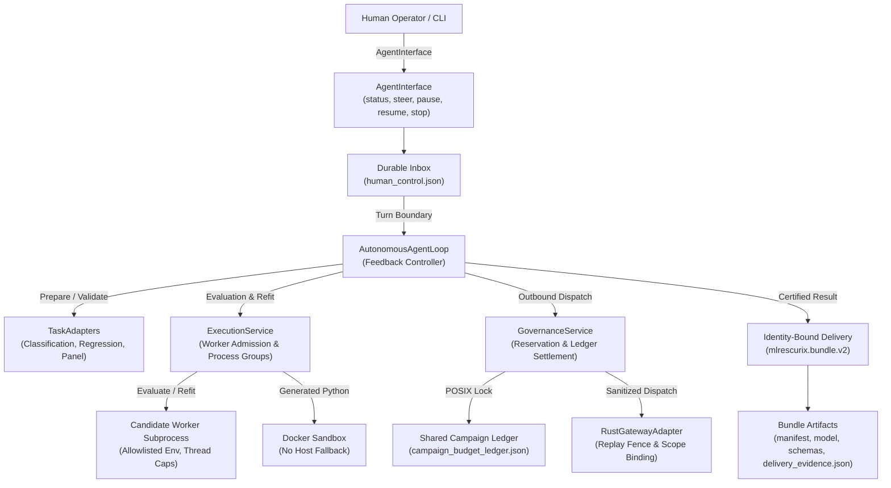

# MLRescurix Architecture Specification

This document specifies the governed dual-tier architecture of MLRescurix at the consolidation baseline (commit `441762f`). It consolidates and supersedes all prior preliminary architectural drafts and notes.

---

## 1. System Overview & Core Principles

MLRescurix is an autonomous, cost-aware machine learning harness designed to solve tabular and panel ML tasks under strict computational and financial constraints. It enforces an architectural boundary between:

1. **Authoritative Rust Control Plane (`crates/harness`)**: Owns state persistence (SQLite with WAL), capacity-based resource scheduling, process lifecycle isolation, cryptographic identity verification, and local API/observability.
2. **Scientific Python Worker Protocol (`mlrescurix_worker.scientific`)**: Owns statistical estimation, feature discovery, ablation, candidate modeling, cross-validation, and candidate packaging.

### Core Invariants

- **Single Dollar Authority**: A shared campaign ceiling of **USD 0.30** covers all tasks, sessions, retries, and uncertain outcomes across the entire campaign. Spend is governed by POSIX file locking (`fcntl.flock`) on a canonical ledger.
- **Strict Label Isolation**: Validation and test features are strictly segregated from target labels during feature engineering and candidate inference. Evaluator predictions determine official scores; self-reported script metrics are strictly advisory.
- **Identity-Bound Lineage**: Every delivered model bundle cryptographically binds source code, configuration, dataset hash, fold commitments, candidate specification, evaluation receipt, critic audit, and applied human steering commands.
- **Fail-Closed Verification**: Tasks with missing quality requirements (K1/K2 null thresholds) or missing provenance (K4 fold gaps) block before provider dispatch or budget reservation.

---

## 2. Core Architectural Components

The consolidation baseline unifies runtime execution into six cohesive components:

### 2.1 Feedback Controller: `AutonomousAgentLoop`

Implemented in [`python/src/mlrescurix_worker/scientific/autonomous_loop.py`](file:///Users/hamza/Developer/Imp_Projects/MLRescurix/python/src/mlrescurix_worker/scientific/autonomous_loop.py).

`AutonomousAgentLoop` is the single active controller. It iteratively selects actions from task context, measured evaluation history, and human guidance.

- **Iterative Turn Cycle**:
  1. *Dossier Formulation*: Generates a structured diagnostics summary on frozen development folds without leaking holdout labels.
  2. *Action Proposal*: Accepts a typed action payload conforming to Draft 2020-12 schema [`contracts/v2/hypothesis_action.schema.json`](file:///Users/hamza/Developer/Imp_Projects/MLRescurix/contracts/v2/hypothesis_action.schema.json).
  3. *Governed Execution*: Dispatches the action through allowlisted tools:
     - `HYPOTHESIS_TRANSFORM`: Fold-local feature mutations evaluated via paired ablation.
     - `EVALUATE_PORTFOLIO`: Measures out-of-fold cross-validation metrics across model families.
     - `BLEND_AND_AUDIT`: Evaluates weighted ensemble predictions against the authoritative critic.
     - `FINALIZE_AND_STOP` / `STOP_EARLY`: Completes the adaptive search.
  4. *Critic Audit*: Evaluates candidate metrics, generalization gap, and slice errors via `CriticEngine`.
  5. *State Checkpoint*: Atomically writes session progress to `autonomous_loop_state.json`.
- **Resource Observability**: Integrates `ProcessTreeSampler` to monitor resident set size (RSS) and CPU time of the active worker process tree. Uncontained host execution is explicitly labeled as `uncontained_host_process` rather than falsely asserting cgroup containment.

### 2.2 Task Adapters: `task_adapters.py`

Implemented in [`python/src/mlrescurix_worker/scientific/task_adapters.py`](file:///Users/hamza/Developer/Imp_Projects/MLRescurix/python/src/mlrescurix_worker/scientific/task_adapters.py).

Task adapters own scientific semantics, frozen data loading, topology configuration, calendar derivation, panel coverage validation, and candidate defaults. They contain **no provider, budget, or worker execution loops**.

- `ClassificationAdapter`: Manages binary and multiclass classification tasks (e.g. K1 Titanic, K3 Forest Cover). Enforces balanced accuracy or multiclass accuracy metrics, class ordering, and stratified split validation.
- `RegressionAdapter`: Manages continuous regression tasks (e.g. K2 House Prices). Handles target transforms (log/log1p), metric direction minimization, and scale inversion for inference.
- `PanelAdapter`: Enforces panel forecasting contracts under [`docs/v2/K5_PANEL_PROTOCOL.json`](file:///Users/hamza/Developer/Imp_Projects/MLRescurix/docs/v2/K5_PANEL_PROTOCOL.json) (e.g. K5 Store Sales):
  - Validates all 1,782 required entity tuples and complete observation calendars.
  - Enforces three exact 15-date forecast horizons across chronological origins.
  - Derives deterministic Gregorian calendar predictors (day of week, day of month, month).
  - Rejects lookahead leakage, unverified covariate backfilling, and missing entities.
- `BenchmarkAdapter`: Bridges task adapters to the standardized benchmark suite in [`docs/v2/BENCHMARK_SUITE.json`](file:///Users/hamza/Developer/Imp_Projects/MLRescurix/docs/v2/BENCHMARK_SUITE.json).

### 2.3 Execution Service: `ExecutionService`

Implemented in [`python/src/mlrescurix_worker/scientific/execution_service.py`](file:///Users/hamza/Developer/Imp_Projects/MLRescurix/python/src/mlrescurix_worker/scientific/execution_service.py).

`ExecutionService` manages execution lifecycles, admission, resource boundaries, and artifact collection for both trusted worker evaluations and isolated script executions:

- **Worker Admission**: Caps evaluations at 12 per session to prevent infinite search loops.
- **Integrity Validation**: Verifies source SHA-256 (`source_identity`) and development data hash against the session binding before executing any evaluation.
- **Process Group Isolation**: Spawns candidate workers (`candidate_worker.py`) in isolated process groups (`start_new_session=True`).
  - Thread caps: Enforces `OMP_NUM_THREADS=1`, `OPENBLAS_NUM_THREADS=1`, `MKL_NUM_THREADS=1`.
  - Environment allowlist: Passes only `PATH`, `SYSTEMROOT`, `LANG`, `TMPDIR`, and controlled `PYTHONPATH`.
  - Process cleanup: Terminates and reaps entire process groups via `os.killpg` on timeout or cancellation.
- **Docker Script Runner (`run_script`)**: Executes agent-generated Python scripts inside a bounded container (`mlrescurix-scientific@sha256:...`) with read-only workspace mounts and scratch tmpfs. Host execution fallback is strictly refused. Script metrics are advisory only.
- **Development Execution Notice**: Host worker execution is explicitly development execution; Linux cgroups, concurrent production isolation, and unavailable hardware measurements are not inferred from successful host subprocess runs.

### 2.4 Governance Service: `GovernanceService` & `CampaignBudgetAuthority`

Implemented in [`python/src/mlrescurix_worker/scientific/governance.py`](file:///Users/hamza/Developer/Imp_Projects/MLRescurix/python/src/mlrescurix_worker/scientific/governance.py).

The governance boundary enforces campaign spending limits, token admission caps, and provider response persistence:

- **Campaign Ledger Authority**: Preserves [`docs/evidence/v2/robustness/20261021-robustness/campaign_budget_ledger.json`](file:///Users/hamza/Developer/Imp_Projects/MLRescurix/docs/evidence/v2/robustness/20261021-robustness/campaign_budget_ledger.json) under `fcntl.flock`. Missing authority files fail closed rather than minting new allowances.
- **Reservation Bounds**: Calculates pre-dispatch reservation amounts using UTF-8 byte lengths as conservative token upper bounds, plus verified pricing ceilings.
- **Token Admission Ceiling**: Rejects runs exceeding 80,000 requested token bounds.
- **Three-Phase Dispatch Fencing**:
  1. `provider_dispatching`: Commits durable reservation under shared ledger lock.
  2. `provider_received`: Checkpoints provider response body before financial settlement.
  3. `provider_settled`: Settles reservation against calculated token rates. Interrupted settlements are reconciled from checkpoints, never resent.
- **Accounting Categories**: Distinguishes calculated estimates (`cost_is_estimate=true`) and unverified accounting from authentic provider invoices. Unused reservations on interrupted calls are marked `uncertain` rather than released.
- **Rust Gateway Adapter**: Live non-fixture dispatches require [`RustGatewayAdapter`](file:///Users/hamza/Developer/Imp_Projects/MLRescurix/python/src/mlrescurix_worker/scientific/rust_gateway.py), which enforces route matching (`deepseek/deepseek-v4.1-flash-1017` via authorized route `inference-net/fp8` or `deepinfra/fp8/flex`, no fallback) and content-bound operator approval.

### 2.5 Contract-Driven Benchmark Runner: `benchmark_runner.py`

Implemented in [`python/src/mlrescurix_worker/scientific/benchmark_runner.py`](file:///Users/hamza/Developer/Imp_Projects/MLRescurix/python/src/mlrescurix_worker/scientific/benchmark_runner.py).

`run_benchmark` replaces legacy task-specific control scripts with a single contract-driven lifecycle:

```mermaid
flowchart LR
    ValidateContract["1. Validate Contract\n(Policy & Thresholds)"] --> ValidatePricing["2. Validate Pricing\n(Provider Snapshot)"]
    ValidatePricing --> StageData["3. Stage Data\n(Hash-bound Dev CSV)"]
    StageData --> RunController["4. Governed Loop\n(AutonomousAgentLoop)"]
    RunController --> AuditCandidate["5. Critic Audit\n(Evaluation Receipt)"]
    AuditCandidate --> RefitCandidate["6. Refit Candidate\n(Dev Data Refit)"]
    RefitCandidate --> PackageBundle["7. Package & Verify\n(mlrescurix.bundle.v2)"]
```

- Public CLI interface: `scripts/run_robustness_campaign.py --mode live_dev --task K1|K2|K3|K4|K5`.
- Historical direct HTTP scripts (`run_kaggle_titanic_live.py`, `run_live_end_to_end_test.py`) fail closed before reading credentials.

### 2.6 Identity-Bound Evidence and Delivery

Implemented in [`python/src/mlrescurix_worker/scientific/evidence.py`](file:///Users/hamza/Developer/Imp_Projects/MLRescurix/python/src/mlrescurix_worker/scientific/evidence.py) and [`crates/harness/src/bundle.rs`](file:///Users/hamza/Developer/Imp_Projects/MLRescurix/crates/harness/src/bundle.rs).

Delivered models are packaged into self-contained distributions conforming to format `mlrescurix.bundle.v2`:

- **Complete Contract Manifest (13 Files)**:
  1. `manifest.json`: Bundle specification, task type, target, metric, and file index.
  2. `metadata.json`: Source commit, build environment, hardware characteristics.
  3. `environment.json`: Python version, operating system, and container metadata.
  4. `entrypoint.py`: Standalone CLI execution contract (`fit` and `predict`).
  5. `model_schema.json`: Input feature types, missing value policies, and decision thresholds.
  6. `data_contract.json`: Input schema and column constraints.
  7. `tolerances.json`: Numerical tolerances for export verification.
  8. `frozen_model.joblib`: Trained estimator pipeline weights.
  9. `model.safetensors`: Zero-pickle model weights (where supported).
  10. `scorecard.json`: Official cross-validation evaluation scorecard.
  11. `test_receipt.json`: Evaluation and audit receipt hashes.
  12. `security_attestation.json`: Tamper-evident hash manifest.
  13. `README.md`: Standalone usage guide.
- **`delivery_evidence.json`**: Included in bundle manifests, recording:
  - Source code SHA-256 (Rust control plane and Python worker).
  - Pinned dataset and split manifest SHA-256.
  - Evaluator specification and result receipts.
  - Critic audit receipt identity.
  - Serialized model digest.
  - Applied human control command IDs and guidance.
  - Trace event digests and provider request IDs.
- **Standalone Serving**: Includes standalone CLI inference (`inference.py`) and zero-dependency HTTP server (`serve.py`) exposing `/health` and `/predict` endpoints.
- **Tamper Detection**: Verified by `mlrescurix-harness verify-bundle`. Any modification to files or hashes triggers immediate rejection.

---

## 3. Trust Boundaries & Security

| Surface | Trust Level | Enforcement Mechanism |
|---|---|---|
| **Evaluator / Scorer** | Trusted | Internal Python kernel in isolated process group; labels withheld from candidate code. |
| **Candidate Code** | Untrusted | Executed in isolated process groups with thread caps, memory limits, and no target column during inference. |
| **Generated Python Scripts** | Untrusted | Docker sandbox only (`/workspace:ro`, `/scratch:rw`, no network, dropped Linux capabilities). Self-reported metrics are advisory only. |
| **Outbound Provider Gateway** | Governed | `OutboundFilter` redaction + independent operator approval command (`approve-outbound-view`). Controller cannot self-approve. |
| **Human Control Interface** | Session-Bound | Bounded inbox (`human_control.json`) under `.human_control.lock`. Cannot alter budgets, frozen contracts, or upload approvals. |

---

## 4. Preserved Historical Evidence & Contracts

The following records are authoritative and must never be deleted, modified, or regenerated:

- [`docs/evidence/v2/robustness/20261021-robustness/campaign_budget_ledger.json`](file:///Users/hamza/Developer/Imp_Projects/MLRescurix/docs/evidence/v2/robustness/20261021-robustness/campaign_budget_ledger.json): Preserved ledger with byte-identical SHA-256 `827abd984dd960f91cd39725d7dcbdb78d47c114322a0358cbbb08a5b30d0b52`.
- [`docs/v2/BENCHMARK_SUITE.json`](file:///Users/hamza/Developer/Imp_Projects/MLRescurix/docs/v2/BENCHMARK_SUITE.json): Benchmark suite policy and frozen split commitments.
- [`docs/v2/K5_PANEL_PROTOCOL.json`](file:///Users/hamza/Developer/Imp_Projects/MLRescurix/docs/v2/K5_PANEL_PROTOCOL.json): Complete panel forecasting protocol for K5 Store Sales.
- [`docs/evidence/**`](file:///Users/hamza/Developer/Imp_Projects/MLRescurix/docs/evidence): Historical test and campaign evidence.
