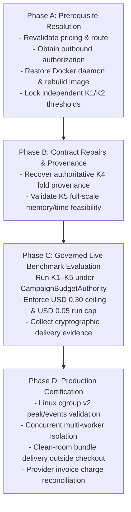

# Current Status and Robustness Roadmap

This document records the verified implementation status, authoritative financial ledger, unresolved blockers, and remaining roadmap for MLRescurix as of the architecture consolidation baseline (commit `441762f`, 2026-10-23).

---

## 1. Executive Summary & Baseline Position

- **Baseline Commit**: `441762f` ("Consolidate governed agent architecture and human control interface").
- **Current Position**: Governed architecture consolidation and common human control interface are **fully implemented and verified offline**.
- **Certification State**: MLRescurix is **NOT CERTIFIED FOR PRODUCTION**. Offline test passes establish architectural wiring, identity tracking, and boundary enforcement; they do **not** certify production clean-room delivery, cgroup containment, or five-task benchmark quality.

---

## 2. Authoritative Campaign Accounting Ledger

The JSON campaign ledger is the single dollar authority across the entire repository. Its values and exact bytes are permanently preserved:

- **Ledger Path**: [`docs/evidence/v2/robustness/20261021-robustness/campaign_budget_ledger.json`](file:///Users/hamza/Developer/Imp_Projects/MLRescurix/docs/evidence/v2/robustness/20261021-robustness/campaign_budget_ledger.json)
- **SHA-256 Digest**: `827abd984dd960f91cd39725d7dcbdb78d47c114322a0358cbbb08a5b30d0b52`
- **Total Campaign Ceiling**: **USD 0.30** (Shared across all tasks, sessions, retries, and uncertain outcomes; **not** a per-problem allowance).
- **Per-Run Main Cap**: **USD 0.05** (USD 0.05 contingency reserved).
- **Cumulative Committed Spend**: **USD 0.050724020** across 29 historical runs (56 local turn records).
- **Recorded Remaining Budget**: **USD 0.249275980** (83.09% remaining).
- **Consolidation Baseline Spend**: **USD 0.00** (Zero paid provider calls, zero additional spend, zero holdout scoring).

> [!IMPORTANT]
> **Estimates vs Invoices**: Historical ledger entries and Rust gateway receipts marked `cost_is_estimate=false` represent **price-derived calculated estimates** using registered token rates and rounding; they are **not verified provider invoices**. Genuine provider charge reconciliation remains blocked pending authentic provider billing receipts.

---

## 3. Implemented & Verified Capabilities

The following components are implemented, tested, and grounded in source inspection:

1. **Unified Feedback Controller (`AutonomousAgentLoop`)**: Single multi-turn loop executing schema-validated actions (`hypothesis_action.schema.json`), logging process-tree RSS/CPU telemetry, and checkpointing progress to `autonomous_loop_state.json`.
2. **Pure Scientific Task Adapters (`task_adapters.py`)**: `ClassificationAdapter`, `RegressionAdapter`, and `PanelAdapter` owning topology configuration, frozen development data staging, panel coverage verification, and candidate defaults. Contain zero provider or budget code.
3. **Execution Service (`ExecutionService`)**: Governs candidate worker lifecycles, bounds evaluation turns ($\le 12$), enforces process group isolation with thread caps (`OMP_NUM_THREADS=1`, `OPENBLAS_NUM_THREADS=1`, `MKL_NUM_THREADS=1`), and executes generated scripts in a Docker-only sandbox with no host fallback.
4. **Governance Boundary (`GovernanceService` & `CampaignBudgetAuthority`)**: Single transactional spending gate under `fcntl.flock`, enforcing conservative byte-upper-bound token reservations, 80K token caps, 3-phase durable dispatch fencing (`dispatching` $\to$ `received` $\to$ `settled`), and uncertain liability tracking.
5. **Contract-Driven Benchmark Runner (`benchmark_runner.py`)**: Unified lifecycle across K1–K5 tasks. Fails closed before budget reservation if scientific contracts or provider pricing snapshots are invalid.
6. **Common Human Control Interface (`AgentInterface`)**: Status inspection, steering, pause, resume, and stop operations via durable inbox (`human_control.json`) and independent lock (`.human_control.lock`). Consumed at safe turn boundaries.
7. **Identity-Bound Evidence & Delivery (`evidence.py`)**: Standalone `mlrescurix.bundle.v2` distribution with all 13 contracts and `delivery_evidence.json` cryptographically binding source SHA-256, data hash, fold hash, candidate spec, evaluation receipt, audit receipt, and applied human commands.
8. **Embedded Runtime Dependency Closure (`assets.rs`)**: Standalone embedded Python files materialized and verified outside the git checkout (`installed_runtime_supports_common_controller_and_human_interface_without_checkout` passed).

---

## 4. Explicit Unresolved External Blockers

The following scientific, environmental, and contractual blockers remain open and must be explicitly retained:

1. **K1 Final Partition Contamination & Ticket Overlap**:
   - The 178-row final partition was evaluated in historical exploratory runs (`run_20261021_172942` and `run_20261021_173653`) after an initial target-leakage defect.
   - The generated K1 manifest has 18 shared `Ticket` values across development and holdout rows.
   - Staging cannot retroactively restore clean final status; K1 results remain exploratory only.
2. **K1 & K2 Missing Absolute Quality Thresholds**:
   - Independent, absolute quality requirements for K1 (Titanic) and K2 (House Prices) are absent from the master policy; thresholds remain `null`.
   - The benchmark runner deterministically blocks further search until domain owners independently freeze absolute thresholds.
3. **K4 Missing Fold Provenance & Gaps**:
   - Authoritative index-space declarations, prediction-context gaps/units, per-origin training bounds, and complete subset mapping are missing from the K4 manifest.
   - Execution remains blocked; silent fold reconstruction or inferred gaps are strictly forbidden.
4. **K5 Unverified Full-Scale Feasibility & Quality**:
   - The source-bound entity and observation calendar protocol is frozen ([`docs/v2/K5_PANEL_PROTOCOL.json`](file:///Users/hamza/Developer/Imp_Projects/MLRescurix/docs/v2/K5_PANEL_PROTOCOL.json)) with all 1,782 entities, exact 15-date horizons, complete observation calendars, and deterministic Gregorian calendar predictors only.
   - Full-scale resource feasibility (memory/time across 2.9M+ training rows) and repaired-revision model quality remain unverified.
5. **Absence of Provider Charge Invoices**:
   - Actual provider invoices and charge receipts are absent. Local ledger amounts cannot be promoted to verified billing.
6. **Future Live Outbound Authorization & Pricing Verification**:
   - Future live calls require explicit independent operator approval (`approve-outbound-view`) and current route availability/pricing verification.
   - Endpoint is pinned strictly to `deepseek/deepseek-v4.1-flash-1017` via OpenRouter `inference-net/fp8` with no fallback.
7. **Docker Daemon Unavailability & Container Image Dependency Gaps**:
   - The Docker daemon is currently unreachable on this development host; the Rust scheduler recovery fixture fails container admission as expected.
   - The cached historical scientific image (`mlrescurix-scientific@sha256:d094b6be...`) lacks `jsonschema==4.26.0` and `psutil==6.1.1` Linux wheels, preventing in-container bounded tmpfs pipeline tests.
8. **Production Certification Deficits**:
   - Full campaign production scheduling, per-job Linux cgroup v2 measurements, concurrent sibling isolation, fault/soak testing, and clean-room delivery remain unverified by offline test suites.

---

## 5. Precise Validation Record

Validation counts from [`docs/evidence/v2/autonomy/20261023-architecture-consolidation/summary.json`](file:///Users/hamza/Developer/Imp_Projects/MLRescurix/docs/evidence/v2/autonomy/20261023-architecture-consolidation/summary.json):

- **Full Python Suite**: **325 passed, 2 skipped, 10 warnings** (220.03s), run before final source guards.
- **Final Affected Python Suite**: **105 passed** (50.17s), including 18 new architecture regressions and final source-binding guards.
- **Rust Lib & Integration Suite**: **63 passed, 2 ignored, 1 filtered** (~67s). The filtered Docker-dependent scheduler fixture was first attempted and failed admission; its log is retained in `rust-docker-blocker.log`.
- **Installed-Runtime Recheck**: **1 passed** (3.21s), exercising controller creation and human interface outside the git tree.
- **Static Checks**: Python `compileall` passed; `cargo build --locked --offline` passed.

---

## 6. Phased Roadmap to Production Certification

The remaining roadmap toward production certification is structured into four sequential phases:

### Phase A: Prerequisite Resolution & Environment Restoration
- Revalidate OpenRouter endpoint pricing and route availability (`deepseek/deepseek-v4.1-flash-1017` on `inference-net/fp8`).
- Restore Docker Desktop daemon on the execution host.
- Rebuild the scientific container image with Linux wheels for `jsonschema==4.26.0` and `psutil==6.1.1` to pass `pip check`.
- Domain owners independently freeze absolute quality thresholds for K1 and K2.

### Phase B: Contract Repairs & Provenance
- Ingest authoritative fold index space and temporal prediction-context gaps for K4 (IEEE-CIS Fraud).
- Execute memory and compute feasibility profiling on the complete 1,782-entity K5 Store Sales panel protocol.

### Phase C: Governed Live Benchmark Evaluation
- Execute live development runs across K1–K5 using `scripts/run_robustness_campaign.py --mode live_dev --task <ID>`.
- Enforce the USD 0.30 campaign ceiling and USD 0.05 per-run cap.
- Collect complete `delivery_evidence.json` and verify candidate bundles via `mlrescurix-harness verify-bundle`.

### Phase D: Production Certification
- Execute multi-job scheduler stress tests with Linux cgroup v2 memory tracking (`memory.peak`, `cgroup.events`).
- Execute clean-room bundle inference and zero-dependency HTTP serving tests outside repository checkouts.
- Ingest authentic provider billing invoices and execute final accounting reconciliation.
