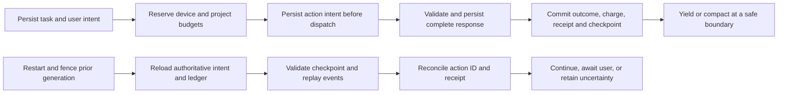

# M0 durable foundation

M0 is a local Rust ledger and a small Python protocol package. The Rust runtime owns durable project and task state, command receipts, event ordering, budgets, leases, checkpoints, and action reconciliation. Python only decodes bounded JSON frames and has no NumPy, pandas, estimator, provider, or training dependency.

## Recovery flow



A checkpoint stores contract and intent revisions, role and prompt identity, branch code hashes, event cursor, evidence/artifact references, pending questions and action/job handles, and its next safe action. It stores no hidden chain of thought or authoritative budget snapshot. The ledger remains authoritative. The runtime retains four checkpoints per task. A damaged latest checkpoint or dangling reference blocks restoration explicitly; an operator must repair state from a known valid backup or use a future recovery tool. M0 does not silently roll back events or charges.

Actions move through `prepared`, `dispatched`, `responded`, `outcome_unknown`, `succeeded`, `failed`, or `cancelled`. Prepared means not sent, so restart can close it without a charge. A dispatched action without a saved response becomes uncertain on restart and retains budget and capacity reservations. A complete validated response is persisted before a commit and is available to reconciliation. A task cannot dispatch another mutation while an earlier action remains unresolved. The local reconciliation command records its proof and actual charge; actual overspend is retained and blocks future admission. External exactly-once execution or billing is not promised.

Generation and lease ID fence stale task owners. A project intent change invalidates affected tasks; evidence-only sibling work can remain available until a project-wide steering change fences it. Timers carry task generation, project revision and a stable delivery key. Restart updates a pending timer's generation when its task intent remains current, then processes overdue timers once. Timer delivery never answers a user question or grants approval.

## Storage and bounds

`Runtime::init` creates a new, empty directory and writes an ownership marker. `Runtime::open` rejects unmarked directories, symlink state files, unknown schema versions and failed SQLite integrity checks. It does not adopt an existing directory. SQLite uses WAL, `synchronous=FULL`, foreign keys, a two-second lock wait, and one in-process writer thread with a 64-request queue. Queue saturation returns backpressure. JSON frames are capped at 64 KiB; command input and checkpoints share that limit. Event reads return at most 256 records per page. The database must be on a local filesystem supported by SQLite WAL.

Budget and capacity amounts use named integer dimensions selected by the configured policy. Each reservation must include every configured dimension. Reservation updates happen in one immediate transaction across device and project scopes. Charges remain separate from held reservations; expired ownership never means zero cost. These M0 ledgers model admissions but do not enforce CPU, memory, disk or wall-time use.

M0 does not compact the durable event/receipt ledger or impose a database disk quota. Keep test databases disposable. Bounded database retention, disk admission, owned artifact cleanup, and worker termination are later work; a full disk causes a visible SQLite error before the caller receives an applied receipt.

## CLI

Build with `cargo build --workspace --locked`. Initialize only a fresh path:

```sh
cargo run -p mlrescurix-harness -- init --state /absolute/new/path --policy policy.json
cargo run -p mlrescurix-harness -- capabilities
cargo run -p mlrescurix-harness -- command --state /absolute/new/path --request command.json
cargo run -p mlrescurix-harness -- snapshot --state /absolute/new/path --project project-id
cargo run -p mlrescurix-harness -- events --state /absolute/new/path --project project-id --after 0
cargo run -p mlrescurix-harness -- restore --state /absolute/new/path --project project-id --task task-id
```

`policy.json` provides device budget and capacity maps plus `max_tasks`. `CreateProject` carries a separate project policy. State changes use durable command IDs and return stored receipts; duplicate IDs with the same project and payload return the original receipt. A reused ID with a different request is an error. `Lifecycle` supports `created`, `paused`, and `cancelled`; M0 deliberately has no completion, score publication, or model finalization command.

## Verification

The shared corpus in `contracts/v1/fixtures` is consumed by Rust and Python. It covers valid hello, observation and checkpoint messages, plus bad versions, IDs, UTF-8 lengths, numeric types/ranges, missing fields, unknown fields, fake scores, and fake finalization claims. Integration tests use temporary state and subprocess exits after intent, dispatch, validated response and commit. A fake observation cannot publish an official score or finalize a model.

Run:

```sh
CARGO_HOME=/private/tmp/mlrescurix-m0-cargo cargo test --workspace --locked
PYTHONPATH=python/src python3 -m unittest discover -s python/tests -v
```

The cargo cache override is only needed on a host where the default Cargo cache is outside the writable workspace. It leaves global Python environments untouched.

## Limits at the M0 boundary

M0 itself has no live provider, autonomous agent loop, supervised worker, scientific training/evaluation, or dashboard. M1 adds a trusted typed-probe supervisor and owned storage lifecycle; its limits are documented in [docs/m1-execution-storage.md](m1-execution-storage.md). `Resolve` is a local administrative reconciliation input; M0 does not verify an external provider's receipt cryptographically. SQLite WAL and `synchronous=FULL` provide the configured local transaction durability subject to filesystem and hardware behavior, and do not make a disk failure recoverable. The Python package validates protocol messages only.

A policy file uses integer counts with unit names embedded in keys. For example:

```json
{"budget":{"calls":100,"tokens":50000},"capacity":{"workers":3},"max_tasks":100}
```

Project policies use the same shape. A real deployment should choose meaningful per-project and device limits; these example values are only protocol examples.
