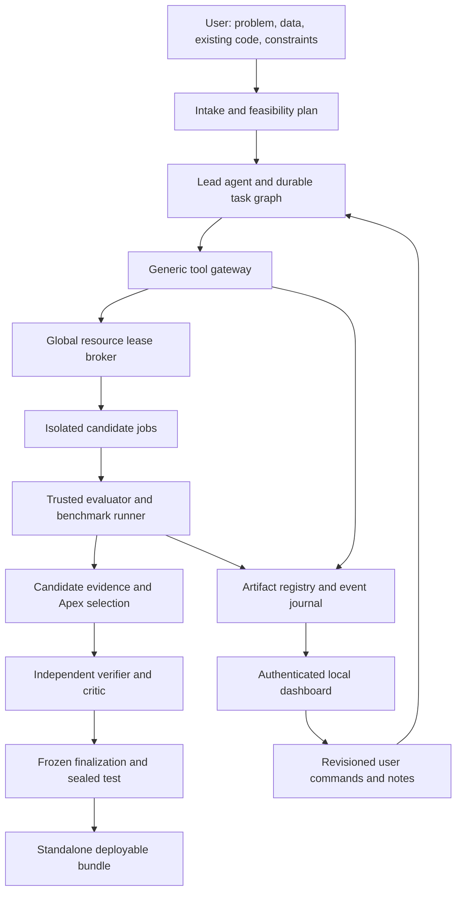

# Target architecture and contract requirements

Status: proposed implementation contracts, 2026-10-14. Names below are design
targets, not existing commands or generated schemas. Implement versioned schemas
and cross-language fixtures in the phase that owns each contract.

Contract ownership includes `contracts/v1/`, `scripts/generate_contracts.py`,
`crates/harness/src/contracts.rs` and the Python protocol validators. The existing
generator writes the v1 worker frame schema and fixture corpus; it does not generate
every Rust type or scientific schema. Extend generation/checking for new contracts
under an explicit version (for example `contracts/v2/`) without rewriting v1 meaning.
Change worker frames only when transport semantics require it, and keep supported
old frames/fixtures stable through the compatibility window.

## Ownership and flow



Rust owns identity, authorization, lifecycle, admission, budgets, durable receipts,
artifact publication, official-result registration, event ordering and delivery
gates. Python owns data/ML computation and evaluator implementations in an isolated
trusted evaluator scope. Candidate code never shares label access or mutation
authority with that evaluator. Agents own hypotheses and code choices; their
claims remain proposals until deterministic checks accept their evidence.

“Deterministic” applies to state transitions, input binding, receipts and admission.
Model training/LLM reasoning may vary; record seeds, environment/device identities
and numerical tolerances. Identical hashes do not promise cross-device equality.

## Agent-first autonomous harness vs. prescriptive scripts

MLRescurix is an **agent-first autonomous coding and discovery harness**, not a library of rigid AutoML scripts:

1. **Unbounded Agent Synthesis Freedom**:
   - The autonomous agent is the primary machine learning engineer. It possesses full authority to generate, mutate, and refactor arbitrary Python code (`candidate/entrypoint.py` and modular source trees).
   - The agent is free to explore arbitrary modeling strategies: bespoke PyTorch/JAX networks, LightGBM/CatBoost ensembles, complex multi-stage feature engineering, custom loss functions, and hybrid pipelines.
   - The harness must never constrain the agent to a hardcoded menu of algorithms or force candidate models into prescriptive execution pipelines.

2. **Deterministic Primitives, Not Prescriptive Rails**:
   - Specialized adapters (e.g. out-of-core Arrow chunking, temporal split validation, frozen embedding caches) exist strictly as **optional low-level primitives and guardrails** in the agent's toolbox.
   - These primitives solve hard mechanical failure modes that LLMs struggle with (such as temporal lookahead leakage, host OOMs, and uncertified remote downloads), but they never dictate candidate model architecture.

3. **The Harness as Secure Operating System and Objective Referee**:
   - The harness operates as an operating system (cgroup v2 resource limits, container leases, crash recovery, CAS artifact store) and an objective referee (`evaluate_submission`, sealed test sets, cryptographic scorecards).
   - The harness guarantees that the agent cannot cheat, leak holdout labels, or crash host infrastructure, while leaving the agent completely free to invent, test, and iterate on solutions.

## Artifact registry

Use additive migrations and retain M6 scientific records during transition.

The existing 128 MiB policy covers managed state, not just SQLite/control metadata.
P1 first enforces that policy across all covered writes. A proposed versioned policy
then introduces separate control-state, artifact CAS, staging/export and environment
quotas at project/global scope, with shared device disk limits and recovery headroom.
Explicitly migrate accounting and limits before placing large weights outside the
old cap. Merely renaming the old ceiling `control_state_bytes` is not preservation.

| Entity | Required data and responsibility |
| --- | --- |
| Blob | SHA-256, verified bytes, owned CAS path, media type; immutable content |
| Artifact | Project-scoped logical ID, kind, producer identity/authority, current version, pins, visibility, tombstone |
| Artifact version | Immutable version ID, blob reference, compact index digest, bounded detailed summary, schema version, source/environment/job bindings |
| Lineage edge | Project-scoped source/destination version IDs and relation: derived_from, evaluates, packages, supersedes |
| Annotation | User/agent note, author, revision, referenced artifact version; never edits an official score |
| Selection | Project revision, candidate and scorecard version, protocol, rationale; unique current Apex pointer |
| Event | Monotonic cursor, project, type/version, committed revision and bounded payload/reference |

Kinds initially cover data profiles, research notes, code, run logs/curves,
diagnostic specs, predictions, scorecards and Apex bundles. Validate payloads with
versioned kind schemas; keep extensions namespaced rather than another permanent
SQL enum bottleneck. Directory artifacts use canonical manifests of file hashes;
validate paths, symlinks, file count and aggregate size before committing.

CRUD means create immutable version, read/query/lineage, update annotations or
publish successor version, and tombstone an unprotected record. Delete never
rewrites lineage, score history, consumed assessments or retry fences. Pinning
controls retention; baseline designation controls comparison; neither crowns Apex.

Publication protocol: acquire byte reservation -> write bounded staging -> hash
and fsync -> atomically publish owned bytes -> commit registry plus event -> settle
reservation. Filesystem and SQLite are not one transaction: reconcile staged files,
orphan blobs and incomplete publication receipts on restart. GC marks references
and leases, tombstones, deletes owned unreferenced bytes, then records completion.
Cross-project deduplication must not expose another project's data or retention.

Agents and UI use the same command service. Official scorecards are writeable only
by evaluator authority; claimed agent metrics are explicitly unofficial. Queries
are paginated, summaries default to <=4 KiB, and raw logs require explicit bounded
retrieval. Privacy/redaction policy applies before notes/plots enter provider views.

List/leaderboard/context injection uses a proposed `index_digest` <=512 UTF-8 bytes;
detailed `summary_text` <=4 KiB is fetched on demand. Bytes are storage bounds, not
token guarantees: measure tokens and cap total query output separately. Apply
typed outbound projection, approved-view policy and `gateway.rs::OutboundFilter`
before provider dispatch. The current heuristic filter cannot guarantee removal of
all secrets/private records. Bind prompt approval, hashing and accounting to the
actual serialized outbound payload; validate tool JSON and required state after
sanitization so truncation/redaction cannot corrupt tool-call history silently.

## Coding tools and candidate boundary

Expose four versioned tool families, backed by existing operations where possible:

| Tool | Contract |
| --- | --- |
| `workspace_fs` | Scoped read/write/patch/glob/search; expected content hash for mutations; bounded results; reject path and symlink escapes |
| `sandbox_exec` | Prefer structured argv; explicit shell mode for agent scripts; approved environment, task generation, lease, deadline, output/scratch caps, durable receipt |
| `evaluate_submission` | Register candidate and bound prediction artifact; locked metric/split; trusted validation and benchmark receipts; adaptive-query budget |
| `artifact_crud` | Project-scoped publication/query/version/lineage/pin/tombstone; expected revision and reservation; no official-score forgery |

Keep governed orchestration controls: delegate, inspect status, complete subtask,
pause/cancel/resume, steering and request finalization. No sandbox tool may run
directly without a broker lease. Retain registered project tools as optional
reusable descriptors calling the same gateway rather than an independent runner.

Candidate v2 is an executable directory plus manifest. The manifest binds source,
training environment, inference environment, input/output schemas, task type,
supported operations, seeds and declared resource request. Example target:

```text
candidate/manifest.json
candidate/entrypoint.py
candidate/source/...
training.lock
inference.lock
```

```sh
python -m candidate.entrypoint fit --train-path /inputs/train.csv --model-dir /outputs/model
python -m candidate.entrypoint predict --input-path /inputs/features.csv --model-dir /inputs/model --output-path /outputs/predictions.csv
```

The harness provides immutable fit data, feature-only prediction inputs, stable row
IDs and class order. Predictions must bind row IDs, candidate/source/model hash,
split fingerprint and protocol; reject missing/extra/duplicate rows, bad dimensions,
NaNs, invalid probabilities and class-order mismatches. Prediction fit state and
official benchmarks refer to the same immutable candidate/model bytes.

Mount only one task's scoped inputs, source and outputs; never mount shared state,
evaluator labels, other branches, credentials or Docker socket. Export changes
through validated publication. Legacy models and pickle files are untrusted code;
inspect/load only inside the candidate sandbox. No runtime `pip install`: approved
locked environments are prepared as separately budgeted jobs before offline fitting.

Default execution uses immutable `/workspace:ro` and task-specific bounded
`/scratch:rw` and `/outputs:rw`; source mutations go through `workspace_fs`.
An explicit staged writable workspace/overlay is optional, with its diff validated
before commit to the branch. Candidate development and official prediction use
the same approved digest-pinned training profile; a distinct inference profile
must be bound and verified for delivery. A read-only mount alone does not authorize
retry: prior publication, evaluator queries, persistent caches and surviving
containers still require reconciliation before resetting disposable output.

Harness-owned CV execution freezes source/config and materializes only each fold's
training rows/labels plus feature-only held-out rows for isolated fit/predict jobs.
Do not mount every fold's training directory together: other folds contain this
fold's held-out labels. Carry only that fold's verified fit artifact to prediction;
block cross-fold writable caches and reused trained weights. Independent scoring
checks row/model/source/split identity and produces authoritative OOF provenance.

The coding agent may already have inspected the full development training labels.
Per-fold mounts prevent accidental shared preprocessing and direct held-label reads
in each run; they cannot prove an agent did not encode remembered labels in source.
Record label exposure and review source/data provenance. Treat development OOF
results accordingly; untouched outer validation/final-test boundaries remain needed
for independent assessment. Newly exposed holdouts are not retroactively independent.

Calibration consumes row/class-aligned OOF prediction tables and training labels;
ensembles use verified parent prediction/model manifests instead of importing their
code into the label-bearing evaluator. Keep composite inference isolated and count
all parent costs. Stacking/calibration training data is distinct from evaluation:
use separate outer validation or properly nested cross-fitting, never report scores
on labels used to fit the combiner as independent evidence. Extend recipe-specific
`scheduled_pipeline.py` and `search/adapter.py` with candidate prediction/search-space
adapters; `calibration.py` already accepts OOF arrays and need not become a universal
estimator class.

Returned validation diagnostics enforce configurable minimum slice support,
coarsening and a shared query budget. Count overlapping/adaptive queries, fidelity
levels and duplicate submissions according to the locked protocol. A minimum group
size alone does not prevent differencing attacks or guarantee privacy; never expose
row-level sealed residuals, and bound the total diagnostic information released.

Rescue distinguishes repaired unfitted source from a supplied pretrained artifact.
A pretrained baseline defaults to `unverified_legacy_baseline` until training/data
provenance supports assessment on an untouched disjoint holdout. Clean refit rebuilds
preprocessing, learned state and weights from permitted training rows; warm-starting
old weights is not a clean refit. User attestations are recorded with uncertainty,
not treated as cryptographic proof of disjointness. If evaluation rows were already
used for development, refitting does not restore their independent-test status.

## Resource broker and execution

Lease fields: project/task/job, generation, backend and device, CPU millicores,
library threads, memory limit/reservation, accelerator units/bytes where supported,
scratch/output bytes, PID cap, deadline, heartbeat and environment hash. Persist
reserve/start/finish/reconcile transitions; terminate and reap before release.

Label Docker containers with harness/state-root owner identity, project, lease and
generation, and persist the exact container ID. Startup discovers daemon-side
survivors even when the CLI client died. Verify ownership and current lease epoch
before adopting or terminating a survivor; do not blindly kill every labeled
container, as another live supervisor may own it. Collect terminal telemetry,
confirm container removal/descendant exit and only then release its reservation.

Use capacity accounting for instantaneous CPU/RAM/GPU/storage and cumulative
accounting for time/tokens/cost. Start with weighted fair queues, per-project limits
and aging; add dominant-resource fairness only when multi-resource traces justify
its complexity. Suspend new admissions under pressure. Do not kill a training job
for fairness unless it explicitly supports resumable checkpoint/preemption.

Available capacity is the constrained runner/device budget minus configurable
headroom, warm-worker overhead and active reservations. Docker VM limits matter on
macOS. MICRO/STANDARD/HEAVY are configurable request presets, not universal truth.
Fractional CPU jobs normally use one library thread; integral leases cap BLAS,
OpenMP, Polars and estimator-specific jobs. Nested CV/HPO parallelism shares the
same allocation. Fifty jobs can queue; actual dispatch satisfies aggregate limits.

Backend capability reports distinguish enforcement, telemetry and certification.
Record per-job memory.max/peak/events and measurement scope on supported Linux
cgroups. An OOM is a failed trial; missing measurements cannot pass a required
constraint. Training peak, inference peak and warm worker overhead are separate.
Metrics collector is trusted and candidate-write-protected. Initially retain
one disposable container per job; pooling is a later measured optimization.

## Durable agents, recovery and memory

Default roles: lead, data/diagnostics, experiment engineer, independent verifier,
critic. Estimator combines deterministic hardware/pilot evidence with agent task
interpretation. Specialist roles are capabilities, not five always-running LLMs.
Keep deterministic verifier separate from an advisory/binding-policy critic.

Task contract: goal, falsifiable hypothesis, immutable inputs, allowed tools,
branch ownership, limits, expected artifacts, acceptance criteria and dependency
IDs. Completion receipt: verdict, experiment/candidate/source IDs, measured metric
delta and protocol, failures, bounded learnings and next actions. Enforce receipt
schema before updating the lead's memory. Invoke research/critic specialists only
when uncertainty or a milestone justifies their cost. External research requires
approved egress and content provenance; training remains offline.

Provider turn ledger binds canonical request, model/settings, prompt/policy/tool
versions, dispatch identity, raw response and usage settlement. Persist the response
before executing tools. Crash before response persistence may leave unknown billing;
reconcile provider evidence when available and refuse to claim exactly-once billing.

Classify tools: pure read, transactional command, isolated replayable job,
reconcilable external operation, irreversible operation. Store intent before effects
and result before context update. Unknown outcomes reconcile using job/command/blob
receipts; never reset-and-replay arbitrary shell effects. Finalization stays tied
to its original frozen artifact; exposed assessment cannot be recreated by retry.

Pause stops admission and checkpoints at a safe boundary. Cancel fences tasks and
terminates descendants; restart discovers surviving containers/processes and leases.
Resume loads authoritative state and the unfinished operation, not a reconstructed
conversation guess. Latest steering changes intent revision and invalidates stale
worker proposals. Lost workers, paused projects and failed projects remain distinct.

Context policy: default approximately 16K total window when supported; maximum
64,000 or provider's smaller window. Count system/messages/schemas/tool results plus
response allowance. Suggested upper-window allocations: 4K pinned state, 12K bounded
milestone summaries, 32K active work, 8K response, 8K schemas/overhead/safety margin.
Unused portions are optional capacity, not required padding. Trigger compaction
before the next request exceeds its budget. Use exact tokenizer where available;
otherwise a conservative bound and an explicit unsupported hard-guarantee report.

Preserve full constraints, newest user steering, Apex/protocol identity, current
leases/tool pairs, unresolved failures and final-test status. Full logs live in
artifacts; provide bounded excerpts and IDs. Summaries are cached with input hashes,
versioned and recoverable; they are never official scientific evidence.

## API and transparent dashboard

Serve loopback Rust API and static UI. Preserve authentication, Host/Origin checks,
CSRF protection for cookie-authenticated mutations, expected revision and idempotent
command IDs. Reuse current `/v1` contracts or add explicit version negotiation;
avoid an accidental `/api/v1` break. Stream durable events after commit with SSE
cursor IDs and Last-Event-ID replay. Snapshot includes revision and cursor; expired
cursors trigger a new snapshot. Disconnect slow readers without blocking writers.
Transient telemetry can be coalesced; terminal state/selection events remain durable.

Five views: experiment DAG with actual running/pruned/failure states; leaderboard
with feasibility and Pareto alternatives; data/model diagnostics with sample counts
and provenance; research feed with hypothesis, evidence and critic notes; resource
drawer with allocated/measured CPU/RAM, leases, queue waits and backend capacity. Queued,
running, screening, validated and final verified states must be visually distinct.
Animation follows receipts, never invents progress or hides waiting for resources.
Use accessible status text, reduced-motion support, virtualization and safe markdown
rendering. Treat plot specs as data; reject executable JS/HTML and remote loads.

User notes/edits become revisioned artifacts/commands. Agents receive a bounded
steering delta at safe boundaries. Downloads verify authorization and immutable
manifest identity. Readers use bounded snapshots/transactions, not a transaction
held open for the lifetime of an SSE connection.

## Delivery and expansion

Freeze candidate, environment, selection and approvals; refit within reserved budget;
reload and certify the exact pipeline; consume sealed test once; package matching
weights, inference CLI/API, schemas, locks, training source, scorecard, model card,
lineage and verification receipts. An optional container/service recipe follows;
live hosting is separately authorized. No final verified label for missing evidence.

TaskAdapter specifies input/schema/split protocol, fit/predict/evaluate operations,
constraints and packaging. Begin with tabular supervised; extend to time-series,
anomaly/clustering, frozen text embeddings and small fine-tuning individually.
Remote RunnerAdapter preserves the same lease/result/artifact contracts. Transfer
policy explicitly controls data/labels/secrets, bytes, cost and shutdown. Sealed
assessment remains local when feasible; a trusted remote evaluator requires its
own explicit threat model and acceptance gate.
