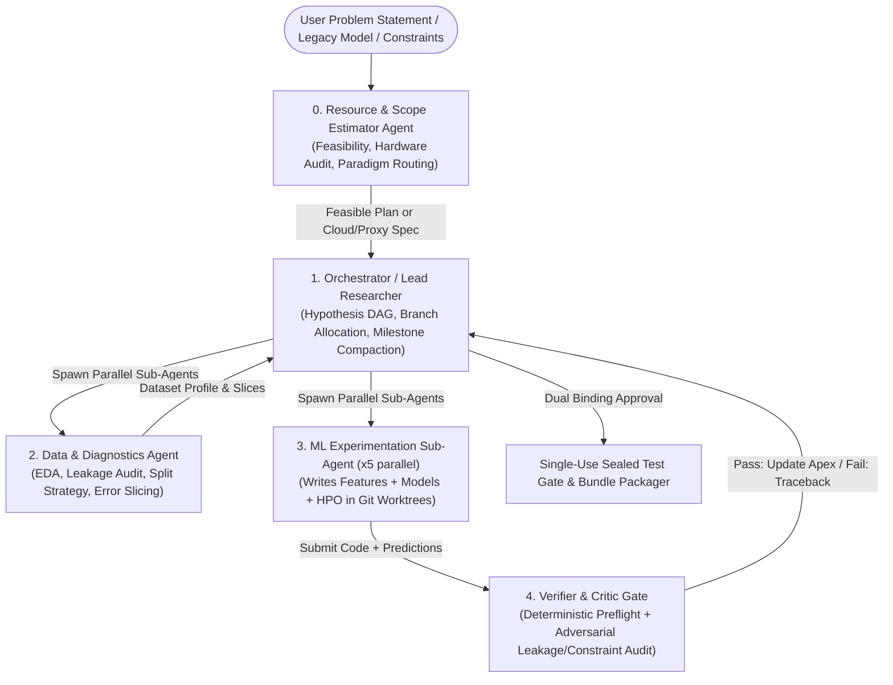

This architectural blueprint and refactoring specification transitions **MLRescurix** from its current M6 rigid tabular harness (`NOT READY FOR RELEASE`) into **MLRescurix v2.0 (M7: Universal Agent-First ML Harness)**.

You can feed this specification directly into your local coding agent as an authoritative master plan.

---

## Task 1: Deep Code Audit & Transition to an "Agent-First" Coding Harness

### 1.1 Audit of the Current M6 Architecture (The Bottlenecks)

Your M6 system has exceptional systems engineering—the Rust SQLite WAL writer thread (`storage.rs`), epoch generation fencing (`core.rs`), single-use `O_CREAT | O_EXCL` sealed test gate (`workflow.py`), and digest-pinned Docker isolation (`sandbox.rs`) are rock-solid. However, **the scientific layer is fighting the agent**:

1. **Hardcoded Recipe Rigidity (`schema_m6.sql` & `workflow.py`)**: Right now, `experiment_dag` enforces a SQL `CHECK` constraint limiting recipes to `'dummy'`, `'linear'`, `'tree'`, and `'hist_boosting'`. Whenever you want to add LightGBM, CatBoost, PyTorch TabNet, or a custom neural architecture, you have to run a SQLite schema migration (`v6 -> v7`). That is an anti-pattern for an agentic harness.
2. **Rigid Python ABC Contracts (`custom/contract.py` & `features.py`)**: Requiring agents to subclass `CustomEstimator` and routing everything through `SplitAwareFeaturePipeline` restricts the agent's coding freedom. Modern coding harnesses (like Claude Code or SWE-agent) succeed because the agent writes raw, idiomatic Python scripts, runs pytest, inspects tracebacks, and iterates.
3. **Cold-Start Container Overhead (`sandbox.rs`)**: Spawning a fresh `docker run` CLI process for every single HPO trial or preflight check adds 800ms–2s of container boot + Python import overhead (`numpy`, `scipy`, `sklearn`) per execution.
4. **The 5 Open M6 Release Gates**:
* *Gate 1 (Non-File Tool Recovery)*: `recovery.rs` tracks tool outcomes, but side-effecting bash commands lack idempotency markers.
* *Gate 2 (128 MiB Ceiling)*: Only enforced in `execution.rs::submit()`. Direct artifact writes bypass the check.
* *Gate 5 (Memory Certification)*: Polling RSS from the host cannot catch transient allocations inside Python; hard enforcement requires reading container cgroup v2 `memory.peak`.


### 1.2 Shifting to an "Agent-First" Paradigm (The 4 Generic Tools)

Drop domain-specific tool bloat (`Category B` JSON-schema project tools, hardcoded HPO CLI wrappers, and rigid feature transform registries). Replace `crates/harness/src/agents/tools.rs` with **4 universal, generic primitives** while keeping **1 immutable boundary** (the Trusted Evaluator):

| Generic Tool Name | Purpose | Security & Invariant Boundary |
| --- | --- | --- |
| `workspace_fs` | `read`, `write`, `apply_diff`, `glob`, `grep` inside the branch worktree (`.m2/worktrees/<branch>`). | Cannot escape worktree root; symlinks rejected; every mutation auto-updates the worktree content SHA-256. |
| `sandbox_bash` | Executes arbitrary shell commands (`pytest`, `python train.py`, profiler scripts) inside a warm container worker mapped to the worktree. | Runs with `--network none`, `--read-only` root, and mounted worktree `/workspace:rw`. Captures `stdout`, `stderr`, exit code, and `memory.peak`. |
| `evaluate_submissions` | **The Immutable Boundary.** Agent passes path to `val_preds.parquet` (or `.csv`). Harness scores it against hidden `val_labels` and logs a node in the Experiment DAG. | Agent **never** sees `val_labels` or `test_labels`. The evaluator runs outside the agent's writable scope, checks row alignment/NaNs, and returns a structured JSON scorecard + residual diagnostics. |
| `artifact_crud` | `publish`, `query`, `lineage`, `pin` for models, plots, EDA profiles, and markdown reports. | Enforces the global State Reservation Ceiling before committing bytes to disk/SQLite. |

### 1.3 Fixing the Contract: Data-Boundary Protocols over Python Classes

Instead of forcing the agent to inherit from `CustomEstimator`, enforce an **Executable Directory Contract** for final delivery (`mlrescurix.pipeline.v2`):

* The agent can write any Python code, use any library in the container, build custom PyTorch loops, or write custom NumPy math.
* To pass preflight (`verifier` agent), the agent's workspace directory must simply expose a standard CLI entrypoint:
```bash
# 1. Fit pipeline on raw training data
python -m candidate.entrypoint fit --train-path /data/train.csv --model-dir /out/model
# 2. Predict on unseen features (Batch & Single-Row Latency Check)
python -m candidate.entrypoint predict --input-path /data/val_features.csv --model-dir /out/model --output-path /out/preds.csv

```


* **Why this wins**: It supports *existing model fixing/enhancement* natively. If a user inputs a broken legacy `.pkl` or a messy `train.py` script alongside a problem statement, the agent reads the existing code via `workspace_fs`, fixes the bug, wraps it in the CLI entrypoint, and immediately benchmarks it against the validation gate.

---

## Task 2: Refactoring the CRUD Artifact Layer & Live Aesthetic Dashboard

Currently, `python/src/mlrescurix_worker/scientific/dashboard.py` is a basic polling script in the Python worker layer. Move the dashboard Server-Sent Events (SSE) / WebSocket API directly into the **Rust Control Plane (`crates/harness/src/server.rs` using `axum`)** so it streams live state straight from SQLite and the filesystem.

### 2.1 Unified Artifact CRUD Schema (`schema_m7_artifacts.sql`)

Replace the fragmented tables (`managed_artifacts`, `feature_transforms`, `calibration_records`, `scientific_ensembles`) with a **Universal Content-Addressable Artifact Registry** that both humans (via the UI) and agents (via `artifact_crud`) can query and mutate:

```sql
CREATE TABLE artifacts_v2 (
    artifact_id TEXT PRIMARY KEY,          -- SHA-256 of content or deterministic UUID
    project TEXT NOT NULL REFERENCES projects(id),
    branch TEXT NOT NULL,
    producer_role TEXT NOT NULL,           -- 'user', 'auditor', 'model_specialist', 'evaluator', etc.
    parent_artifact_id TEXT,               -- Enables full lineage & tree animation
    category TEXT NOT NULL CHECK(category IN (
        'dataset_profile',                 -- EDA distributions, correlation matrices, missingness
        'research_note',                   -- Markdown hypothesis, failure analysis, literature thoughts
        'code_patch',                      -- Git diff, custom estimator module, training script
        'trial_run',                       -- Hyperparameters, training curve logs, resource telemetry
        'diagnostic_plot',                 -- Vega-Lite / Plotly JSON specs (Calibration, SHAP, Residuals)
        'scorecard',                       -- Official validation/test metrics & constraint verification
        'apex_bundle'                      -- Final deployable pipeline package
    )),
    title TEXT NOT NULL,
    media_type TEXT NOT NULL,              -- 'application/json', 'text/markdown', 'application/octet-stream'
    summary_json TEXT NOT NULL,            -- Lightweight metadata (<4KB) indexed for instant agent/UI queries
    storage_path TEXT,                     -- Relative path in CAS store (.m2/cas/<sha256>)
    bytes INTEGER NOT NULL,
    is_apex INTEGER DEFAULT 0,
    pinned INTEGER DEFAULT 0,
    created_ms INTEGER NOT NULL
);

CREATE INDEX idx_artifacts_project_cat ON artifacts_v2(project, category, created_ms DESC);
CREATE INDEX idx_artifacts_lineage ON artifacts_v2(project, parent_artifact_id);

```

### 2.2 Bidirectional CRUD (How Agent & User Collaborate)

* **Agent $\rightarrow$ UI**: When the `auditor` runs an EDA script, it calls `artifact_crud(action="publish", category="dataset_profile", summary_json={...})`. The Rust server pushes an SSE event `ArtifactCreated`, and the dashboard immediately renders the interactive correlation and missingness graphs.
* **Agent $\leftarrow$ System**: When the `lead` agent starts a new turn, it doesn't read raw 50,000-line logs. It calls `artifact_crud(action="query", category="scorecard", limit=5)` to fetch the concise `summary_json` of the top 5 models and their residual failure slices.
* **User $\rightarrow$ Agent**: In the UI, the user can click any node in the Experiment Tree, add a human comment, pin a model as a baseline to beat, or edit a `research_note` Markdown card. That mutation writes a row in `artifacts_v2` with `producer_role = 'user'`, which is injected into the `lead` agent's next turn delta.

### 2.3 Live Aesthetic Dashboard Design (The 4 Panes)

Build a lightweight, zero-build or Vite+React frontend (`crates/harness/ui/`) served by `axum` on `[http://127.0.0.1:8765](http://127.0.0.1:8765)` connected via `/api/v1/projects/:id/stream` (SSE):

1. **Pane 1: Live Animated Experiment DAG & Tree Search (Center Canvas)**
* Renders `experiment_dag` + `artifacts_v2` lineage in real time using **D3.js / React Flow**.
* **Visual States**:
* *Pulsing Blue Node*: Currently running inside a warm container worker (shows live CPU%, RAM MiB from cgroup telemetry, and epoch progress).
* *Muted Grey Node*: Pruned at 0.5 fidelity screening or failed preflight stability check.
* *Emerald Green Node*: Validated feasible model.
* *Glowing Gold Crown Node (`Apex`)*: Current Pareto-optimal champion across accuracy, latency, and model size.


* Clicking any node opens its exact code diff (`code_patch`), training log stream, and diagnostic plots.


2. **Pane 2: Live Arena Leaderboard & Pareto Frontier (Top Right)**
* Real-time scatter plot of **Validation Score vs. Inference Latency (ms) / Model Size (MiB)** with hard user constraints drawn as red boundary lines.
* Multi-seed confidence intervals (`[2026, 2027, 2028]`) displayed as error bars on top contenders.


3. **Pane 3: Interactive Data & Model Diagnostics (Bottom Right)**
* Renders JSON specs (`Plotly` / `Vega-Lite`) emitted by the `diagnostic_engineer`:
* Calibration reliability curves (Platt vs. Isotonic vs. Uncalibrated).
* Confusion matrices, ROC/PR curves, and SHAP/permutation feature importance bar charts.
* Worst-performing data slices (e.g., *"Error rate is 3.4x higher when `account_age < 30`"*).


4. **Pane 4: Transparent Research Feed & Agent Lab Notebook (Left Sidebar)**
* Renders `research_note` Markdown artifacts chronologically like a live scientific journal: Hypothesis $\rightarrow$ Code Written $\rightarrow$ Preflight Result $\rightarrow$ Validation Scorecard $\rightarrow$ Critic Verdict.


---

## Task 3: High-Concurrency Deterministic Architecture (10 Projects $\times$ 5 Workers = 50 Concurrent Sandboxes)

### 3.1 Why 50 Concurrent `docker run` Processes Will Crash the Host

If you run 10 projects concurrently, each executing 5 scripts simultaneously (50 concurrent jobs), your current M6 setup (`--memory 1g --cpus 1` per `docker run`) will attempt to allocate **50 GiB of RAM and 50 CPU cores**, triggering host OOM kills and Docker daemon lockups. Furthermore, spawning 50 cold containers simultaneously causes massive disk I/O thrashing.

### 3.2 Two-Level Resource Broker & Warm Container Worker Pool

Refactor `crates/harness/src/execution.rs` and `sandbox.rs` into a **Resource-Aware Lease Broker** backed by **Warm Container Zygotes**:

```
+-----------------------------------------------------------------------------------+
| HOST HARDWARE PROBER & GLOBAL RESOURCE BROKER (crates/harness/src/broker.rs)      |
| - Detects Total Host Cores (C) & Usable Host RAM (M)                              |
| - Reserves 2 Cores & 2 GiB RAM strictly for Rust Control Plane + OS + SQLite      |
| - Manages Token Buckets: CPU Millicores Pool & Memory MiB Pool                    |
+-----------------------------------------------------------------------------------+
          |                                                       |
          v (Hierarchical DRF: Dominant Resource Fairness)        v
+-----------------------------------+           +-----------------------------------+
| Project 1 (Weight=5, 5 Active)    |   ...     | Project 10 (Weight=5, 5 Active)   |
| - Guaranteed Share: M/10, C/10    |           | - Guaranteed Share: M/10, C/10    |
| - Can burst if Projects 2..9 idle |           | - Preemptible burst leases        |
+-----------------------------------+           +-----------------------------------+
          |                                                       |
          +---------------------------+---------------------------+
                                      v
+-----------------------------------------------------------------------------------+
| WARM SANDBOX POOL (N Long-Lived Pinned Containers, e.g., 1 per Project)           |
| - Container runs a lightweight Rust/Python Zygote Daemon with pre-imported        |
|   numpy, scipy, pandas, sklearn, lightgbm, torch (Copy-on-Write shared RAM!)      |
| - Executes up to 5 concurrent scripts via Linux cgroup v2 sub-slices + namespaces |
+-----------------------------------------------------------------------------------+

```

#### Key Architectural Upgrades for `execution.rs` & `sandbox.rs`:

1. **Shared Memory via Warm Zygote Containers (Massive RAM Savings)**:
* Instead of 50 isolated `docker run` invocations (which duplicate 150 MiB of Python/NumPy/Scikit-Learn shared libraries 50 times = **7.5 GiB wasted RAM**), run **1 warm container per active project** (10 containers total) or a fixed global pool of containers.
* Inside the container, run a tiny preload daemon (`mlrescurix_worker/zygote.py`) that imports `numpy`, `pandas`, `scipy`, and `sklearn` at boot, then uses `os.fork()` inside an isolated sub-directory `/tmp/job-<id>` and drops privileges for each of the 5 concurrent scripts. Because of Linux **Copy-on-Write (CoW)** page sharing, all 5 workers share the exact same physical RAM pages for Python libraries!


2. **Dynamic Resource Token Tagging**:
* Every script execution declares a **Resource Profile** (`MICRO`, `STANDARD`, `HEAVY`):
* `MICRO` (EDA, linting, unit test, preflight check): `250m CPU, 256 MiB RAM, max 15s`.
* `STANDARD` (0.5 fidelity HPO trial, feature engineering): `1000m CPU, 768 MiB RAM, max 120s`.
* `HEAVY` (Full refit, ensemble stacking, small neural fine-tune): `2000m CPU, 2048 MiB RAM, max 600s`.


* The Rust `ResourceBroker` only dispatches a job when `allocated_ram + job.ram <= host_budget_ram` and `allocated_cpu + job.cpu <= host_budget_cpu`. Thus, 10 projects can easily have 50 scripts queued/active—40 lightweight/IO-bound or staged seamlessly across 8–16 physical cores—**with zero risk of host OOM**.


3. **Thread-Over-Subscription Lock (`OMP_NUM_THREADS`)**:
* When running 50 scripts concurrently, OpenBLAS/MKL/OpenMP inside NumPy and Scikit-Learn will default to spawning `num_cpus` threads *per process* (50 $\times$ 8 = 400 threads), grinding the CPU to a halt via context-switching.
* Hardcode in `sandbox.rs` environment injection:
```rust
cmd.env("OMP_NUM_THREADS", assigned_cores.to_string())
   .env("MKL_NUM_THREADS", assigned_cores.to_string())
   .env("OPENBLAS_NUM_THREADS", assigned_cores.to_string())
   .env("NUMEXPR_NUM_THREADS", assigned_cores.to_string())
   .env("POLARS_MAX_THREADS", assigned_cores.to_string());

```


4. **SQLite Reader/Writer Separation (`storage.rs`)**:
* Keep your single dedicated writer thread (`mlrescurix-writer` with `sync_channel(64)`), but add a **Read-Only Connection Pool (`r2d2` or `deadpool-sqlite` with 16 `SQLITE_OPEN_READ_ONLY` connections)** in WAL mode. Dashboard SSE streams, artifact queries, and agent context lookups will never block or contend with the writer thread across 10 concurrent projects.


---

## Task 4: Agentic Workflow, Sub-Agent Orchestration, Zero-Waste Recovery & <64K Context Compaction

### 4.1 Streamlined Specialist Topology (Consolidating 8 Roles into 5 Focused Agents)

Your M4 design has 8 roles (`lead`, `auditor`, `feature_engineer`, `model_specialist`, `search_engineer`, `diagnostic_engineer`, `verifier`, `critic`). Having separate `feature_engineer`, `model_specialist`, and `search_engineer` agents causes excessive handoff overhead and context duplication because features, models, and hyperparameters are tightly coupled in code.

Consolidate `crates/harness/src/agents/roles.rs` into **5 high-leverage agents** with strict input/output contracts:



### 4.2 Hard 64K Token Context Budget & Milestone Compaction Engine (`context.rs`)

To guarantee no agent ever exceeds **64,000 tokens** (and typically operates under **16,000 tokens** for fast, cheap, high-accuracy reasoning), implement a **3-Tier Hierarchical Memory Architecture** in `crates/harness/src/agents/context.rs`:

| Tier | Token Allocation | Contents | Eviction & Compaction Rule |
| --- | --- | --- | --- |
| **Tier 1: Pinned Constitutional Header** | $\le 4,000$ tokens | Problem statement, hardware/latency constraints, dataset schema summary, current `Apex` scorecard, and system prompt. | **Never evicted.** Updated atomically only when a new Apex model is crowned. |
| **Tier 2: Milestone Episodic Memory** | $\le 12,000$ tokens | Structured Markdown summaries of completed milestones (e.g., *M1 EDA Findings*, *M2 Baseline Insights*, *M3 Dead-End Architectures*). | Compacted at every milestone boundary via `compact_milestone()`. Raw tool logs from previous milestones are deleted from context. |
| **Tier 3: Rolling Scratchpad (Current Turn Loop)** | $\le 32,000$ tokens | Active git worktree file tree, last 5 tool calls, and current hypothesis execution trace. | **Hard Ring-Buffer**: Tool outputs (stdout/stderr) are truncated at `2,000 tokens` (head 50 lines + tail 50 lines; full log saved to `artifacts_v2`). At `48,000 total tokens`, automatic mid-milestone compaction triggers. |

#### The Milestone Compaction Protocol (`compact_milestone` in `orchestrator.rs`):

When a sub-agent completes a task (or hits turn 8), it **cannot** return its raw conversation history to the Orchestrator. It must invoke a terminal tool `complete_subtask(structured_report)` containing:

1. `hypothesis_tested`: 1 sentence.
2. `code_artifact_id` & `git_commit_sha`: Exact pointer.
3. `validation_metrics_delta`: e.g., `ROC-AUC: 0.842 -> 0.879 (+0.037), Latency: 4.2ms`.
4. `key_learnings_and_failures`: Max 250 words (what worked, what failed, why).
The Orchestrator appends *only* this 300-token receipt into its Tier 2 memory and discards the sub-agent's 30,000-token scratchpad.

### 4.3 Zero-Token-Waste Crash Recovery & Resume (`recovery.rs`)

To resolve **M6 Release Gate 1** and ensure stopping/resuming a project wastes zero tokens:

1. **Pre-LLM Prompt Hash & Idempotent Turn Ledger**:
* Before sending a request to OpenRouter/DeepSeek, serialize the exact prompt payload, compute `request_sha256`, and write a row in `provider_turn_receipts(status = 'dispatched')`.
* When the response arrives, commit the raw response JSON and token charge to SQLite **before** parsing or executing any tool calls.


2. **Deterministic Tool-Call Checkpointing**:
* Every tool call inside a turn is assigned a deterministic `call_id = sha256(project + task + turn + tool_index + tool_name + canonical_args)`.
* If the harness is killed (`SIGINT`/`SIGKILL`) while 3 out of 5 parallel `sandbox_bash` scripts are running:
* On `mlrescurix-harness resume`, `recovery.rs` inspects `tool_outcomes`.
* The LLM turn is **not** re-billed or re-prompted (the LLM response is already saved in `provider_turn_receipts`).
* Tools 1, 2, and 3 (which already recorded `outcome_sha256`) immediately return their cached outputs from SQLite.
* Only Tools 4 and 5 are re-dispatched into the warm container worktree after resetting the worktree to the pre-tool git tree hash!


### 4.4 Production-Grade System Prompts (`roles.rs`)

Drop these directly into `crates/harness/src/agents/roles.rs`:

* **1. Orchestrator (`lead`) Prompt Core**:
> *"You are the Principal ML Architect of MLRescurix. You do not write training code directly; you manage an Experiment DAG across isolated Git worktrees. Every decision must follow the Scientific Method: (1) Read the Data & Diagnostics profile, (2) Formulate a falsifiable hypothesis with an expected metric delta, (3) Dispatch parallel `experiment_engineer` sub-agents with orthogonal hypotheses (e.g., Branch A: GBDT + target encoding; Branch B: Regularized Linear + spline interactions; Branch C: Neural/Embedding or Domain features), (4) Prune losing branches aggressively, and (5) Compact lessons into Tier 2 memory. Never request Sealed Test Gate finalization until the candidate beats the baseline across all 3 confirmation seeds `[2026, 2027, 2028]` and passes the Critic Gate."*


* **2. Data & Diagnostics Agent (`auditor`) Prompt Core**:
> *"You are the Forensic Data & Diagnostics Auditor. Before any model is trained, you write Python scripts via `sandbox_bash` to inspect target distributions, ID/timestamp leakage, high-cardinality columns, covariate shift between splits, and missingness patterns. After a candidate is evaluated, you analyze out-of-fold residuals to identify exact failure slices (e.g., subgroup underperformance or calibration drift) and publish interactive diagnostic specs via `artifact_crud`."*


* **3. ML Experimentation Sub-Agent (`experiment_engineer`) Prompt Core**:
> *"You are an Autonomous ML Coding Engineer operating in an isolated Git worktree. You have full freedom to write modular Python pipelines (`candidate/entrypoint.py`) using Scikit-Learn, LightGBM/CatBoost/XGBoost, Optuna, or PyTorch. You MUST enforce strict fold-local transformations (zero leakage across CV folds), write fast unit tests (`pytest`), run 0.5-fidelity screening first, and submit validation predictions via `evaluate_submissions`. Respect the assigned hardware ceiling (`OMP_NUM_THREADS`, RAM cap, latency budget) at all times."*


* **4. Independent Critic (`critic`) Prompt Core**:
> *"You are an Adversarial ML Auditor. Your sole job is to find reasons to REJECT a candidate before the single-use Sealed Test Gate is consumed. Audit the candidate's git diff for subtle data leakage (global target statistics, future lookahead, row-order leakage), check single-row p99 inference latency, verify NaN/unseen-category resilience, and confirm calibration Brier score improvements. Output a binding `CriticAudit` verdict."*


---

## Task 5: Expanding Beyond Tabular ML — The Resource-Aware Universal ML Harness

Your intuition here is spot on: **the reason local ML harnesses fail when expanding beyond tabular ML is that they blindly try to run a 7B LLM or heavy RL environment on a laptop, hit OOM or a 40-hour training wall, and crash.**

If you add a **Pre-Flight Hardware & Complexity Estimator (`crates/harness/src/estimator.rs` + `estimator` agent)** at the very start of the workflow, MLRescurix becomes a **Universal Resource-Aware ML Harness** covering Tabular, NLP/Small-LLMs, Time-Series, Unsupervised/Anomaly Detection, and Offline RL.

### 5.1 How the Hardware & Complexity Estimator Works (`Step 0`)

Before initializing the research loop, `mlrescurix-harness estimate` runs a deterministic hardware probe (`sysinfo` + GPU/MPS/CUDA detection) combined with a problem statement analyzer:

1. **Hardware Fingerprint**:
* Detects CPU architecture (`arm64` Apple Silicon / `x86_64`), physical cores, available RAM, disk bandwidth, and accelerator memory (e.g., Apple Metal Unified Memory, local NVIDIA VRAM, or CPU-only).


2. **Analytical Compute & Memory Budgeting Formulas**:
* **Tabular / Classical ML**:

$$\text{Peak RAM} \approx 4 \times (N_{\text{rows}} \times N_{\text{cols}} \times 8\text{ bytes}) + \text{Model State}$$


* **Small LLM / Transformer Fine-Tuning (LoRA / QLoRA / DistilBERT / ModernBERT / MicroLM)**:

$$\text{VRAM/RAM}_{\text{QLoRA}} \approx (0.6\text{ bytes} \times P_{\text{params}}) + \text{Activations}(B \times L \times d_{\text{model}}) + \text{LoRA Gradients}$$


* **Wall-Clock Training Time Estimate**:

$$\text{Est. Time (sec)} = \frac{6 \times P_{\text{active}} \times N_{\text{tokens or samples}} \times N_{\text{epochs}}}{\text{Sustained Host FLOPS Utilization}}$$


### 5.2 The 3-Tier Feasibility Negotiation Protocol

When the user submits a problem statement (e.g., *"Fine-tune an LLM for customer support ticket routing with <50ms latency"* or *"Train a policy on offline user interaction logs"*), the Estimator Agent classifies the request into one of three tiers and negotiates with the user **before spending compute**:

| Feasibility Tier | Condition | Harness Action & Smart Alternative Offered to User |
| --- | --- | --- |
| **Tier GREEN (Local Native Execution)** | Fits within $<70\%$ of local RAM/VRAM and $<30\text{ min}$ wall-clock budget. | Proceeds immediately. (e.g., Tabular GBDT/Stacking, Unsupervised IsolationForest/UMAP+HDBSCAN, Offline RL via Fitted Q-Iteration/Decision Transformer on small state spaces, or fine-tuning a 135M–500M parameter encoder/SLM). |
| **Tier YELLOW (Local Proxy / Distilled Alternative)** | Naive model exceeds local hardware (e.g., user asks for a 7B LLM on an 8GB RAM machine), **but the task can be solved within constraints via an architectural pivot**. | **Proposes a Smart Local Pivot:**<br>

<br>1. *Knowledge Distillation / Teacher-Student*: Use API LLM to label/generate synthetic logits on 2,000 rows, then distill into a local `ModernBERT-base`, `TF-IDF + HistGradientBoosting`, or `100M QLoRA` model.<br>

<br>2. *Frozen Embeddings + Tabular Head*: Extract embeddings once using a quantized local ONNX encoder, cache them to disk, and run MLRescurix's tabular ensemble engine on top! |
| **Tier RED (Remote Burst Required)** | Problem fundamentally requires heavy compute (e.g., 8B+ full fine-tuning, large vision backbones, or 10M-row dataset). | Outputs an exact **Compute Deficit Receipt** (*"Requires 24 GiB VRAM and ~1.8 GPU hours; local machine has 8 GiB RAM"*) and offers to switch the `SandboxRunner` execution backend from local Docker to a remote SSH/Cloud GPU container endpoint while keeping the **Rust Control Plane, SQLite state, and Sealed Test Gate strictly on the user's local machine**. |

### 5.3 Generalizing the Evaluators & Bundles Across Modalities

To support non-tabular modalities without breaking your clean architecture, generalize `scientific/workflow.py` and `bundle.rs` around **Task Archetypes**:

1. `tabular_supervised` (Binary, Multiclass, Regression, Ranking — current M6).
2. `tabular_unsupervised` (Anomaly detection, clustering — evaluated via Silhouette, Davies-Bouldin, reconstruction error, plus stability across bootstrap resamples).
3. `text_and_slm` (Classification, extraction, instruction tuning — evaluated via exact match, F1, Rouge/Perplexity, latency per token, exported as quantized ONNX or GGUF/Safetensors + `inference.py`).
4. `sequential_and_rl` (Time-series forecasting & Offline RL / Contextual Bandits — evaluated via temporal backtesting or Doubly Robust Off-Policy Evaluation [OPE] on sealed trajectory logs).

---

## Master Implementation Prompt (Copy-Paste into Your Local Coding Agent)

Below is the self-contained execution prompt you can paste directly into your coding agent inside the `MLRescurix` repository to resolve the M6 release blockers and build the M7 Agent-First upgrades incrementally:

```markdown
# TASK: Upgrade MLRescurix from M6 to M7 (Universal Agent-First ML Harness)

You are operating inside the `MLRescurix` repository (`crates/harness`, `python/src/mlrescurix_worker`, `contracts/v1`). Preserve all existing M0-M6 safety invariants (dedicated SQLite writer thread, epoch generation fencing, single-use O_CREAT|O_EXCL sealed test gate, outbound view firewall, and zero host Python execution).

Execute the following 5 architectural upgrades in order, running `cargo test` and `pytest` after each phase:

### Phase 1: Close the 5 Open M6 Release Gates
1. **Universal 128 MiB State Reservation (`crates/harness/src/storage.rs` & `execution.rs`)**:
   - Move the 128 MiB state directory ceiling check out of `execution.rs::submit()` into a centralized storage guard invoked by ALL state-writing paths (job submission, artifact registration, checkpoint creation, and bundle export).
   - Add an archival/tombstone command (`mlrescurix-harness archive-artifacts`) that prunes unpinned intermediate trial weights while keeping cryptographic SHA-256 receipts in `managed_artifacts`.
2. **Idempotent Non-File Tool Recovery (`crates/harness/src/agents/recovery.rs`)**:
   - Before executing any tool in `orchestrator.rs`, record the pre-execution Git worktree tree hash in `tool_outcomes`.
   - On crash recovery (`reconcile_interrupted_turn`), if a tool was in-flight without a committed `outcome_sha256`, reset the branch worktree to the recorded pre-tool tree hash and re-execute only the uncompleted tool calls without re-prompting or re-billing the LLM provider.
3. **Hard Container Cgroup Memory Certification (`crates/harness/src/agents/sandbox.rs`)**:
   - Replace host-side RSS polling with container cgroup memory watermark inspection (`memory.peak` / `memory.max_usage_in_bytes`) inside the Docker execution wrapper so memory constraint certification is deterministic.

### Phase 2: Agent-First Generic Tools & Decoupled Model Contract
1. **Remove Hardcoded SQL Recipe Constraints (`crates/harness/src/schema_m7.sql`)**:
   - Create migration `v9 -> v10` (`schema_m7.sql`). Remove the hardcoded `CHECK(recipe IN ('dummy', 'linear', 'tree', 'hist_boosting'))` constraint on `experiment_dag` so agents can register arbitrary model architectures (`lightgbm`, `catboost`, `custom_mlp`, `stacking`, `qlora_slm`, `isolation_forest`, etc.).
2. **Streamline `ToolRegistry` (`crates/harness/src/agents/tools.rs`)**:
   - Implement the 4 core generic agent tools:
     - `workspace_fs` (`read`, `write`, `apply_diff`, `glob`, `grep` scoped to `.m2/worktrees/<branch>`).
     - `sandbox_bash` (runs arbitrary Python/pytest/training scripts inside the container mapped to the worktree with resource profile tags: `MICRO`, `STANDARD`, `HEAVY`).
     - `evaluate_submissions` (scores agent's validation prediction file against sealed validation labels via the Trusted Evaluator and records an `experiment_dag` trial receipt + residual error slices).
     - `artifact_crud` (`publish`, `query`, `lineage`, `pin` against the new `artifacts_v2` table).
3. **Executable Directory Contract (`python/src/mlrescurix_worker/custom/preflight.py`)**:
   - Allow agents to submit either a `CustomEstimator` subclass OR a standard CLI module (`python -m candidate.entrypoint fit ...` and `predict ...`) so existing legacy user models and arbitrary Python pipelines can be fixed, enhanced, and verified seamlessly.

### Phase 3: High-Concurrency Resource Broker & Warm Zygote Sandbox (10x5 Concurrency)
1. **Resource Broker (`crates/harness/src/broker.rs`)**:
   - Probe host CPU cores and usable RAM at supervisor startup, reserving 2 cores and 2 GiB RAM for the host/control plane.
   - Implement token-bucket admission for `MICRO` (250m CPU, 256MB), `STANDARD` (1 CPU, 768MB), and `HEAVY` (2 CPU, 2048MB) jobs across up to 10 concurrent projects and 50 queued/active scripts using Hierarchical Dominant Resource Fairness (DRF).
   - Inject `OMP_NUM_THREADS`, `MKL_NUM_THREADS`, `OPENBLAS_NUM_THREADS`, and `NUMEXPR_NUM_THREADS` matching the job's leased CPU cores to prevent thread oversubscription.
2. **SQLite Read Pool (`crates/harness/src/storage.rs`)**:
   - Add a read-only SQLite connection pool (`SQLITE_OPEN_READ_ONLY`) alongside the single dedicated writer thread so concurrent agent reads and UI queries never block writes.
3. **Warm Container Zygote (`python/src/mlrescurix_worker/zygote.py`)**:
   - Add a preloaded container worker mode that imports `numpy`, `scipy`, `pandas`, and `sklearn` once and forks isolated sub-processes per job for Copy-on-Write RAM sharing and <50ms startup latency.

### Phase 4: Unified CRUD Artifact Registry & Live SSE Dashboard
1. **Universal `artifacts_v2` Table (`schema_m7.sql`)**:
   - Add `artifacts_v2` supporting categories: `dataset_profile`, `research_note`, `code_patch`, `trial_run`, `diagnostic_plot`, `scorecard`, and `apex_bundle` with `parent_artifact_id` lineage tracking and `<4KB` `summary_json` metadata.
2. **Real-Time Streaming Server (`crates/harness/src/server.rs`)**:
   - Expose REST + SSE endpoints (`/api/v1/projects/:id/stream`, `/api/v1/projects/:id/artifacts`, `/api/v1/projects/:id/dag`) streaming live Experiment DAG state changes, cgroup resource telemetry, Pareto frontier leaderboards, and Markdown research notes.

### Phase 5: 64K Context Compaction & Pre-Flight Hardware/Modality Estimator
1. **3-Tier Context Compactor (`crates/harness/src/agents/context.rs`)**:
   - Enforce a hard 64,000-token ceiling: Tier 1 Constitutional Header (<=4K tokens), Tier 2 Milestone Episodic Summaries (<=12K tokens), and Tier 3 Rolling Scratchpad (<=32K tokens, truncating raw stdout/stderr to 2,000 tokens and archiving full outputs to `artifacts_v2`).
2. **Hardware & Scope Estimator (`crates/harness/src/estimator.rs`)**:
   - Implement `mlrescurix-harness estimate` and the `estimator` specialist role to evaluate problem statements + dataset dimensions against local hardware capacity, classifying runs into Tier GREEN (Local Native), Tier YELLOW (Local Proxy/Distillation/Cached Embeddings pivot), or Tier RED (Remote SSH/Cloud container worker burst).

```