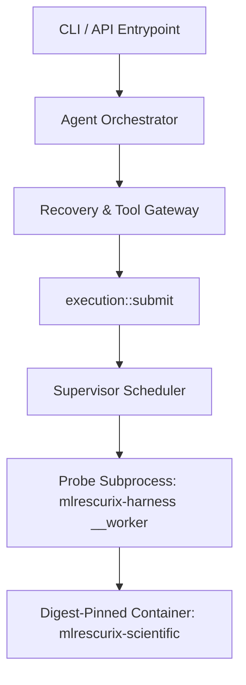

# P1.1 Mutation & Effect Matrix

**Status**: Authoritative inventory created for P1.1 (2026-10-14).  
**Baseline commit**: `abf1f235030a79f9a606b429e34608431e37603d`.  
**Scope**: Complete inventory of SQLite tables, filesystem mutations, and runner entrypoints across MLRescurix v2.  
**Classification standard**:
- **Verified Source Behavior**: Behavior implemented and validated by locked regressions in `crates/harness`.
- **Proposed Improvement**: Contract, schema extension, or safety boundary specified for v2 implementation (P1.2–P1.6, P2+).

---

## 1. Architectural Principles & Invariants

1. **Durable Intent Precedes Effect**: Every non-idempotent or external effect must persist an authoritative intent record before initiating the mutation.
2. **Authoritative Receipts Precede Checkpoints**: Outcomes must be committed to durable receipts (e.g., `tool_outcomes`, `charges`, `pipeline_receipts`) before advancing high-level state checkpoints (e.g., `agent_checkpoints`, `provider_turn_receipts`).
3. **No Blind Replay**: A process crash after an unconfirmed effect never authorizes repeating the action. Recovery must reconcile against authoritative external or database receipts; missing or contradictory evidence produces an explicit uncertain/rejected outcome.
4. **State Admission Ceiling**: All managed state is bounded by declared project and device capacity (current policy: 128 MiB ceiling, 64 MiB disk headroom). Writes must not bypass admission accounting.
5. **Epoch & Generation Fencing**: Task leases, job submissions, and tool invocations are fenced by monotonic `generation` and `intent_revision` counters. Outdated epochs are deterministically rejected.

---

## 2. SQLite Mutation Inventory

The harness state database is stored in `state.sqlite` using SQLite WAL mode with `PRAGMA synchronous=FULL` and `PRAGMA foreign_keys=ON`. Below is the complete inventory of all tables subject to write mutations.

### 2.1 Core & Foundation State (M0)

| Table | Ownership | Mutations & Triggers | Admission & Reservations | Durable Intent Receipt | Durable Result Receipt | Idempotency Key | Crash Behavior & Recovery Gaps |
|---|---|---|---|---|---|---|---|
| `device` | M0 Runtime | `INSERT` during `Runtime::init` | Single-row invariant (`CHECK(id=1)`). | Request command receipt | `commands` table entry | `id=1` | **Verified**: Immutable after creation. **Gap**: None. |
| `projects` | M0 Runtime | `INSERT` on `CreateProject`; `UPDATE` on `Pause`, `Resume`, `Cancel`, `intent_revision` increment | Project budget and capacity defined in `policy`. Revisions increment monotonically. | `commands` record for project creation | `events` (`project.created`, `project.cancelled`) | `id` (Project ID) | **Verified**: Revisions fence stale requests. **Gap**: Archival/tombstone protocol pending (P1.4). |
| `branches` | M0 Workspace | `INSERT` on `CreateBranch`; `UPDATE` on `update_branch_head` | Checked against parent project existence. | `CreateBranch` command | `commands` table entry | `(project, id)` | **Verified**: Fails on conflict. **Gap**: Storage quota does not yet track untracked branch disk growth directly (P1.3). |
| `tasks` | M0 Scheduler | `INSERT` on `CreateTask`; `UPDATE` on `Claim`, `RenewLease`, `Yield`, `CloseTask`, generation bump | Enforces `max_tasks` per project policy. Lease expiration `expires_ms` enforced. | `Request` command | `commands` receipt, `events` (`task.claimed`, `task.closed`) | `(project, id)` | **Verified**: Lease expiry releases task to next worker; stale generation rejected. **Gap**: Cross-task dependency DAG reconciliation pending (P5). |
| `actions` | M0 Engine / Supervisor | `INSERT` on `Prepare` or `Supervisor::admit`; `UPDATE` on `Dispatch`, `Response`, `Commit`, `Resolve`, `MarkUnknown` | Atomic capacity reservation required in `reservations`. | Action definition with `deadline_ms`, `generation`, `budget` | `charges` table entry, `action.receipt` JSON | `(project, id)` | **Verified**: Unsettled actions block new dispatches; orphaned dispatched actions settled at ceiling on recovery. **Gap**: Cleanup retains actions indefinitely; bounds needed (P1.4). |
| `reservations` | M0 Engine / Supervisor | `INSERT` on `Prepare` or `Supervisor::admit` (`held=1`); `UPDATE` on release/settlement (`held=0`); `DELETE` on cleanup | Atomic budget and capacity decrement against project policy. | Action prepare request | Succeeded/failed settlement sets `held=0` | `(project, action)` | **Verified**: Held reservations prevent double allocation across crashes. **Gap**: Reservation accounting currently separate from blob CAS accounting (P1.3, P2). |
| `charges` | M0 Engine / Supervisor | `INSERT` on `Commit`, `Resolve`, or `settle_job_action` | Must not exceed reserved action budget. | Settled action receipt | `events` (`action.committed`) | `(project, action)` | **Verified**: Duplicate insertion ignored; rollup rejects malformed charges. **Gap**: Long-term rollup compaction policy needed (P1.4). |
| `commands` | M0 Engine | `INSERT` on every `Runtime::command` execution | Immediate SQLite transaction. | Inbound `Request` | Stored `Receipt` JSON | `(project, id)` | **Verified**: Repeated command ID returns cached receipt without re-execution. **Gap**: Command history unbounded; requires lease-aware compaction (P1.4). |
| `events` | M0 Event Journal | `INSERT` on state transitions | Sequential `AUTOINCREMENT` cursor. | Preceding operation execution | Committed event row | `cursor` (Monotonic integer) | **Verified**: Cursor-based replay supported; retained events capped at 10,000 per project in cleanup. **Gap**: SSE durable cursors and event schema versioning pending (P2.4). |
| `checkpoints` | M0 Context | `INSERT` on `Checkpoint` operation | Sequential task sequence. | Stored context payload digest | Stored checkpoint row | `(project, task, sequence)` | **Verified**: Corrupted digest fails recovery. **Gap**: Spills to filesystem CAS pending (P2). |
| `questions` | M0 Human Interface | `INSERT` on `AskQuestion`; `UPDATE` on `AnswerQuestion` | Blocks automated admission if unanswered questions exist. | Question prompt | Answer payload | `(project, id)` | **Verified**: Blocks scheduler admission while pending. **Gap**: UI integration pending (P6). |
| `refs` | M0 Registry | `INSERT` on `AddRef`; `DELETE` on `RemoveRef` | Project scoped reference identity. | Content digest | Stored reference row | `(project, id)` | **Verified**: Preserves pinned digests. **Gap**: Migration to P2 Artifact Versioning (P2.1). |
| `timers` | M0 Timer | `INSERT` on `ScheduleTimer`; `UPDATE` on `CancelTimer`, `DeliverTimer` | `due_ms` and unique `delivery_key`. | Schedule request | Delivered status | `(project, id)`, `delivery_key` UNIQUE | **Verified**: Replays due timers on restart. **Gap**: None. |

---

### 2.2 Execution & Scheduler State (M1)

| Table | Ownership | Mutations & Triggers | Admission & Reservations | Durable Intent Receipt | Durable Result Receipt | Idempotency Key | Crash Behavior & Recovery Gaps |
|---|---|---|---|---|---|---|---|
| `jobs` | M1 Scheduler / Supervisor | `INSERT` on `execution::submit` (`status='queued'`); `UPDATE` on admit (`running`), finish (`succeeded`/`failed`), reap (`timed_out`), or cancel | Enforces project queue limit (128), device queue limit (1024), project job history ceiling (4096), and 128 MiB state ceiling. | `JobSpec` JSON validated and committed | `artifacts` JSON list, `ended_ms`, `reason` | `(project, id)` | **Verified**: Reused `job_id` with different spec rejected; identical spec returns existing view. **Gap**: Supervisor crash during worker execution recovered to `recovering`, but tool-level reconciliation was unlinked (P1.2 target). |
| `scheduler` | M1 Scheduler | `INSERT`/`UPDATE` on `Supervisor::admit` | Single key-value table for scheduling metadata. | None | Stored cursor (e.g. `last_project`) | `key` | **Verified**: Recovers round-robin cursor across supervisor restarts. **Gap**: None. |
| `project_weights` | M1 Scheduler | `INSERT`/`UPDATE` on `set_project_weight` | Range checked `1..=10`. | Weight change command | `events` (`scheduler.weight_changed`) | `project` | **Verified**: Survives restarts. **Gap**: Dynamic weight aging pending (P3.2). |
| `managed_artifacts` | M1 Scheduler | `INSERT` on `Supervisor::finish`; `UPDATE` on `pin_artifact` | Verified by `Supervisor::publish` output limits. | Staged artifact files | Stored row with `bytes`, `sha256`, `pinned` | `(project, job, name)` | **Verified**: Unpinned artifacts collected by GC when jobs terminal. **Gap**: Blobs unlinked from global CAS (P2). |
| `environments` | M1 Runner | `INSERT` on `create_environment`, `register_container_environment`; `UPDATE` on profile installation or failure | Environment identity hash based on Python version, OS, arch, binary path. | Interpreter verification probe | Status updated to `ready` or `failed` | `id` | **Verified**: Unverified environment rejected; leases block removal. **Gap**: Dynamic environment image caching pending (P4). |
| `environment_leases` | M1 Runner | `INSERT` on `Supervisor::admit`; `DELETE` on `Supervisor::finish` or `recover_expired` | Prevents concurrent mutation or deletion of leased environments. | Active job assignment | Deletion after verified worker exit and job finish | `(environment, project, job)` | **Verified**: Leased environment cannot be mutated or deleted; Docker survivor reconciliation checks persisted lease epoch and retains the lease until confirmed exit. |
| `job_telemetry` | M1 Supervisor | `INSERT`/`UPDATE` on `sample_process` and validated pre-teardown cgroup receipt persistence | Bounded process and cgroup telemetry sampling. | Process probe and Docker cgroup v2 monitor receipt | Stored CPU%, peak RSS and cgroup peak/events receipt | `(project, job)` | **Verified**: Peak RSS is monotonic; supported cgroup v2 receipts include memory peak/events and are validated before a certified job can finish. |

---

### 2.3 Scientific Engine & Pipeline State (M2)

| Table | Ownership | Mutations & Triggers | Admission & Reservations | Durable Intent Receipt | Durable Result Receipt | Idempotency Key | Crash Behavior & Recovery Gaps |
|---|---|---|---|---|---|---|---|
| `scientific_datasets` | M2 Scientific | `INSERT` on `register_dataset` | Path verified inside state root; SHA-256 computed. | Registered source file | Stored row with `path`, `bytes`, `sha256` | `(project, id)` | **Verified**: Dataset files verified before registration; mutations blocked. **Gap**: CAS deduplication across projects (P2). |
| `scientific_jobs` | M2 Scientific | `INSERT` on `execution::submit` (`Probe::Scientific`); `UPDATE` on `Supervisor::finish` | Verified dataset existence; scientific operation RBAC. | Scientific `Probe` spec | `result_sha256` updated upon completion | `(project, job)` | **Verified**: Linked to registered dataset. **Gap**: Candidate code isolation inside Docker required (P4). |
| `final_test_gates` | M2 Evaluation | `INSERT` on `finalize` job submission (`status='reserved'`); `UPDATE` on `Supervisor::finish` (`status='consumed'`); `DELETE` on early pre-test failure | Exactly one reservation permitted per `(project, dataset_sha256)`. | Sealed assessment reservation | `status='consumed'`, `result_sha256`, `frozen_model_sha256` | `(project, access_id, dataset_sha256)` | **Verified**: Single-use sealed test gate fsynced before scoring; interrupted test cannot be re-executed; gate reconciled on restart. **Gap**: None (closed in M6). |
| `pipeline_receipts` | M2 Evaluation | `INSERT` on `Supervisor::finish` after `verify_pipeline_receipt` | Verified OOF provenance, disjoint held-out rows, model/prediction hashes. | Verified pipeline run outputs | Full cryptographic receipt JSON | `(project, job)` | **Verified**: Tampered receipt or row overlap rejected. **Gap**: Extensible candidate CLI contract adapter (P4.2). |
| `content_decisions` | M2 Governance | `INSERT` on `record_content_decision` | Validates candidate binding hash; critic audit or user approval. | Content decision request | Stored decision row with `approved` boolean | `(project, candidate, kind, actor)` | **Verified**: Finalization refuses candidates without content-bound approval. **Gap**: Multi-party review policies (P5). |
| `scientific_ensembles` | M2 Engine | `INSERT` on `register_scientific_ensemble` | Verified parent candidate existence and feasibility check. | Parent IDs and recipe type | Stored ensemble row | `(project, ensemble_id)` | **Verified**: Lineage verified. **Gap**: Composite candidate executable execution (P4). |
| `feature_transforms` | M2 Engine | `INSERT` on `register_feature_transform` | Validated parent dataset ID. | Transform spec JSON | Stored transform row | `(project, transform_id)` | **Verified**: Linked to dataset. **Gap**: None. |
| `calibration_records` | M2 Engine | `INSERT` on `register_calibration_record` | Validated base candidate ID. | Method (`isotonic`/`sigmoid`) | Stored scores (`brier_score`, `log_loss`) | `(project, calibration_id)` | **Verified**: Linked to candidate. **Gap**: None. |

---

### 2.4 Agent Orchestration & Recovery State (M4)

| Table | Ownership | Mutations & Triggers | Admission & Reservations | Durable Intent Receipt | Durable Result Receipt | Idempotency Key | Crash Behavior & Recovery Gaps |
|---|---|---|---|---|---|---|---|
| `agent_tasks` | M4 Orchestrator | `INSERT`/`UPDATE` on `schedule_specialist` | Exploratory budget reserve (20% finalization reserve protected). | Handoff intent and role specification | Stored task status (`paused`, `active`, `completed`) | `(project, task_id)` | **Verified**: Paused specialist tasks resume under supervisor control. **Gap**: Dynamic worker leasing (P3). |
| `agent_checkpoints` | M4 Context | `INSERT` on `record_checkpoint` | Maximum context tokens and message bounds. | Serialized `AgentContextManager` state | Stored checkpoint JSON | `(project, task_id, checkpoint_index)` | **Verified**: Restores context messages, active jobs, findings, and achievements across crashes. **Gap**: Compression ratio optimization (P5.4). |
| `achievements` | M4 Context | `INSERT` on `record_achievement` | Evidence file hash verified if provided. | Achievement summary and metrics | Stored achievement row | `(project, achievement_id)` | **Verified**: Retrieval verifies content hash against CAS. **Gap**: Event journal unification (P2.4). |
| `handoffs` | M4 Orchestrator | `INSERT` on `schedule_specialist`; `UPDATE` on handoff acceptance | Monotonic handoff version. | Structured handoff payload | Status updated to `accepted` | `(project, handoff_id)` | **Verified**: Context passed immutably to specialist. **Gap**: None. |
| `scientific_findings` | M4 Context | `INSERT` on `record_finding` | Hypothesis ID and verdict binding. | Finding rationale and metrics | Stored finding row | `(project, finding_id)` | **Verified**: Durable retrieval supported. **Gap**: Lineage graph queries (P2.3). |
| `agent_tools` | M4 Tools | `INSERT` on `ToolRegistry::register_tool` | JSON Schema validation; source hash verification. | Tool descriptor JSON | Stored immutable descriptor | `(project, tool_name, version)` | **Verified**: Re-registration with different descriptor rejected. **Gap**: None. |
| `provider_accounting`| M4 Gateway | `INSERT` on `record_provider_accounting` | Bounded token and millicent ceiling. | Inbound model response usage | Stored actual cost and latency | `(project, action_id)` | **Verified**: Accurate billing settlement across crashes. **Gap**: Provider rate card versioning (P5). |
| `critic_audits` | M4 Critic | `INSERT` on `submit_critic_audit` | Auditor role check; protocol compliance boolean. | Audit verdict and rationale | Stored audit row | `(project, candidate_id, auditor_role)` | **Verified**: Finalization checks audit compliance. **Gap**: Independent verifier agent (P5.6). |
| `provider_turn_receipts` | M4 Orchestrator | `INSERT` on turn start; `UPDATE` on `reconcile`, response received, or tool execution | Bounded turn ceiling; settled action required. | Sanitized request digest and action | `status='completed'`, `response_json`, `tool_protocol` | `(project, task, turn)` | **Verified**: All 4 crash states (`awaiting_response`, `outcome_unknown`, `response_received`, `executing_tools`) reconciled safely without blind replay. **Gap**: Non-file tool effects required authoritative external evidence (Target of P1.2). |
| `outbound_views` | M4 Gateway | `INSERT` on `stage_outbound_view`; `UPDATE` on `approve_outbound_view` | Content-bound view digest (`request_sha256`). | Sanitized request view JSON | `approved=1`, `expires_ms` | `(project, request_sha256)` | **Verified**: Outbound request blocked unless exact hash approved and unexpired. **Gap**: Outbound filter heuristics need strict schema typing (P5.3). |
| `tool_outcomes` | M4 Recovery | `INSERT` before tool effect; `UPDATE` on tool effect completion | Branch lock serialization (`BranchLock`). | `intent_json` persisted prior to execution | `outcome` text, `outcome_sha256` digest | `(project, task, turn, call_id)` | **Verified**: File tools reconcile before/after hashes; outcome returned without replay. **Gap**: Scheduler job submission lacked durable intent binding and crash recovery against `jobs` table (P1.2 target). |

---

## 3. Filesystem Mutation Inventory

All filesystem mutations take place under `<state>` (`.mlrescurix-state`). Symlinks escaping the state root are strictly rejected (`libc::O_NOFOLLOW` / `symlink_metadata`).

| Path / Hierarchy | Owner | Write Protocol & Protection | Admission / Quota | Idempotency & Conflict Policy | Crash Behavior & Cleanup |
|---|---|---|---|---|---|
| `state.sqlite*` | Rust Runtime | SQLite WAL journal; `synchronous=FULL`; atomic transactions. | 128 MiB state admission ceiling checked prior to job queueing. | SQLite ACID transactions. | Replayed from WAL on reconnect. Corrupt SHM/WAL detected and safely recovered. |
| `SUPERVISOR.lock` | M1 Supervisor | `flock(LOCK_EX \| LOCK_NB)`. | Exactly one supervisor per state root. | Single lock inode. | Kernel releases lock on supervisor process termination. File remains. |
| `COLLECTOR.lock` | M1 Storage GC | `flock(LOCK_EX \| LOCK_NB)`. | Cross-process serialization of GC. | Single lock inode. | Kernel releases lock on process exit. |
| `tool-<hash>.lock`| M4 Recovery | `flock(LOCK_EX \| LOCK_NB)`. | Process-scoped serialization per `(project, branch)`. | Hash of `project/branch`. | Kernel releases lock on crash. File remains in state to avoid recreation races. |
| `OWNED` | M0 Runtime | Written during `Runtime::init`; checked on every `connect()`. | Must match exact bytes `mlrescurix-owned-v1\n`. | Immutable marker. | Unowned or missing marker causes all operations to immediately refuse. |
| `environments/<id>` | M1 Runner | Staged in `environments/.<id>.staging`, verified, and atomically renamed. | Disk space check (`512 MiB` headroom). | Identity hash derived from interpreter version and platform. | Partial staging directory removed on failure or restart. |
| `datasets/
/<id>.csv` | M2 Scientific | Staged in temporary file, hashed, fsynced, atomically renamed. | Checked against project state admission limit. | Content SHA-256 bound. | Incomplete staging cleaned up; existing dataset with different hash rejected. |
| `artifacts/
/<job>/` | M1 Supervisor / Worker | Worker writes to `artifacts/
/.<job>.staging/`. Supervisor verifies and renames to final directory. | Bounded by `JobSpec.max_output_bytes` (up to 4 MiB). | Unique `job_id`. Directory rename is atomic. | Incomplete staging discarded on restart; valid staging matching deadline adopted. |
| `logs/
/<job>.log` | M1 Supervisor | Output redirected from worker subprocess. | Capped at 1 MiB (`LOG_CAP`); truncated if exceeded. | Unique `job_id`. | Truncated to `LOG_CAP` on `finish()`. |
| `scientific-sources/<hash>/` | M2 Engine | Embedded Python sources copied to content-hashed directory. | Bounded to 8 snapshots and 1 MiB size. | Content hash of embedded source tree. | Immutable once created. Corrupt snapshot rejected. |
| `workflows/
/...` | M2 Scientific | Staged in workflow directory: `trials/`, `bundle/`, `results.json`, `final.json`. | 64 MiB workflow directory cap; 16 pipeline receipts limit. | Pinned candidate and test access identities. | Stale or unverified files removed during cleanup. |
| `workflows/
/test_access.json` | M2 Evaluator | Created before scoring; fsynced with parent directory. | Single-use sealed test access marker. | Single-use per dataset. | Interrupted scoring leaves marker; cannot be repeated; gate consumed. |
| `workspaces/
/<b>/` | M4 Workspace | Staged in `.tool-<hash>.staging`, fsynced, atomically renamed to target file. | Scoped to branch directory; symlinks rejected. | Verified before/after content hashes. | Durable intent in `tool_outcomes` allows clean recovery or rollback. |
| `runtime-assets/<hash>/` | Asset Manager | Embedded runtime assets materialized into standalone state. | Read-only target verification. | SHA-256 of embedded runtime assets. | Atomic staging and file verification; direct fallback removed. |

---

## 4. Runner Entrypoints Inventory

MLRescurix isolates execution across three boundaries: in-process Rust, supervised private probe subprocesses, and digest-pinned OCI containers. Untrusted candidate execution on the host is strictly prohibited.

### 4.1 Subprocess & Worker Entrypoints

1. **`Supervisor::start` / `Supervisor::tick`**:
   - **Isolation**: Host supervisor thread; manages child worker process group.
   - **Entrypoint**: Spawns `mlrescurix-harness __worker <spec_path> <stage_path>`.
   - **Enforcement**: Process group kill (`SIGTERM` -> 300ms -> `SIGKILL`); process RSS and CPU sampling via `/bin/ps`.
   - **Crash Recovery**: Orphan workers discovered at supervisor startup are stopped; running jobs marked `recovering` with a grace deadline.

2. **`mlrescurix-harness __worker` (`execution::worker`)**:
   - **Isolation**: Independent child process; drops privileges; runs in new process group.
   - **Limits**: Thread limits (`OMP_NUM_THREADS`, `OPENBLAS_NUM_THREADS`, etc. set to `threads`); timeout enforced by supervisor.
   - **Operation**: Reads typed `JobSpec` JSON; dispatches probe; writes output artifacts to staging directory; writes output manifest. Never executes arbitrary shell strings.

3. **`SandboxRunner::execute`**:
   - **Isolation**: Subprocess execution in branch workspace or snapshot.
   - **Status Refusal**: If Docker runtime is unavailable, execution is honestly refused (`SandboxStatus::Unavailable`). Host Python fallback for untrusted code is prohibited.
   - **Limits**: `SandboxLimits` (`max_wall_ms`, `max_output_bytes`, `network_disabled`).

4. **Container Execution (`scheduled_pipeline.py` / `mlrescurix-scientific`)**:
   - **Isolation**: Digest-pinned image (`mlrescurix-scientific@sha256:...`); `--pull=never`, `--network none`, `--read-only`, `--cap-drop ALL`, `--security-opt no-new-privileges:true`.
   - **Memory & PID Caps**: `--memory 1g --cpus 1 --pids-limit 64 --tmpfs /tmp:rw,noexec,nosuid,size=64m`.
   - **Mounts**: Read-only dataset `/dataset.csv:ro`, read-only python runtime `/python:ro`, writable bounded `/outputs:rw`. Evaluator labels and Docker socket are never mounted.

---

## 5. Recovery Gaps Analysis & Phase Roadmap

Below is the authoritative mapping of recovery capabilities, distinguishing verified M6 status, P1.2 in-scope repairs, and open future gates.

| Functional Area | Current Baseline Status | P1.2 Implementation (Current Slice) | Remaining v2 Roadmap Gate |
|---|---|---|---|
| **File Tool Mutations** (`file_write`, `file_patch`) | **Verified**: Durable intent before write; before/after content hashes; atomic staging and rename; recovery detects pre-applied effects. | Preserved without regression. | P1.3: Quota integration. |
| **Scheduler Job Submission** (`schedule_pipeline`) | **Recovery Gap**: Tool intent was generic stub (`requires_authoritative_tool_evidence`); crashed submission before outcome persistence could not recover existing job. | **Implemented in P1.2**: Persist full intent (project, task, turn, generation, canonical args, dataset hash, env identity, protocol hash, planned spec hash). On crash, reconcile against authoritative `jobs` table without duplicate queueing, double reservation, or provider turn replay. Missing evidence produces explicit uncertain outcome. | P3: Resource broker multi-project leasing. |
| **Provider Turn Crashes** | **Verified**: All 4 states (`awaiting_response`, `outcome_unknown`, `response_received`, `executing_tools`) reconciled safely at admitted ceiling without blind LLM replay. | Integrated with P1.2 tool reconciliation during `executing_tools`. | P5.3: Provider context window accounting. |
| **Sealed Assessment Isolation** | **Verified**: Single-use `test_access.json` marker fsynced prior to scoring; interrupted assessment cannot repeat. | Preserved without regression. | P4.4: Candidate sandboxed scoring. |
| **Storage Admission Ceiling** | **Partial (Gate 2 Open)**: 128 MiB check protects scheduler job queueing and output reservations. | P1.3–P1.6: Managed mutation admission, archival, retry fences, and real ENOSPC restart recovery are covered. Shared-device external writes remain outside the harness reservation model; M6 Gate 2 remains open for broader P2 lifecycle bounds. | P2: Broader artifact registry and lifecycle accounting. |
| **Cgroup & Memory Certification** | **Implemented for supported Docker cgroup v2 hosts**: Per-job limits, feature probe, measured receipts and deterministic refusal are covered. | P1.5 verified by fault and live pinned-Docker tests. | P3/P7: Expand supported-host matrix and installed-delivery certification. |
| **Artifact Registry & Lineage** | **Partial**: Tables exist for `pipeline_receipts`, `managed_artifacts`, `scientific_ensembles`. Blobs not yet unified under immutable CAS. | Unchanged in this slice. | P2: Unified artifact registry, CAS, and event journal. |

