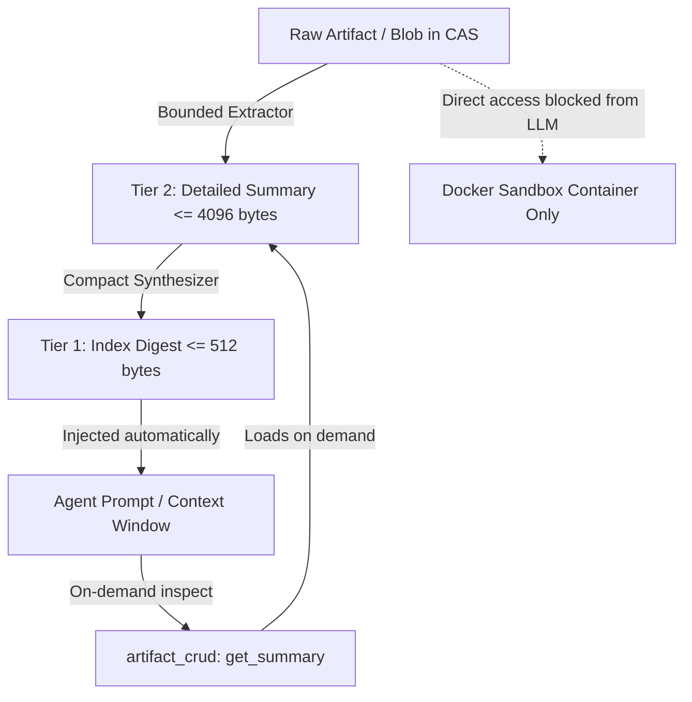

# P2.1 Artifact Registry & Versioned Contract Design

**Status**: Reviewable Architecture Proposal (2026-10-14).  
**Phase**: P2 (Artifact versions, lineage, and events) — Slice P2.1.  
**Baseline commit**: `ed5812f` (`codex/p1-cgroup-orphan-recovery`).  
**Prerequisites**: P1 (P1.1–P1.6) verified and complete. SQLite `PRAGMA user_version` remains at 9 until runtime migration in P2.2.  
**Scope**: Read-only inventory of existing artifact records and lifecycles, gap and compatibility risk analysis, and concrete architecture design for unified Content-Addressable Storage (CAS), immutable artifact versions, lineage graphs, annotations, durable event journals, and two-tier summary contracts.

---

## 1. Executive Summary & Core Constraints

In MLRescurix v1 and M0–M6, artifact handling emerged organically across disparate subsystems:
- M0 tracked primitive references (`refs`) for task context checkpoints.
- M1 tracked job-level filesystem outputs (`managed_artifacts`) under `artifacts/<project>/<job>/`.
- M2/M3 stored scientific datasets (`scientific_datasets`) and experiment outputs (`trial_results`) with ad-hoc workflow file paths (`trials/<id>/candidate.joblib`).
- M4 recorded agent achievements (`achievements`) and findings (`scientific_findings`) with ad-hoc filesystem checks (`.m2/evidence/`, `workflows/<p>/evidence/`).
- M6 introduced authoritative cryptographic pipeline receipts (`pipeline_receipts`), content decisions (`content_decisions`), and state-bound bundle verification (`bundle/manifest.json`).

While functional for individual milestones, this fragmented structure has critical architectural limitations:
1. **No Content-Addressable Storage (CAS)**: Files are copied or addressed by mutable relative paths, preventing cross-job and cross-project deduplication and risking drift.
2. **Missing Logical Identity & Versioning**: Artifacts are strictly bound to ephemeral job IDs. There is no concept of a long-lived logical artifact (e.g. `candidate.primary_logistic`) evolving through immutable versions (`v1`, `v2`, ...).
3. **Implicit & Late Lineage**: Lineage is only captured during finalization in a single `lineage.json` file rather than as a first-class, queryable DAG spanning all intermediate trials, evaluations, and derivations.
4. **Context Window Token Bloat Risk**: Agents reading raw trial results or findings risk exhausting LLM context windows without bounded summaries.
5. **Event Journal Fragmentation**: State transitions emit unstructured events without typed schema versioning or replay retention guarantees.

P2.1 establishes the authoritative architectural design for a unified, versioned artifact registry without altering runtime code.

### 1.1 Non-Negotiable Invariants & Preserved Constraints
The design strictly preserves all system invariants:
- **Trusted Scoring & Split/Label Isolation**: Official scorecards are writable *only* by evaluator authority (`evaluator:trusted`). Claimed agent metrics are explicitly marked unofficial. Evaluator processes never import arbitrary candidate code into a label-bearing context.
- **Single-Use Sealed Test Gate**: Final assessment gates (`final_test_gates`) remain single-use, hardware-fsynced, and cryptographically bound to the frozen candidate model and test split.
- **Docker-Only Scientific & Candidate Execution**: Untrusted candidate fitting, prediction, and agent sandbox code run *only* inside approved, digest-pinned OCI containers (`mlrescurix-scientific@sha256:...`). Host scientific execution remains prohibited.
- **128 MiB Managed-State Policy Ceiling**: All state writes (CAS blobs, registry rows, staging directories, logs, runtime assets) must pass pre-admission accounting under the 128 MiB ceiling with 4 MiB emergency headroom and 2 MiB SQLite/WAL reserve. Zero silent write exemptions.
- **Generation & Intent Fencing**: Stale workers and superseded task epochs are deterministically rejected before publication.
- **Durable Retry Fences**: Idempotency retry fences (`commands`, `action_fences`, `tombstones`) are never deleted during compaction or garbage collection.
- **Database Versioning Discipline**: SQLite `PRAGMA user_version` remains strictly at 9 in this design slice. P2 owns the additive migration to `user_version = 10` upon explicit user authorization.

---

## 2. Authoritative Inventory of Current Artifact Records & Lifecycle

### 2.1 Authoritative SQLite Tables (M0–M6)

| Table | Owning Milestone | Primary Key | Key Columns & Artifact Semantics | Current Lifecycle & Limitations |
|---|---|---|---|---|
| `refs` | M0 (`schema.sql`) | `(project, id)` | `category TEXT`, `digest TEXT` | Used by `storage.rs::validate_context_refs` to validate `Context.evidence`, `Context.artifacts`, `Context.jobs`. Primitive pointer; no byte count, media type, or versioning. |
| `managed_artifacts` | M1 (`schema_m1.sql`) | `(project, job, name)` | `bytes INTEGER`, `sha256 TEXT`, `pinned INTEGER` | Stores output files emitted by worker jobs. Pinned files (`pinned=1`) protected from GC. Keyed by job ID; cannot represent an artifact across jobs. |
| `tombstones` | P1.4 (`execution.rs`, `storage.rs`) | `(project, entity_kind, entity_id)` | `parent_id TEXT`, `identity_hash TEXT`, `reclaimed_bytes INTEGER`, `details_json TEXT`, `tombstoned_ms INTEGER` | Records pruned terminal jobs, unpinned deleted artifacts, and compacted settled actions with reclaimed bytes. |
| `scientific_datasets` | M2 (`schema_m2.sql`) | `(project, id)` | `path TEXT`, `bytes INTEGER`, `sha256 TEXT`, `registered_ms INTEGER` | Registered dataset CSV files (bounded 1 byte to 32 MiB). Unlinked from global CAS. |
| `scientific_jobs` | M2/M6 (`schema_m6_completion.sql`) | `(project, job)` | `dataset TEXT`, `operation TEXT`, `spec TEXT`, `result_sha256 TEXT` | Records scientific operation (`audit`, `baselines`, `finalize`, `trial`, `pipeline`) and output hash. |
| `final_test_gates` | M2/M6 (`schema_m2.sql`) | `(project, access_id)` | `dataset_sha256 TEXT`, `candidate_id TEXT`, `frozen_model_sha256 TEXT`, `status TEXT`, `result_sha256 TEXT` | Single-use sealed test consumption gate. Fsynced before scoring; interlock prevents duplicate evaluation. |
| `search_sessions` | M3 (`schema_m3.sql`) | `(project, id)` | `dataset_id TEXT`, `apex_candidate_id TEXT`, `selection_record TEXT` | Search state machine. Stores JSON selection record and pointer to Apex candidate. |
| `experiment_dag` | M3/M6 (`schema_m6.sql`) | `(project, id)` | `session_id TEXT`, `recipe TEXT`, `parameters TEXT`, `fidelity REAL`, `parent_id TEXT` | DAG of trial configurations. Parent-child links exist only within search session. |
| `trial_results` | M3 (`schema_m3.sql`) | `(project, experiment_id)` | `primary_metric REAL`, `metrics TEXT`, `is_feasible INTEGER`, `model_sha256 TEXT`, `predictions_sha256 TEXT`, `artifact_path TEXT` | Stores metric scores and relative filesystem path (`trials/<exp_id>/trial.json`). |
| `achievements` | M4 (`schema_m4.sql`) | `(project, achievement_id)` | `task_id TEXT`, `kind TEXT`, `summary TEXT`, `evidence_sha256 TEXT`, `metrics TEXT` | Agent milestones. Points to evidence SHA-256 in ad-hoc paths. |
| `scientific_findings` | M4 (`schema_m4.sql`) | `(project, finding_id)` | `task_id TEXT`, `hypothesis_id TEXT`, `verdict TEXT`, `rationale TEXT`, `metrics TEXT`, `artifacts TEXT` | Agent hypotheses and conclusions. `artifacts` is an untyped JSON list of names/hashes. |
| `scientific_ensembles` | M5 (`schema_m5.sql`) | `(project, ensemble_id)` | `recipe_type TEXT`, `parent_ids TEXT`, `weights TEXT`, `is_feasible INTEGER` | Lineage represented as comma-delimited strings in `parent_ids`. |
| `calibration_records` | M5 (`schema_m5.sql`) | `(project, calibration_id)` | `base_candidate_id TEXT`, `method TEXT`, `brier_score REAL`, `log_loss REAL` | Brier score and calibration method linked to base candidate ID. |
| `pipeline_receipts` | M6 (`schema_m6_completion.sql`) | `(project, candidate)` | `job TEXT`, `dataset_sha256 TEXT`, `source_sha256 TEXT`, `environment_identity TEXT`, `protocol_sha256 TEXT`, `model_sha256 TEXT`, `predictions_sha256 TEXT`, `oof_sha256 TEXT`, `receipt_json TEXT` | Authoritative cryptographic receipt for scheduled pipelines. Binds dataset, source code, environment, and OOF outputs. |
| `content_decisions` | M6 (`schema_m6_completion.sql`) | `(project, candidate, kind, created_ms)` | `binding_sha256 TEXT`, `kind TEXT`, `actor TEXT`, `approved INTEGER`, `rationale TEXT`, `binding_json TEXT` | Authoritative approval decisions (`user_approval`, `critic_audit`). |

### 2.2 Authoritative Filesystem Paths

```text
.mlrescurix-state/
├── OWNED                                  # Ownership marker (mlrescurix-owned-v1)
├── SUPERVISOR.lock / COLLECTOR.lock       # Cross-process locks
├── state.sqlite, -wal, -shm               # Authoritative SQLite database
├── artifacts/
│   └── <project>/
│       ├── .<job>.staging/                # Worker staging (purged on failure/restart)
│       └── <job>/                         # Published worker outputs
├── workflows/
│   └── <project>/
│       ├── dataset_manifest.json          # Ingested dataset profile
│       ├── results.json                   # Trial results collection
│       ├── final.json                     # Final verified scorecard
│       ├── selection.json                 # Apex selection record
│       ├── lineage.json                   # Finalized pipeline lineage
│       ├── test_access.json               # Sealed test consumption marker
│       ├── .bundle_stage/                 # Temporary bundle staging
│       ├── bundle/                        # Final deliverable bundle (manifest.json, model.joblib)
│       ├── trials/<exp_id>/               # Per-trial artifacts (candidate.joblib, trial.json)
│       └── evidence/<sha256>              # Ad-hoc evidence files
├── .m2/
│   └── evidence/<sha256>                  # Historical ad-hoc evidence path
├── datasets/
│   └── <project>/<id>.csv                 # Registered immutable CSV data
├── workspaces/
│   └── <project>/<branch>/                # Branch working trees
├── runtime-assets/<hash>/python/          # Embedded Python runtime assets
├── scientific-sources/<hash>/             # Embedded scientific Python modules
└── logs/<project>/<job>.log               # Subprocess logs (capped at 1 MiB)
```

### 2.3 Authoritative APIs & Consumers

1. **Rust Supervisor (`execution.rs`)**:
   - `Supervisor::publish`: Inspects `artifacts/<project>/.<job>.staging/`, validates file sizes and non-symlink metadata against `v.spec.max_output_bytes`, fsyncs and atomically renames to `artifacts/<project>/<job>/`, and commits rows into `managed_artifacts`.
   - `collect_artifacts` & `archive_artifacts`: Sweeps unpinned terminal job directories, records reclaimed bytes in `tombstones`, protects active leases, active tasks, and pinned artifacts (`pinned=1`).
   - `verify_finalized_pipeline_bundle`: Cross-checks `workflows/<project>/bundle/manifest.json` against `managed_artifacts` and `final_test_gates`.
2. **Agent Tools & Context (`agents/tools.rs`, `orchestrator.rs`, `context.rs`)**:
   - `retrieve_evidence(evidence_id)`: Queries `achievements` or `scientific_findings`, probes both `.m2/evidence/<sha>` and `workflows/<p>/evidence/<sha>`, computes SHA-256, and returns JSON payload.
   - `request_finalization`: Submits finalization job; verifies content decisions and critic audits before scoring.
   - `AgentContextManager`: Spills older findings and achievements to text prompts with pointers to `retrieve_evidence`.
3. **Python Dashboard (`mlrescurix_worker/scientific/dashboard.py`)**:
   - `GET /v1/projects/<id>/snapshot`: Queries SQLite tables directly (`jobs`, `search_sessions`, `experiment_dag`, `trial_results`, `agent_tasks`, `scientific_findings`) and reads JSON files from `workflows/<project>/`.
   - `GET /v1/projects/<id>/events?after=<cursor>`: SSE stream that polls SQLite `events` via Rust CLI `events`.

---

## 3. Gaps, Inefficiencies & Compatibility Risks

1. **Storage Duplication & Inconsistent CAS**:
   - Blobs are duplicated between `artifacts/`, `workflows/trials/`, `workflows/bundle/`, and `evidence/`.
   - Storing identical model weights or prediction arrays across multiple trials exhausts the 128 MiB policy ceiling prematurely.
   - No single cryptographic CAS directory exists.
2. **Disconnected Artifact Identities**:
   - `managed_artifacts` is keyed by `(project, job, name)`. If job `j1` creates a model and job `j2` evaluates it, the model is only known as `artifacts/p/j1/model.joblib`. There is no logical entity `model.linear_baseline` with version `v1`.
   - `refs` in M0 holds `(id, category, digest)` but lacks foreign keys to actual files, media types, or version trees.
3. **Lineage Fragmentation**:
   - Intermediate model derivations (e.g. data transform -> base model -> calibration -> ensemble) are recorded across disjoint tables (`experiment_dag`, `feature_transforms`, `calibration_records`, `scientific_ensembles`) using incompatible formats (strings, JSON, parent IDs).
   - Graph queries (e.g. "which dataset, transform, and code produced candidate X?") require manual joins across five tables.
4. **Context Window Token Bloat Risk**:
   - When an agent retrieves evidence, the entire raw JSON metrics or string rationale is returned.
   - Without a standardized `<= 512` byte `index_digest` for discovery and `<= 4096` byte `summary_text` for on-demand inspection, agents can easily exhaust prompt token limits or trigger Context Firewall redaction.
5. **Dashboard SSE Connection Contention**:
   - Dashboard holds an HTTP connection open for SSE, currently invoking Rust CLI subprocesses in a loop.
   - Long-running transactions or direct table locks during event streaming can starve SQLite WAL writers.
6. **Migration Compatibility with user_version = 9**:
   - Existing tables must remain readable. Any change to `managed_artifacts`, `pipeline_receipts`, or `trial_results` must be purely additive.
   - Upgrading from `user_version = 9` to `10` must preserve all historical rows, existing retry fences, and pinned artifacts.

---

## 4. Target Architecture & Relational Contracts (`user_version = 10`)

### 4.1 Content-Addressable Storage (CAS) Layout
All immutable artifact data bytes reside in a centralized, hash-addressed directory under the state root:

```text
.mlrescurix-state/
└── cas/
    ├── .staging/                          # Bounded temporary write staging
    │   └── <uuid-or-nonce>.tmp
    └── <sha256[0..2]>/                    # 2-character fan-out directory (e.g., 3c/)
        └── <sha256>                       # Immutable blob file (read-only 0o444)
```

#### CAS Invariants & Write Protocol:
1. **Pre-Admission Reservation**: Prior to writing, caller must acquire a byte reservation via `enforce_state_write_admission(bytes, StorageWriteKind::ManagedBlob, Some(project))` against the 128 MiB policy.
2. **Bounded Staging**: Write blob bytes to `<state>/cas/.staging/<nonce>.tmp`. Enforce size limits and symlink rejection (`O_NOFOLLOW`).
3. **Cryptographic Verification**: Compute SHA-256 while streaming/writing. Confirm computed hash matches expected hash (or use computed hash as blob identity).
4. **Hardware Fsync & Read-Only Perms**: Fsync file and parent directory. Set file permissions to read-only (`0o444`).
5. **Atomic Rename**: Atomically rename `<state>/cas/.staging/<nonce>.tmp` to `<state>/cas/<hash[0..2]>/<hash>`. If destination exists (identical content), unreserved staging file is deleted immediately.
6. **SQLite Metadata Commit**: In the same immediate database transaction, insert `blobs` record and corresponding `artifact_versions` record.
7. **Reservation Settlement**: Settle held reservation.
8. **Crash Reconciliation**: Any orphaned files in `<state>/cas/.staging/` older than 15 minutes are purged during startup or GC sweep.

### 4.2 Target SQLite Schema DDL (`schema_m7_artifacts.sql`)

```sql
-- MLRescurix v2 Artifact Registry Schema Migration: user_version 9 -> 10

-- 1. Immutable Content-Addressable Storage Blobs
CREATE TABLE blobs(
  sha256 TEXT PRIMARY KEY,
  bytes INTEGER NOT NULL CHECK(bytes >= 0),
  media_type TEXT NOT NULL,
  created_ms INTEGER NOT NULL
);
CREATE INDEX blobs_created ON blobs(created_ms);

-- 2. Logical Artifact Entities (Project-Scoped)
CREATE TABLE artifacts(
  project TEXT NOT NULL REFERENCES projects(id),
  artifact_id TEXT NOT NULL,
  kind TEXT NOT NULL CHECK(kind IN (
    'data_profile',
    'research_note',
    'code',
    'run_log',
    'diagnostic_spec',
    'prediction',
    'scorecard',
    'apex_bundle',
    'checkpoint',
    'model_weights'
  )),
  producer_authority TEXT NOT NULL,
  current_version_id TEXT,
  pinned INTEGER NOT NULL DEFAULT 0 CHECK(pinned IN (0, 1)),
  visibility TEXT NOT NULL DEFAULT 'project' CHECK(visibility IN ('public', 'project', 'internal')),
  tombstoned_ms INTEGER,
  created_ms INTEGER NOT NULL,
  updated_ms INTEGER NOT NULL,
  PRIMARY KEY(project, artifact_id)
);
CREATE INDEX artifacts_project_kind ON artifacts(project, kind, pinned);

-- 3. Immutable Artifact Versions
CREATE TABLE artifact_versions(
  project TEXT NOT NULL REFERENCES projects(id),
  version_id TEXT NOT NULL,
  artifact_id TEXT NOT NULL,
  blob_sha256 TEXT NOT NULL REFERENCES blobs(sha256),
  index_digest TEXT NOT NULL,
  summary_text TEXT,
  schema_version INTEGER NOT NULL DEFAULT 1,
  metadata_json TEXT NOT NULL DEFAULT '{}',
  source_job_id TEXT,
  created_ms INTEGER NOT NULL,
  PRIMARY KEY(project, version_id),
  FOREIGN KEY(project, artifact_id) REFERENCES artifacts(project, artifact_id),
  FOREIGN KEY(project, source_job_id) REFERENCES jobs(project, id),
  CHECK(length(index_digest) <= 512),
  CHECK(summary_text IS NULL OR length(summary_text) <= 4096)
);
CREATE INDEX artifact_versions_lookup ON artifact_versions(project, artifact_id, created_ms);
CREATE INDEX artifact_versions_blob ON artifact_versions(blob_sha256);

-- 4. Directed Lineage Graph
CREATE TABLE artifact_lineage(
  project TEXT NOT NULL REFERENCES projects(id),
  source_version_id TEXT NOT NULL,
  target_version_id TEXT NOT NULL,
  relation TEXT NOT NULL CHECK(relation IN (
    'derived_from',
    'evaluates',
    'packages',
    'supersedes'
  )),
  metadata_json TEXT NOT NULL DEFAULT '{}',
  created_ms INTEGER NOT NULL,
  PRIMARY KEY(project, source_version_id, target_version_id, relation),
  FOREIGN KEY(project, source_version_id) REFERENCES artifact_versions(project, version_id),
  FOREIGN KEY(project, target_version_id) REFERENCES artifact_versions(project, version_id)
);
CREATE INDEX artifact_lineage_target ON artifact_lineage(project, target_version_id, relation);

-- 5. Mutable Versioned Annotations (Notes & Critique)
CREATE TABLE artifact_annotations(
  project TEXT NOT NULL REFERENCES projects(id),
  annotation_id TEXT NOT NULL,
  version_id TEXT NOT NULL,
  author TEXT NOT NULL,
  revision INTEGER NOT NULL DEFAULT 1,
  note_text TEXT NOT NULL,
  created_ms INTEGER NOT NULL,
  PRIMARY KEY(project, annotation_id),
  FOREIGN KEY(project, version_id) REFERENCES artifact_versions(project, version_id),
  CHECK(length(note_text) <= 4096)
);
CREATE INDEX artifact_annotations_version ON artifact_annotations(project, version_id);

-- 6. Project Candidate Selection & Apex History
CREATE TABLE project_selections(
  project TEXT NOT NULL REFERENCES projects(id),
  selection_id TEXT NOT NULL,
  candidate_version_id TEXT NOT NULL,
  scorecard_version_id TEXT NOT NULL,
  protocol_sha256 TEXT NOT NULL,
  rationale TEXT NOT NULL,
  is_apex INTEGER NOT NULL CHECK(is_apex IN (0, 1)),
  created_ms INTEGER NOT NULL,
  PRIMARY KEY(project, selection_id),
  FOREIGN KEY(project, candidate_version_id) REFERENCES artifact_versions(project, version_id),
  FOREIGN KEY(project, scorecard_version_id) REFERENCES artifact_versions(project, version_id)
);
CREATE INDEX project_selections_apex ON project_selections(project, is_apex, created_ms);

-- 7. Versioned Durable Event Journal
CREATE TABLE durable_events(
  cursor INTEGER PRIMARY KEY AUTOINCREMENT,
  project TEXT NOT NULL REFERENCES projects(id),
  event_type TEXT NOT NULL,
  version INTEGER NOT NULL DEFAULT 1,
  payload_json TEXT NOT NULL,
  committed_ms INTEGER NOT NULL
);
CREATE INDEX durable_events_stream ON durable_events(project, cursor);

PRAGMA user_version = 10;
```

### 4.3 Multi-File Directory Artifacts & Canonical Manifest Contract
Composite artifacts (such as model bundles, source trees, and fold arrays) are stored in the CAS as a single canonical JSON manifest blob with media type `application/x-directory-manifest+json`:

```json
{
  "manifest_version": 1,
  "kind": "directory_manifest",
  "total_bytes": 1048576,
  "file_count": 3,
  "files": [
    { "path": "entrypoint.py", "bytes": 2048, "sha256": "e3b0c44298fc1c149afbf4c8996fb92427ae41e4649b934ca495991b7852b855" },
    { "path": "model.joblib", "bytes": 1042432, "sha256": "5f4dcc3b5aa765d61d8327deb882cf99" },
    { "path": "schema.json", "bytes": 4096, "sha256": "098f6bcd4621d373cade4e832627b4f6" }
  ]
}
```
Validation rules:
- Paths must be sorted lexicographically, relative, non-empty, and strictly free of `..` or leading `/`.
- Symlinks are strictly prohibited.
- `file_count <= 1024` and `total_bytes` within allocated write budget.

---

## 5. Context Firewall & Two-Tier Summary Contracts

To prevent unbounded token growth and protect LLM reasoning from high-entropy outputs:



### 5.1 Tier 1: Index Digest Contract (`<= 512` UTF-8 Bytes)
Mandatory field on every `artifact_versions` record.
- **Purpose**: Low-overhead discovery, leaderboards, DAG listings, and automatic agent context injection.
- **Budget**: Exactly bounded to `<= 512` bytes (enforced by SQLite `CHECK(length(index_digest) <= 512)`).
- **Contents**: Identity, kind, short verdict/metric, creation epoch, and reference to version ID.
- **Example**:
  ```text
  [candidate_logistic_v2] kind:scorecard metric:0.8412_f1 feasibility:feasible created:2026-10-14T11:00Z sha:a1b2c3d4 (use get_summary with id='ver_c2_score' for full metrics)
  ```

### 5.2 Tier 2: Detailed Summary Contract (`<= 4096` UTF-8 Bytes)
Optional field on `artifact_versions`, fetched on-demand by agents.
- **Purpose**: Diagnostic drill-down, critic audit review, and user dashboard views.
- **Budget**: Bounded to `<= 4096` bytes (enforced by SQLite `CHECK(summary_text IS NULL OR length(summary_text) <= 4096)`).
- **Contents**: Summary table of metrics, hyperparameters, data slice support, and verification receipts.
- **Outbound Filter Gate**: Must pass `OutboundFilter` and approved-view validation before being emitted to provider APIs.

---

## 6. Migration Strategy & Backward Compatibility (`user_version = 9` to `10`)

### 6.1 Safe Non-Destructive DDL & Backfill
When P2 implementation is authorized, migration execution will follow this sequence:
1. Open immediate transaction with `rusqlite::TransactionBehavior::Immediate`.
2. Execute `schema_m7_artifacts.sql` creating the 7 new tables and their indexes.
3. **Backfill Existing Records**:
   - `managed_artifacts`: For each existing record, register a blob in `blobs` and create a legacy artifact version `(artifact_id = name, version_id = format!("{}_{}", job, name))` with an auto-generated `<= 512` byte index digest.
   - `scientific_datasets`: Register as `kind = 'data_profile'` artifacts with `pinned = 1`.
   - `pipeline_receipts`: Backfill into `artifact_versions` with `kind = 'scorecard'` and link to candidate via `artifact_lineage (relation = 'evaluates')`.
   - `final_test_gates`: Backfill into `project_selections` for consumed gates.
4. Verify foreign key integrity with `PRAGMA foreign_key_check;`.
5. Bump `PRAGMA user_version = 10;`.
6. Commit transaction.

### 6.2 Reader Compatibility Matrix

| Consumer / Surface | Current Access | P2 Transition Behavior | Long-Term P2 Surface |
|---|---|---|---|
| `bundle::verify_bundle` | Queries `managed_artifacts` | Continues querying `managed_artifacts` (dual-written) | Queries `artifact_versions` via `bundle/manifest.json` |
| `Supervisor::publish` | Inserts into `managed_artifacts` | Dual-writes to `managed_artifacts` and `artifact_versions` | Writes exclusively to `artifact_versions` |
| `collect_artifacts` | Deletes from `managed_artifacts` | Marks `artifact_versions.tombstoned_ms` and unlinks unreferenced `blobs` | Lease-aware CAS GC |
| `retrieve_evidence` tool | Scans `.m2/evidence/` & SQLite | First checks `artifact_versions` / CAS, falls back to legacy paths | Unified `artifact_crud` tool |
| Python `dashboard.py` | Scans `workflows/<p>/*.json` & SQLite | Reads both legacy workflow JSONs and new `artifact_versions` table | Rust axum API streaming `durable_events` |

---

## 7. Bounded Storage Behavior & Lease-Aware Garbage Collection

### 7.1 Strict 128 MiB Capacity Accounting
- All CAS blob allocations must request reservations under `StorageWriteKind::ManagedBlob`.
- SQLite database metadata growth is bounded:
  - `index_digest` `<= 512` bytes, `summary_text` `<= 4096` bytes.
  - Command body compaction (P1.4) retains only SHA-256 hashes for settled actions.
  - Durable events retain a sliding window (default 10,000 per project) with cursor snapshot checkpoints.

### 7.2 Lease-Aware GC Protocol (Sweep & Tombstone)
GC operates without blocking active jobs:
1. **Acquire Cross-Process Lock**: Acquire `COLLECTOR.lock`.
2. **Mark Phase (Protected Set Identification)**:
   - All `blobs` referenced by `artifacts` where `pinned = 1`.
   - All `blobs` referenced by `project_selections` where `is_apex = 1`.
   - All `blobs` referenced by active environment leases (`environment_leases`).
   - All `blobs` referenced by active agent tasks (`tasks.status = 'active'`).
   - All `blobs` referenced by jobs terminal for less than 1 hour (grace window).
3. **Sweep Phase (Unreferenced Deletion)**:
   - Identify unreferenced CAS files under `<state>/cas/`.
   - Compute SHA-256 and byte size.
   - Delete physical file.
   - Insert receipt into `tombstones (entity_kind = 'artifact', ...)`.
   - Delete row from `blobs` table.
4. **Fsync Parent Directories**: Fsync CAS bucket directories to guarantee reclaim on crash.

---

## 8. Test Matrix & Acceptance Gates for Implementation (P2.2–P2.5)

| Slice | Required Regression / Verification Gate | Pass Criteria |
|---|---|---|
| **P2.1 (Current)** | Static Documentation & Architecture Check | All v2 docs cross-reference cleanly; zero runtime diffs; `PRAGMA user_version = 9` preserved. |
| **P2.2** | Populated Upgrade & CAS Atomic Publish | Existing v9 database upgrades to v10 with zero lost records. CAS publish is atomic; crash during staging leaves no corrupt blobs. |
| **P2.3** | Two-Tier Summary Bounds & Evaluator Authority | `index_digest > 512` bytes or `summary_text > 4096` bytes rejects deterministically. Unauthorized agent attempting to publish `kind = 'scorecard'` is rejected. |
| **P2.4** | Durable Event Journaling & Replay Cursors | Every mutation transaction atomically commits a `durable_events` record. Cursor replay is monotonic; reconnects recover missing events. |
| **P2.5** | Reader Pool & SSE Non-Blocking Stress | Multiple concurrent readers inspect DAG and artifact lineage under WAL mode without blocking supervisor writers or deadlocking SQLite. |

---

## 9. Open Decisions & Required Implementation Authorization

### 9.1 Open Architectural Decisions
1. **CAS Scope (Per-Project vs Global)**:
   - *Proposal*: Global CAS layout (`<state>/cas/<hash[0..2]>/<hash>`) with project-scoped foreign key references in `artifact_versions`. This maximizes deduplication of identical datasets and pretrained weights while strictly isolating project namespaces.
2. **Event Retention Ceiling**:
   - *Proposal*: Default 10,000 events per project. Periodic background compaction records cursor snapshot and prunes older terminal events while preserving retry fences.
3. **Read-Only Connection Pool Sizing**:
   - *Proposal*: 4 dedicated read-only SQLite connections (`PRAGMA query_only = ON`) for HTTP/SSE queries, preventing writer starvation.

### 9.2 Specific Authorization Needed to Proceed
To advance from this design proposal to runtime implementation (P2.2):
1. **Authorize Schema Migration**: Approval to add `crates/harness/src/schema_m7_artifacts.sql` and advance `PRAGMA user_version` from 9 to 10 in `crates/harness/src/execution.rs` and `storage.rs`.
2. **Authorize Runtime CAS Module**: Approval to implement `crates/harness/src/cas.rs` managing hash-addressed storage, staging, and atomic publishing under the 128 MiB policy.
3. **Authorize Dual-Write Compatibility Adapters**: Approval to update `Supervisor::publish` and `managed_artifacts` to mirror records into `artifact_versions`.
