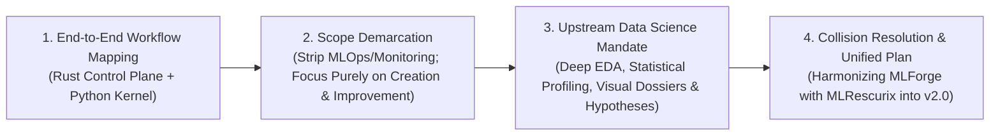

# MLRescurix v2.0: Master Architecture, Lifecycle Journey & Implementation Blueprint

> **Status:** Final Architectural Specification & Implementation Master Plan  
> **Target Release:** `v2.0`  
> **Scope Invariant:** Strictly bounded to **Data Science, EDA, Model Creation, Model Improvement, and Certified Handoff**. All downstream MLOps, production drift monitoring, and live maintenance tools are explicitly excluded.

---

## 1. Executive Summary & Core Objective

The mission of **MLRescurix** is to build a high-throughput, cost-aware, autonomous machine learning harness that executes the entire analytical and modeling journey of a **Staff Data Scientist / Kaggle Grandmaster**—from raw, dirty input data to an immutable, certified, production-grade model bundle (`mlrescurix.bundle.v2`).

By decoupling the **Deterministic Rust Control Plane** (memory limits, SQLite state ledger, sealed holdout vault, and L0–L4 verification gates) from the **Python Scientific Kernel** (exploratory data analysis, hypothesis formation, and warm containerized model training), MLRescurix eliminates the primary failure modes of existing AutoML agents:
1. **Silent Data & Target Leakage** (prevented via an out-of-process trusted evaluator and single-use SQLite holdout vault).
2. **Hallucinated Metrics & Unstable Code** (prevented via a 10-primitive Typed Action DSL and deterministic L0–L4 verification gates).
3. **Runaway Compute & Memory Crashes** (prevented via multi-fidelity BOHB search, LC-PFN early-stopping pruners, and Linux cgroup v2 memory ceilings).

---

## 2. Conversation Synthesis: How the Architecture Evolved

Across our discussions, the architecture evolved through four decisive phases of design and refinement:



1. **End-to-End Workflow & Sub-50ms Sandboxes:** Established the foundational boundary between the Rust Control Plane and Python execution workers running in ephemeral, warm Docker containers with 32KB diagnostic error recovery bridges.
2. **Strict Scope Clarification:** Pruned all post-deployment MLOps components (`mlforge-monitor`, `drift_check.py`, `alerts.py`, and ongoing model maintenance). Locked the project scope exclusively to **data processing, EDA, hypothesis generation, model training, ensembling, and verified artifact handoff**.
3. **The Data Science & EDA Imperative:** Acknowledged that jumping directly from raw data to gradient boosting trees causes catastrophic failure on dirty real-world datasets. Introduced a formal upstream Data Science engine: dirty string parsing, semantic topology classification, statistical tests (ANOVA, Kruskal-Wallis, Mutual Information), missingness profiling (MCAR/MAR/MNAR), visual artifact generation, and hypothesis formulation.
4. **Collision Resolution:** Formally analyzed and resolved the 4 architectural overlaps between the harvested MLForge algorithms and the MLRescurix core.

---

## 3. Resolving the 4 Architectural Collisions

When merging the algorithmic harvest of **MLForge** with the **MLRescurix** Scientific Kernel, four major contradictions were identified and resolved:

```mermaid
classDiagram
    class Collision1_PreFlight {
        MLForge: deletion_analysis.py (MI < 0.01, r > 0.95, ID leak)
        MLRescurix: semantic_sieve.py + eda_agent.py
        Resolution: Single-pass Hard-Pruning Gate inside eda_agent.py on train fold
    }
    class Collision2_PruningVsInteractions {
        MLForge: Immediately drops univariate MI < 0.01
        MLRescurix: Discovers 2D non-linear interactions (A/B, A*B)
        Resolution: Two-Tier Quarantine Pool (quarantine_columns)
    }
    class Collision3_HypothesesDSL {
        MLForge: 4 rigid text macros
        MLRescurix: Rich statistical primitives (Box-Cox, OOF Bayes, etc.)
        Resolution: 10-Primitive Typed Action DSL mapped to primitives.py
    }
    class Collision4_NestedCVCompute {
        MLForge: 5x5 Nested CV at Phase 6 (25x compute)
        MLRescurix: Multi-fidelity BOHB + K-fold OOF Ensemble
        Resolution: Fold-Variance Gate (std <= 0.05) + 1,000x OOF Bootstrap CI
    }
```



### Collision 1: Duplicated Pre-Flight & Leakage Logic
* **Problem:** Running `deletion_analysis.py` after `semantic_sieve.py` and `eda_agent.py` redundantly calculates Mutual Information and correlation matrices twice.
* **Unified Resolution:** **Single-Pass Hard Pruning.** Merge all deletion rules directly into [`eda_agent.py`](file:///Users/hamza/Developer/Imp_Projects/MLRescurix/python/src/mlrescurix_worker/scientific/eda_agent.py). Feature-target associations and cross-correlations are computed **exactly once** on the training folds *strictly after* the holdout vault is locked.

### Collision 2: Premature MI Pruning vs. Interaction Discovery
* **Problem:** `deletion_analysis.py` immediately deletes features with univariate $\text{MI} < 0.01$. However, individually weak features (e.g., tenure and loan amount) often form massive non-linear predictors when combined as ratios ($A / B$) or products ($A \times B$).
* **Unified Resolution:** **Two-Tier Quarantine (`QuarantinePool`).** Features with $\text{MI} < 0.01$ are placed in `state.quarantine_columns`. They are excluded from baseline tree splits (cutting noise) but remain fully accessible to `QuasiIdDecomposer` and `add_interaction` if their joint 2D MI is high.

### Collision 3: Free-Form M1 Hypotheses vs. Typed Executor
* **Problem:** Prompting an LLM (M1) to write free-form pandas scripts causes AST syntax errors, namespace clashes, and data leakage. MLForge's 4 macros were too limited to express rich statistical transformations.
* **Unified Resolution:** **10-Primitive Typed Action DSL.** The M1 Orchestrator emits structured JSON adhering to a strict schema. [`hypothesis_executor.py`](file:///Users/hamza/Developer/Imp_Projects/MLRescurix/python/src/mlrescurix_worker/scientific/hypothesis_executor.py) deterministically maps these JSON payloads to verified classes in [`primitives.py`](file:///Users/hamza/Developer/Imp_Projects/MLRescurix/python/src/mlrescurix_worker/scientific/primitives.py).

### Collision 4: Nested CV Compute Explosion
* **Problem:** Running a full $5 \times 5$ Nested CV on an ensemble of 6 models at the end wastes $25\times$ compute and causes hours of container delay.
* **Unified Resolution:** **Fold-Variance Gate + 1,000× OOF Bootstrap CI.** Enforce a fold standard deviation gate ($\sigma_{\text{CV}} \le 0.05$) across the already-computed $K$-fold cross-validation. Run a 1,000× Monte Carlo Bootstrap on the pooled Out-of-Fold prediction vector:
  $$\text{CI}_{95\%} = \left[ \text{Percentile}_{2.5\%}\left(\text{Metric}(\mathbf{y}_{\text{true}}^{(b)}, \hat{\mathbf{y}}_{\text{oof}}^{(b)}\right), \; \text{Percentile}_{97.5\%}\left(\text{Metric}(\mathbf{y}_{\text{true}}^{(b)}, \hat{\mathbf{y}}_{\text{oof}}^{(b)}\right) \right]$$
  Full nested CV is reserved strictly for tiny datasets ($N < 10,000$).

---

## 4. End-to-End Master Lifecycle (MLRescurix v2.0)

```
[ USER INPUT: Problem Statement + Raw Dataset + Target/Metric + Latency SLA ]
                                      │
  ════════════════════════════════════▼════════════════════════════════════
  PHASE 0: IMMUTABLE FRAMING & RUST LEDGER (`crates/harness/storage.rs`)
  ├─ Locks `ProjectSpec` (Metric, Latency SLA, 128 MiB Ledger Cap)
  └─ Queries `meta_db.py` to seed solution space & hyperparameter prior bounds
  ════════════════════════════════════╦════════════════════════════════════
                                      ║
  ════════════════════════════════════▼════════════════════════════════════
  PHASE 1: DATA HYGIENE, TOPOLOGY & VAULT SPLIT (`dirty_sanitizer` + `semantic_sieve`)
  ├─ `dirty_sanitizer.py`: Sentinels -> NaN, accounting "(1,234)", currencies, float32
  ├─ `semantic_sieve.py`: Tags DROP_SURROGATE_ID, QUASI_ID, TEXT, SAFE_CAT, TEMPORAL
  └─ LEAKAGE FIREWALL: Locks Stratified/Group/Purged-Time CV + Sealed SQLite Holdout Vault
  ════════════════════════════════════╦════════════════════════════════════
                                      ║
  ════════════════════════════════════▼════════════════════════════════════
  PHASE 2: DEEP STATISTICAL EDA & DELETION SIEVE (`eda_agent.py`)
  ├─ Univariate & Missingness Profiling: Skewness, Kurtosis, MCAR/MAR/MNAR classification
  ├─ Bivariate Engine: ANOVA F-test, Kruskal-Wallis, Spearman, Mutual Information
  ├─ Integrated Deletion Sieve: Drops |r|>0.98 leaks, r>0.95 collinear pairs, quarantines MI<0.01
  ├─ Visual Dossier: Generates `.m2/artifacts/eda/*.svg` + `eda_report.md` (Context Firewall <=4KB)
  └─ FAST-PROBE GATE: Default LightGBM/Ridge hits SLA? ──► Skip Phase 3 directly to Phase 4!
  ════════════════════════════════════╦════════════════════════════════════
                                      ║ (Iterative Optimization Needed)
  ╔═══════════════════════════════════▼═══════════════════════════════════╗
  ║ PHASE 3: CLOSED-LOOP HYPOTHESIS & MULTI-FIDELITY BOHB SEARCH          ║
  ║                                                                       ║
  ║  ┌─────────────────────────────────────────────────────────────────┐  ║
  ║  │ 1. M1 reads `eda_report.md` + Out-of-Fold Error Forensics      │  ║
  ║  └────────────────────────────────┬────────────────────────────────┘  ║
  ║                                   ▼                                   ║
  ║  ┌─────────────────────────────────────────────────────────────────┐  ║
  ║  │ 2. 10-Primitive Typed Hypothesis Action DSL                     │  ║
  ║  │    Applies 1 isolated transform via `hypothesis_executor.py`   │  ║
  ║  └────────────────────────────────┬────────────────────────────────┘  ║
  ║                                   ▼                                   ║
  ║  ┌─────────────────────────────────────────────────────────────────┐  ║
  ║  │ 3. Multi-Fidelity BOHB + LC-PFN Pruning Callback                │  ║
  ║  │    • Runs in Warm Docker Sandboxes (<50ms startup, cgroup v2)   │  ║
  ║  │    • Fidelity 10% -> 33% -> 100% | Prunes bottom 85% at ep 4    │  ║
  ║  └────────────────────────────────┬────────────────────────────────┘  ║
  ║                                   ▼                                   ║
  ║  ┌─────────────────────────────────────────────────────────────────┐  ║
  ║  │ 4. Trusted Evaluator: Scores OOF out-of-process                 │  ║
  ║  │    Updates family champion in Rust `DiversityBuffer`            │  ║
  ║  └────────────────────────────────┬────────────────────────────────┘  ║
  ╚═══════════════════════════════════╬═══════════════════════════════════╝
                                      ║ (Loop Converged or Compute Cap Reached)
  ════════════════════════════════════▼════════════════════════════════════
  PHASE 4: DIVERSITY STACKING, POST-PROCESSING & 0.5% COMPLEXITY GATE
  ├─ Non-Negative Constrained Meta-Learner across DiversityBuffer (weights >= 0, sum=1)
  ├─ 0.5% Parsimony Gate: Reject ensemble if Gain < +0.5% or Latency > SLA limit
  └─ Post-Processing: Platt/Isotonic Probability Calibration & Threshold Optimization
  ════════════════════════════════════╦════════════════════════════════════
                                      ║
  ════════════════════════════════════▼════════════════════════════════════
  PHASE 5: ADVERSARIAL RED-TEAM CRITIC & L0–L4 VERIFICATION LADDER
  ├─ Gate 1: Subgroup Slice Audit (`slice_analysis.py`) — Veto if slice drop > 15%
  ├─ Gate 2: Fold Stability & Overfitting — Veto if fold std > 0.05 or train-val gap > 0.10
  ├─ Gate 3: 1,000x OOF Bootstrap Confidence Interval verification
  ├─ Gate 4: Permutation Feature Leakage Probe (checks single-feature dominance)
  ├─ Gate 5: Deterministic Code Verification (L0 AST -> L1 Diff -> L2 Types -> L3 Lint -> L4 Tests)
  └─ SINGLE-USE SEALED HOLDOUT: Unlocks SQLite Vault EXACTLY ONCE for untainted final score
  ════════════════════════════════════╦════════════════════════════════════
                                      ║
  ════════════════════════════════════▼════════════════════════════════════
  PHASE 6: CERTIFIED PRODUCTION HANDOFF (`mlrescurix.bundle.v2`)
  └─ Emits standalone directory: `model.pkl`, `inference.py`, `serve.py`, `model_card.md`, `scorecard.json`
```

---

## 5. The 10-Primitive Typed Action DSL

To ensure 100% determinism during Phase 3, the M1 Orchestrator is restricted to emitting typed JSON actions that map directly to [`primitives.py`](file:///Users/hamza/Developer/Imp_Projects/MLRescurix/python/src/mlrescurix_worker/scientific/primitives.py):

| Typed Action | Trigger in `eda_report.md` / Critic | Executed Transformer in `primitives.py` |
|---|---|---|
| `APPLY_SKEW_TRANSFORM` | Feature skewness $|\text{skew}| > 2.0$ | Wraps column in $\log(1+x)$, Box-Cox, or `QuantileTransformer`. |
| `ENCODE_HIGH_CARD_CAT` | Categorical with $>50$ levels & high MI | Fits `NestedOOFEmpiricalBayesEncoder` with Gaussian noise. |
| `DECOMPOSE_QUASI_ID` | Tagged as `QUASI_ID_DECOMPOSE` | Runs `QuasiIdDecomposer` (alphanumeric prefix, length, group count). |
| `EMBED_SHORT_TEXT` | Tagged as `SHORT_TEXT_EMBED` | Runs `LightweightTextEmbedder` (honorifics + TF-IDF SVD-16). |
| `ADD_MNAR_INDICATOR` | Missingness flagged as `MNAR` or `MAR` | Generates binary `col__is_nan` indicator prior to imputation. |
| `ADD_INTERACTION` | Top-2 MI pair or high residual split | Computes ratio $\frac{A}{|B| + \epsilon}$ and product $A \times B$ (auto-pruned if CV drops). |
| `DELETE_FEATURE` | Permutation importance $\le 0$ | Moves feature to permanent `dropped_features` list. |
| `REORDER_MODEL_PRIORITY` | Active family plateaus for 3 trials | Switches sprint to next family (`CatBoost`, `TabNet`, `ElasticNet`). |
| `UPDATE_SEARCH_SPACE` | Train-Val gap $> 0.10$ (Overfitting) | Tightens tree depth, increases $L_2$ regularization / minimum leaf mass. |
| `TRANSFORM_TARGET` | Continuous target skew $|\text{skew}| > 1.5$ | Wraps estimator in `TransformedTargetRegressor(func=np.log1p)`. |

---

## 6. Target Codebase Blueprint (`python/src/mlrescurix_worker/scientific/`)

All harvested and upgraded components live in a single unified scientific directory:

```text
python/src/mlrescurix_worker/scientific/
├── dirty_sanitizer.py        # Stage 1: Sentinel scrubbing, dirty regex coercion, float32 downcasting
├── semantic_sieve.py         # Stage 2: Information-theoretic role tagging & Vault holdout split lock
├── eda_agent.py              # Stage 3: Statistical EDA, visual SVGs, and integrated deletion sieve
├── meta_db.py                # Ported from MLForge: Topology fingerprint -> search space warm-start
├── primitives.py             # Verified leakage-free scikit-learn / PyArrow transformers
├── hypothesis_executor.py    # Upgraded: 10-primitive Typed Action DSL executor
├── bohb_search.py            # Ported from MLForge: Multi-fidelity Hyperband scheduler (10% -> 33% -> 100%)
├── lcpfn_pruner.py           # Ported from MLForge: Learning curve extrapolation early-stopping callback
├── pareto_ensemble.py        # Upgraded: DiversityBuffer, non-negative meta-learner, and 0.5% Gate
├── postprocess.py            # Ported from phase 5: Isotonic/Platt calibration & threshold tuning
├── critic_engine.py          # Upgraded: Subgroup slice audit (15% drop rule) + 1,000x OOF Bootstrap CI
└── model_card_gen.py         # Ported from MLForge: Compiles EdaDossier SVGs + Scorecard into Markdown
```

---

## 7. Deliverable Artifact Anatomy (`mlrescurix.bundle.v2`)

The final output handed off to production engineers contains **zero dependencies** on MLRescurix, Docker, or Rust:

```text
mlrescurix.bundle.v2/
├── model.pkl                        # Serialized pipeline: Sanitizer + Primitives + Model/Stack
├── inference.py                     # Standalone CLI: accepts raw CSV/JSON -> outputs predictions
├── serve.py                         # Standalone FastAPI/HTTP server (/health, /predict endpoints)
├── scorecard.json                   # Cryptographic receipt: CV scores, slice metrics, holdout result
├── model_card.md                    # Executive card: lineage, parameters, slice audit, data topology
└── assets/
    └── eda/                         # Embedded directly into model_card.md
        ├── target_distribution.svg
        ├── missingness_summary.svg
        ├── top_features_association.svg
        └── correlation_matrix.svg
```

---

## 8. Final Conclusion & Immediate Next Steps

> [!IMPORTANT]
> **Conclusion:** The architectural tension between exploratory data science and strict harness determinism is resolved. MLRescurix v2.0 treats data exploration, statistical hypothesis testing, and leak-proof feature engineering with the same algorithmic rigor as model training and ensembling.

### Execution Phasing
* **Step 1 (Pre-Flight & Topology):** Upgrade [`eda_agent.py`](file:///Users/hamza/Developer/Imp_Projects/MLRescurix/python/src/mlrescurix_worker/scientific/eda_agent.py) with the integrated deletion rules, implement `quarantine_columns`, and port [`meta_db.py`](file:///Users/hamza/Developer/Imp_Projects/MLRescurix/MLForge/.agents/skills/mlforge-dev/scripts/shared/meta_db.py).
* **Step 2 (Hypothesis DSL & BOHB):** Expand [`hypothesis_executor.py`](file:///Users/hamza/Developer/Imp_Projects/MLRescurix/python/src/mlrescurix_worker/scientific/hypothesis_executor.py) to the 10-primitive DSL; connect [`bohb_search.py`](file:///Users/hamza/Developer/Imp_Projects/MLRescurix/MLForge/.agents/skills/mlforge-dev/scripts/bohb_search.py) and [`lcpfn_pruner.py`](file:///Users/hamza/Developer/Imp_Projects/MLRescurix/MLForge/.agents/skills/mlforge-dev/scripts/lcpfn_pruner.py).
* **Step 3 (Ensembling & Parsimony):** Implement the `DiversityBuffer`, constrained OOF stacking, and the 0.5% Complexity Gate in [`pareto_ensemble.py`](file:///Users/hamza/Developer/Imp_Projects/MLRescurix/python/src/mlrescurix_worker/scientific/pareto_ensemble.py).
* **Step 4 (Verification & Delivery):** Integrate slice analysis and 1,000× OOF Bootstrap CI into [`critic_engine.py`](file:///Users/hamza/Developer/Imp_Projects/MLRescurix/python/src/mlrescurix_worker/scientific/critic_engine.py); finalize [`model_card_gen.py`](file:///Users/hamza/Developer/Imp_Projects/MLRescurix/MLForge/.agents/skills/mlforge-dev/scripts/model_card_gen.py) and clean-room bundle export.
